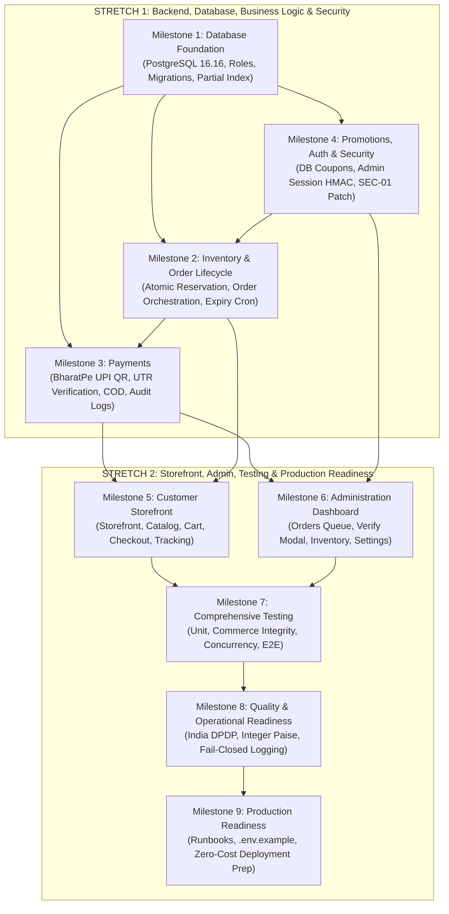

# NAVA CREATIONS — MASTER CONSOLIDATED EXECUTION SPECIFICATION
## Comprehensive Architecture, Milestone Mapping & Two-Stretch Execution Specification

**Document Version:** 1.0.0-PROD  
**Governance Framework:** Google Elephant-Goldfish Model (EGM)  
**Atelier:** Bengaluru, Karnataka, India  
**Date:** 2026-11-13  
**Working Branch:** `phase-3-integrated-commerce`  
**Baseline HEAD Commit:** `b12bf269328e5be9480dad6f35f723cafa3e46a7`  
**Database Target:** Isolated PostgreSQL 16.16 (`nava_gateb_test` on `127.0.0.1:5432`)  
**Budgetary Constraint:** Strict ₹0 Recurring Cost (Direct UPI QR + COD + Manual UTR Bank Verification; No Stripe or Paid APIs)  

---

## 1. Executive Summary & Verified Architecture Baseline

NAVA CREATIONS is a production-grade e-commerce application for an artisanal handmade bangles and jewellery atelier based in Bengaluru, Karnataka. Following the successful completion of **Gate B Database Foundation** on PostgreSQL 16.16, this document establishes the definitive, verified architectural baseline and provides the actionable execution blueprint to complete the platform across two consolidated execution stretches.

### 1.1 Verified Monorepo Architecture
The codebase is structured as a Turborepo + pnpm modular monorepo:
- **`apps/web`:** Next.js 15 (App Router, React 19, Tailwind CSS 3.4), containing 53 route handlers and page views across customer storefront and store manager administrative operations.
- **`packages/db`:** Prisma ORM 6.19.3, containing the canonical data schema (`schema.prisma`), client generator, and 4 sequential migrations deployed against `nava_gateb_test`.
- **`packages/domain`:** Pure, framework-agnostic domain logic and deterministic state machines:
  - `Money`: Integer paise arithmetic ensuring zero floating-point imprecision.
  - `TaxEngine`: Karnataka intrastate GST split (1.5% CGST + 1.5% SGST) and interstate IGST (3%) on precious jewellery and fashion accessories.
  - `OrderStateMachine`, `PaymentStateMachine`, `ReservationStateMachine`, `RefundStateMachine`: Linear state transition graphs enforcing strict e-commerce integrity.
  - `PromotionEngine`: Percentage and flat discount calculations with minimum basket thresholds and maximum discount ceilings.
- **`packages/shared`:** Cross-cutting domain types, DTO contracts, and RFC 7807/domain error classes (`ValidationError`, `NotFoundError`, `ConflictError`, `InsufficientStockError`, `ForbiddenError`).
- **`packages/config`:** Shared TypeScript configuration and build presets.

### 1.2 Verified Database Foundation (Gate B Complete)
- **Engine:** PostgreSQL 16.16 running as Windows service `postgresql-x64-16` on port `5432`.
- **Database:** `nava_gateb_test` (OID `16399`), isolated from any potential production environment.
- **Role Isolation:**
  - `nava_migrator`: Dedicated DDL owner role with schema ownership.
  - `nava_app`: Dedicated least-privilege DML application role (`NOSUPERUSER, NOCREATEDB, NOCREATEROLE, NOBYPASSRLS`). Granted `SELECT, INSERT, UPDATE, DELETE` on application tables and `USAGE` on sequences. Access to `_prisma_migrations` is strictly denied (`permission denied for table _prisma_migrations`). DDL `CREATE/DROP` and `TRUNCATE` operations are denied.
- **Migrations Deployed (All `finished: true, rolled_back: false`):**
  1. `0_init`: 24 core relational tables and indexes (BOM stripped).
  2. `20261111_add_enquiries`: Customer jewellery consultation enquiry table.
  3. `2026111201_add_payment_enums`: PostgreSQL native enum types `PaymentStatus` and `PaymentMethod`.
  4. `2026111202_apply_sovereign_payments`: Sovereign payment columns (`claimed_utr`, `verified_transaction_id`, `is_duplicate_claim`, `verified_at`, `verified_by_user_id`, `verification_notes`, `courier_awb`).
- **Partial Unique Index Active:**
  ```sql
  CREATE UNIQUE INDEX "payments_claimed_utr_verified_unique" 
  ON "payments" ("claimed_utr") 
  WHERE "status" = 'VERIFIED'::"PaymentStatus" AND "claimed_utr" IS NOT NULL;
  ```

---

## 2. Inventory of Verified Working Modules vs. Incomplete Work

### 2.1 Genuine Verified Implementation Status

| Milestone | Component / Module | Implementation State | Verification Evidence |
| :--- | :--- | :--- | :--- |
| **M1: Database** | Isolated PostgreSQL 16.16 | **100% COMPLETE** | Live SQL catalog audit, 2-role auth verified, 4 migrations deployed. |
| **M1: Database** | Role Least-Privilege & DDL Isolation | **100% COMPLETE** | Live permission checks: DDL/TRUNCATE denied for `nava_app`. |
| **M2: Inventory** | Concurrency-Safe Stock Reservation | **VERIFIED** | 5-way concurrent race test: 0 overselling; final stock = 0. |
| **M2: Inventory** | 15-Minute Expiry TTL Logic | **CODE COMPLETE** | `InventoryReservationService.releaseExpiredReservations` passes unit tests. |
| **M3: Payments** | Sovereign UPI QR & Intent URI Generation | **100% COMPLETE** | BharatPe QR, NPCI `upi://pay` generation verified. |
| **M3: Payments** | UTR Duplicate Claim Flagging | **VERIFIED** | Duplicate pending UTR flagged with `isDuplicate: true` for admin audit. |
| **M3: Payments** | Fail-Closed Payment Verification Transaction | **VERIFIED** | Interactive transaction: duplicate bank ref throws P2002 -> `ConflictError` (409); zero-row payment rollback verified. |
| **M3: Payments** | Cash on Delivery (COD) Rules | **VERIFIED** | Enforces ₹5,000 threshold and ₹100 collection surcharge. |
| **M4: Promotions** | Calculation Engine (`PromotionEngine`) | **VERIFIED** | 8/8 domain vitest unit tests passing 100%. |
| **M4: Auth & Sec** | Store Manager Admin Session & HMAC Auth | **VERIFIED** | HMAC-SHA256 bearer tokens, timing-safe equality, `AdminSession` DB model. |
| **M5: Storefront** | Responsive UI & Product Views | **BUILT & TESTED** | Homepage, `/shop`, `/products/[slug]`, `/cart`, `/checkout` complete. |
| **M6: Admin UI** | Manager Dashboard, Inventory, Orders, Settings | **BUILT & TESTED** | 14 admin pages and modals with session protection. |
| **M7: QA** | Automated Test Suites | **VERIFIED** | 73/73 domain tests pass; 4/4 commerce integrity tests pass; 5/5 typecheck pass. |

### 2.2 Genuine Incomplete Work & Identified Gaps

1. **GAP-SEC-01 (CRITICAL): Unauthenticated Customer Order Retrieval (IDOR / PII Leak)**
   - *Affected File:* `apps/web/app/api/orders/[orderNumber]/route.ts`
   - *Defect:* Any anonymous visitor can supply an `orderNumber` and retrieve complete customer delivery PII (name, phone, email, address, paise totals).
   - *Required Fix:* Dual-path server authorization: verified customer session OR high-entropy guest access token. Return uniform 404 on unauthorized requests.
2. **GAP-PROM-01 (HIGH): Ephemeral In-Memory Promotion / Coupon System**
   - *Affected File:* `apps/web/lib/promotion-service.ts`
   - *Defect:* Coupons and usage counters reside on `globalThis.__nava_coupons__` with zero PostgreSQL persistence. Server restart resets usage counts, enabling budget cap bypass.
   - *Required Fix:* Add `coupons` table in PostgreSQL via Prisma migration; execute atomic usage increment within database transaction.
3. **GAP-DATA-01 / GAP-ORD-01 (HIGH): Order Creation Atomicity & Fallback Leak**
   - *Affected File:* `apps/web/lib/order-service.ts`
   - *Defect:* Stock reservations and coupon increments occur sequentially *before* order persistence; if order insertion fails, stock remains held and coupons used. In non-production, database errors are swallowed and fall back to in-memory `memoryOrders`.
   - *Required Fix:* Encapsulate stock decrement, coupon usage, and order + order items + payment creation into a single interactive Prisma transaction. Fail-closed: reject in-memory fallback.
4. **GAP-DATA-02 (MEDIUM): Missing PostgreSQL CHECK Constraint on Stock**
   - *Affected File:* `packages/db/prisma/schema.prisma` (`inventory_items`)
   - *Defect:* Table `inventory_items` lacks a database-level `CHECK ("available_qty" >= 0 AND "reserved_qty" >= 0)`.
   - *Required Fix:* Add database constraint via migration.
5. **GAP-RES-01 (MEDIUM): Automated Reservation Expiry Trigger**
   - *Affected Component:* Background worker / cron
   - *Defect:* `releaseExpiredReservations` exists in `InventoryReservationService` but lacks an automated trigger or scheduled endpoint.
   - *Required Fix:* Provide a protected maintenance route `POST /api/cron/release-reservations` (or internal interval worker) with integration tests.

---

## 3. Mapping Modules to the Nine Milestones



### Module Mapping Matrix

| Milestone | Subsystem / Packages | Key Files & Modules | Status |
| :--- | :--- | :--- | :--- |
| **M1: Database** | `@nava/db`, `scripts/` | `prisma/schema.prisma`, `migrations/*`, `init-test-db.js`, `test-db-guard.js` | **100% COMPLETE** |
| **M2: Inventory & Orders** | `@nava/domain`, `@nava/web` | `inventory-reservation-service.ts`, `order-service.ts`, `order-state-machine.ts` | **IN PROGRESS** (Atomicity patch needed) |
| **M3: Payments** | `@nava/domain`, `@nava/web` | `payment-service.ts`, `payment-state-machine.ts`, `/api/admin/orders/[id]/verify-payment` | **IN PROGRESS** (Core verified, UI verify wired) |
| **M4: Promo, Auth & Sec** | `@nava/domain`, `@nava/web` | `promotion-service.ts`, `auth.ts`, `/api/orders/[orderNumber]/route.ts` | **IN PROGRESS** (SEC-01 & DB Promo queued) |
| **M5: Storefront** | `@nava/web` | `app/page.tsx`, `app/shop/*`, `app/products/*`, `app/cart/*`, `app/checkout/*` | **BUILT** (Awaiting M2-M4 backend integration) |
| **M6: Admin Dashboard** | `@nava/web` | `app/admin/*`, `components/admin/*`, `app/api/admin/*` | **BUILT** (Awaiting M4 promo persistence) |
| **M7: Testing** | `packages/domain/tests`, `scripts/`, `apps/web/e2e` | Vitest suites, `test-phase3-commerce-integrity.js`, Playwright E2E specs | **IN PROGRESS** (Vitest 100%, E2E ready) |
| **M8: Quality & Ops** | Monorepo root, `packages/` | DPDP privacy controls, integer money invariants, audit logging | **QUEUED** |
| **M9: Production Ready** | Monorepo root, `docs/` | Deployment runbooks, environment security guides, smoke checks | **QUEUED** |

---

## 4. Dependencies Between Stretch 1 and Stretch 2

The boundaries between Stretch 1 and Stretch 2 are strictly decoupled by contract:

1. **Checkout & Order Creation Dependency:**
   - Milestone 5 (`/checkout` UI) relies on `POST /api/orders`, which calls `OrderService.createOrder`.
   - *Dependency Invariant:* `OrderService.createOrder` must execute an atomic interactive database transaction ensuring stock reservation and coupon decrement succeed together. The storefront checkout cannot be certified until M2/M4 atomic ordering is deployed.
2. **Order Tracking Privacy Dependency:**
   - Milestone 5 (`/orders/[orderNumber]` tracking UI) relies on `GET /api/orders/[orderNumber]`.
   - *Dependency Invariant:* SEC-01 dual-path authorization must be implemented in M4 before certifying the storefront order tracking journey to avoid leaking customer PII.
3. **Admin Payment Verification Dependency:**
   - Milestone 6 (`/admin/orders` Verify Bank Credit modal) relies on `PATCH /api/admin/orders/[id]/verify-payment`.
   - *Dependency Invariant:* Handled by Milestone 3. The backend already returns HTTP 409 `ConflictError` on duplicate UTR/bank references, which the admin UI renders gracefully.
4. **Coupon Admin & Checkout Consistency Dependency:**
   - Milestone 5 (checkout coupon application) and Milestone 6 (`/admin/promotions` CRUD) currently interact with an in-memory Map.
   - *Dependency Invariant:* Database persistence of `coupons` (M4) must precede storefront checkout and admin coupon certification.

---

## 5. Consolidated Execution Specification — STRETCH 1

### 5.1 Step 1: Remediate GAP-SEC-01 (Dual-Path Order Authorization & Tracking Privacy)
- **Target Files:**
  - `apps/web/lib/order-service.ts`: Generate deterministic stateless HMAC guest access token on order creation and include in `OrderDto`.
  - `apps/web/app/api/orders/route.ts`: Expose `guestAccessToken` in order creation API response.
  - `apps/web/app/api/orders/[orderNumber]/route.ts`: Validate dual-path authorization (Admin/Owner session OR valid stateless HMAC token).
  - `apps/web/app/checkout/page.tsx`: Redirect guest orders to `/orders/${orderNumber}?token=${guestAccessToken}`.
  - `apps/web/app/orders/[orderNumber]/page.tsx`: Extract `searchParams.token` and pass to API request.
- **Objective:** Eliminate anonymous PII enumeration while preserving guest tracking and customer account tracking.
- **Stateless HMAC Architecture (Mandated):**
  - Compute token using `ADMIN_AUTH_SECRET`:
    ```ts
    const guestAccessToken = crypto
      .createHmac('sha256', process.env.ADMIN_AUTH_SECRET || 'nava-default-fallback-secret-256')
      .update(`${orderNumber}:${order.createdAt.getTime()}`)
      .digest('hex');
    ```
  - Authorization check:
    1. If request passes `verifyAdminSession(request)` or matches authenticated user session -> allow full access.
    2. For guest: compare `request.headers.get('x-order-access-token')` or `searchParams.get('token')` using `crypto.timingSafeEqual`.
    3. If unauthorized, malformed, or nonexistent order: return uniform `404 Not Found` (never 401/403) to prevent order enumeration.
  - Sanitize order DTO: return delivery PIN and state, masked phone (`******1234`), and masked name for public tracking.

### 5.2 Step 2: Implement Persistent Database Model for Promotions (GAP-PROM-01)
- **Target Package:** `packages/db` (`schema.prisma` and additive migration)
- **Schema Additions (`schema.prisma`):**
  ```prisma
  enum PromotionType {
    PERCENTAGE
    FLAT_AMOUNT
  }

  model Coupon {
    id               String       @id @default(uuid())
    code             String       @unique
    description      String
    type             PromotionType
    value            Int          // Percentage (10 = 10%) or Paise (20000 = ₹200)
    minOrderPaise    Int          @default(0) @map("min_order_paise")
    maxDiscountPaise Int?         @map("max_discount_paise")
    usageLimit       Int?         @map("usage_limit")
    usageCount       Int          @default(0) @map("usage_count")
    isActive         Boolean      @default(true) @map("is_active")
    validFrom        DateTime?    @map("valid_from")
    validUntil       DateTime?    @map("valid_until")
    createdAt        DateTime     @default(now()) @map("created_at")
    updatedAt        DateTime     @updatedAt @map("updated_at")

    @@map("coupons")
  }
  ```
- **Migration Deployment & Seed:** Deployed via `nava_migrator` using `scripts/deploy-test-migrations.js` semantics, including seeds for standard promotions (`BRIDAL10`, `NAVA200`, `FESTIVE15`).
- **Service Refactor:** Refactor `apps/web/lib/promotion-service.ts` to execute database queries with atomic usage increments using native raw tagged SQL inside the transaction (avoiding invalid `prisma.raw` column comparison):
  ```ts
  // Atomic increment with usage limit guard (ARCH-01 Fix)
  const affectedCount = await tx.$executeRaw`
    UPDATE "coupons"
    SET "usage_count" = "usage_count" + 1, "updated_at" = NOW()
    WHERE "code" = ${normalizedCode}
      AND "is_active" = true
      AND ("usage_limit" IS NULL OR "usage_count" < "usage_limit");
  `;
  if (affectedCount === 0) {
    throw new ValidationError('Coupon usage limit reached or coupon inactive');
  }
  ```

### 5.3 Step 3: Atomic Order Creation & Database CHECK Constraints (GAP-DATA-01 & GAP-DATA-02)
- **Target Files:** `packages/db/prisma/schema.prisma`, `apps/web/lib/order-service.ts`, `apps/web/lib/inventory-reservation-service.ts`, `apps/web/lib/promotion-service.ts`
- **Database CHECK Constraint:** Add migration applying:
  ```sql
  ALTER TABLE "inventory_items" 
  ADD CONSTRAINT "inventory_items_non_negative_stock" 
  CHECK ("available_qty" >= 0 AND "reserved_qty" >= 0);
  ```
- **Unified Transaction Client Pattern:** Refactor `InventoryReservationService` and `PromotionService` methods to accept an optional transaction client parameter `tx?: Prisma.TransactionClient | typeof prisma` so that `OrderService.createOrder` passes its interactive transaction without causing nested transaction collisions.
- **Atomic Transaction Orchestration (ARCH-02 & ARCH-03 Fix):** In `OrderService.createOrder`:
  - Run inside a single `prisma.$transaction(async (tx) => { ... })`:
    1. **Deterministic Variant Ordering:** Sort items by `variantId` alphabetically (`[...items].sort((a, b) => a.variantId.localeCompare(b.variantId))`) to prevent PostgreSQL multi-item deadlocks (`40P01`).
    2. **Lock & Decrement Stock:** For each sorted item, execute atomic conditional update:
       `tx.inventoryItem.updateMany({ where: { variantId: item.variantId, availableQty: { gte: item.quantity } }, data: { availableQty: { decrement: item.quantity }, reservedQty: { increment: item.quantity } } })`. If `count === 0`, throw `InsufficientStockError`.
    3. **Validate & Increment Coupon:** If coupon is present, execute atomic raw SQL increment above via `tx.$executeRaw`.
    4. **Insert Order Records First:** Insert `orders` (with nested `order_items` and `payments`), obtaining the generated `order.id` (satisfying foreign key constraint before reservation insertion).
    5. **Insert Inventory Reservation:** Insert `inventory_reservations` linked with the newly created `order.id` and associated `inventory_reservation_items`.
  - Remove silent `try...catch` memory fallbacks. If any step fails or database is unavailable, the entire transaction rolls back and throws the typed domain error.

### 5.4 Step 4: Reservation Expiry Background Trigger (GAP-RES-01 & RSK-05 Fix)
- **Target File:** `apps/web/app/api/cron/release-reservations/route.ts` & `apps/web/lib/inventory-reservation-service.ts`
- **Objective:** Enable automated release of abandoned reservations older than 15 minutes.
- **Verification Window Protection (RSK-05):** In `InventoryReservationService.releaseExpiredReservations`:
  - The cleanup routine must strictly exclude reservations whose linked order is in `AWAITING_PAYMENT_VERIFICATION` or has a submitted `claimedUtr`.
  - Filter query:
    ```ts
    const expired = await tx.inventoryReservation.findMany({
      where: {
        status: 'PENDING',
        expiresAt: { lt: now },
        OR: [
          { order: null },
          { order: { status: { notIn: ['AWAITING_PAYMENT_VERIFICATION', 'PROCESSING', 'SHIPPED', 'DELIVERED'] } } }
        ]
      },
      include: { items: true, order: true }
    });
    ```
- **Security & Methods:** Guard with `CRON_SECRET` bearer authentication header; support both `GET` and `POST` methods to accommodate external pingers and serverless cron monitors.
- **Execution:** Invokes `InventoryReservationService.releaseExpiredReservations()` and returns `{ releasedCount, timestamp }`.

---

## 6. Consolidated Execution Specification — STRETCH 2

### 6.1 Milestone 5: Customer Storefront Integration
- Validate end-to-end user checkout journey:
  - Homepage category discovery -> Product detail size selector (2.4, 2.6, 2.8) -> Cart bag drawer -> `/checkout` form with Indian address & PIN code validation -> Apply coupon code -> Select UPI QR -> Submit UTR -> `/orders/[orderNumber]` order tracking.
- Ensure all prices display integer paise formatted as Indian Rupees (`₹X,XXX`).

### 6.2 Milestone 6: Administration Dashboard Certification
- Verify Store Manager workflows:
  - Login via `/admin/login` using administrative credentials.
  - `/admin/orders`: Filter by `AWAITING_PAYMENT_VERIFICATION`, inspect claimed UTR and customer notes, click "Verify Bank Credit", submit bank transaction ID, verify automatic state transition to `PROCESSING` with audit log.
  - `/admin/inventory`: Live stock adjustments with non-negative validation.
  - `/admin/promotions`: Create, toggle, and view persistent coupon campaigns.
  - `/admin/settings`: View and update UPI VPA, Merchant Name, COD thresholds.

### 6.3 Milestone 7: Comprehensive Automated Verification
- **Unit & Domain Tests:** All Vitest suites passing (State machines, Money, TaxEngine, PromotionEngine).
- **Commerce Integrity Suite:** Concurrency stock test, duplicate UTR handling, P2002 conflict handling, atomic rollback.
- **E2E Playwright Suite:** Complete 14-spec run covering admin authorization, checkout flows, coupon application, and payment verification.

### 6.4 Milestone 8: Quality, Operational Readiness & DPDP Compliance
- Verify DPDP compliance: zero unauthenticated PII leakage.
- Integer paise integrity: zero floating-point arithmetic across all financial calculations.
- Fail-closed audit logging: all payment state changes recorded in `audit_logs` table.

### 6.5 Milestone 9: Production Readiness & Deployment Runbook
- Generate `.env.example` documentation with all required environment keys.
- Prepare production database migration deployment guide.
- Operational runbooks for manual bank reconciliation, order cancellations, and refunds.

---

## 7. Governance, Approval Boundaries & Risk Register

### 7.1 Strict Approval Boundaries
In compliance with project directives, the following operations require explicit owner authorization:
- Any destructive database operations (`DROP DATABASE`, `DROP TABLE`).
- Modifying production DNS, domains, or hosting infrastructure.
- Incurring recurring or one-off financial expenses (Strict ₹0 budget).
- Committing, tagging, or pushing to remote Git repositories.

### 7.2 Active Risk Register

| Risk ID | Description | Impact | Mitigation Strategy |
| :--- | :--- | :--- | :--- |
| **RSK-01** | Concurrent bank reference collision | High | Handled by partial unique index `payments_claimed_utr_verified_unique` and HTTP 409 conflict mapping. |
| **RSK-02** | Phantom stock overselling | High | Enforced by atomic conditional decrement (`gte: quantity`) and PostgreSQL non-negative CHECK constraint. |
| **RSK-03** | DPDP PII data leakage | High | Remediated in Step 1 (SEC-01) with dual-path authorization and uniform 404 responses. |
| **RSK-04** | Ephemeral promotion budget leakage | Medium | Remediated in Step 2 with persistent PostgreSQL `coupons` table. |
| **RSK-05** | Manual verification window inventory collision | Critical | Exclude orders in `AWAITING_PAYMENT_VERIFICATION` or with submitted UTR from 15-minute reservation expiry cron. |
| **RSK-06** | Admin portal lockout DoS on rate limiting | High | Bind auth rate limiting strictly to client IP / subnet rather than static global account key. |
