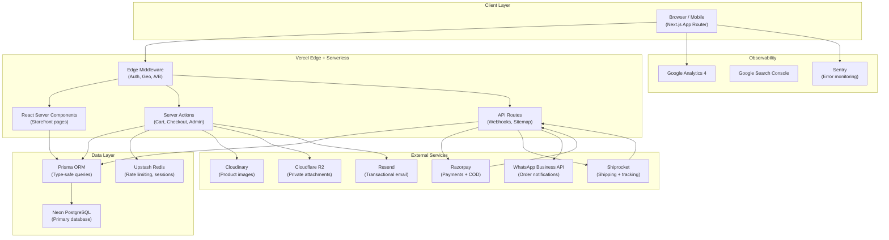
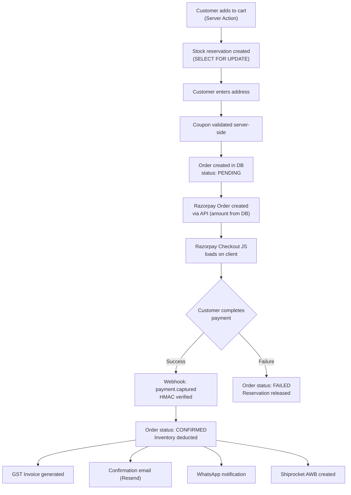
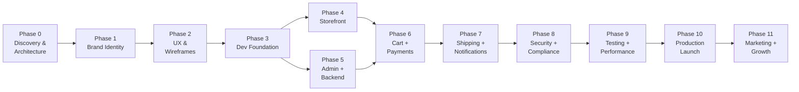

# NAVA CREATIONS — Phase 0 Master Summary
## E-Commerce Platform Blueprint

> [!IMPORTANT]
> This is the definitive Phase 0 deliverable. Business owner and development team should read this document before any Phase 1 work begins. All open questions must be resolved before significant development investment is made.

---

## Table of Contents

- [A. Executive Summary](#a-executive-summary)
- [B. Recommended Architecture and Stack](#b-recommended-architecture-and-stack)
- [C. Final Proposed Sitemap](#c-final-proposed-sitemap)
- [D. Admin Feature Matrix and Role Permissions](#d-admin-feature-matrix-and-role-permissions)
- [E. Brand Identity Directions Awaiting Approval](#e-brand-identity-directions-awaiting-approval)
- [F. Database and System Diagrams](#f-database-and-system-diagrams)
- [G. Security Threat Model — Top Priorities](#g-security-threat-model--top-priorities)
- [H. Integration and Payment Evaluation](#h-integration-and-payment-evaluation)
- [I. Open Questions Requiring Business Owner](#i-open-questions-requiring-business-owner)
- [J. Phase-by-Phase Development Plan](#j-phase-by-phase-development-plan)
- [K. Phase 1 Readiness Checklist](#k-phase-1-readiness-checklist)

---

## A. Executive Summary

### What NAVA CREATIONS Is Building

NAVA CREATIONS is a Bengaluru-based Indian accessories brand specialising in handmade bangles, bridal bangles, Kundan-work bangles, festival collections, return gifts, and hair accessories. The brand currently operates through Instagram (`@nava__creationsss`) and WhatsApp — channels that have proven the product-market fit but impose hard limits on growth, discoverability, and operational efficiency.

**The Vision:** A fully owned, independent e-commerce platform that:
- Removes dependency on Instagram's algorithm and WhatsApp's informal order management
- Enables 24/7 browsing, cart, and checkout without manual intervention
- Builds an owned customer database for direct marketing
- Supports bridal consultation workflows, bulk return-gift orders, and custom enquiries
- Presents a premium brand identity that reflects the quality of the product

### The Opportunity

| Channel | Limitation | Platform Solution |
|---|---|---|
| Instagram | Algorithm-dependent, no native checkout, DM-based order management | Owned SEO traffic, product catalogue, cart, and payment |
| WhatsApp | No transaction record, manual invoice, no customer account | Automated order confirmation, GST invoice, tracking |
| Both | No inventory visibility, no reports, no customer data ownership | Real-time inventory, sales reports, CRM |

Indian accessories e-commerce is a large, growing market. Handmade and bridal jewellery buyers increasingly expect a polished online experience. NAVA CREATIONS has the product — this platform gives it the infrastructure.

### What Phase 0 Has Produced

Phase 0 is a complete discovery and architecture sprint producing **20 planning documents** across 6 domains:

#### Business Documents
| # | Document | Description |
|---|---|---|
| 1 | [BUSINESS_REQUIREMENTS](docs/business/BUSINESS_REQUIREMENTS.md) | Full functional, non-functional, and Indian operational requirements |
| 2 | [CUSTOMER_SEGMENTS](docs/business/CUSTOMER_SEGMENTS.md) | Six customer segments with STP framework, interview scripts, usability plan |
| 3 | [OPEN_QUESTIONS](docs/business/OPEN_QUESTIONS.md) | Complete register of unresolved decisions with priority and owner |

#### Branding Documents
| # | Document | Description |
|---|---|---|
| 4 | [BRAND_RESEARCH](docs/branding/BRAND_RESEARCH.md) | Competitor analysis, Indian market positioning, brand archetype |
| 5 | [LOGO_DIRECTIONS](docs/branding/LOGO_DIRECTIONS.md) | Three distinct logo concepts for business owner approval |
| 6 | [DESIGN_TOKENS_PROPOSAL](docs/branding/DESIGN_TOKENS_PROPOSAL.md) | Colour palettes, typography, spacing, and icon system |

#### Technical Architecture Documents
| # | Document | Description |
|---|---|---|
| 7 | [TECH_STACK](docs/technical/TECH_STACK.md) | Full stack evaluation with justifications and trade-offs |
| 8 | [SYSTEM_ARCHITECTURE](docs/technical/SYSTEM_ARCHITECTURE.md) | Deployment topology, service boundaries, infrastructure design |
| 9 | [DATABASE_SCHEMA](docs/technical/DATABASE_SCHEMA.md) | Full PostgreSQL schema with Prisma models, indexes, and constraints |
| 10 | [API_DESIGN](docs/technical/API_DESIGN.md) | REST endpoints, Next.js Server Actions, webhook contracts |

#### UX & Product Documents
| # | Document | Description |
|---|---|---|
| 11 | [SITEMAP](docs/ux/SITEMAP.md) | Complete URL hierarchy for storefront and admin |
| 12 | [USER_FLOWS](docs/ux/USER_FLOWS.md) | Critical path flows: discovery → checkout, bridal enquiry, admin fulfilment |
| 13 | [WIREFRAME_NOTES](docs/ux/WIREFRAME_NOTES.md) | Layout and component notes for every key page |
| 14 | [CONTENT_STRATEGY](docs/ux/CONTENT_STRATEGY.md) | Copy direction, SEO framework, and content calendar outline |

#### Operations & Commerce Documents
| # | Document | Description |
|---|---|---|
| 15 | [INVENTORY_MANAGEMENT](docs/operations/INVENTORY_MANAGEMENT.md) | Stock tracking, reservations, low-stock alerts, variant management |
| 16 | [ORDER_MANAGEMENT](docs/operations/ORDER_MANAGEMENT.md) | Order lifecycle, COD workflow, return and refund process |
| 17 | [SHIPPING_INTEGRATION](docs/operations/SHIPPING_INTEGRATION.md) | Shiprocket evaluation, label generation, tracking webhook design |
| 18 | [PAYMENT_INTEGRATION](docs/operations/PAYMENT_INTEGRATION.md) | Razorpay integration plan, webhook handling, refund flow |

#### Security & Compliance Documents
| # | Document | Description |
|---|---|---|
| 19 | [THREAT_MODEL](docs/security/THREAT_MODEL.md) | STRIDE threat analysis, attack surface map, mitigations |
| 20 | [COMPLIANCE_CHECKLIST](docs/security/COMPLIANCE_CHECKLIST.md) | IT Act 2000, DPDP Act 2023, GST, Consumer Protection Act requirements |

### Key Decisions Made in Phase 0

1. **Framework:** Next.js 15 App Router with TypeScript — maximises SEO via Server Components, enables Server Actions for cart/checkout without a separate API service
2. **Database:** PostgreSQL via Neon (serverless, branching) + Prisma ORM — strong typing, migrations, and Indian hosting edge latency
3. **Payments:** Razorpay recommended over Cashfree — dominant Indian developer ecosystem, superior webhook documentation, Razorpay Checkout handles UPI, cards, net banking, and COD natively
4. **Storage:** Cloudinary for product images (transformation API for responsive images), S3-compatible private store for sensitive documents
5. **Deployment:** Vercel for storefront (global CDN, preview deployments, Vercel Analytics) + Neon for database
6. **Admin RBAC:** Six roles defined: Owner, Store Manager, Product Manager, Order Manager, Content Editor, Support Staff
7. **Indian compliance:** GST invoice generation built into order flow from day one; DPDP Act 2023 consent framework planned

### Key Questions Still Open

> [!CAUTION]
> These are blockers. Phase 1 cannot complete without them.

- Legal business name and entity type (sole proprietor vs LLP) — required for payment gateway KYC
- GST registration status and GSTIN — required for invoicing
- Logo direction selection (3 options prepared — business owner must choose)
- Domain name (navacreations.in availability to be confirmed)
- Full confirmed product list with pricing

---

## B. Recommended Architecture and Stack

### Technology Decisions

| Layer | Choice | Justification |
|---|---|---|
| **Framework** | Next.js 15 App Router + TypeScript | React Server Components for SEO, Server Actions for mutations, single codebase for storefront + admin |
| **Styling** | Tailwind CSS v4 + shadcn/ui | Utility-first CSS with zero dead code, shadcn/ui provides accessible admin components without lock-in |
| **Database** | PostgreSQL (Neon serverless) + Prisma ORM | Relational integrity for orders/inventory, Prisma type safety, Neon's branching for safe migrations |
| **Auth** | Auth.js v5 (NextAuth) | Credentials provider for email/password + magic link; session stored in JWT or DB, easy to extend |
| **Payments** | Razorpay | #1 Indian payment gateway by developer adoption; hosted checkout removes PCI scope; excellent webhook HMAC docs |
| **Image Storage** | Cloudinary | On-the-fly responsive image transformations (WebP, AVIF, resize); CDN delivery; direct upload from admin |
| **Private Storage** | AWS S3 / Cloudflare R2 | Signed URLs for enquiry attachments, insurance documents; not publicly accessible |
| **Deployment** | Vercel | Zero-config Next.js deployment, preview URLs per PR, Vercel Analytics, Edge Middleware for geolocation |
| **Email** | Resend | Developer-first transactional email; React Email templates; generous free tier |
| **Shipping** | Shiprocket | Multi-carrier aggregator (Blue Dart, DTDC, Delhivery, Ekart); AWB generation, tracking webhooks, COD remittance |
| **Analytics** | GA4 + Google Search Console | Standard for Indian SMBs; Search Console for organic keyword tracking |
| **Testing** | Vitest + Playwright + Lighthouse CI | Unit/integration with Vitest, E2E with Playwright, automated Web Vitals gating on CI |
| **CI/CD** | GitHub Actions | Free for public/small private repos; deploy preview on PR, deploy to production on merge to main |

### Why Razorpay Over Cashfree

Razorpay is the recommended choice for three concrete reasons:
1. **Developer ecosystem:** Significantly more Stack Overflow answers, GitHub issues, community examples in India
2. **Webhook documentation:** Razorpay's HMAC signature verification docs are clearer and better tested
3. **Checkout SDK:** Razorpay Checkout JS handles the full UPI collect + intent flow, including UPI Autopay for subscriptions if NAVA CREATIONS later introduces a "jewellery subscription box"

Cashfree remains a viable alternative if Razorpay onboarding is delayed due to KYC issues.

### High-Level System Architecture



---

## C. Final Proposed Sitemap

### Public Storefront

```
/ (Home)
├── /shop
│   ├── /shop/bangles
│   │   ├── /shop/bangles/handmade
│   │   ├── /shop/bangles/bridal
│   │   ├── /shop/bangles/kundan
│   │   └── /shop/bangles/festival
│   ├── /shop/hair-accessories
│   ├── /shop/return-gifts
│   └── /shop/all
├── /products/[slug]  (Product Detail Page)
├── /collections/[slug]  (Curated collection pages)
├── /bridal  (Bridal landing page)
├── /festival  (Festival collections landing)
├── /return-gifts  (Bulk/return-gift landing)
├── /custom-enquiry  (Custom order enquiry form)
├── /about
├── /contact
├── /blog
│   ├── /blog/[slug]  (Blog post)
│   └── /blog/category/[category]
├── /faq
├── /track-order  (Guest order tracking)
├── /auth
│   ├── /auth/login
│   ├── /auth/register
│   ├── /auth/forgot-password
│   └── /auth/reset-password
├── /account  (Protected — customer account)
│   ├── /account/orders
│   ├── /account/orders/[id]
│   ├── /account/wishlist
│   ├── /account/addresses
│   └── /account/profile
├── /cart
├── /checkout
│   ├── /checkout/address
│   ├── /checkout/payment
│   └── /checkout/success
├── /legal
│   ├── /legal/privacy-policy
│   ├── /legal/terms-of-service
│   ├── /legal/return-policy
│   ├── /legal/shipping-policy
│   └── /legal/cancellation-policy
└── /search  (Search results)
```

### Admin Panel

```
/admin  (Dashboard overview)
├── /admin/products
│   ├── /admin/products/new
│   ├── /admin/products/[id]
│   └── /admin/products/[id]/variants
├── /admin/categories
├── /admin/collections
├── /admin/inventory
│   └── /admin/inventory/[variantId]
├── /admin/orders
│   ├── /admin/orders/[id]
│   └── /admin/orders/[id]/fulfil
├── /admin/customers
│   └── /admin/customers/[id]
├── /admin/enquiries
│   └── /admin/enquiries/[id]
├── /admin/promotions
│   ├── /admin/promotions/coupons
│   └── /admin/promotions/banners
├── /admin/content
│   ├── /admin/content/homepage
│   ├── /admin/content/blog
│   └── /admin/content/blog/[id]
├── /admin/reports
│   ├── /admin/reports/sales
│   ├── /admin/reports/inventory
│   └── /admin/reports/customers
├── /admin/settings
│   ├── /admin/settings/general
│   ├── /admin/settings/payments
│   ├── /admin/settings/shipping
│   ├── /admin/settings/email
│   └── /admin/settings/taxes
└── /admin/users
    ├── /admin/users/new
    ├── /admin/users/[id]
    └── /admin/users/audit-log
```

### Utility Pages

```
/404  (Not Found)
/500  (Server Error)
/maintenance  (Maintenance mode)
/sitemap.xml  (Auto-generated)
/robots.txt   (Auto-generated)
```

---

## D. Admin Feature Matrix and Role Permissions

> [!NOTE]
> Roles are enforced server-side on every route, Server Action, and API endpoint. No role check is ever trusted from the client.

| Feature | Owner | Store Manager | Product Manager | Order Manager | Content Editor | Support Staff |
|---|:---:|:---:|:---:|:---:|:---:|:---:|
| **Products** | | | | | | |
| Create product | ✅ | ✅ | ✅ | ❌ | ❌ | ❌ |
| Edit product | ✅ | ✅ | ✅ | ❌ | ❌ | ❌ |
| Delete product | ✅ | ✅ | ❌ | ❌ | ❌ | ❌ |
| View products | ✅ | ✅ | ✅ | ✅ | ✅ | ✅ |
| Publish / unpublish product | ✅ | ✅ | ✅ | ❌ | ❌ | ❌ |
| Manage product variants / SKUs | ✅ | ✅ | ✅ | ❌ | ❌ | ❌ |
| Upload product images | ✅ | ✅ | ✅ | ❌ | ✅ | ❌ |
| **Inventory** | | | | | | |
| View inventory levels | ✅ | ✅ | ✅ | ✅ | ❌ | ❌ |
| Adjust inventory (manual) | ✅ | ✅ | ✅ | 🔄 Order cancellations only | ❌ | ❌ |
| Set low-stock threshold | ✅ | ✅ | ✅ | ❌ | ❌ | ❌ |
| View stock reservations | ✅ | ✅ | ✅ | ✅ | ❌ | ❌ |
| **Orders** | | | | | | |
| View all orders | ✅ | ✅ | ❌ | ✅ | ❌ | ✅ |
| Update order status | ✅ | ✅ | ❌ | ✅ | ❌ | 🔄 Add notes only |
| Cancel order | ✅ | ✅ | ❌ | ✅ | ❌ | ❌ |
| Initiate refund | ✅ | ✅ | ❌ | 🔄 Up to ₹5,000 | ❌ | ❌ |
| Handle return requests | ✅ | ✅ | ❌ | ✅ | ❌ | 🔄 Log only |
| Generate GST invoice | ✅ | ✅ | ❌ | ✅ | ❌ | ❌ |
| View payment details | ✅ | ✅ | ❌ | ✅ | ❌ | ❌ |
| Print shipping label | ✅ | ✅ | ❌ | ✅ | ❌ | ❌ |
| **Customers** | | | | | | |
| View customer list | ✅ | ✅ | ❌ | ✅ | ❌ | ✅ |
| View customer profile & history | ✅ | ✅ | ❌ | ✅ | ❌ | ✅ |
| Edit customer details | ✅ | ✅ | ❌ | ❌ | ❌ | ❌ |
| Handle custom enquiries | ✅ | ✅ | ❌ | 🔄 View only | ❌ | ✅ |
| **Promotions & Marketing** | | | | | | |
| Create / edit coupons | ✅ | ✅ | ❌ | ❌ | ❌ | ❌ |
| View coupons | ✅ | ✅ | ✅ | ✅ | ✅ | ❌ |
| Manage promotional banners | ✅ | ✅ | ❌ | ❌ | ✅ | ❌ |
| **Content** | | | | | | |
| Publish blog posts | ✅ | ✅ | ❌ | ❌ | ✅ | ❌ |
| Edit blog posts | ✅ | ✅ | ❌ | ❌ | ✅ | ❌ |
| Delete blog posts | ✅ | ✅ | ❌ | ❌ | 🔄 Own posts only | ❌ |
| Manage homepage content / hero | ✅ | ✅ | ❌ | ❌ | ✅ | ❌ |
| Edit legal pages | ✅ | 🔄 With owner approval | ❌ | ❌ | ❌ | ❌ |
| **Reports & Analytics** | | | | | | |
| View sales reports | ✅ | ✅ | ❌ | ✅ | ❌ | ❌ |
| View inventory reports | ✅ | ✅ | ✅ | ✅ | ❌ | ❌ |
| View customer reports | ✅ | ✅ | ❌ | ❌ | ❌ | ❌ |
| Export data (CSV / Excel) | ✅ | ✅ | 🔄 Product data only | 🔄 Order data only | ❌ | ❌ |
| **Administration** | | | | | | |
| Manage admin users | ✅ | ❌ | ❌ | ❌ | ❌ | ❌ |
| Assign / change roles | ✅ | ❌ | ❌ | ❌ | ❌ | ❌ |
| View audit log | ✅ | ✅ | ❌ | ❌ | ❌ | ❌ |
| Manage store settings | ✅ | 🔄 Non-financial only | ❌ | ❌ | ❌ | ❌ |
| Manage payment settings | ✅ | ❌ | ❌ | ❌ | ❌ | ❌ |
| Manage shipping settings | ✅ | ✅ | ❌ | ❌ | ❌ | ❌ |
| Manage tax / GST settings | ✅ | ❌ | ❌ | ❌ | ❌ | ❌ |

**Legend:** ✅ Full access &nbsp;|&nbsp; 🔄 Limited access (note shown) &nbsp;|&nbsp; ❌ No access

---

## E. Brand Identity Directions Awaiting Approval

> [!CAUTION]
> **No direction is final. The business owner must review all three directions and either select one, combine elements, or request a revision before Phase 1 brand identity work can be finalised.**

Three distinct logo and identity directions have been designed for NAVA CREATIONS. Each reflects a different positioning — the business owner must choose the direction that best reflects the brand's personality and target customer.

---

### Direction 1: Elegant Botanical Wordmark

**Concept:** A refined, hand-lettered wordmark "NAVA CREATIONS" with a delicate lotus or jasmine motif integrated into the letterforms. Evokes premium Indian craftsmanship with a contemporary, feminine touch. Inspired by modern Indian jewellery brands that bridge heritage and lifestyle.

**Recommended Colour Palette:**
| Token | Colour | Hex | Usage |
|---|---|---|---|
| Primary | Deep Rose Gold | `#C4956A` | Logo, CTA buttons, headings |
| Secondary | Ivory | `#FAF7F2` | Backgrounds, cards |
| Accent | Forest Green | `#2D5016` | Botanical elements, hover states |
| Text | Charcoal | `#1A1A1A` | Body text |
| Surface | Warm White | `#FFFFFF` | Base |

**Typography:**
- Display: *Cormorant Garamond* (serif — editorial, bridal-ready)
- Body: *DM Sans* (clean, legible at small sizes)
- Accent: *Great Vibes* (optional script for tagline)

**Personality:** Elegant · Bridal · Floral · Traditional with a modern edit

---

### Direction 2: Contemporary Luxury Monogram

**Concept:** A geometric monogram "NC" constructed from interlocking bangles or circular forms — the product itself becomes the logo mark. Clean, minimal, luxury-coded. Sits confidently on packaging, social media, and app icons. Appeals to younger urban buyers and lifestyle customers.

**Recommended Colour Palette:**
| Token | Colour | Hex | Usage |
|---|---|---|---|
| Primary | Midnight Plum | `#2C1654` | Monogram, primary actions |
| Secondary | Champagne Gold | `#D4AF37` | Accent lines, borders, icons |
| Background | Near-Black | `#0F0F0F` | Dark mode cards, packaging |
| Text Light | Platinum | `#E8E8E8` | On dark backgrounds |
| Surface | Off-White | `#F9F5FF` | Light mode base |

**Typography:**
- Display: *Playfair Display* (high-contrast serif, luxury feel)
- Body: *Inter* (universal legibility)
- Monogram: custom geometric construction

**Personality:** Luxury · Modern · Urban · Bold · Minimal

---

### Direction 3: Story-Driven Mark

**Concept:** An illustrative icon depicting a woman's silhouette adorned with bangles, or a pair of bangles arranged to suggest infinity and celebration. Warm, storytelling brand mark that creates emotional connection. Works well for social media, festival campaigns, and return-gift packaging. Closest to community-brand aesthetics.

**Recommended Colour Palette:**
| Token | Colour | Hex | Usage |
|---|---|---|---|
| Primary | Terracotta | `#C1440E` | Logo mark, primary buttons |
| Secondary | Turmeric Yellow | `#F5C842` | Festival accent, badges |
| Tertiary | Dusty Mauve | `#C49A9A` | Softer backgrounds, cards |
| Text | Deep Brown | `#2E1B0E` | Body copy, headings |
| Surface | Cream | `#FDF6EC` | Base background |

**Typography:**
- Display: *Yeseva One* (decorative serif, festive energy)
- Body: *Nunito* (friendly, approachable)
- Accent: *Tiro Devanagari Latin* (optional for Hindi tagline)

**Personality:** Warm · Festive · Story-driven · Community · Artisanal

---

> [!NOTE]
> See [LOGO_DIRECTIONS.md](docs/branding/LOGO_DIRECTIONS.md) for full visual mockup descriptions, usage guidelines, and digital/print specifications for each direction.

---

## F. Database and System Diagrams

### Core Entity Relationship Diagram

```mermaid
erDiagram
    users {
        uuid id PK
        string email UK
        string name
        string phone
        enum role
        timestamp created_at
    }

    addresses {
        uuid id PK
        uuid user_id FK
        string line1
        string line2
        string city
        string state
        string pincode
        boolean is_default
    }

    categories {
        uuid id PK
        string name
        string slug UK
        uuid parent_id FK
        int sort_order
    }

    products {
        uuid id PK
        string name
        string slug UK
        text description
        uuid category_id FK
        boolean is_published
        timestamp created_at
    }

    product_variants {
        uuid id PK
        uuid product_id FK
        string sku UK
        string size
        string colour
        string material
        int price_paise
        int compare_price_paise
        string[] image_urls
    }

    inventory_items {
        uuid id PK
        uuid variant_id FK UK
        int quantity_available
        int quantity_reserved
        int low_stock_threshold
        timestamp updated_at
    }

    stock_reservations {
        uuid id PK
        uuid inventory_item_id FK
        uuid order_id FK
        int quantity
        timestamp expires_at
    }

    orders {
        uuid id PK
        string order_number UK
        uuid user_id FK
        uuid shipping_address_id FK
        enum status
        int subtotal_paise
        int discount_paise
        int shipping_paise
        int gst_paise
        int total_paise
        string coupon_code
        enum payment_method
        timestamp created_at
    }

    order_items {
        uuid id PK
        uuid order_id FK
        uuid variant_id FK
        string sku_snapshot
        string name_snapshot
        int price_paise_snapshot
        int quantity
    }

    payment_attempts {
        uuid id PK
        uuid order_id FK
        string razorpay_order_id
        string razorpay_payment_id
        enum status
        int amount_paise
        timestamp attempted_at
    }

    shipments {
        uuid id PK
        uuid order_id FK
        string awb_number
        string carrier
        string tracking_url
        enum status
        timestamp shipped_at
        timestamp delivered_at
    }

    coupons {
        uuid id PK
        string code UK
        enum discount_type
        int discount_value
        int min_order_paise
        int max_uses
        int used_count
        timestamp expires_at
        boolean is_active
    }

    coupon_usages {
        uuid id PK
        uuid coupon_id FK
        uuid user_id FK
        uuid order_id FK
        timestamp used_at
    }

    users ||--o{ orders : "places"
    users ||--o{ addresses : "has"
    orders ||--|{ order_items : "contains"
    order_items }o--|| product_variants : "snapshot of"
    product_variants }o--|| products : "belongs to"
    products }o--|| categories : "in"
    inventory_items ||--|| product_variants : "tracks"
    inventory_items ||--o{ stock_reservations : "has"
    orders ||--o{ payment_attempts : "has"
    orders ||--o{ shipments : "fulfilled by"
    coupons ||--o{ coupon_usages : "tracked by"
    users ||--o{ addresses : "has"
    orders }o--|| addresses : "ships to"
```

### Request Flow — Checkout



---

## G. Security Threat Model — Top Priorities

> [!WARNING]
> Security is not an afterthought. All mitigations below must be implemented before production launch, not added post-launch.

### Top 10 Security Threats

| # | Threat | Attack Scenario | Mitigation |
|---|---|---|---|
| 1 | **Payment Webhook Spoofing** | Attacker sends fake `payment.captured` webhook to mark orders as paid without payment | Verify Razorpay HMAC signature on every webhook using `razorpay-signature` header; reject any webhook that fails |
| 2 | **Inventory Race Condition** | Two customers simultaneously purchase the last item; both succeed; stock goes negative | Use `SELECT ... FOR UPDATE` in a PostgreSQL transaction for all stock reservations and deductions |
| 3 | **Payment Amount Tampering** | Attacker modifies the amount in the Razorpay checkout JS call or intercepts it | Order amount is always read from the server-side `orders` table when creating Razorpay order; client sends no amount |
| 4 | **Credential Stuffing** | Bot tests leaked username/password combinations from other breaches | Rate limit `/auth/login` (5 attempts per 15 min per IP via Upstash Redis); bcrypt with cost factor 12; HIBP breach check on registration |
| 5 | **Broken Access Control** | Logged-in customer accesses `/admin` or another customer's order by guessing UUID | Server-side permission check on every route, Server Action, and API endpoint; UUIDs are non-sequential but not a security boundary |
| 6 | **XSS in User Content** | Attacker injects `<script>` via product review or enquiry form; executed in admin or customer browsers | Strict CSP headers; React JSX auto-escapes; sanitise rich text inputs with DOMPurify before storage |
| 7 | **SQL Injection** | Attacker crafts malicious query strings to dump database | Prisma uses parameterised queries by default; never concatenate user input into raw SQL |
| 8 | **Malicious File Upload** | Attacker uploads `.exe` or oversized file disguised as product image or enquiry attachment | Validate MIME type server-side (not just extension); 10 MB size limit; store attachments in private S3, never execute |
| 9 | **Secret / Credential Exposure** | API keys committed to Git; exposed in client bundle | All secrets in environment variables only; `.env` in `.gitignore`; Dependabot for dependency CVE alerts; bundle analyser to verify no secrets in JS |
| 10 | **Admin Privilege Escalation** | Authenticated staff member modifies their own role or exploits a missing check | RBAC deny-by-default: all permissions explicitly granted; role changes only by Owner; every mutation logged to audit trail |

### Launch Security Checklist (Brief)

- [ ] HTTPS enforced on all routes; HTTP → HTTPS redirect at Vercel edge
- [ ] Security headers set: `Strict-Transport-Security`, `X-Frame-Options: DENY`, `X-Content-Type-Options: nosniff`, `Referrer-Policy`, `Permissions-Policy`
- [ ] Content Security Policy deployed and tested; no `unsafe-inline` or `unsafe-eval`
- [ ] Razorpay webhook HMAC verification implemented and unit tested
- [ ] All Server Actions validate session and role before executing
- [ ] Rate limiting on `/auth/login`, `/auth/register`, `/checkout`, and payment endpoints
- [ ] No secrets in Git history (run `git-secrets` or `gitleaks` scan)
- [ ] Dependabot enabled on GitHub repository
- [ ] Admin panel on a separate subdomain or verified Vercel middleware protection
- [ ] File upload: MIME validation, size limit, private storage, no public URL for attachments
- [ ] GST invoice PDF generated server-side only; not cacheable via CDN
- [ ] Database: Neon IP allowlist set; connection pooling via Prisma's connection pool; no direct public access
- [ ] Audit log captures: login, role changes, refunds, product deletions, settings changes
- [ ] DPDP Act 2023: Consent banner, data deletion endpoint, privacy policy current
- [ ] Penetration test or OWASP ZAP scan before go-live

> [!NOTE]
> See [THREAT_MODEL.md](docs/security/THREAT_MODEL.md) for the full STRIDE analysis and [COMPLIANCE_CHECKLIST.md](docs/security/COMPLIANCE_CHECKLIST.md) for the complete regulatory compliance framework.

---

## H. Integration and Payment Evaluation

### Razorpay vs Cashfree

> [!NOTE]
> Fee structures and feature availability change. Always verify on the official Razorpay and Cashfree websites before integrating. Figures below are illustrative only.

| Feature | Razorpay | Cashfree |
|---|---|---|
| UPI (collect + intent) | ✅ | ✅ |
| Standard Checkout (hosted page) | ✅ | ✅ |
| Custom Checkout (headless) | ✅ | ✅ |
| Webhook with HMAC signature | ✅ Excellent docs | ✅ Good docs |
| Refunds API | ✅ | ✅ |
| COD handling | Partial (COD order creation) | Partial |
| Automated COD remittance | ❌ Manual | ❌ Manual |
| EMI / BNPL options | ✅ | ✅ |
| Indian market developer adoption | ⭐⭐⭐⭐⭐ Very high | ⭐⭐⭐⭐ High |
| Developer documentation quality | ⭐⭐⭐⭐⭐ Excellent | ⭐⭐⭐⭐ Good |
| Community / Stack Overflow presence | Very strong | Moderate |
| Free onboarding | ✅ | ✅ |
| Standard transaction fee | ~2% (verify on site) | Varies by plan |
| International payments | ✅ (additional fee) | ✅ (additional fee) |
| Dashboard quality | ⭐⭐⭐⭐⭐ | ⭐⭐⭐⭐ |
| Next.js / Node.js SDK | ✅ Official | ✅ Official |
| **Recommendation** | ✅ **Recommended** | Alternative if needed |

**Decision: Razorpay.** Primary justification: larger Indian developer community means faster debugging, more examples, and better-tested integration patterns. Secondary: Razorpay's HMAC webhook verification documentation is clearer and more complete.

### Shiprocket Evaluation

Shiprocket is recommended as the shipping aggregator for the following reasons:
- Multi-carrier access (Blue Dart, DTDC, Delhivery, Ekart, Xpressbees) from one dashboard
- Automated AWB generation via API
- Real-time tracking webhook (ship → out for delivery → delivered)
- COD remittance tracking
- Competitive rate calculator for Bengaluru pickup → PAN India delivery

---

## I. Open Questions Requiring Business Owner

> [!CAUTION]
> These questions are **not optional planning exercises**. Each has a concrete deadline impact — development cannot proceed in the affected area until the answer is confirmed.

| # | Question | Why Critical | Deadline Impact |
|---|---|---|---|
| 1 | **Legal business name and entity type** (Sole Proprietor, LLP, Pvt Ltd?) | Required for Razorpay KYC onboarding, GST registration, bank account, all legal documents | Blocks payment gateway onboarding — cannot accept payments without this |
| 2 | **GST registration status** (Are you currently registered? Do you need to register?) | Determines whether GST is shown on invoices and prices; required for invoicing design | Blocks all invoice and pricing page design decisions |
| 3 | **GSTIN** | Must appear on every GST invoice by law | Required before any order can be legally fulfilled |
| 4 | **Official business email address** | Required for Razorpay, Shiprocket, Resend, and all customer-facing communications | Blocks all third-party service onboarding |
| 5 | **Logo direction selection** (from 3 directions in LOGO_DIRECTIONS.md) | All Phase 1 brand deliverables (colour system, typography, components) depend on the approved logo | Blocks Phase 1 completion |
| 6 | **Colour palette approval** | Tailwind design tokens, component theming, and all design work depend on approved palette | Blocks Phase 2 wireframe and UI design |
| 7 | **Full confirmed product list with accurate names** | Product catalogue, URL slugs, category structure, and navigation all depend on knowing the product set | Blocks Phase 4 storefront build |
| 8 | **Product photography plan** | High-quality images are critical to conversion; existing photos must be audited for web use (resolution, background, lighting) | Blocks Phase 4; reshoots require 2–4 weeks additional lead time |
| 9 | **Pricing for all products** (including variant pricing if size/material affects price) | Product pages, cart, checkout, and payment integration all require accurate pricing | Blocks Phase 4 and Phase 6 |
| 10 | **Domain name decision** (navacreations.in, navacreations.com, or other?) | Domain must be registered and DNS configured before Vercel deployment, email setup, and any marketing | Blocks Phase 3 infrastructure setup |
| 11 | **Return and refund policy decisions** (How many days? Condition requirements? Exchange vs cash refund?) | Legal pages (Return Policy) must reflect actual business policy, not generic templates; Consumer Protection Act requires this | Blocks legal page drafting; consumer-facing policy decisions |
| 12 | **Shipping carrier preference and delivery zones** (Pan India? Only Karnataka? COD zones?) | Shiprocket configuration, shipping rate display at checkout, and delivery time estimates all depend on this | Blocks Phase 7 shipping integration |
| 13 | **COD enablement decision** (Will you offer Cash on Delivery?) | COD adds significant operational complexity (failed delivery, remittance lag, fraud); decision must be made early | Affects Phase 6 checkout complexity and Phase 7 COD workflow |
| 14 | **Customer WhatsApp contact consent** (Do existing Instagram/WhatsApp customers consent to being contacted on the new platform?) | DPDP Act 2023 and WhatsApp Business Policy require consent before sending marketing messages to existing contacts | Blocks customer migration and launch marketing list |
| 15 | **Budget and development timeline confirmation** (Target launch date? Budget range for development, tools, and ongoing hosting?) | Determines phase duration, number of features in MVP, and tool tier choices (e.g., Neon free vs paid, Cloudinary free vs paid) | Affects all phases; must be confirmed before Phase 3 begins |

---

## J. Phase-by-Phase Development Plan

### Roadmap Summary

| Phase | Name | Duration | Key Deliverable | Depends On |
|---|---|---|---|---|
| **0** | Discovery & Architecture | 3–4 weeks | This blueprint (20 documents) | — |
| **1** | Brand Identity | 2–3 weeks | Approved logo, design tokens, brand guidelines | Owner answers open questions (#1–6) |
| **2** | UX & Wireframes | 3–4 weeks | High-fidelity wireframes for all key pages | Phase 1 complete |
| **3** | Dev Foundation | 1–2 weeks | Repo, CI/CD, DB schema, auth scaffold, env setup | Phase 2 complete |
| **4** | Storefront | 4–6 weeks | Full public website (product catalogue, PDPs, search) | Phase 3 complete |
| **5** | Admin + Backend | 4–6 weeks | Full admin dashboard (products, orders, inventory, users) | Phase 3 complete (runs in parallel with Phase 4) |
| **6** | Cart + Payments | 3–4 weeks | Complete checkout with Razorpay, COD, GST invoice | Phase 4 + Phase 5 complete |
| **7** | Shipping + Notifications | 2–3 weeks | Shiprocket integration, order tracking, transactional email, WhatsApp | Phase 6 complete |
| **8** | Security + Compliance | 2–3 weeks | Pen test, OWASP scan, DPDP compliance, legal pages | Phase 7 complete |
| **9** | Testing + Performance | 2–3 weeks | Full test suite (Vitest + Playwright), Lighthouse CI, load testing | Phase 8 complete |
| **10** | Production Launch | 1–2 weeks | Live website, DNS cutover, monitoring active | Phase 9 complete |
| **11** | Marketing + Growth | Ongoing | SEO content, social campaigns, first 100 orders | Phase 10 complete |

**Estimated total calendar time:** 30–44 weeks (7–11 months), depending on team size and owner decision speed.

> [!TIP]
> Phases 4 and 5 can run in parallel with separate frontend and backend developers, reducing total time by 4–6 weeks.

### Phase Dependency Flowchart



---

## K. Phase 1 Readiness Checklist

> [!IMPORTANT]
> Phase 1 (Brand Identity) cannot begin meaningfully until all items in this checklist are completed. Partial completion leads to rework, which costs time and money.

### Business Owner Actions

- [ ] **Legal business name confirmed** — the exact name as it will appear on payment gateway KYC, GST registration, and invoices
- [ ] **Logo direction selected** — review the three directions in [LOGO_DIRECTIONS.md](docs/branding/LOGO_DIRECTIONS.md) and choose one (or indicate which elements to combine)
- [ ] **Colour direction preference indicated** — either approve one of the palettes above or describe the vibe you want (e.g., "warm and festive" or "cool and minimal")
- [ ] **Brand personality / tone confirmed** — which best describes NAVA CREATIONS: *"Elegant and traditional"* vs *"Modern and minimal"* vs *"Warm and festive community brand"*?
- [ ] **Domain name registered** — `navacreations.in` or your preferred domain; check availability at GoDaddy / BigRock / Google Domains; register ASAP
- [ ] **Business email address set up** — e.g., `hello@navacreations.in` or `navacreations@gmail.com` as interim; this address goes on all KYC documents
- [ ] **Product photography audit completed** — count how many products have clean, web-ready photos (white background, good lighting, 1200px+ resolution) vs how many need a reshoot
- [ ] **GST consultation booked with CA** — to determine if registration is required at current revenue level and to begin the registration process

### Developer / Technical Actions

- [ ] **GitHub repository created** — suggested name: `nava-creations` or `nava-creations-web`; set visibility to Private
- [ ] **Vercel account created and connected to GitHub** — link the repository for automatic preview deployments on every pull request
- [ ] **Neon (or Supabase) database provisioned** — create a project, copy the connection string, create a `dev` branch for local development
- [ ] **Cloudinary account created** — free tier is sufficient for Phase 1; create a dedicated `nava-creations` cloud; note API key and secret
- [ ] **Domain DNS pointing to Vercel** — once domain is registered, add it to Vercel project and update nameservers / A records
- [ ] **Development environment set up** on the developer's machine:
  - Node.js 20 LTS installed
  - `pnpm` package manager installed (`npm install -g pnpm`)
  - PostgreSQL running locally (Docker or Neon dev branch)
  - VS Code + Prisma extension + Tailwind CSS IntelliSense
- [ ] **Environment variable template created** — `.env.example` committed to Git with placeholder values; `.env` added to `.gitignore`; never commit real secrets

---

> [!NOTE]
> **Document Index:** All 20 Phase 0 documents are in the `docs/` directory, organised by domain: `docs/business/`, `docs/branding/`, `docs/technical/`, `docs/ux/`, `docs/operations/`, `docs/security/`.

---

*Phase 0 is complete. All 20 planning documents have been created in the docs/ directory. The next step is for the business owner to review this summary, answer the open questions, and approve a logo direction so that Phase 1 can begin.*
