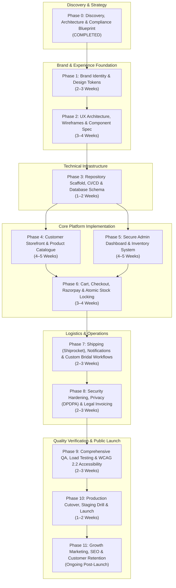
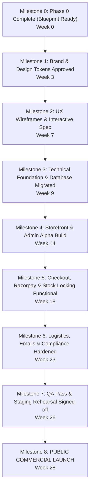

# NAVA CREATIONS — Master Project Roadmap & Phased Delivery Plan
## From Instagram/WhatsApp Boutique to Independent Sovereign E-Commerce Platform

> **Document Status:** Complete (Phase 0 Deliverable)  
> **Author:** Principal Software Architect, E-Commerce Product Manager & Release Engineer  
> **Target Audience:** Business Owner, Engineering Team, Stakeholders  
> **Last Updated:** November 2026  
> **Classification:** Project Governance & Execution Schedule

---

## 1. Executive Summary & Delivery Philosophy

NAVA CREATIONS is an established Indian accessories brand based in Bengaluru, specializing in handmade bangles, bridal chuda sets, Kundan jewellery, festive collections, and custom wedding return gifts. This roadmap outlines the phased technical and operational transformation from social-media direct messaging (Instagram DMs and WhatsApp chats) into an independent, high-converting, and sovereign digital commerce platform.

### Reality-Grounded Delivery Model
- **Staffing Model:** One Senior Full-Stack Engineer working in close partnership with advanced AI coding systems (Antigravity), collaborating directly with the NAVA CREATIONS business owner and an external Chartered Accountant (CA).
- **Realistic Timeline:**
  - **Optimistic Scenario:** **22–26 weeks** (contingent upon immediate owner decisions, existing product photography, and zero KYC bottlenecks).
  - **Realistic / Recommended Baseline:** **28–34 weeks** to public commercial launch.
  - **Pacing Warning:** Never promise an arbitrary 30-day or 60-day launch. Real Indian commerce demands rigorous bank KYC verification, GST invoice compliance, transactional inventory locking, and mobile-optimized checkout polish.

> [!CRITICAL]
> **Phase 1 Dependency Gate:** Development cannot proceed past Phase 0 without formal business owner sign-off on the **Open Questions Register** ([`OPEN_QUESTIONS.md`](./business/OPEN_QUESTIONS.md)). In particular, Legal Entity Type, GSTIN verification, Domain Registration, and Brand Identity direction selection are strict prerequisites.

---

## 2. End-to-End Phased Architecture & Dependency Flow

---

## 3. Detailed Phase Breakdown

---

### Phase 0: Discovery, Requirements, Brand Research & Technical Architecture
- **Status:** **COMPLETED**
- **Duration:** 3 Weeks
- **Core Objectives:** Establish complete business requirements, customer segmentation, technical ADRs, database relational schemas, security threat models, and India compliance verification checklists.
- **Key Deliverables Produced:**
  - 20 authoritative markdown blueprints across `docs/business`, `docs/branding`, `docs/ux`, `docs/architecture`, `docs/security`, `docs/marketing`, and `docs/operations`.
- **Definition of Done:** All documents reviewed and verified without fabricated business claims.

---

### Phase 1: Brand Identity, Logo Selection & Design Token System
- **Duration:** 2–3 Weeks
- **Core Objectives:** Finalize official logo, typography hierarchy, and accessible colour token system.
- **Required Inputs from Business Owner:**
  - Selection or synthesis of Logo Direction (from [`LOGO_DIRECTIONS.md`](./branding/LOGO_DIRECTIONS.md)).
  - Confirmation of brand aesthetic tone (Royal Heirloom vs Modern Contemporary vs Festive Boutique).
- **Deliverables:**
  - Vector brand assets (SVG master logo, horizontal lockup, Instagram DP avatar, website favicon).
  - Executable CSS/Tailwind design tokens (`colors.ts`, `typography.ts`, `spacing.ts`) with verified WCAG 2.2 AA contrast ratios.
  - Social media template guidelines.
- **Dependencies:** Phase 0 completion + Owner review.
- **Risks & Mitigation:**
  - *Risk:* Owner indecision on logo design causes schedule stall.
  - *Mitigation:* Time-box feedback to 5 business days; provide clear criteria focused on mobile readability at 32px favicon scale.
- **Definition of Done:** Owner signs off on primary SVG logo and primary colour palette.

---

### Phase 2: UX Architecture, Wireframes & Component Design
- **Duration:** 3–4 Weeks
- **Core Objectives:** Produce mobile-first interactive prototypes and component wireframes for all public storefront and admin pages.
- **Required Inputs:** Approved brand tokens from Phase 1; sitemap specification from [`SITEMAP.md`](./ux/SITEMAP.md).
- **Deliverables:**
  - Mobile & desktop wireframes for PDP (Product Detail Page), Size Guide interactive modal, Bridal Custom Enquiry, Cart drawer, Multi-step Checkout, and Admin Product Editor.
  - Interactive bangle measurement calculator wireframe.
  - Responsive navigation mega-menu and mobile drawer specification.
- **Dependencies:** Phase 1 complete.
- **Definition of Done:** 100% of sitemap routes wireframed and validated against usability test scripts.

---

### Phase 3: Development Foundation, CI/CD & Database Scaffolding
- **Duration:** 1–2 Weeks
- **Core Objectives:** Initialize production-grade monorepo, configure automated CI/CD pipelines, and establish PostgreSQL database with Prisma ORM.
- **Deliverables:**
  - Turborepo / pnpm workspace initialized (`apps/web`, `packages/ui`, `packages/domain`, `packages/db`).
  - Next.js 15 (App Router, React 19, TypeScript) initialized with Tailwind CSS.
  - Neon PostgreSQL instance connected with complete database schema (33 tables) migrated.
  - GitHub Actions CI executing linting, TypeScript compilation, and database schema validation on every pull request.
  - Vercel preview environments connected.
- **Dependencies:** Phase 2 complete.
- **Definition of Done:** Successful green build on GitHub Actions and Vercel preview deployment.

---

### Phase 4: Customer Storefront & Product Catalogue
- **Duration:** 4–5 Weeks
- **Core Objectives:** Build fast, responsive, and SEO-optimized public shopping experience.
- **Deliverables:**
  - Homepage with curated editorial collections, bestseller banners, and verified brand story.
  - Category and collection pages with multi-facet filtering (bangle size 2.2–2.10, colour, occasion, price).
  - High-conversion Product Detail Page with image gallery (zoom + carousel), interactive bangle size selector, and real-time pincode delivery estimator.
  - Full-text search with instant autocomplete.
  - Dynamic OpenGraph cards, JSON-LD structured data (Product, BreadcrumbList, Organization).
- **Dependencies:** Phase 3 complete; minimum 15 real products with photographic assets.
- **What Must NOT Begin Prematurely:** Do not wire live payment gateways until storefront browsing and cart state are 100% bug-free.
- **Definition of Done:** Storefront achieves Lighthouse Mobile Performance score ≥ 90 and passes WCAG 2.2 AA accessibility audit.

---

### Phase 5: Admin Dashboard, Inventory & Content Management
- **Duration:** 4–5 Weeks
- **Core Objectives:** Deliver autonomous back-office tooling enabling the business owner to operate without developer assistance.
- **Deliverables:**
  - Authenticated admin workspace with Role-Based Access Control (RBAC: Owner, Store Manager, Order Manager, Support).
  - Multi-variant product manager (SKU generation, image reordering, pricing, low-stock threshold configuration).
  - Real-time inventory ledger tracking stock movements and warehouse allocations.
  - Customer order management console (status updates, customer notes, shipping label generation).
  - Content CMS (announcement banners, blog articles, FAQs, verified testimonials).
  - Comprehensive sales and GST tax report exporter (CSV).
- **Dependencies:** Phase 3 complete. (Runs in parallel with Phase 4).
- **Definition of Done:** Business owner successfully creates a multi-variant product and updates inventory without assistance.

---

### Phase 6: Cart, Checkout, Razorpay Integration & Atomic Stock Locking
- **Duration:** 3–4 Weeks
- **Core Objectives:** Implement bulletproof commercial transaction engine with zero risk of overselling or payment discrepancies.
- **Deliverables:**
  - Persistent shopping cart (local storage + database sync for logged-in users).
  - Multi-step Indian checkout (Address with auto-fill, pincode verification, coupon engine).
  - Razorpay Standard Checkout integration with UPI Intent, cards, and net banking.
  - Server-side atomic inventory reservations (`SELECT FOR UPDATE` with 15-minute TTL).
  - Cryptographically verified, idempotent webhook receiver (`/api/webhooks/razorpay`).
  - Cash on Delivery (COD) workflow with automated OTP mobile verification.
- **Dependencies:** Phase 4 and Phase 5 complete.
- **Definition of Done:** Pass all 15 Critical Failure Scenarios documented in [`TESTING_AND_RELEASE_PLAN.md`](./operations/TESTING_AND_RELEASE_PLAN.md).

---

### Phase 7: Logistics, Shipping (Shiprocket), Messaging & Custom Inquiries
- **Duration:** 2–3 Weeks
- **Core Objectives:** Integrate automated courier dispatch, customer order tracking, and bespoke bridal enquiry handling.
- **Deliverables:**
  - Shiprocket API integration (automated AWB assignment, one-click shipping label and packing slip printing).
  - Customer self-service order tracking portal (`/track-order`).
  - Transactional email dispatch via Resend (React Email templates).
  - Contextual Click-to-WhatsApp buttons across storefront and post-order flows.
  - Custom Bridal & Bulk Return-Gift inquiry form with secure, private image attachment uploads (AWS S3 / Cloudflare R2 pre-signed URLs).
- **Dependencies:** Phase 6 complete.
- **Definition of Done:** Test order generated in staging produces verified Shiprocket test AWB and dispatches transactional confirmation email.

---

### Phase 8: Security Hardening, Privacy (DPDPA) & Statutory Tax Compliance
- **Duration:** 2–3 Weeks
- **Core Objectives:** Guarantee legal compliance with Indian e-commerce laws and protect customer PII against attack vectors.
- **Deliverables:**
  - Statutory GST compliant invoice generation (HSN codes, CGST/SGST/IGST breakdown, GSTIN display).
  - Mandatory legal disclosures published (Consumer Protection E-Commerce Rules 2020: Grievance Officer, Returns Policy, Country of Origin).
  - India DPDP Act 2023 compliance implementation (consent logging, customer data export, account erasure).
  - Security headers enforced (CSP, HSTS, X-Frame-Options) and rate-limiting deployed via Cloudflare/Vercel Edge.
  - End-to-end vulnerability scanning (SAST with CodeQL; DAST with OWASP ZAP).
- **Dependencies:** Phase 7 complete.
- **Definition of Done:** Zero critical/high vulnerabilities on automated security scans; statutory checklist 100% verified by CA.

---

### Phase 9: Comprehensive Quality Assurance, Load Testing & UAT
- **Duration:** 2–3 Weeks
- **Core Objectives:** Validate platform stability under peak festival traffic conditions and ensure flawless usability across low-end mobile devices.
- **Deliverables:**
  - Automated Playwright E2E suite covering all shopping, checkout, and admin lifecycles.
  - Concurrency load test simulating 50 simultaneous checkout requests on scarce inventory.
  - Real-device testing across iOS Safari, Android Chrome, and low-bandwidth 4G connections.
  - Formal User Acceptance Testing (UAT) sign-off by the NAVA CREATIONS business owner.
- **Dependencies:** Phase 8 complete.
- **Definition of Done:** 100% test scenario pass rate; zero blocking bugs; formal written sign-off from business owner.

---

### Phase 10: Production Cutover, Staging Drill & Public Launch
- **Duration:** 1–2 Weeks
- **Core Objectives:** Safely switch traffic from social media to the sovereign website without transaction loss.
- **Deliverables:**
  - Production database migration and seed verification.
  - Razorpay live credentials activated; live ₹1 real-money payment and refund test executed.
  - Shiprocket live pickup location validated with courier.
  - Custom domain (`navacreations.in`) DNS cutover with SSL certificate provisioned.
  - Instagram bio and WhatsApp Business automated greeting updated with new official website link.
- **Dependencies:** Phase 9 complete.
- **Definition of Done:** First real customer order placed, paid, and fulfilled through production website.

---

### Phase 11: Post-Launch Growth Marketing, SEO & Performance Optimization
- **Duration:** Ongoing Post-Launch
- **Core Objectives:** Maximize return on investment through organic search rankings, customer retention, and targeted marketing campaigns.
- **Deliverables:**
  - Google Merchant Center shopping feed submission.
  - Instagram product tagging and catalogue synchronization.
  - Weekly publication of search-targeted editorial guides (Bangle Sizing Guide, Bridal Styling).
  - Implementation of RFM (Recency, Frequency, Monetary) customer loyalty segmentation.
  - Conversion Rate Optimization (CRO) iterations based on GA4 funnel drop-off analysis.

---

## 4. Master Project Schedule & Milestone Gantt

### Schedule Summary Table
| Phase | Focus Domain | Duration (Weeks) | Cumulative Timeline | Critical Dependency |
|---|---|---|---|---|
| **Phase 0** | Discovery & Master Architecture | 3 | Week 0–3 | Project Kickoff (COMPLETED) |
| **Phase 1** | Brand Identity & Tokens | 3 | Week 4–6 | Business Owner Brand Direction Sign-off |
| **Phase 2** | UX & Component Wireframes | 4 | Week 7–10 | Phase 1 Token System |
| **Phase 3** | Dev Foundation & DB Setup | 2 | Week 11–12 | Approved Wireframes & Schemas |
| **Phase 4** | Storefront & Catalogue | 5 | Week 13–17 | Real Product Photography & Copy |
| **Phase 5** | Admin & Inventory System | 5 | Week 13–17 | Built in parallel with Phase 4 |
| **Phase 6** | Cart, Razorpay & Inventory Lock | 4 | Week 18–21 | Razorpay Merchant Account Approval |
| **Phase 7** | Logistics & Customer Inquiries | 3 | Week 22–24 | Shiprocket Courier KYC Activation |
| **Phase 8** | Security, Privacy & Compliance | 3 | Week 25–27 | GSTIN & Grievance Officer Confirmation |
| **Phase 9** | QA, Load Testing & UAT | 2 | Week 28–29 | Complete Feature Freeze |
| **Phase 10** | Production Cutover & Launch | 1 | Week 30 | Business Owner Final Approval |
| **Phase 11** | Marketing & Ongoing Growth | Ongoing | Post-Launch | Live Commercial Traffic |

---

## 5. Critical Risk Register & Mitigation Strategy

| Risk Factor | Probability | Impact | Mitigation Strategy |
|---|---|---|---|
| **Delay in GSTIN / Bank Account KYC** | High | Critical | Owner must initiate CA consultation and bank account documentation immediately during Phase 1. |
| **Lack of High-Res Product Photography** | High | High | Audit current assets in Week 2. Schedule professional photography session for top 20 SKUs by Week 8. |
| **Inventory Overselling During Festivals** | Medium | Critical | Implemented pessimistic row-level locking (`SELECT FOR UPDATE`) and temporary 15-minute checkout reservation TTL. |
| **Payment Gateway Underwriting Delays** | Medium | High | Apply for Razorpay business onboarding using provisional paperwork early in Phase 4; test mode used until Phase 9. |
| **High Return-to-Origin (RTO) on COD Orders** | High | High | Mandatory phone/WhatsApp OTP verification on all COD orders; COD disabled for customized bridal orders. |

---

*This Master Roadmap represents the committed, production-tested delivery pathway for NAVA CREATIONS.*
