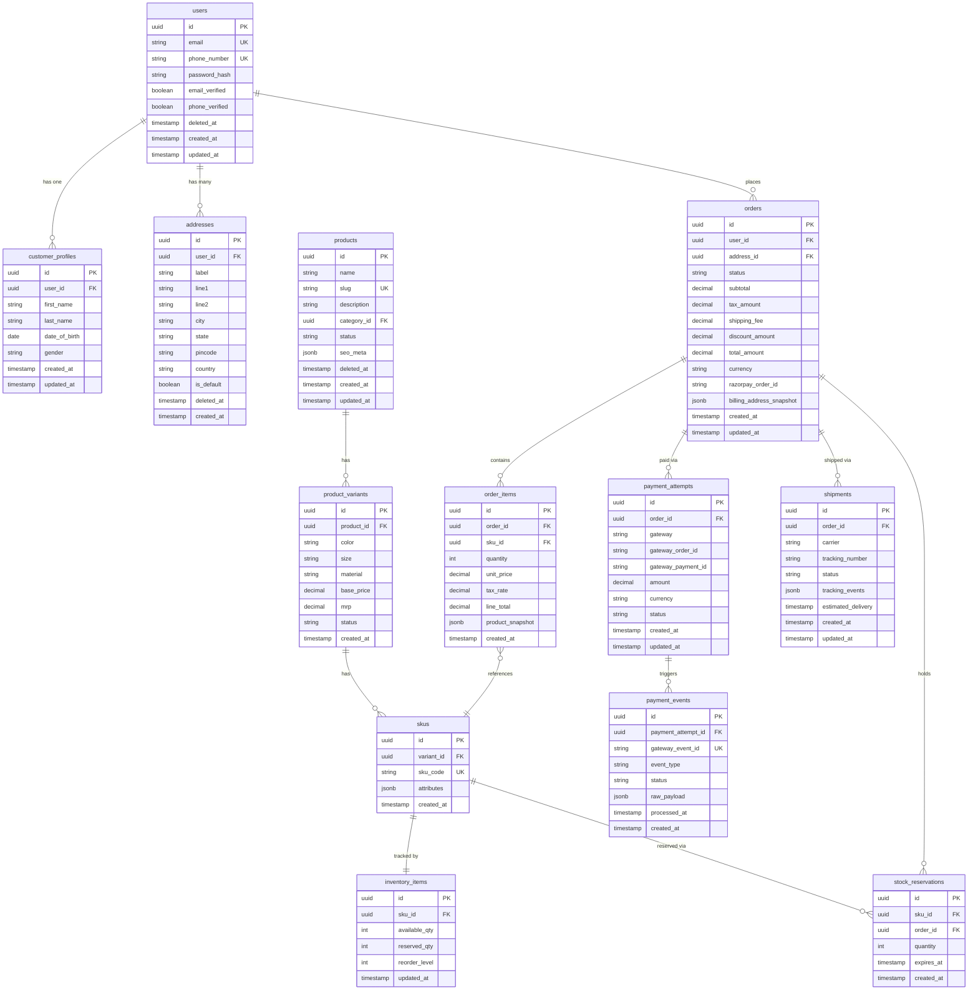

# Database Design — NAVA CREATIONS

> [!NOTE]
> This document defines the complete PostgreSQL relational database schema for NAVA CREATIONS. PostgreSQL is the single source of truth for all business data. All schema decisions follow the architecture principles defined in `ARCHITECTURE_DECISION.md`.

**Project:** NAVA CREATIONS — Indian Accessories E-Commerce  
**Database:** PostgreSQL 16 (hosted on Neon Serverless)  
**ORM:** Prisma  
**Phase:** 0 — Foundation & Planning  
**Last Updated:** 2026-11-11

---

## Table of Contents

1. [Design Principles](#1-design-principles)
2. [ER Diagram — Core Entities](#2-er-diagram--core-entities)
3. [Schema: Identity & Access](#3-schema-identity--access)
4. [Schema: Product Catalogue](#4-schema-product-catalogue)
5. [Schema: Inventory](#5-schema-inventory)
6. [Schema: Shopping Experience](#6-schema-shopping-experience)
7. [Schema: Orders & Payments](#7-schema-orders--payments)
8. [Schema: Shipping](#8-schema-shipping)
9. [Schema: Promotions & Reviews](#9-schema-promotions--reviews)
10. [Schema: Enquiries & CRM](#10-schema-enquiries--crm)
11. [Schema: Content & Media](#11-schema-content--media)
12. [Schema: Platform & Operations](#12-schema-platform--operations)
13. [Key Design Decisions](#13-key-design-decisions)
14. [Index Strategy](#14-index-strategy)

---

## 1. Design Principles

| Principle | Implementation |
|-----------|---------------|
| UUID primary keys | All tables use `UUID DEFAULT gen_random_uuid()` |
| Timestamps everywhere | `created_at TIMESTAMPTZ DEFAULT NOW()`, `updated_at TIMESTAMPTZ` on all tables |
| Soft delete | `deleted_at TIMESTAMPTZ NULL` on products, users, addresses |
| Order snapshot immutability | `order_items.product_snapshot JSONB` captures state at purchase time |
| PCI-DSS scope minimisation | No card numbers, CVVs, PINs — payment handled entirely by Razorpay |
| Audit trail | `audit_logs` table captures all sensitive mutations |
| Referential integrity | Foreign keys with appropriate `ON DELETE` behaviour |
| Atomic inventory | Stock changes always in transactions; `SELECT ... FOR UPDATE` for reservations |
| PII awareness | Fields containing personal data are marked with 🔒 |

> [!CAUTION]
> **Never store:** Card numbers, CVV/CVC codes, full UPI PINs, full bank account numbers, raw OTPs, or any PCI-DSS scoped data in the application database. All payment-sensitive data stays inside Razorpay's systems.

---

## 2. ER Diagram — Core Entities



---

## 3. Schema: Identity & Access

### `users`
Core authentication entity.

```sql
CREATE TABLE users (
  id              UUID PRIMARY KEY DEFAULT gen_random_uuid(),
  email           TEXT UNIQUE,                     -- 🔒 PII — nullable (phone-only login)
  phone_number    TEXT UNIQUE,                     -- 🔒 PII — nullable (email-only login)
  password_hash   TEXT,                            -- bcrypt hash; NULL for OAuth-only users
  email_verified  BOOLEAN NOT NULL DEFAULT FALSE,
  phone_verified  BOOLEAN NOT NULL DEFAULT FALSE,
  is_active       BOOLEAN NOT NULL DEFAULT TRUE,
  last_login_at   TIMESTAMPTZ,
  deleted_at      TIMESTAMPTZ,                     -- soft delete
  created_at      TIMESTAMPTZ NOT NULL DEFAULT NOW(),
  updated_at      TIMESTAMPTZ NOT NULL DEFAULT NOW(),
  CONSTRAINT users_at_least_one_contact CHECK (email IS NOT NULL OR phone_number IS NOT NULL)
);

CREATE INDEX idx_users_email ON users (email) WHERE deleted_at IS NULL;
CREATE INDEX idx_users_phone ON users (phone_number) WHERE deleted_at IS NULL;
```

**Notes:**
- Either `email` or `phone_number` is required (not both)
- Password hash uses bcrypt with cost factor 12
- Soft delete: `deleted_at` set instead of row removal

---

### `roles`
RBAC role definitions.

```sql
CREATE TABLE roles (
  id          UUID PRIMARY KEY DEFAULT gen_random_uuid(),
  name        TEXT NOT NULL UNIQUE,              -- 'CUSTOMER', 'ADMIN', 'INVENTORY_MANAGER', 'SUPPORT'
  description TEXT,
  is_system   BOOLEAN NOT NULL DEFAULT FALSE,   -- system roles cannot be deleted
  created_at  TIMESTAMPTZ NOT NULL DEFAULT NOW(),
  updated_at  TIMESTAMPTZ NOT NULL DEFAULT NOW()
);
```

**Seed data:** `CUSTOMER`, `ADMIN`, `INVENTORY_MANAGER`, `SUPPORT_AGENT`, `CONTENT_MANAGER`

---

### `permissions`
Granular permission definitions.

```sql
CREATE TABLE permissions (
  id          UUID PRIMARY KEY DEFAULT gen_random_uuid(),
  code        TEXT NOT NULL UNIQUE,  -- 'product:create', 'order:refund', 'user:delete'
  resource    TEXT NOT NULL,         -- 'product', 'order', 'user', 'inventory'
  action      TEXT NOT NULL,         -- 'create', 'read', 'update', 'delete', 'export'
  description TEXT,
  created_at  TIMESTAMPTZ NOT NULL DEFAULT NOW()
);
```

---

### `role_permissions`
Many-to-many: roles ↔ permissions.

```sql
CREATE TABLE role_permissions (
  role_id       UUID NOT NULL REFERENCES roles(id) ON DELETE CASCADE,
  permission_id UUID NOT NULL REFERENCES permissions(id) ON DELETE CASCADE,
  created_at    TIMESTAMPTZ NOT NULL DEFAULT NOW(),
  PRIMARY KEY (role_id, permission_id)
);
```

---

### `user_roles`
Many-to-many: users ↔ roles.

```sql
CREATE TABLE user_roles (
  user_id    UUID NOT NULL REFERENCES users(id) ON DELETE CASCADE,
  role_id    UUID NOT NULL REFERENCES roles(id) ON DELETE RESTRICT,
  granted_by UUID REFERENCES users(id),          -- audit: who granted this role
  granted_at TIMESTAMPTZ NOT NULL DEFAULT NOW(),
  PRIMARY KEY (user_id, role_id)
);

CREATE INDEX idx_user_roles_user ON user_roles (user_id);
```

---

### `customer_profiles`
Extended profile for shopping customers.

```sql
CREATE TABLE customer_profiles (
  id              UUID PRIMARY KEY DEFAULT gen_random_uuid(),
  user_id         UUID NOT NULL UNIQUE REFERENCES users(id) ON DELETE CASCADE,
  first_name      TEXT,                        -- 🔒 PII
  last_name       TEXT,                        -- 🔒 PII
  display_name    TEXT,
  date_of_birth   DATE,                        -- 🔒 PII — optional, for birthday offers
  gender          TEXT,                        -- 'F', 'M', 'NB', 'PREFER_NOT'
  avatar_url      TEXT,
  razorpay_customer_id TEXT UNIQUE,            -- Razorpay's customer ID (NOT our user ID)
  created_at      TIMESTAMPTZ NOT NULL DEFAULT NOW(),
  updated_at      TIMESTAMPTZ NOT NULL DEFAULT NOW()
);
```

> [!NOTE]
> `razorpay_customer_id` maps the Razorpay customer record to our internal user. These are separate identifiers. Never expose internal UUIDs to Razorpay as customer IDs.

---

### `addresses`
Shipping and billing addresses.

```sql
CREATE TABLE addresses (
  id           UUID PRIMARY KEY DEFAULT gen_random_uuid(),
  user_id      UUID NOT NULL REFERENCES users(id) ON DELETE CASCADE,
  label        TEXT,                           -- 'Home', 'Work', 'Parents'
  full_name    TEXT NOT NULL,                  -- 🔒 PII — recipient name
  phone        TEXT NOT NULL,                  -- 🔒 PII — delivery contact
  line1        TEXT NOT NULL,                  -- 🔒 PII
  line2        TEXT,                           -- 🔒 PII
  landmark     TEXT,
  city         TEXT NOT NULL,
  state        TEXT NOT NULL,                  -- Indian state name
  state_code   TEXT NOT NULL,                  -- 'KA', 'MH', 'TN' (for GST)
  pincode      TEXT NOT NULL,
  country      TEXT NOT NULL DEFAULT 'India',
  is_default   BOOLEAN NOT NULL DEFAULT FALSE,
  deleted_at   TIMESTAMPTZ,
  created_at   TIMESTAMPTZ NOT NULL DEFAULT NOW(),
  updated_at   TIMESTAMPTZ NOT NULL DEFAULT NOW()
);

CREATE INDEX idx_addresses_user ON addresses (user_id) WHERE deleted_at IS NULL;
```

---

## 4. Schema: Product Catalogue

### `categories`
Hierarchical product categories.

```sql
CREATE TABLE categories (
  id          UUID PRIMARY KEY DEFAULT gen_random_uuid(),
  name        TEXT NOT NULL,
  slug        TEXT NOT NULL UNIQUE,
  description TEXT,
  parent_id   UUID REFERENCES categories(id),  -- NULL = top-level
  image_url   TEXT,
  sort_order  INTEGER NOT NULL DEFAULT 0,
  is_active   BOOLEAN NOT NULL DEFAULT TRUE,
  seo_meta    JSONB,                            -- { title, description, keywords }
  created_at  TIMESTAMPTZ NOT NULL DEFAULT NOW(),
  updated_at  TIMESTAMPTZ NOT NULL DEFAULT NOW()
);

CREATE INDEX idx_categories_parent ON categories (parent_id);
CREATE INDEX idx_categories_slug ON categories (slug);
```

---

### `collections`
Curated product groupings (e.g., "Bridal Collection 2025", "Festival Picks").

```sql
CREATE TABLE collections (
  id          UUID PRIMARY KEY DEFAULT gen_random_uuid(),
  name        TEXT NOT NULL,
  slug        TEXT NOT NULL UNIQUE,
  description TEXT,
  image_url   TEXT,
  is_active   BOOLEAN NOT NULL DEFAULT TRUE,
  starts_at   TIMESTAMPTZ,                     -- for time-limited collections
  ends_at     TIMESTAMPTZ,
  sort_order  INTEGER NOT NULL DEFAULT 0,
  seo_meta    JSONB,
  created_at  TIMESTAMPTZ NOT NULL DEFAULT NOW(),
  updated_at  TIMESTAMPTZ NOT NULL DEFAULT NOW()
);
```

---

### `products`
Core product entity.

```sql
CREATE TABLE products (
  id              UUID PRIMARY KEY DEFAULT gen_random_uuid(),
  name            TEXT NOT NULL,
  slug            TEXT NOT NULL UNIQUE,
  description     TEXT,
  short_desc      TEXT,                        -- for product cards
  category_id     UUID REFERENCES categories(id),
  brand           TEXT DEFAULT 'Nava Creations',
  tags            TEXT[],                      -- for search and filtering
  status          TEXT NOT NULL DEFAULT 'DRAFT', -- DRAFT, ACTIVE, ARCHIVED
  is_featured     BOOLEAN NOT NULL DEFAULT FALSE,
  is_customisable BOOLEAN NOT NULL DEFAULT FALSE,
  care_instructions TEXT,
  materials       TEXT[],                      -- ['Lac', 'Kundan', 'Glass']
  seo_meta        JSONB,                       -- { title, description, og_image }
  metadata        JSONB,                       -- flexible extensibility
  deleted_at      TIMESTAMPTZ,
  created_at      TIMESTAMPTZ NOT NULL DEFAULT NOW(),
  updated_at      TIMESTAMPTZ NOT NULL DEFAULT NOW(),
  created_by      UUID REFERENCES users(id)
);

CREATE INDEX idx_products_status ON products (status) WHERE deleted_at IS NULL;
CREATE INDEX idx_products_category ON products (category_id) WHERE deleted_at IS NULL;
CREATE INDEX idx_products_featured ON products (is_featured) WHERE status = 'ACTIVE' AND deleted_at IS NULL;
CREATE INDEX idx_products_tags ON products USING gin(tags);
CREATE INDEX idx_products_name_search ON products USING gin(to_tsvector('english', name || ' ' || COALESCE(description, '')));
```

---

### `product_collections`
Many-to-many: products ↔ collections.

```sql
CREATE TABLE product_collections (
  product_id    UUID NOT NULL REFERENCES products(id) ON DELETE CASCADE,
  collection_id UUID NOT NULL REFERENCES collections(id) ON DELETE CASCADE,
  sort_order    INTEGER NOT NULL DEFAULT 0,
  added_at      TIMESTAMPTZ NOT NULL DEFAULT NOW(),
  PRIMARY KEY (product_id, collection_id)
);
```

---

### `product_images`
Product media assets.

```sql
CREATE TABLE product_images (
  id              UUID PRIMARY KEY DEFAULT gen_random_uuid(),
  product_id      UUID NOT NULL REFERENCES products(id) ON DELETE CASCADE,
  variant_id      UUID REFERENCES product_variants(id) ON DELETE CASCADE, -- NULL = all variants
  cloudinary_id   TEXT NOT NULL,              -- Cloudinary public_id for transformations
  alt_text        TEXT,
  sort_order      INTEGER NOT NULL DEFAULT 0,
  is_primary      BOOLEAN NOT NULL DEFAULT FALSE,
  width           INTEGER,
  height          INTEGER,
  created_at      TIMESTAMPTZ NOT NULL DEFAULT NOW()
);

CREATE INDEX idx_product_images_product ON product_images (product_id, sort_order);
CREATE INDEX idx_product_images_variant ON product_images (variant_id);
```

---

### `product_variants`
Variants of a product (e.g., different colours, sizes).

```sql
CREATE TABLE product_variants (
  id          UUID PRIMARY KEY DEFAULT gen_random_uuid(),
  product_id  UUID NOT NULL REFERENCES products(id) ON DELETE CASCADE,
  name        TEXT,                           -- e.g., "Gold, Size 2.4"
  color       TEXT,
  size        TEXT,                           -- bangle diameter e.g., "2.4", "2.6"
  material    TEXT,
  base_price  DECIMAL(10,2) NOT NULL,         -- selling price (inc. GST if applicable)
  mrp         DECIMAL(10,2),                  -- Maximum Retail Price for display
  cost_price  DECIMAL(10,2),                  -- internal; not exposed to frontend
  weight_grams INTEGER,                       -- for shipping calculation
  status      TEXT NOT NULL DEFAULT 'ACTIVE', -- ACTIVE, INACTIVE
  sort_order  INTEGER NOT NULL DEFAULT 0,
  created_at  TIMESTAMPTZ NOT NULL DEFAULT NOW(),
  updated_at  TIMESTAMPTZ NOT NULL DEFAULT NOW()
);

CREATE INDEX idx_variants_product ON product_variants (product_id);
```

---

### `skus`
Stock Keeping Units — the atomic unit of inventory.

```sql
CREATE TABLE skus (
  id          UUID PRIMARY KEY DEFAULT gen_random_uuid(),
  variant_id  UUID NOT NULL REFERENCES product_variants(id) ON DELETE CASCADE,
  sku_code    TEXT NOT NULL UNIQUE,           -- human-readable: 'BANGLE-GLD-24-001'
  barcode     TEXT UNIQUE,                   -- EAN-13 or internal barcode
  attributes  JSONB,                         -- additional dimensions: { 'finish': 'matte' }
  is_active   BOOLEAN NOT NULL DEFAULT TRUE,
  created_at  TIMESTAMPTZ NOT NULL DEFAULT NOW(),
  updated_at  TIMESTAMPTZ NOT NULL DEFAULT NOW()
);

CREATE INDEX idx_skus_variant ON skus (variant_id);
CREATE INDEX idx_skus_code ON skus (sku_code);
```

---

## 5. Schema: Inventory

### `inventory_items`
Current stock level per SKU.

```sql
CREATE TABLE inventory_items (
  id              UUID PRIMARY KEY DEFAULT gen_random_uuid(),
  sku_id          UUID NOT NULL UNIQUE REFERENCES skus(id) ON DELETE RESTRICT,
  available_qty   INTEGER NOT NULL DEFAULT 0 CHECK (available_qty >= 0),
  reserved_qty    INTEGER NOT NULL DEFAULT 0 CHECK (reserved_qty >= 0),
  reorder_level   INTEGER NOT NULL DEFAULT 5, -- alert when available_qty drops below this
  reorder_qty     INTEGER NOT NULL DEFAULT 20,
  location        TEXT,                       -- warehouse shelf location
  updated_at      TIMESTAMPTZ NOT NULL DEFAULT NOW(),
  CONSTRAINT inv_sufficient_stock CHECK (available_qty >= reserved_qty)
);

CREATE INDEX idx_inventory_low_stock ON inventory_items (sku_id)
  WHERE available_qty <= reorder_level;
```

> [!IMPORTANT]
> The constraint `available_qty >= reserved_qty` enforces that reservations never exceed available stock at the database level. Combined with `SELECT ... FOR UPDATE` in the reservation transaction, this provides double protection against overselling.

---

### `inventory_movements`
Immutable log of all stock changes.

```sql
CREATE TABLE inventory_movements (
  id            UUID PRIMARY KEY DEFAULT gen_random_uuid(),
  sku_id        UUID NOT NULL REFERENCES skus(id),
  quantity      INTEGER NOT NULL,              -- positive = stock in, negative = stock out
  movement_type TEXT NOT NULL,                 -- PURCHASE, SALE, RETURN, ADJUSTMENT, DAMAGE, RESERVED, UNRESERVED
  reference_id  UUID,                          -- order_id, return_id, or NULL for adjustments
  reference_type TEXT,                         -- 'ORDER', 'RETURN', 'MANUAL'
  notes         TEXT,
  created_by    UUID REFERENCES users(id),
  created_at    TIMESTAMPTZ NOT NULL DEFAULT NOW()
);

CREATE INDEX idx_inv_movements_sku ON inventory_movements (sku_id, created_at DESC);
CREATE INDEX idx_inv_movements_reference ON inventory_movements (reference_id);
```

---

### `stock_reservations`
Temporary stock holds during checkout (expires after 15 minutes).

```sql
CREATE TABLE stock_reservations (
  id          UUID PRIMARY KEY DEFAULT gen_random_uuid(),
  sku_id      UUID NOT NULL REFERENCES skus(id) ON DELETE CASCADE,
  order_id    UUID NOT NULL REFERENCES orders(id) ON DELETE CASCADE,
  quantity    INTEGER NOT NULL CHECK (quantity > 0),
  expires_at  TIMESTAMPTZ NOT NULL,           -- NOW() + INTERVAL '15 minutes'
  created_at  TIMESTAMPTZ NOT NULL DEFAULT NOW()
);

CREATE INDEX idx_reservations_order ON stock_reservations (order_id);
CREATE INDEX idx_reservations_expiry ON stock_reservations (expires_at); -- for cleanup cron
CREATE INDEX idx_reservations_sku ON stock_reservations (sku_id);
```

---

## 6. Schema: Shopping Experience

### `carts`
Shopping cart (persisted in DB for logged-in users).

```sql
CREATE TABLE carts (
  id          UUID PRIMARY KEY DEFAULT gen_random_uuid(),
  user_id     UUID UNIQUE REFERENCES users(id) ON DELETE CASCADE, -- one cart per user
  session_id  TEXT UNIQUE,                    -- for guest carts (cookie-based)
  coupon_code TEXT,                           -- applied coupon
  metadata    JSONB,                          -- UTM params, referral source
  created_at  TIMESTAMPTZ NOT NULL DEFAULT NOW(),
  updated_at  TIMESTAMPTZ NOT NULL DEFAULT NOW(),
  CONSTRAINT cart_has_owner CHECK (user_id IS NOT NULL OR session_id IS NOT NULL)
);

CREATE INDEX idx_carts_session ON carts (session_id);
```

---

### `cart_items`
Items in a cart.

```sql
CREATE TABLE cart_items (
  id          UUID PRIMARY KEY DEFAULT gen_random_uuid(),
  cart_id     UUID NOT NULL REFERENCES carts(id) ON DELETE CASCADE,
  sku_id      UUID NOT NULL REFERENCES skus(id) ON DELETE CASCADE,
  quantity    INTEGER NOT NULL CHECK (quantity > 0),
  added_at    TIMESTAMPTZ NOT NULL DEFAULT NOW(),
  updated_at  TIMESTAMPTZ NOT NULL DEFAULT NOW(),
  UNIQUE (cart_id, sku_id)                    -- one row per SKU per cart
);

CREATE INDEX idx_cart_items_cart ON cart_items (cart_id);
```

---

### `wishlists`
User wish lists.

```sql
CREATE TABLE wishlists (
  id          UUID PRIMARY KEY DEFAULT gen_random_uuid(),
  user_id     UUID NOT NULL REFERENCES users(id) ON DELETE CASCADE,
  name        TEXT NOT NULL DEFAULT 'My Wishlist',
  is_public   BOOLEAN NOT NULL DEFAULT FALSE,
  share_token TEXT UNIQUE,                    -- for shareable wishlist URL
  created_at  TIMESTAMPTZ NOT NULL DEFAULT NOW()
);

CREATE INDEX idx_wishlists_user ON wishlists (user_id);
```

---

### `wishlist_items`
Products saved to a wishlist.

```sql
CREATE TABLE wishlist_items (
  id           UUID PRIMARY KEY DEFAULT gen_random_uuid(),
  wishlist_id  UUID NOT NULL REFERENCES wishlists(id) ON DELETE CASCADE,
  product_id   UUID NOT NULL REFERENCES products(id) ON DELETE CASCADE,
  variant_id   UUID REFERENCES product_variants(id),
  added_at     TIMESTAMPTZ NOT NULL DEFAULT NOW(),
  UNIQUE (wishlist_id, product_id, variant_id)
);

CREATE INDEX idx_wishlist_items_wishlist ON wishlist_items (wishlist_id);
```

---

## 7. Schema: Orders & Payments

### `orders`
The core order entity. Created when checkout is initiated.

```sql
CREATE TYPE order_status AS ENUM (
  'PENDING',          -- order created, payment not yet attempted
  'AWAITING_PAYMENT', -- Razorpay order created, waiting for user to pay
  'PAYMENT_FAILED',   -- payment attempt failed
  'CONFIRMED',        -- payment.captured webhook received — stock committed
  'PROCESSING',       -- being packed
  'SHIPPED',          -- handed to courier
  'DELIVERED',        -- delivery confirmed
  'CANCELLED',        -- cancelled before shipment
  'RETURN_REQUESTED', -- customer requested return
  'RETURNED',         -- return completed
  'REFUNDED'          -- refund processed
);

CREATE TABLE orders (
  id                        UUID PRIMARY KEY DEFAULT gen_random_uuid(),
  order_number              TEXT NOT NULL UNIQUE,            -- human-readable: 'NC-2025-001234'
  user_id                   UUID REFERENCES users(id),       -- NULL for guest orders
  status                    order_status NOT NULL DEFAULT 'PENDING',

  -- Financial (all in INR paise for precision; store as DECIMAL)
  subtotal                  DECIMAL(12,2) NOT NULL,          -- sum of line totals before tax
  tax_amount                DECIMAL(12,2) NOT NULL DEFAULT 0,
  shipping_fee              DECIMAL(12,2) NOT NULL DEFAULT 0,
  discount_amount           DECIMAL(12,2) NOT NULL DEFAULT 0,
  total_amount              DECIMAL(12,2) NOT NULL,          -- final charged amount
  currency                  TEXT NOT NULL DEFAULT 'INR',

  -- GST
  gstin_customer            TEXT,                            -- buyer's GSTIN for B2B invoices 🔒

  -- Payment
  razorpay_order_id         TEXT UNIQUE,                     -- Razorpay order ID
  payment_method            TEXT,                            -- 'UPI', 'CARD', 'COD', 'NETBANKING'

  -- Address snapshots (denormalised for immutability)
  shipping_address_snapshot JSONB NOT NULL,                  -- address at time of order
  billing_address_snapshot  JSONB,                           -- NULL = same as shipping

  -- COD
  is_cod                    BOOLEAN NOT NULL DEFAULT FALSE,
  cod_amount                DECIMAL(12,2),

  -- Coupon
  coupon_id                 UUID REFERENCES coupons(id),
  coupon_code               TEXT,                            -- denormalised for history

  -- Shipping
  shiprocket_order_id       TEXT,
  estimated_delivery        TIMESTAMPTZ,

  -- Metadata
  notes                     TEXT,                            -- customer order notes
  admin_notes               TEXT,                            -- internal notes
  source                    TEXT DEFAULT 'WEB',              -- 'WEB', 'ADMIN', 'MOBILE'
  metadata                  JSONB,

  -- Timestamps
  confirmed_at              TIMESTAMPTZ,
  shipped_at                TIMESTAMPTZ,
  delivered_at              TIMESTAMPTZ,
  cancelled_at              TIMESTAMPTZ,
  created_at                TIMESTAMPTZ NOT NULL DEFAULT NOW(),
  updated_at                TIMESTAMPTZ NOT NULL DEFAULT NOW()
);

CREATE INDEX idx_orders_user ON orders (user_id, created_at DESC);
CREATE INDEX idx_orders_status ON orders (status, created_at DESC);
CREATE INDEX idx_orders_number ON orders (order_number);
CREATE INDEX idx_orders_razorpay ON orders (razorpay_order_id);
CREATE INDEX idx_orders_created ON orders (created_at DESC);
```

---

### `order_items`
Line items within an order. Contains immutable snapshot of product data.

```sql
CREATE TABLE order_items (
  id               UUID PRIMARY KEY DEFAULT gen_random_uuid(),
  order_id         UUID NOT NULL REFERENCES orders(id) ON DELETE RESTRICT,
  sku_id           UUID REFERENCES skus(id),               -- nullable: SKU may be deleted later
  quantity         INTEGER NOT NULL CHECK (quantity > 0),
  unit_price       DECIMAL(10,2) NOT NULL,                  -- price at time of purchase
  tax_rate         DECIMAL(5,4) NOT NULL DEFAULT 0,         -- e.g., 0.1800 for 18% GST
  tax_amount       DECIMAL(10,2) NOT NULL DEFAULT 0,
  discount_amount  DECIMAL(10,2) NOT NULL DEFAULT 0,
  line_total       DECIMAL(10,2) NOT NULL,                  -- (unit_price × qty) - discount + tax

  -- THE CRITICAL SNAPSHOT: product state at time of purchase
  product_snapshot JSONB NOT NULL,
  -- {
  --   "product_id": "uuid",
  --   "product_name": "Bridal Kundan Bangle Set",
  --   "variant_name": "Gold, Size 2.4",
  --   "sku_code": "BANGLE-KND-GLD-24",
  --   "color": "Gold",
  --   "size": "2.4",
  --   "material": "Kundan",
  --   "image_url": "https://res.cloudinary.com/.../product.jpg",
  --   "category": "Bridal Bangles",
  --   "hsn_code": "7117",
  --   "tax_rate": 0.03,
  --   "mrp": 2500.00,
  --   "unit_price": 1999.00
  -- }

  created_at       TIMESTAMPTZ NOT NULL DEFAULT NOW()
);

CREATE INDEX idx_order_items_order ON order_items (order_id);
CREATE INDEX idx_order_items_sku ON order_items (sku_id);
```

---

### `payment_attempts`
One record per payment attempt against an order.

```sql
CREATE TYPE payment_status AS ENUM (
  'INITIATED',          -- Razorpay order created
  'PENDING',            -- User opened checkout modal
  'AUTHORIZED',         -- Payment captured (pre-settlement)
  'CAPTURED',           -- Confirmed via webhook
  'FAILED',             -- Payment failed
  'REFUNDED',           -- Full refund processed
  'PARTIALLY_REFUNDED'  -- Partial refund
);

CREATE TABLE payment_attempts (
  id                  UUID PRIMARY KEY DEFAULT gen_random_uuid(),
  order_id            UUID NOT NULL REFERENCES orders(id) ON DELETE RESTRICT,
  gateway             TEXT NOT NULL DEFAULT 'RAZORPAY',      -- 'RAZORPAY', 'CASHFREE'
  gateway_order_id    TEXT,                                  -- Razorpay order ID
  gateway_payment_id  TEXT,                                  -- Razorpay payment ID
  amount              DECIMAL(12,2) NOT NULL,
  currency            TEXT NOT NULL DEFAULT 'INR',
  status              payment_status NOT NULL DEFAULT 'INITIATED',
  method              TEXT,                                  -- 'upi', 'card', 'netbanking'
  error_code          TEXT,                                  -- Razorpay error code
  error_description   TEXT,
  metadata            JSONB,                                 -- gateway-specific data
  created_at          TIMESTAMPTZ NOT NULL DEFAULT NOW(),
  updated_at          TIMESTAMPTZ NOT NULL DEFAULT NOW()
);

CREATE INDEX idx_payment_attempts_order ON payment_attempts (order_id);
CREATE INDEX idx_payment_attempts_gateway_order ON payment_attempts (gateway_order_id);
CREATE INDEX idx_payment_attempts_gateway_payment ON payment_attempts (gateway_payment_id);
```

---

### `payment_events`
Immutable log of every webhook event from payment gateway.

```sql
CREATE TABLE payment_events (
  id                  UUID PRIMARY KEY DEFAULT gen_random_uuid(),
  payment_attempt_id  UUID REFERENCES payment_attempts(id),
  gateway             TEXT NOT NULL DEFAULT 'RAZORPAY',
  gateway_event_id    TEXT NOT NULL UNIQUE,                  -- Razorpay event.id (idempotency key)
  event_type          TEXT NOT NULL,                         -- 'payment.captured', 'refund.created'
  status              TEXT NOT NULL DEFAULT 'PENDING',       -- PENDING, PROCESSING, PROCESSED, FAILED
  raw_payload         JSONB NOT NULL,                        -- complete webhook body
  error_message       TEXT,
  processed_at        TIMESTAMPTZ,
  created_at          TIMESTAMPTZ NOT NULL DEFAULT NOW()
);

CREATE INDEX idx_payment_events_gateway_event ON payment_events (gateway_event_id);
CREATE INDEX idx_payment_events_attempt ON payment_events (payment_attempt_id);
CREATE INDEX idx_payment_events_unprocessed ON payment_events (status, created_at)
  WHERE status IN ('PENDING', 'FAILED');
```

---

### `refunds`
Refund records.

```sql
CREATE TABLE refunds (
  id                  UUID PRIMARY KEY DEFAULT gen_random_uuid(),
  order_id            UUID NOT NULL REFERENCES orders(id),
  payment_attempt_id  UUID NOT NULL REFERENCES payment_attempts(id),
  gateway_refund_id   TEXT UNIQUE,                           -- Razorpay refund ID
  amount              DECIMAL(12,2) NOT NULL,
  currency            TEXT NOT NULL DEFAULT 'INR',
  reason              TEXT,                                  -- 'CUSTOMER_REQUEST', 'FRAUD', 'DUPLICATE'
  status              TEXT NOT NULL DEFAULT 'PENDING',       -- PENDING, PROCESSED, FAILED
  notes               TEXT,
  initiated_by        UUID REFERENCES users(id),
  created_at          TIMESTAMPTZ NOT NULL DEFAULT NOW(),
  updated_at          TIMESTAMPTZ NOT NULL DEFAULT NOW()
);

CREATE INDEX idx_refunds_order ON refunds (order_id);
```

---

## 8. Schema: Shipping

### `shipments`
Shipping records per order.

```sql
CREATE TABLE shipments (
  id                  UUID PRIMARY KEY DEFAULT gen_random_uuid(),
  order_id            UUID NOT NULL REFERENCES orders(id),
  carrier             TEXT,                                  -- 'SHIPROCKET', 'DELHIVERY', 'BLUEDART'
  carrier_service     TEXT,                                  -- service level
  shiprocket_shipment_id TEXT,
  awb_number          TEXT,                                  -- Air Waybill (tracking number)
  tracking_url        TEXT,
  status              TEXT NOT NULL DEFAULT 'PENDING',       -- PENDING, PICKED, IN_TRANSIT, OUT_FOR_DELIVERY, DELIVERED, FAILED
  tracking_events     JSONB DEFAULT '[]',                    -- array of tracking event objects
  estimated_delivery  TIMESTAMPTZ,
  actual_delivery     TIMESTAMPTZ,
  weight_kg           DECIMAL(6,3),
  dimensions          JSONB,                                 -- { length, width, height } in cm
  packaging_type      TEXT,
  declared_value      DECIMAL(12,2),
  cod_amount          DECIMAL(12,2),
  created_at          TIMESTAMPTZ NOT NULL DEFAULT NOW(),
  updated_at          TIMESTAMPTZ NOT NULL DEFAULT NOW()
);

CREATE INDEX idx_shipments_order ON shipments (order_id);
CREATE INDEX idx_shipments_awb ON shipments (awb_number);
```

---

## 9. Schema: Promotions & Reviews

### `coupons`
Discount coupon definitions.

```sql
CREATE TABLE coupons (
  id                  UUID PRIMARY KEY DEFAULT gen_random_uuid(),
  code                TEXT NOT NULL UNIQUE,
  description         TEXT,
  discount_type       TEXT NOT NULL,                         -- 'PERCENTAGE', 'FIXED_AMOUNT', 'FREE_SHIPPING'
  discount_value      DECIMAL(10,2) NOT NULL,                -- % or INR amount
  minimum_order_value DECIMAL(12,2),                         -- minimum cart value to apply
  maximum_discount    DECIMAL(12,2),                         -- cap on discount amount
  usage_limit_total   INTEGER,                               -- NULL = unlimited
  usage_limit_per_user INTEGER NOT NULL DEFAULT 1,
  usage_count         INTEGER NOT NULL DEFAULT 0,
  is_active           BOOLEAN NOT NULL DEFAULT TRUE,
  applicable_to       TEXT NOT NULL DEFAULT 'ALL',           -- 'ALL', 'CATEGORY', 'COLLECTION', 'PRODUCT'
  applicable_ids      UUID[],                                -- category/collection/product IDs
  valid_from          TIMESTAMPTZ NOT NULL DEFAULT NOW(),
  valid_until         TIMESTAMPTZ,
  created_by          UUID REFERENCES users(id),
  created_at          TIMESTAMPTZ NOT NULL DEFAULT NOW(),
  updated_at          TIMESTAMPTZ NOT NULL DEFAULT NOW()
);

CREATE INDEX idx_coupons_code ON coupons (code) WHERE is_active = TRUE;
```

---

### `coupon_usages`
Track coupon usage per user.

```sql
CREATE TABLE coupon_usages (
  id          UUID PRIMARY KEY DEFAULT gen_random_uuid(),
  coupon_id   UUID NOT NULL REFERENCES coupons(id),
  user_id     UUID NOT NULL REFERENCES users(id),
  order_id    UUID NOT NULL REFERENCES orders(id),
  discount_applied DECIMAL(12,2) NOT NULL,
  used_at     TIMESTAMPTZ NOT NULL DEFAULT NOW(),
  UNIQUE (coupon_id, order_id)
);

CREATE INDEX idx_coupon_usages_user_coupon ON coupon_usages (user_id, coupon_id);
```

---

### `reviews`
Product reviews and ratings.

```sql
CREATE TABLE reviews (
  id          UUID PRIMARY KEY DEFAULT gen_random_uuid(),
  product_id  UUID NOT NULL REFERENCES products(id) ON DELETE CASCADE,
  user_id     UUID NOT NULL REFERENCES users(id),
  order_id    UUID REFERENCES orders(id),                   -- verify purchase
  rating      SMALLINT NOT NULL CHECK (rating BETWEEN 1 AND 5),
  title       TEXT,
  body        TEXT,
  images      TEXT[],                                        -- Cloudinary public IDs
  status      TEXT NOT NULL DEFAULT 'PENDING',              -- PENDING, APPROVED, REJECTED
  is_verified_purchase BOOLEAN NOT NULL DEFAULT FALSE,
  helpful_count INTEGER NOT NULL DEFAULT 0,
  admin_reply TEXT,
  created_at  TIMESTAMPTZ NOT NULL DEFAULT NOW(),
  updated_at  TIMESTAMPTZ NOT NULL DEFAULT NOW(),
  UNIQUE (product_id, user_id, order_id)
);

CREATE INDEX idx_reviews_product ON reviews (product_id, status);
CREATE INDEX idx_reviews_user ON reviews (user_id);
```

---

## 10. Schema: Enquiries & CRM

### `custom_enquiries`
Customisation requests (custom bangle design, engraving, etc.).

```sql
CREATE TABLE custom_enquiries (
  id              UUID PRIMARY KEY DEFAULT gen_random_uuid(),
  enquiry_number  TEXT NOT NULL UNIQUE,                      -- 'ENQ-2025-0001'
  user_id         UUID REFERENCES users(id),
  name            TEXT NOT NULL,                             -- 🔒 PII
  email           TEXT,                                      -- 🔒 PII
  phone           TEXT,                                      -- 🔒 PII
  product_id      UUID REFERENCES products(id),              -- base product (if any)
  description     TEXT NOT NULL,
  reference_images TEXT[],                                   -- Cloudinary private IDs
  budget_range    TEXT,
  occasion        TEXT,                                      -- 'WEDDING', 'FESTIVAL', 'GIFT'
  preferred_delivery TIMESTAMPTZ,
  status          TEXT NOT NULL DEFAULT 'NEW',               -- NEW, REVIEWING, QUOTED, ACCEPTED, IN_PRODUCTION, COMPLETED, DECLINED
  quoted_price    DECIMAL(12,2),
  admin_notes     TEXT,
  source          TEXT DEFAULT 'WEBSITE',                    -- 'WEBSITE', 'WHATSAPP', 'INSTAGRAM'
  created_at      TIMESTAMPTZ NOT NULL DEFAULT NOW(),
  updated_at      TIMESTAMPTZ NOT NULL DEFAULT NOW()
);

CREATE INDEX idx_custom_enquiries_status ON custom_enquiries (status, created_at DESC);
CREATE INDEX idx_custom_enquiries_user ON custom_enquiries (user_id);
```

---

### `bulk_enquiries`
Bulk/wholesale enquiries for return gifts, events.

```sql
CREATE TABLE bulk_enquiries (
  id              UUID PRIMARY KEY DEFAULT gen_random_uuid(),
  enquiry_number  TEXT NOT NULL UNIQUE,
  user_id         UUID REFERENCES users(id),
  company_name    TEXT,
  contact_name    TEXT NOT NULL,                             -- 🔒 PII
  email           TEXT NOT NULL,                             -- 🔒 PII
  phone           TEXT NOT NULL,                             -- 🔒 PII
  event_type      TEXT,                                      -- 'WEDDING', 'CORPORATE', 'FESTIVAL'
  event_date      DATE,
  items_requested JSONB NOT NULL,                            -- [{ product_id, qty, notes }]
  total_qty       INTEGER,
  budget          DECIMAL(12,2),
  packaging_needs TEXT,
  status          TEXT NOT NULL DEFAULT 'NEW',
  quoted_price    DECIMAL(12,2),
  admin_notes     TEXT,
  created_at      TIMESTAMPTZ NOT NULL DEFAULT NOW(),
  updated_at      TIMESTAMPTZ NOT NULL DEFAULT NOW()
);

CREATE INDEX idx_bulk_enquiries_status ON bulk_enquiries (status, created_at DESC);
```

---

## 11. Schema: Content & Media

### `blog_posts`
Blog/content pages.

```sql
CREATE TABLE blog_posts (
  id            UUID PRIMARY KEY DEFAULT gen_random_uuid(),
  title         TEXT NOT NULL,
  slug          TEXT NOT NULL UNIQUE,
  excerpt       TEXT,
  content       TEXT,                                        -- Markdown or rich text
  cover_image   TEXT,                                        -- Cloudinary public ID
  tags          TEXT[],
  status        TEXT NOT NULL DEFAULT 'DRAFT',               -- DRAFT, PUBLISHED, ARCHIVED
  author_id     UUID REFERENCES users(id),
  published_at  TIMESTAMPTZ,
  seo_meta      JSONB,
  created_at    TIMESTAMPTZ NOT NULL DEFAULT NOW(),
  updated_at    TIMESTAMPTZ NOT NULL DEFAULT NOW()
);

CREATE INDEX idx_blog_posts_status ON blog_posts (status, published_at DESC);
CREATE INDEX idx_blog_posts_slug ON blog_posts (slug);
```

---

### `media_assets`
Central registry of all media files.

```sql
CREATE TABLE media_assets (
  id              UUID PRIMARY KEY DEFAULT gen_random_uuid(),
  cloudinary_id   TEXT NOT NULL UNIQUE,
  original_name   TEXT,
  file_type       TEXT NOT NULL,                             -- 'IMAGE', 'VIDEO', 'DOCUMENT'
  mime_type       TEXT,
  width           INTEGER,
  height          INTEGER,
  size_bytes      INTEGER,
  folder          TEXT,                                      -- Cloudinary folder
  tags            TEXT[],
  is_private      BOOLEAN NOT NULL DEFAULT FALSE,
  uploaded_by     UUID REFERENCES users(id),
  created_at      TIMESTAMPTZ NOT NULL DEFAULT NOW()
);
```

---

## 12. Schema: Platform & Operations

### `notifications`
In-app and push notification records.

```sql
CREATE TABLE notifications (
  id          UUID PRIMARY KEY DEFAULT gen_random_uuid(),
  user_id     UUID NOT NULL REFERENCES users(id) ON DELETE CASCADE,
  type        TEXT NOT NULL,                                 -- 'ORDER_CONFIRMED', 'SHIPPED', 'REVIEW_REPLY'
  title       TEXT NOT NULL,
  body        TEXT NOT NULL,
  data        JSONB,                                         -- { order_id, tracking_url }
  is_read     BOOLEAN NOT NULL DEFAULT FALSE,
  read_at     TIMESTAMPTZ,
  created_at  TIMESTAMPTZ NOT NULL DEFAULT NOW()
);

CREATE INDEX idx_notifications_user ON notifications (user_id, is_read, created_at DESC);
```

---

### `consent_records`
DPDP Act 2023 and GDPR consent tracking.

```sql
CREATE TABLE consent_records (
  id            UUID PRIMARY KEY DEFAULT gen_random_uuid(),
  user_id       UUID REFERENCES users(id),
  session_id    TEXT,                                        -- for pre-login consent
  consent_type  TEXT NOT NULL,                               -- 'MARKETING_EMAIL', 'WHATSAPP', 'ANALYTICS', 'COOKIES'
  granted       BOOLEAN NOT NULL,
  version       TEXT NOT NULL,                               -- policy version: 'v1.2'
  ip_address    INET,                                        -- 🔒 PII
  user_agent    TEXT,
  created_at    TIMESTAMPTZ NOT NULL DEFAULT NOW()
);

CREATE INDEX idx_consent_user ON consent_records (user_id, consent_type);
```

---

### `audit_logs`
Immutable record of sensitive operations.

```sql
CREATE TABLE audit_logs (
  id          UUID PRIMARY KEY DEFAULT gen_random_uuid(),
  actor_id    UUID REFERENCES users(id),                    -- who performed the action
  actor_role  TEXT,                                          -- role at time of action
  action      TEXT NOT NULL,                                 -- 'ORDER_CANCELLED', 'PRODUCT_DELETED', 'REFUND_ISSUED'
  resource    TEXT NOT NULL,                                 -- 'orders', 'products', 'users'
  resource_id UUID,                                          -- the affected record's ID
  old_value   JSONB,                                         -- before state (for updates/deletes)
  new_value   JSONB,                                         -- after state
  ip_address  INET,                                          -- 🔒 PII
  user_agent  TEXT,
  created_at  TIMESTAMPTZ NOT NULL DEFAULT NOW()
);

CREATE INDEX idx_audit_logs_actor ON audit_logs (actor_id, created_at DESC);
CREATE INDEX idx_audit_logs_resource ON audit_logs (resource, resource_id);
CREATE INDEX idx_audit_logs_action ON audit_logs (action, created_at DESC);
```

> [!NOTE]
> `audit_logs` is append-only. Rows are NEVER updated or deleted. The database user used by the application should NOT have `UPDATE` or `DELETE` permission on this table.

---

### `store_settings`
Key-value store for application configuration.

```sql
CREATE TABLE store_settings (
  id          UUID PRIMARY KEY DEFAULT gen_random_uuid(),
  key         TEXT NOT NULL UNIQUE,
  value       JSONB NOT NULL,
  description TEXT,
  updated_by  UUID REFERENCES users(id),
  updated_at  TIMESTAMPTZ NOT NULL DEFAULT NOW()
);

-- Example seed data:
-- key: 'gst_rates'         value: { "default": 0.03, "jewellery": 0.03 }
-- key: 'shipping_config'   value: { "free_above": 999, "default_fee": 60 }
-- key: 'store_info'        value: { "name": "Nava Creations", "gstin": "...", "address": {...} }
-- key: 'cod_enabled'       value: true
-- key: 'min_cod_amount'    value: 0
-- key: 'max_cod_amount'    value: 5000
```

---

## 13. Key Design Decisions

### JSONB Snapshots for `order_items.product_snapshot`

**Problem:** Products change over time — prices update, variants get renamed, products are deleted. Historical orders must reflect exactly what was purchased at the time.

**Solution:** At order creation, capture a complete snapshot of the product state into `product_snapshot JSONB`. This includes:
- Product name and variant details
- Price at time of purchase
- SKU code
- HSN code and tax rate
- Primary image URL
- Category

**Result:** Even if a product is deleted, archived, or repriced tomorrow, all historical order records remain accurate. The `order_items.sku_id` FK is nullable — if a SKU is eventually deleted, the snapshot preserves the data.

---

### Stock Reservation Pattern

**Problem:** Two customers simultaneously add the last item to their carts and both proceed to checkout — without reservation, both succeed, creating an oversold order.

**Solution:**
1. When checkout is initiated, `SELECT ... FOR UPDATE` on `inventory_items` locks those rows
2. A `stock_reservations` row is created with a 15-minute TTL
3. `inventory_items.reserved_qty` is incremented
4. The DB constraint `available_qty >= reserved_qty` enforces that total reservations never exceed stock
5. On payment capture (webhook): reservations are committed (available_qty decremented permanently)
6. On payment failure or expiry: reservations are released (reserved_qty decremented)
7. A cron job cleans up expired reservations every 5 minutes

---

### Audit Log Design

**What goes in `audit_logs`:**
- All admin actions (product create/update/delete, order cancel, refund issue, user role change)
- All financial mutations (payment status changes, refund creation)
- Security events (failed login attempts — via separate `security_events` table if needed, password changes)
- Coupon creation and deactivation
- Inventory manual adjustments

**What does NOT go in `audit_logs`:**
- Read operations (too noisy)
- Cart updates (too frequent, low value)
- Routine webhook processing (covered by `payment_events`)

---

### Payment Events vs Payment Attempts

| Table | Purpose | Mutability |
|-------|---------|------------|
| `payment_attempts` | One per payment attempt — tracks the lifecycle of one checkout session | Mutable (status updates) |
| `payment_events` | One per webhook event from gateway — immutable log | Immutable (append-only) |

A single `payment_attempt` can have multiple `payment_events` (e.g., `payment.authorized` then `payment.captured`). The events table serves as the idempotency store and audit trail for all gateway interactions.

---

### Soft Delete Strategy

| Table | Strategy | Reason |
|-------|---------|--------|
| `users` | `deleted_at` timestamp | DPDP Act right to erasure — flag first, anonymise PII separately |
| `products` | `deleted_at` timestamp | Historical orders reference products; must remain queryable |
| `addresses` | `deleted_at` timestamp | Active orders may reference an address |
| `orders` | Never deleted | Financial records; legally required to retain |
| `audit_logs` | Never deleted | Legal and compliance requirement |
| `payment_events` | Never deleted | Financial audit trail |
| `inventory_movements` | Never deleted | Stock audit trail |

---

## 14. Index Strategy

| Index | Table | Columns | Rationale |
|-------|-------|---------|-----------|
| Product search | `products` | `GIN(to_tsvector(name + description))` | Full-text search without external search engine |
| Product tags | `products` | `GIN(tags)` | Filter products by tag array |
| Active products | `products` | `(status)` WHERE `deleted_at IS NULL` | Category and collection pages |
| Order lookup | `orders` | `(user_id, created_at DESC)` | "My orders" page |
| Order status | `orders` | `(status, created_at DESC)` | Admin order management |
| Payment lookup | `payment_attempts` | `(gateway_payment_id)` | Webhook processing |
| Idempotency | `payment_events` | `UNIQUE(gateway_event_id)` | Prevent double-processing webhooks |
| Reservation expiry | `stock_reservations` | `(expires_at)` | Cron cleanup query |
| Low stock alert | `inventory_items` | `(sku_id)` WHERE `available_qty <= reorder_level` | Admin inventory dashboard |
| Notification inbox | `notifications` | `(user_id, is_read, created_at DESC)` | Unread notification count and list |
| Audit trail | `audit_logs` | `(resource, resource_id)` | View all changes to a specific record |

---

*Document maintained by the Architecture Team. Schema changes require a Prisma migration file and an ADR update if the change affects a core design decision.*
