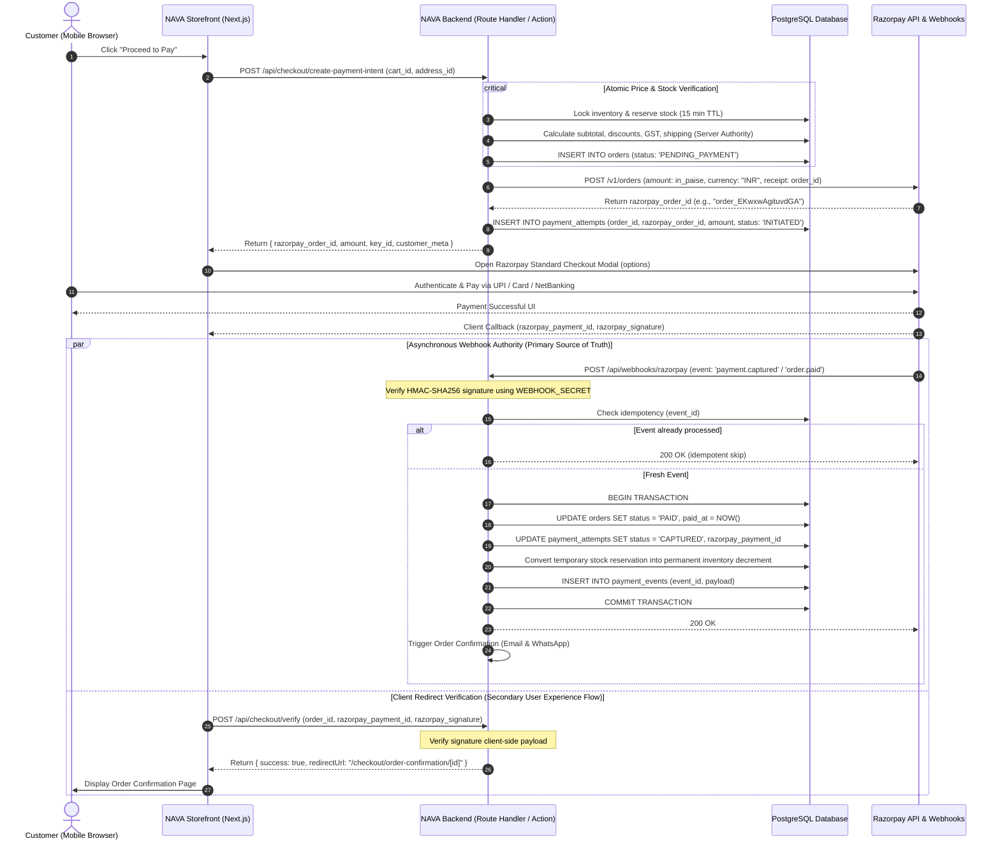
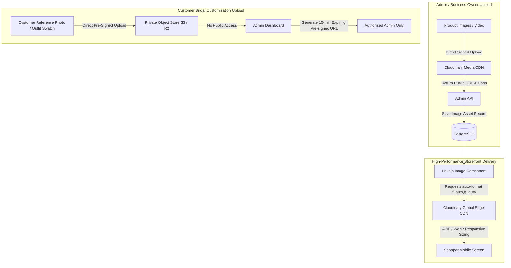
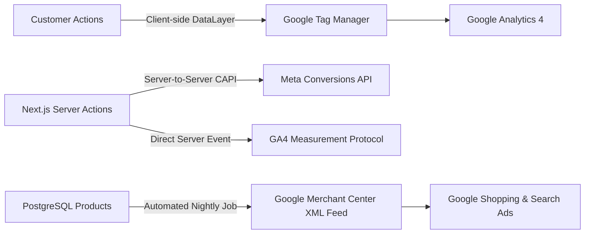

# NAVA CREATIONS — External Integration Plan & API Architecture
## Comprehensive Gateway, Logistics, Messaging, Storage, and Analytics Specifications

> **Document Status:** Complete (Phase 0 Deliverable)  
> **Author:** Principal Software Architect & Senior Full-Stack Engineer  
> **Target Audience:** Development Team, Technical Leads, Integration Partners  
> **Last Updated:** November 2026  
> **Classification:** Internal Technical Architecture

---

## 1. Executive Summary & Integration Principles

NAVA CREATIONS is an artisan-crafted accessories brand based in Bengaluru, transitioning from informal social commerce (Instagram DM and WhatsApp) to an independent, production-grade e-commerce platform. To ensure business agility, high customer conversion, and minimal operational overhead for a solo developer supported by AI tooling, the external integration architecture follows five non-negotiable principles:

1. **Vendor Decoupling via Adapter Pattern:** Domain business logic (e.g., checkout, order state, inventory) must never directly invoke proprietary external SDK methods. All third-party services are mediated through typed interface adapters (`IPaymentGateway`, `IShippingProvider`, `INotificationService`, `IFileStorage`). Replacing or augmenting a provider (e.g., adding Cashfree alongside Razorpay) requires zero changes to core domain logic.
2. **Asynchronous Webhook-Driven Authority:** Client-side redirects and browser states are strictly considered untrusted notifications. State transitions for financial transactions, fulfillment statuses, and inventory decrements occur exclusively upon cryptographically verified server-to-server webhooks or active server-side polling reconciliation.
3. **Strict Idempotency:** Every webhook ingestion and API retry mechanism must be idempotent. Webhook event identifiers and custom idempotent keys (`X-Idempotency-Key`) prevent duplicate order fulfillment, duplicate charges, or double refunds under network retries.
4. **Least-Privilege Secret Management:** API credentials, private signing keys, and webhook secrets are injected strictly via encrypted server environment variables. Public keys (`RAZORPAY_KEY_ID`) are isolated from server-only secrets (`RAZORPAY_KEY_SECRET`, `WEBHOOK_SECRET`). No secret is ever committed to source control or exposed in client bundles.
5. **Graceful Degradation & Fault Tolerance:** If an external service experiences downtime (e.g., shipping aggregator rate API timeout), the application degrades gracefully to deterministic fallback behavior (e.g., standard flat-rate shipping estimation) rather than halting customer checkout.

```mermaid
flowchart TD
    subgraph Client["Customer / Admin Browser"]
        Storefront["Next.js Storefront / Admin"]
    end

    subgraph AppServer["NAVA Next.js App Router (Vercel)"]
        API["Route Handlers & Server Actions"]
        Adapters["Integration Adapters Layer\n(Typed Interfaces)"]
        Worker["Background Queue / Scheduled Jobs"]
    end

    subgraph Database["Primary Data Store (Neon PostgreSQL)"]
        DB[(PostgreSQL 16\nACID Transaction Store)]
        IdempotencyTable[(idempotency_keys &\npayment_events)]
    end

    subgraph External["External Service Ecosystem"]
        Razorpay["Razorpay Gateway\n(UPI, Cards, NetBanking)"]
        Shiprocket["Shiprocket Logistics\n(Multi-courier Aggregator)"]
        Resend["Resend\n(Transactional Email)"]
        WhatsApp["WhatsApp Business Cloud API\n(Transactional Alerts)"]
        Cloudinary["Cloudinary CDN\n(Optimized Images)"]
        PrivateS3["Private Object Store\n(Customer Enquiry Uploads)"]
        GA4["Google Analytics 4 &\nMeta Conversions API"]
    end

    Storefront -->|HTTPS / TLS 1.3| API
    API --> Adapters
    Adapters -->|Prisma ORM| DB
    Adapters -->|Prisma ORM| IdempotencyTable

    Adapters -->|HTTPS REST API| Razorpay
    Adapters -->|HTTPS REST API| Shiprocket
    Adapters -->|HTTPS REST API| Resend
    Adapters -->|HTTPS REST API| WhatsApp
    Adapters -->|Signed Upload API| Cloudinary
    Adapters -->|Pre-signed S3 URL| PrivateS3

    Razorpay -.->|Signed Webhooks (HMAC-SHA256)| API
    Shiprocket -.->|Signed Tracking Webhooks| API
```

---

## 2. Payment Gateway Evaluation & Integration Plan

### 2.1 Gateway Evaluation: Razorpay vs. Cashfree

To provide Indian shoppers with frictionless, trustworthy payment methods (dominant UPI apps like PhonePe, Google Pay, Paytm, CRED, BHIM, alongside RuPay, Visa, Mastercard, and Net Banking), we evaluated the two premier Reserve Bank of India (RBI)-authorized Payment Aggregators (PA): **Razorpay** and **Cashfree**.

| Evaluation Criterion | Razorpay (Official Specification) | Cashfree Payments (Official Specification) | NAVA Project Assessment |
|---|---|---|---|
| **Primary Suitability** | Standard for Indian D2C & Luxury Brands | Strong for high-volume enterprise & marketplace payouts | **Razorpay preferred** for higher brand trust among boutique buyers |
| **Checkout Experience** | Standard Hosted Checkout (modal popup / redirect), zero PCI-DSS customer data exposure | Cashfree Drop Checkout / Hosted Checkout | Both offer clean hosted popups; Razorpay has unmatched UX polish on Indian mobile web |
| **UPI Intent & Auto-Detection** | Full support for UPI Intent, Dynamic QR, and deep-linking on iOS/Android mobile browsers | Full UPI Intent and deep-linking support | Parity; Razorpay demonstrates >95% success rate on Tier-1/Tier-2 mobile devices |
| **Cash on Delivery (COD)** | Razorpay Magic Checkout / standard manual tracking | Cashfree COD verification features | NAVA will implement server-side COD validation with OTP verification |
| **Webhook Security** | HMAC-SHA256 signature verification over raw request payload | HMAC-SHA256 signature verification via secret key | Both meet OWASP ASVS Level 2 standards |
| **Refunds & Instant Payouts** | Normal refund (5-7 working days) & Instant Refund API | Cashgram & Instant Refund APIs | Razorpay Instant Refund available upon account maturation |
| **Developer Ecosystem & SDKs** | World-class TypeScript SDK (`razorpay`), detailed documentation, active Discord | Robust Node SDK (`cashfree-pg`), good documentation | Razorpay documentation and community troubleshooting are superior for solo engineers |
| **Standard Domestic Pricing** | 2.0% + GST per successful domestic transaction (UPI, Debit/Credit, NetBanking) | 1.90% - 2.0% + GST per successful domestic transaction | Pricing is virtually identical; 0.1% difference is negligible at early boutique volumes |
| **Account Onboarding KYC** | Requires registered Indian entity (Proprietorship / LLP / Pvt Ltd), PAN, Bank Account | Similar KYC requirements for Indian entities | **Owner Action Required:** Formal business registration documents must be submitted |

> [!NOTE]
> **Architectural Recommendation:** **Razorpay** is selected as the primary payment gateway for NAVA CREATIONS due to its universal recognition among Indian retail customers, highest mobile UPI completion rates, and turnkey integration simplicity with Next.js. Cashfree remains the vetted secondary fallback adapter should business underwriting or merchant category restrictions dictate an alternative.

---

### 2.2 Razorpay Technical Architecture & Integration Flow

#### 2.2.1 Checkout Mode: Standard Hosted Modal / Redirect
NAVA CREATIONS will implement the **Razorpay Standard Checkout** flow using the server-side Orders API. Under this model:
1. No sensitive card numbers, CVVs, expiry dates, or UPI MPINs ever transit or touch NAVA CREATIONS servers (complete PCI-DSS SAQ-A compliance).
2. The server creates an immutable order intent on Razorpay's infrastructure with the exact server-calculated amount in paise (1 INR = 100 paise).
3. The customer completes payment inside the secure Razorpay iframe/modal.

#### 2.2.2 End-to-End Sequence Diagram



---

### 2.3 Webhook Security & Idempotency Specification

```typescript
// Architectural Reference: /packages/domain/src/security/verifyRazorpaySignature.ts
import crypto from 'node:crypto';

export function verifyRazorpayWebhookSignature(
  rawBody: string,
  signatureHeader: string | null,
  webhookSecret: string
): boolean {
  if (!signatureHeader || !webhookSecret) return false;

  const expectedSignature = crypto
    .createHmac('sha256', webhookSecret)
    .update(rawBody)
    .digest('hex');

  // Constant-time comparison prevents timing attacks (OWASP ASVS 10.3)
  return crypto.timingSafeEqual(
    Buffer.from(expectedSignature, 'utf8'),
    Buffer.from(signatureHeader, 'utf8')
  );
}
```

#### Webhook Events Monitored:
1. `order.paid`: Primary trigger to mark order confirmed and decrement stock.
2. `payment.captured`: Secondary verification confirming fund capture.
3. `payment.failed`: Triggers release of held inventory reservations back to available stock; sends notification to customer with retry link.
4. `refund.processed`: Updates internal order record and credit ledger upon successful refund settlement.

---

### 2.4 Refund & Settlement Lifecycle

- **Automated Reversal:** If payment is captured but inventory reservation failed due to an exceptional race condition, a server-side background job immediately invokes `POST /v1/payments/{payment_id}/refund` with `{ "amount": full_amount, "notes": { "reason": "Inventory allocation race failure" } }`.
- **Admin-Triggered Refunds:** Accessible solely by the `Owner` or `Store Manager` role via the admin dashboard. The internal system requires an audited internal reason and supports partial or full refunds.
- **Settlement & Reconciliation:** Razorpay settles funds on a standard **T+2 banking days** cycle into NAVA's verified Indian current account. A daily reconciliation cron downloads the Razorpay Settlement CSV to reconcile bank credits against captured orders.

---

## 3. Shipping & Logistics Integration Plan

### 3.1 Aggregator Strategy: Shiprocket

For an emerging boutique shipping delicate handmade bangles and accessories across India from Bengaluru, partnering directly with individual couriers (Delhivery, BlueDart, DTDC) is inefficient due to minimum monthly volume thresholds and distinct tracking APIs.

**Shiprocket** is selected as the logistics aggregator for Phase 4-7 launch:
- Single unified REST API integrating 14+ national couriers (Delhivery, Blue Dart, Shadowfax, DTDC, Ekart).
- Automated Courier Recommendation Engine (CORE) selecting the optimal carrier by delivery speed, cost, and reliability score for specific pin codes.
- Integrated Non-Delivery Report (NDR) workflow minimizing Return-to-Origin (RTO) expenses.
- Native automated tracking updates via SMS and WhatsApp.

```mermaid
flowchart LR
    A[Order Marked 'PAID' in Admin] --> B[Shiprocket API: Create Custom Order]
    B --> C[Fetch Serviceable Couriers & Rates]
    C --> D[Generate AWB & Shipping Label]
    D --> E[Print Packing Slip & Affix Label]
    E --> F[Courier Pickup from Bengaluru Atelier]
    F --> G[Real-Time Tracking Webhooks]
    G --> H[Update NAVA Order Tracking DB]
    H --> I[Notify Customer via Email / WhatsApp]
```



---

### 3.2 Key Logistics API Workflows

#### 1. Pincode Serviceability & Delivery Estimate API
- **Endpoint:** `GET https://apiv2.shiprocket.in/v1/external/courier/serviceability/`
- **Trigger:** Invoked on the Product Detail Page (PDP) when a customer enters a 6-digit Indian PIN code, and during checkout.
- **Cache Strategy:** Serviceability per PIN code is cached in Redis / Next.js memory cache with an 8-hour TTL to prevent redundant third-party API latency.
- **Response:** Estimated delivery window (e.g., "Expected in 3-5 business days in Karnataka; 4-7 business days across India") and COD availability.

#### 2. Order Creation & AWB Assignment
- **Endpoint:** `POST https://apiv2.shiprocket.in/v1/external/orders/create/adhoc`
- **Payload:** Exact dimensions (length, breadth, height in cm) and dead weight (approx 150g - 400g for bangles with bubble wrap and rigid protective box), HSN code, order items, and pickup location ID (`BENGALURU_ATELIER`).
- **Label Generation:** Admin can print the official thermal barcode shipping label (AWB) directly from the NAVA Admin dashboard with one click.

#### 3. Real-Time Tracking Ingestion (Webhooks)
Shiprocket pushes status events to `POST /api/webhooks/shiprocket`:
- `AWB_ASSIGNED`
- `PICKED_UP`
- `IN_TRANSIT`
- `OUT_FOR_DELIVERY`
- `DELIVERED`
- `RTO_INITIATED` (Return to Origin)

NAVA's order tracking page (`/track-order?orderId=...&phone=...`) renders real-time milestones based on these updates without exposing internal warehouse notes.

---

## 4. Communication & Messaging Integrations

### 4.1 Transactional Email: Resend

Email provides the formal legal and commercial proof of purchase, tax invoices, and account security notices.

- **Provider:** **Resend** (built by the creators of React Email).
- **Architecture:** Email templates are authored as typed React components (`@react-email/components`), version-controlled in `/packages/ui/src/emails`.
- **Infrastructure:** Domain authentication via DKIM, SPF, and DMARC records on `navacreations.in` to guarantee primary inbox delivery (zero spam landing).

#### Standard Email Notification Matrix:
| Trigger Event | Template Component | Key Information Included |
|---|---|---|
| Order Placed (Prepaid) | `OrderConfirmationEmail.tsx` | Order ID, Itemized breakdown, GST invoice breakdown, Delivery address, Tracking link |
| Order Placed (COD) | `CodConfirmationEmail.tsx` | Order ID, COD payment amount due in cash, Verification link |
| Shipment Dispatched | `ShipmentDispatchedEmail.tsx` | Courier partner, AWB number, Live tracking link, Estimated delivery date |
| Order Delivered | `OrderDeliveredEmail.tsx` | Delivery confirmation, Customer support link, Care instructions for handmade jewellery |
| Custom Bridal Enquiry | `EnquiryReceivedEmail.tsx` | Acknowledgment of custom design request, SLA response time (within 24-48 hours) |
| Quotation Sent | `BridalQuotationEmail.tsx` | Itemized custom quote, Validity period (7 days), One-click approval & payment link |

---

### 4.2 WhatsApp Customer Communication Strategy

In the Indian retail market, WhatsApp is the primary communication medium. NAVA CREATIONS will execute a phased rollout:

#### Phase 1: Click-to-WhatsApp (Zero Cost, Immediate Trust)
- Deep-linked floating WhatsApp buttons on the storefront and product pages.
- Pre-populated contextual text:
  - *PDP:* `"Hi NAVA Creations, I am inquiring about the [Product Name] (SKU: [SKU]) in size [Size]. Is customization possible?"`
  - *Order Confirmation:* `"Hi NAVA Creations, I have placed order #[Order_ID]. Here is my query regarding delivery."`
- Directs to the verified WhatsApp Business mobile app handled by the business owner.

#### Phase 2: Automated WhatsApp Cloud API (Phase 7+)
- Migration to official **WhatsApp Cloud API** (via Meta Business Platform or BSP like Interakt / AiSensy).
- Sends automated, opt-in HSM (Highly Structured Message) transactional templates:
  - Order confirmed notification with thumbnail.
  - Out for delivery alert with delivery agent details.
  - Immediate notification for custom bridal design consultations.
- Full compliance with Indian DPDP Act 2023: explicit customer opt-in checkbox during checkout; opt-out ("Reply STOP") respected immediately.

---

## 5. Media & Asset Storage Architecture

Handmade jewellery and bridal bangles demand rich, high-resolution photography displaying intricate Kundan stone settings, hand-threaded silk work, and gold-finish details. Improper image handling degrades Core Web Vitals (LCP > 4.0s).



### 5.1 Public Assets: Cloudinary Media CDN
- **Use Case:** High-resolution product catalogue photos, collection hero banners, blog imagery.
- **Dynamic Optimization:** Uses automatic format selection (`f_auto` → AVIF/WebP) and automatic quality compression (`q_auto:good`).
- **Responsive Generation:** Automatic `srcset` generation scaling images from 320px (mobile thumbnail) up to 1440px (desktop zoom).
- **Upload Flow:** Client-side direct signed upload using temporary HMAC signature generated by the Next.js server, preventing upload bottlenecks on the Node/Next server runtime.

### 5.2 Private Assets: Customer Bridal Enquiries
- **Use Case:** Customers uploading personal wedding outfit photos, jewellery reference sketches, and heirloom bangle sizing images.
- **Security & Privacy:** Customer uploads **must never be accessible via public CDN URLs**.
- **Implementation:** Uploaded directly to a private Amazon S3 / Cloudflare R2 bucket with `private` ACL. The application server generates temporary pre-signed GET URLs with a strict 15-minute expiration, viewable only by authenticated admin users.
- **MIME & Size Restrictions:** Strictly validated server-side: `.jpg`, `.jpeg`, `.png`, `.webp`, `.heic` only. Maximum file size: 10MB per reference image. Automatic virus and malicious payload screening.

---

## 6. Marketing, SEO & Product Analytics Integrations



### 6.1 Google Analytics 4 (GA4) E-Commerce Tracking
Integrated via Next.js Script component (`@next/third-parties/google`) with strict consent management:
- `view_item_list` (category browsing)
- `view_item` (product detail view with price, category, SKU)
- `add_to_cart` / `remove_from_cart`
- `begin_checkout`
- `add_shipping_info` / `add_payment_info`
- `purchase` (including transaction ID, value in INR, tax, shipping, items array)

### 6.2 Google Merchant Center & Structured Data
- Automated dynamic XML product feed generated at `/api/feeds/google-merchant.xml` updating inventory and prices daily.
- Complies with Indian e-commerce standards: includes `g:price` (INR with GST inclusion), `g:condition` (new), `g:availability` (in stock / out of stock), `g:brand` ("NAVA CREATIONS"), and `g:country_of_origin` ("IN").

---

## 7. Official Source Register & Verification Matrix

| Service / Authority | Documentation Resource URL | Verified Capability | Status / Verification |
|---|---|---|---|
| **Razorpay Payments** | `https://razorpay.com/docs/payments/payment-gateway/web-integration/standard/` | Standard Hosted Checkout, UPI Intent, Webhook verification | Official Documentation Verified |
| **Razorpay Webhooks** | `https://razorpay.com/docs/webhooks/validate-test/` | HMAC-SHA256 signature verification algorithm | Official Documentation Verified |
| **Cashfree Payments** | `https://docs.cashfree.com/docs/javascript-sdk` | Drop Checkout JS SDK & Webhook verification | Official Documentation Verified |
| **Shiprocket API** | `https://apidocs.shiprocket.in/` | Courier serviceability, AWB generation, Tracking webhooks | Official Documentation Verified |
| **Resend Email** | `https://resend.com/docs/introduction` | REST API, Next.js integration, React Email compatibility | Official Documentation Verified |
| **Cloudinary** | `https://cloudinary.com/documentation/image_upload_api_cheat_sheet` | Direct signed uploads, automated AVIF/WebP delivery | Official Documentation Verified |
| **WhatsApp Cloud API** | `https://developers.facebook.com/docs/whatsapp/cloud-api` | Transactional HSM templates, Opt-in requirements | Official Documentation Verified |
| **Google Merchant Center** | `https://support.google.com/merchants/answer/7052112` | Products feed specification for Indian INR currency | Official Documentation Verified |

---

*This integration blueprint establishes the exact architectural interfaces and security models required for Phase 4 through Phase 7 implementations.*
