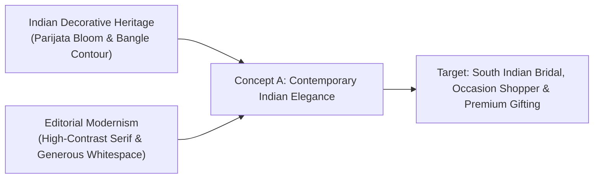

# NAVA CREATIONS — Creative Direction Report: Concept A
## Concept A: Contemporary Indian Elegance ("The Botanical Parijata")

> **Document Status:** Complete (Phase 1 Deliverable)  
> **Prepared by:** Luxury & Lifestyle Identity Designer & Creative Director  
> **Classification:** Creative Proposal Awaiting Business Owner Approval  
> **Asset Location:** [`assets/branding/concept-a/`](../../assets/branding/concept-a/)

---

## 1. Concept Name & Executive Summary
**Direction Name:** *Contemporary Indian Elegance* (Internal Working Title: *"The Botanical Parijata"*)  
**Core Aesthetic:** Refined botanical line-art anchored in South Indian flora, paired with high-contrast editorial serif typography and modern, tracked sans-serif sub-text.

Concept A balances authentic Indian decorative heritage with contemporary minimalist restraint. It draws upon the delicate floral wirework seen in heirloom Karnataka jewellery and the auspicious Parijata (night-blooming jasmine) flower, translating traditional motifs into an unbroken vector line that communicates handcrafted intimacy.



---

## 2. Creative Rationale
- **Cultural Rootedness Without Cliché:** Mass-market Indian accessories brands frequently resort to predictable, heavy motifs: dense mandalas, peacocks with feather gradients, royal crowns, or religious temple iconography. Concept A introduces a clean, singular botanical line-art crest that reads distinctly *Indian* and *auspicious* without religious exclusivity or visual clutter.
- **Handcrafted Narrative:** The continuous stroke of the botanical petals evokes the delicate gold filigree wire and silk-thread loops hand-turned by Bengaluru craftspeople.
- **Aspirational Commercial Tier:** Positions NAVA CREATIONS comfortably in the accessible luxury category—above fast-fashion costume jewellery and local bazaar stalls, yet warm and approachable for online shoppers.

---

## 3. Visual Inspiration
- **Flora of South India:** The *Nyctanthes arbor-tristis* (Parijata/Harsingar)—fabled in Indian classical literature for its sweet fragrance, white petals, and saffron-orange stem. It symbolizes dawn, fresh beginnings (*nava*), and auspicious celebrations.
- **Karnataka Silk Saree Borders:** The subtle geometric vine (*bel*) patterns woven into traditional Mysore and Kanjeevaram silk saree borders.
- **Modern Luxury Editorial Design:** High-end global fashion houses that successfully balance organic floral marks with crisp typographic discipline (e.g., Diptyque, Chopard, Sabyasachi Fine Jewellery).

---

## 4. Logo Design & Structural Geometry
The Concept A visual mark consists of three harmonious layers:
1. **The Botanical Crest:** A five-petal Parijata bloom drawn with an unbroken 2.2pt vector line. In the center sits a double-ring bezel enclosing a miniature gem seed node. A subtle dashed golden orbit floats behind the petals, representing a circular bangle form.
2. **The Primary Wordmark ("NAVA"):** Set in high-contrast editorial serif letterforms with fine hairlines, sculpted serifs, and generous character spacing (tracking 0.12em).
3. **The Sub-Wordmark & Anchor ("CREATIONS • BENGALURU"):** Clean, tracked geometric sans-serif (tracking 0.38em) anchored by a delicate golden horizontal rule with a central Kundan gem bead.

```
       [ Parijata Bloom + Bangle Orbit ]
                      │
                   [ NAVA ]
          ──────────── • ────────────
             [ CREATIONS • BENGALURU ]
```

---

## 5. Master Asset Specifications

All vector assets are exported in clean SVG vector format located in `assets/branding/concept-a/`:

| Asset File | Canonical Path | ViewBox | Intended Context |
|---|---|---|---|
| **Primary Horizontal Logo** | [`logo-horizontal.svg`](../../assets/branding/concept-a/logo-horizontal.svg) | `0 0 640 160` | Desktop website navigation bar, email headers, horizontal invoice banner. |
| **Primary Stacked Logo** | [`logo-stacked.svg`](../../assets/branding/concept-a/logo-stacked.svg) | `0 0 400 360` | Center-aligned storefront header, packaging box sleeve, shipping bag face. |
| **Secondary Circular Seal** | [`logo-secondary.svg`](../../assets/branding/concept-a/logo-secondary.svg) | `0 0 300 300` | Wax seal stickers, tissue paper stamp, hang tags, certificates of authenticity. |
| **Standalone Icon** | [`icon.svg`](../../assets/branding/concept-a/icon.svg) | `0 0 160 160` | Mobile app icon, Instagram profile avatar, social watermark, checkout favicon. |
| **Monochrome Black** | [`logo-monochrome-black.svg`](../../assets/branding/concept-a/logo-monochrome-black.svg) | `0 0 640 160` | Single-color print invoices, thermal courier labels, black-and-white newspaper ads. |
| **Monochrome White / Reversed**| [`logo-monochrome-white.svg`](../../assets/branding/concept-a/logo-monochrome-white.svg) | `0 0 640 160` | Dark plum backgrounds, velvet jewelry pouches, dark website footer. |
| **Single-Color Brand Plum** | [`logo-single-color.svg`](../../assets/branding/concept-a/logo-single-color.svg) | `0 0 640 160` | Screen printing on kraft bags, single-ink stationery printing. |
| **Browser Tab Favicon** | [`favicon.svg`](../../assets/branding/concept-a/favicon.svg) | `0 0 32 32` | 32×32 pixel browser tab icon with enhanced high-contrast petal silhouettes. |

---

## 6. Color System for Concept A

Concept A utilizes a warm, imperial wine and gold palette:

```
┌────────────────────────────────────────────────────────────────────────┐
│ PRIMARY BRAND PLUM: #5C1D38 (Deep Wine / Rich Aubergine)               │
│ • Intended: Primary logo wordmark, primary CTAs, luxury packaging box   │
│ • Contrast on Cream: 8.1:1 (Exceeds WCAG AAA standard)                 │
├────────────────────────────────────────────────────────────────────────┤
│ ANTIQUE GOLD: #C5A059 (Warm Muted Brass / Champagne Gold)              │
│ • Intended: STRICTLY DECORATIVE line art, foil stamp, borders, badges  │
│ • Notice: Fails WCAG AA for body text. Never use for text paragraphs. │
├────────────────────────────────────────────────────────────────────────┤
│ WARM IVORY: #FDFBF7 (Natural Cotton Paper / Cream Surface)             │
│ • Intended: Primary background surface for website, unboxing paper     │
│ • Contrast with Primary Plum: 8.1:1; Contrast with Stone 900: 14.8:1   │
├────────────────────────────────────────────────────────────────────────┤
│ STONE CHARCOAL: #1C1917 (Stone 900 Readable Ink)                       │
│ • Intended: All high-readability body copy, pricing numbers, invoices  │
└────────────────────────────────────────────────────────────────────────┘
```

---

## 7. Typography Hierarchy
- **Display & Headings:** `Cormorant Garamond` (Google Fonts, Open Font License). An aristocratic, historically-grounded serif typeface that captures the delicacy of traditional metalwork.
- **Body, UI & Sub-Headings:** `DM Sans` (Google Fonts, Open Font License). A geometric humanist sans-serif delivering exceptional legibility across low-cost Indian mobile Android devices and high-resolution iPhones.
- **Price & Tabular Data:** `DM Mono` (Google Fonts, Open Font License). Ensures tabular numbers line up evenly on cart drawers, price tags, and GST invoices.

---

## 8. Brand Applications & Real-World Translation

1. **Website Storefront (Desktop & Mobile):**
   - The horizontal lockup sits poised at `44px` height in the sticky header.
   - On mobile screens, the header contracts gracefully to the standalone Parijata icon flanked by clean search and shopping bag icons.
2. **Instagram Avatar & Content Template:**
   - The Parijata bloom centered on a deep plum circular ground (`1080×1080px`) stands out immediately amidst busy competitor profile grids.
   - Editorial post templates pair a thin gold outer hairline with rich macro photos of Kundan bangles resting on raw silk cloth.
3. **Packaging Box & Luxury Unboxing:**
   - Deep wine rigid pull-drawer box featuring **hot-stamped antique gold foil** on textured matte paper.
   - Sliding the ivory velvet drawer reveals the bangles nestled inside an anti-tarnish foam insert.
4. **Thank-You Note & Care Insert:**
   - A6 heavyweight cream laid card with blind debossed borders, welcoming the customer to the *"NAVA family"* with a signed note and a metric bangle sizing verification chart.

---

## 9. Critical Assessment: Strengths, Trade-Offs & Scalability

### Strengths
- **Unrivalled Bridal Resonance:** The combination of Parijata flowers, deep plum, and antique gold triggers immediate cultural associations with South Indian wedding muhurthams, Kanjeevaram sarees, and festive joy.
- **High Memorability:** The Parijata flower is distinct from generic lotus or peacock marks used by competitors like Kushal’s or local commercial jewelers.
- **Physical Print Elegance:** Vector geometry is impeccably suited for hot-foil stamping, blind debossing, and metal jewelry tags.

### Trade-Offs & Risks
- **Floral Category Congestion:** While the Parijata execution is refined, floral motifs are prevalent in Indian jewellery branding; exceptional photography is required to maintain its high-fashion edge.
- **Fine Hairline Rendering:** The 2.2pt line art in the botanical mark requires careful SVG rasterization when scaled below 24px in browser UI (mitigated by the custom-crafted `favicon.svg` which optimizes geometry for 32px display).

### Category Expansion Scalability
- **Score: 9/10.** Because the mark is botanical rather than an overt representation of a bangle, NAVA CREATIONS can easily expand into hair accessories, bridal waist belts (*oddiyanam*), earrings, and home festive decor without rebranding.

---

*Direction Concept A is fully prepared for business owner evaluation.*
