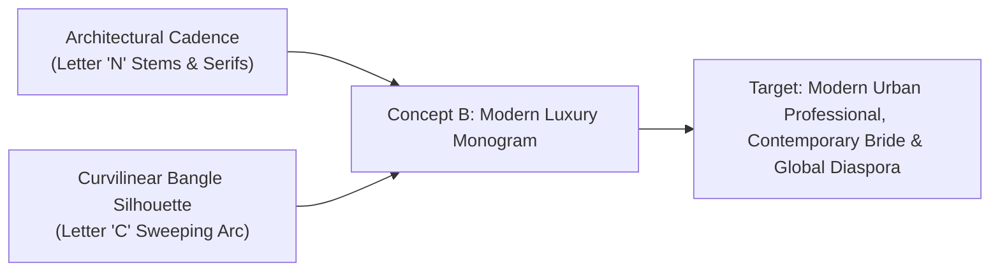

# NAVA CREATIONS — Creative Direction Report: Concept B
## Concept B: Modern Luxury Monogram ("The Bangle Monogram")

> **Document Status:** Complete (Phase 1 Deliverable)  
> **Prepared by:** Luxury & Lifestyle Identity Designer & Creative Director  
> **Classification:** Creative Proposal Awaiting Business Owner Approval  
> **Asset Location:** [`assets/branding/concept-b/`](../../assets/branding/concept-b/)

---

## 1. Concept Name & Executive Summary
**Direction Name:** *Modern Luxury Monogram* (Internal Working Title: *"The Architectural NC Bangle"*)  
**Core Aesthetic:** Geometric interlocking monogram of letters 'N' and 'C', subtly forming a circular bangle silhouette with metallic finials, paired with clean international luxury serif typography.

Concept B positions NAVA CREATIONS as a contemporary, design-forward luxury accessories house. It draws inspiration from international luxury monograms (Cartier, Celine, Chaumet) while subtly encoding the architectural geometry of an open Indian metal kada (bangle) within the negative space of the letters.



---

## 2. Creative Rationale
- **Subtle Cultural Intelligence:** Rather than overt ethnic ornamentation, Concept B incorporates Indian heritage through structural subtlety. The sweeping arc of the letter 'C' embraces the vertical uprights of the 'N' in the exact silhouette of an open-hinged Indian bangle with ball finials.
- **Superior Small-Scale Legibility:** Monograms possess unmatched visual punch. At a 32px browser favicon scale or a 40px mobile header, Concept B retains 100% clarity where intricate line drawings degrade.
- **International Appeal & Future Category Elasticity:** By stepping away from floral or regional motifs, this direction allows NAVA to project global luxury appeal, making it equally compelling for urban Bengaluru buyers and international diaspora bridal shoppers in the US, UK, and Singapore.

---

## 3. Visual Inspiration
- **The Geometry of Indian Kadas:** The open-ended heavy gold kadas of Karnataka and Rajasthan, terminated by spherical metallic finials.
- **Mid-Century Architectural Type Design:** The proportions of geometric serifs (Tenor Sans, Didot) with vertical stress and hair-fine bracketed serifs.
- **Modern Luxury Monogrammatic Heritage:** The enduring marks of fine European and Asian luxury jewelers that distill complex craftsmanship into an iconic, memorable cipher.

---

## 4. Logo Design & Structural Geometry
The Concept B mark is constructed on a rigorous square grid (1:1 aspect ratio):
1. **The 'N' Uprights (Royal Emerald):** Two parallel vertical pillars (stroke weight 3.5pt) anchored by classical bracketed serifs at top and bottom. A dynamic diagonal stroke connects the stems.
2. **The 'C' Bangle Arc (Champagne Gold):** An open circular stroke that swings around the 'N', passing through the central intersection. A subtle stroke break with a central clearing mask creates the optical illusion of interlaced metal wires.
3. **The Wordmark ("NAVA CREATIONS"):** Set in `Tenor Sans`, an open, sculpture-like serif with generous kerning and uppercase dignity, balanced by a fine gold geometric hairline.

```
            ╭───────────╮
            │   N   C   │  ← Interlocking Monogram
            ╰───────────╯
                  │
              [ NAVA ]
          ─────── ◆ ───────
        [ CREATIONS • BENGALURU ]
```

---

## 5. Master Asset Specifications

All vector assets are exported in clean SVG vector format located in `assets/branding/concept-b/`:

| Asset File | Canonical Path | ViewBox | Intended Context |
|---|---|---|---|
| **Primary Horizontal Logo** | [`logo-horizontal.svg`](../../assets/branding/concept-b/logo-horizontal.svg) | `0 0 640 160` | Desktop navigation bar, email confirmation headers, digital receipts. |
| **Primary Stacked Logo** | [`logo-stacked.svg`](../../assets/branding/concept-b/logo-stacked.svg) | `0 0 400 360` | Center-aligned storefront header, packaging sleeve, garment hang tag. |
| **Secondary Circular Seal** | [`logo-secondary.svg`](../../assets/branding/concept-b/logo-secondary.svg) | `0 0 300 300` | Embossed wax seals on bridal boxes, circular sticker tags, tissue seal. |
| **Standalone Icon** | [`icon.svg`](../../assets/branding/concept-b/icon.svg) | `0 0 160 160` | Mobile app icon, Instagram profile avatar, social watermark, checkout favicon. |
| **Monochrome Black** | [`logo-monochrome-black.svg`](../../assets/branding/concept-b/logo-monochrome-black.svg) | `0 0 640 160` | Single-color print invoices, thermal courier labels, black-and-white print. |
| **Monochrome White / Reversed**| [`logo-monochrome-white.svg`](../../assets/branding/concept-b/logo-monochrome-white.svg) | `0 0 640 160` | Emerald green jewelry boxes, dark website footer, black velvet packaging. |
| **Single-Color Emerald** | [`logo-single-color.svg`](../../assets/branding/concept-b/logo-single-color.svg) | `0 0 640 160` | Single-ink stationery printing, custom ribbons, screen printing. |
| **Browser Tab Favicon** | [`favicon.svg`](../../assets/branding/concept-b/favicon.svg) | `0 0 32 32` | 32×32 pixel browser tab icon featuring bold, high-contrast NC letterforms. |

---

## 6. Color System for Concept B

Concept B introduces an aristocratic, high-fashion emerald and champagne gold palette:

```
┌────────────────────────────────────────────────────────────────────────┐
│ ROYAL EMERALD: #173E2E (Deep Forest / Imperial Panna Green)           │
│ • Intended: Primary monogram stems, luxury packaging boxes, badges     │
│ • Cultural Reference: Traditional Panna/Emerald stones in bridal sets  │
│ • Contrast on Alabaster: 9.8:1 (Exceeds WCAG AAA standard)             │
├────────────────────────────────────────────────────────────────────────┤
│ CHAMPAGNE GOLD: #D4AF37 (Pale Polished Gold / Warm Brass)              │
│ • Intended: STRICTLY DECORATIVE monogram 'C' loop, fine rules, foil    │
│ • Contrast Note: Decorative only; never utilized for body text        │
├────────────────────────────────────────────────────────────────────────┤
│ ALABASTER SURFACE: #F8F8F6 (Cool Neutral Bone / Mineral White)         │
│ • Intended: Primary canvas, clean card surfaces, product backgrounds   │
│ • Contrast with Stone Charcoal: 15.6:1 (WCAG AAA)                      │
├────────────────────────────────────────────────────────────────────────┤
│ STONE INK: #1A1A1A (Near Black / High-Definition Type)                 │
│ • Intended: All high-readability body copy, technical specs, invoices  │
└────────────────────────────────────────────────────────────────────────┘
```

---

## 7. Typography Hierarchy
- **Display & Headings:** `Tenor Sans` paired with `Playfair Display` (Google Fonts, Open Font License). An exceptionally balanced, sculptured serif that conveys modern editorial poise.
- **Body, UI & Navigation:** `Jost` / `Inter` (Google Fonts, Open Font License). Clean, geometric sans-serif delivering razor-sharp rendering on modern mobile displays.
- **Price & Numbers:** `DM Mono` (Google Fonts, Open Font License). Maintains numeric alignment across cart tables and checkout totals.

---

## 8. Brand Applications & Real-World Translation

1. **Website Storefront (Desktop & Mobile):**
   - The NC monogram serves as an indelible architectural anchor in the website header.
   - On mobile screens, the monogram scales down effortlessly without loss of detail.
2. **Instagram Avatar & Social Presentation:**
   - In a social feed crowded with busy, floral Indian jewellery pages, the crisp emerald-and-gold NC monogram immediately signals high-end curation.
3. **Packaging Box & Physical Merchandise:**
   - Rigid emerald green drawer box with embossed champagne gold foil NC monogram.
   - Works brilliantly as a custom brass metal clasp or charm tag attached to high-end bridal chuda sets.
4. **Jewellery Hang Tag & Swing Label:**
   - Clean rectangular tag with beveled corners, black/gold typography, and the embossed NC monogram.

---

## 9. Critical Assessment: Strengths, Trade-Offs & Scalability

### Strengths
- **Unrivalled Scalability & Versatility:** Works flawlessly at 16px, 32px, 1200px, in print, in metal casting, and on fabric ribbons.
- **Highest Differentiation from Mass Market:** Distinctive from 95% of domestic Indian accessories brands that default to ornate botanical or religious marks.
- **Sovereign Luxury Perception:** Carries the weight and poise of a standalone design house.

### Trade-Offs & Risks
- **Lower Immediate "Ethnic Indian" Cue:** Some traditional customers seeking an explicitly bridal or temple-jewelry aesthetic may initially perceive the mark as too international or modern.
- **Requires Brand Storytelling:** The subtle "bangle" curvature in the letter 'C' is a hidden delight that must be reinforced through product photography and editorial copy.

### Category Expansion Scalability
- **Score: 10/10.** Outstanding long-term elasticity. A pure monogram mark places zero conceptual barriers on expanding into watches, handbags, hair adornments, scarves, or fine jewellery.

---

*Direction Concept B is fully prepared for business owner evaluation.*
