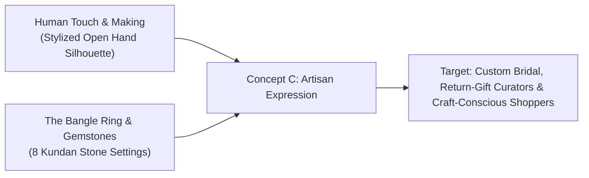

# NAVA CREATIONS — Creative Direction Report: Concept C
## Concept C: Artisan Expression ("The Maker's Touch")

> **Document Status:** Complete (Phase 1 Deliverable)  
> **Prepared by:** Luxury & Lifestyle Identity Designer & Creative Director  
> **Classification:** Creative Proposal Awaiting Business Owner Approval  
> **Asset Location:** [`assets/branding/concept-c/`](../../assets/branding/concept-c/)

---

## 1. Concept Name & Executive Summary
**Direction Name:** *Artisan Expression* (Internal Working Title: *"The Maker's Touch"*)  
**Core Aesthetic:** Organic, human-centered silhouette of an artisan hand cupping and presenting an open golden bangle ring, paired with a warm classical serif wordmark and handwritten italic descriptor.

Concept C emphasizes the emotional humanity, craftsmanship, and ceremonial ritual of Indian accessories. It highlights the hands that turn the silk thread and set the Kundan stones, as well as the intimate cultural gesture of sliding bangles onto a bride’s wrist or presenting return gifts to loved ones.



---

## 2. Creative Rationale
- **The Power of the Maker Narrative:** In an era of anonymous, drop-shipped costume jewellery, highlighting the human touch is the ultimate commercial differentiator. Concept C directly reflects the handmade nature of NAVA’s core catalog.
- **The Ritual of Gifting and Ceremony:** The open palm gesture echoes the traditional South Indian *dana* (generous gifting) and the ceremonial moment when mother, sisters, and friends adorn the bride’s wrists during the *Valaikappu* or *Bangle Ceremony*.
- **Warmth and Intimacy:** While Concepts A and B lean toward refined luxury and architectural modernism, Concept C communicates warmth, community, and personal accessibility.

---

## 3. Visual Inspiration
- **Hasta Mudras of Indian Classical Iconography:** The open, offering palm (*Varada Mudra* and *Pataka Hasta*)—representing auspicious grace, blessing, and welcome without sectarian religious dogma.
- **The Workshop of the Bengaluru Bangle Maker:** The physical posture of an artisan holding an unfinished metal kada in the palm while wrapping raw silk thread or applying lac adhesive.
- **Terracotta & Natural Indian Earth Tones:** The baked clay of South Indian pottery, natural unbleached cotton (*kora* cloth), and the warm amber sheen of vintage brass bangles.

---

## 4. Logo Design & Structural Geometry
The Concept C visual mark is composed of:
1. **The Hand & Bangle Emblem:** An organic, stylized hand silhouette drawn with a continuous 2.5pt stroke. Floating within the palm is a perfect circular bangle in amber gold, adorned with 8 cardinal Kundan stone settings.
2. **The Primary Wordmark ("NAVA"):** Rendered in `Cinzel` / `Playfair Display` with classical Roman capitals, dignified proportions, and subtle calligraphic flare.
3. **The Descriptor ("CREATIONS • HANDCRAFTED"):** Set in warm, personal italic serif typography, supported by an organic hand-drawn divider rule with a central terracotta gem node.

```
       [ Stylized Hand Cupping Kundan Bangle ]
                         │
                      [ NAVA ]
             ──────────── • ────────────
           [ CREATIONS • HANDCRAFTED ]
```

---

## 5. Master Asset Specifications

All vector assets are exported in clean SVG vector format located in `assets/branding/concept-c/`:

| Asset File | Canonical Path | ViewBox | Intended Context |
|---|---|---|---|
| **Primary Horizontal Logo** | [`logo-horizontal.svg`](../../assets/branding/concept-c/logo-horizontal.svg) | `0 0 640 160` | Desktop navigation bar, email confirmation headers, digital receipts. |
| **Primary Stacked Logo** | [`logo-stacked.svg`](../../assets/branding/concept-c/logo-stacked.svg) | `0 0 400 360` | Center-aligned storefront header, packaging box sleeve, shipping bag face. |
| **Secondary Circular Seal** | [`logo-secondary.svg`](../../assets/branding/concept-c/logo-secondary.svg) | `0 0 300 300` | Rubber stamps on unbleached kraft paper bags, sealing tape, authenticity certificate. |
| **Standalone Icon** | [`icon.svg`](../../assets/branding/concept-c/icon.svg) | `0 0 160 160` | Mobile app icon, Instagram profile avatar, social watermark, checkout favicon. |
| **Monochrome Black** | [`logo-monochrome-black.svg`](../../assets/branding/concept-c/logo-monochrome-black.svg) | `0 0 640 160` | Single-color print invoices, thermal courier labels, black-and-white print. |
| **Monochrome White / Reversed**| [`logo-monochrome-white.svg`](../../assets/branding/concept-c/logo-monochrome-white.svg) | `0 0 640 160` | Terracotta packaging boxes, dark website footer, cloth dust bags. |
| **Single-Color Terracotta** | [`logo-single-color.svg`](../../assets/branding/concept-c/logo-single-color.svg) | `0 0 640 160` | Single-ink stationery printing, custom ribbons, screen printing. |
| **Browser Tab Favicon** | [`favicon.svg`](../../assets/branding/concept-c/favicon.svg) | `0 0 32 32` | 32×32 pixel browser tab icon featuring the high-contrast circular bangle with 4 cardinal Kundan stones. |

---

## 6. Color System for Concept C

Concept C embraces a tactile, artisanal terracotta and amber gold palette:

```
┌────────────────────────────────────────────────────────────────────────┐
│ WARM TERRACOTTA: #9E4733 (Baked Earth / Raw Brick Rust)                │
│ • Intended: Primary hand icon strokes, artisan badges, packaging kraft │
│ • Contrast on Linen: 5.6:1 (Meets WCAG AA standard)                    │
├────────────────────────────────────────────────────────────────────────┤
│ AMBER GOLD: #D89D40 (Warm Saffron Gold / Antique Brass)                │
│ • Intended: STRICTLY DECORATIVE bangle ring, stone nodes, divider      │
│ • Contrast Note: Decorative only; never utilized for body text        │
├────────────────────────────────────────────────────────────────────────┤
│ UNBLEACHED LINEN: #F4EFEB (Kora Cotton / Raw Handloom Surface)         │
│ • Intended: Primary canvas, card backgrounds, unboxing paper           │
│ • Contrast with Deep Umber: 14.2:1 (WCAG AAA)                          │
├────────────────────────────────────────────────────────────────────────┤
│ DEEP UMBER INK: #2E1B15 (Deep Roasted Coffee / High-Definition Type)   │
│ • Intended: All high-readability body copy, technical specs, invoices  │
└────────────────────────────────────────────────────────────────────────┘
```

---

## 7. Typography Hierarchy
- **Display & Headings:** `Cinzel` paired with `Playfair Display` (Google Fonts, Open Font License). Majestic classical letterforms with open proportions and hand-carved stone elegance.
- **Descriptors & Storytelling:** `Playfair Display Italic`. Conveys the intimacy of a handwritten note from the maker.
- **Body & UI:** `DM Sans` (Google Fonts, Open Font License). Maintains clean, modern reading performance on mobile screens.

---

## 8. Brand Applications & Real-World Translation

1. **Website Storefront (Desktop & Mobile):**
   - Imbues the digital storefront with a warm, boutique, workshop ambiance.
   - Highlights the bespoke custom bridal inquiry form, reinforcing that every piece is crafted to individual order.
2. **Physical Rubber Stamp on Kraft Paper Bags:**
   - Concept C is uniquely suited to physical rubber stamps inked in deep umber or terracotta, stamped directly onto unbleached recycled kraft shopping bags and boxes.
3. **Packaging Box & Unboxing Experience:**
   - Natural linen-wrapped hardboard box with terracotta screen-printed logo and warm amber satin ribbon pull.
4. **Artisan Care Companion Card:**
   - Detailed care guide printed on textured laid cardstock explaining how silk threads and Kundan settings are preserved over time.

---

## 9. Critical Assessment: Strengths, Trade-Offs & Scalability

### Strengths
- **Unrivalled Human Warmth & Gifting Story:** Encodes the emotion of giving and making into the visual mark itself.
- **Incredible Offline Brand Charm:** Translates exceptionally well to rustic, artisanal physical packaging (kraft paper, rubber stamps, wax seals, linen bags).
- **High Emotional Trust:** Immediately dispels the fear of cold, dropshipped, or mass-produced e-commerce merchandise.

### Trade-Offs & Risks
- **Complexity at Small Screen Scales:** The hand silhouette is detailed; at 16px to 32px, the fingers can become muddy (mitigated by `favicon.svg` which isolates the bold bangle and 4 cardinal jewel nodes).
- **Perception of "Folk / Rustic":** If not paired with disciplined editorial typography, an artisan hand mark can sometimes be misconstrued as low-priced handicraft rather than luxury couture.

### Category Expansion Scalability
- **Score: 7.5/10.** Because the mark explicitly incorporates a hand and bangle silhouette, expanding into home decor or non-wearable lifestyle categories may dilute the metaphor over time.

---

*Direction Concept C is fully prepared for business owner evaluation.*
