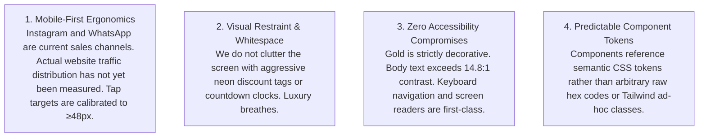

# NAVA CREATIONS — Digital Product Design System Specification
## Component Architecture, Token Registry, and Accessible Storefront Blueprint

> **Document Status:** Proposed specification; pending implementation and validation.  
> **Brand:** NAVA CREATIONS  
> **Platform Target:** Next.js 15 App Router, React 19, Tailwind CSS v4, shadcn/ui  
> **Accessibility Target:** WCAG 2.2 Level AA; implementation and conformance have not yet been tested.  
> **Version:** 1.0.0

---

## 1. Design System Philosophy & Core Principles

The NAVA CREATIONS design system bridges the gap between luxury Indian artisanal jewelry aesthetics and high-performance, mobile-first e-commerce conversion rates.



---

## 2. Token Registry & Variable Mapping

All tokens are defined as CSS Custom Properties in [`assets/branding/exports/tokens.css`](../../assets/branding/exports/tokens.css) and structured JSON in [`assets/branding/exports/tokens.json`](../../assets/branding/exports/tokens.json).

### 2.1 Selected Colour-Pair Contrast Calculations (Not a Complete WCAG Audit)

| UI Element Pairing | Background Color | Foreground Color | Calculated Contrast | WCAG 2.2 AA Status | Usage Permission |
|---|---|---|---|---|---|
| **Body Paragraph on Canvas** | Cream (`#FDFBF7`) | Stone 900 (`#1C1917`) | **16.92:1** | **PASS (AAA)** | Primary running text, descriptions |
| **Secondary Copy on Canvas** | Cream (`#FDFBF7`) | Stone 600 (`#57534E`) | **7.38:1** | **PASS (AAA)** | Metadata, subheadings, SKU |
| **Muted Captions on Canvas** | Cream (`#FDFBF7`) | Stone 500 (`#78716C`) | **4.64:1** | **PASS (AA)** | Captions, helper text (12px min) |
| **Primary Button** | Plum (`#5C1D38`) | Cream Text (`#FDFBF7`)| **12.04:1** | **PASS (AAA)** | Primary action button labels |
| **Success Badge** | Forest Green (`#15803D`) | White (`#FFFFFF`) | **5.02:1** | **PASS (AA)** | In-stock, confirmed orders |
| **Error Message** | Soft Red Tint (`#FEF2F2`) | Red 700 (`#B91C1C`) | **5.91:1** | **PASS (AA)** | Form validation alert text |
| **Antique Gold on Cream** | Cream (`#FDFBF7`) | Antique Gold (`#C5A059`)| **2.38:1** | ❌ **FAIL (<4.5:1)**| **PROHIBITED FOR TEXT**. Decorative only |
| **Antique Gold Foil on Plum**| Plum (`#5C1D38`) | Antique Gold (`#C5A059`)| **5.06:1** | **PASS (AA)** | Large borders, foil logos, icons (≥4.5:1) |

---

## 3. Layout Grid & Responsive Breakpoints

The layout uses a 12-column desktop grid scaling to a fluid 4-column mobile grid:

```
┌────────────────────────────────────────────────────────────────────────┐
│ BREAKPOINT TABLE                                                       │
├────────────┬─────────────┬──────────┬─────────┬────────┬───────────────┤
│ Breakpoint │ Device View │ Min-Width│ Columns │ Gutter │ Screen Margin │
├────────────┼─────────────┼──────────┼─────────┼────────┼───────────────┤
│ xs         │ Mobile S    │ 360px    │ 4       │ 12px   │ 16px          │
│ sm         │ Mobile L    │ 480px    │ 4       │ 16px   │ 20px          │
│ md         │ Tablet      │ 768px    │ 8       │ 24px   │ 32px          │
│ lg         │ Laptop      │ 1024px   │ 12      │ 24px   │ 48px          │
│ xl         │ Desktop     │ 1280px   │ 12      │ 32px   │ 64px          │
│ 2xl        │ Wide Screen │ 1440px   │ 12      │ 32px   │ Max 1200px ctr│
└────────────┴─────────────┴──────────┴─────────┴────────┴───────────────┘
```

> [!NOTE]
> **Mobile Product Feed Layout:** On viewports `< 768px`, product listings display as single-column full-bleed cards (or clean 2-column compact cards on screens ≥ 400px), avoiding cramped text wrapping and thumbnail distortion.

---

## 4. Component Design Specifications

### 4.1 Buttons & Action Controls

```
1. PRIMARY FILLED BUTTON (CTA)
   ┌────────────────────────────────────────────────────────┐
   │                  ADD TO SHOPPING BAG                   │
   └────────────────────────────────────────────────────────┘
   • Height: 48px (Desktop) / 52px (Mobile tap target)
   • Background: var(--color-primary-plum) #5C1D38
   • Hover: var(--color-primary-plum-hover) #48162C (Darkens 15%)
   • Label: DM Sans 600 SemiBold, 14px, letter-spacing: 0.08em, Uppercase
   • Text Color: #FDFBF7 (Contrast 12.04:1)
   • Border Radius: var(--radius-md) 8px
   • Focus Ring: 3px solid var(--color-accent-gold) #C5A059 with 2px offset

2. SECONDARY OUTLINED BUTTON
   ┌────────────────────────────────────────────────────────┐
   │                  VIEW SIZING GUIDE                     │
   └────────────────────────────────────────────────────────┘
   • Height: 48px (Desktop) / 52px (Mobile)
   • Background: Transparent
   • Border: 1.5px solid var(--color-primary-plum) #5C1D38
   • Text Color: var(--color-primary-plum) #5C1D38
   • Hover: Background #FAF4F7 (Light plum tint)

3. GHOST / TEXT LINK BUTTON
   Explore Collection ───→
   • Padding: 8px 0
   • Text: var(--color-primary-plum) #5C1D38
   • Underline: 1px solid var(--color-accent-gold) on hover
```

---

### 4.2 Form Controls & Inputs

```
   ┌────────────────────────────────────────────────────────┐
   │ Shipping Pincode *                                     │
   │ 560038                                         [ CHECK]│
   └────────────────────────────────────────────────────────┘
   • Height: 52px (Ergonomic mobile touch target)
   • Background: var(--color-surface-cream) #FDFBF7
   • Border: 1px solid var(--color-border-subtle) #E7E5E4
   • Border Radius: var(--radius-md) 8px
   • Typography: DM Sans 400 Regular, 15px
   • Focus State: Border 2px solid var(--color-primary-plum), background #FFFFFF
   • Error State: Border 2px solid var(--color-status-error) #B91C1C, helper text below
```

---

### 4.3 High-Conversion Product Card

```
   ┌────────────────────────────────────────────────────────┐
   │ [BRIDAL EDIT]                                    [ ♡ ] │
   │                                                        │
   │                [ 4:5 IMAGE SHOWCASE ]                  │
   │               Bangles on Silk Cushion                  │
   │                                                        │
   ├────────────────────────────────────────────────────────┤
   │ Aadya Kundan Silk Bangle Set                           │
   │ Ruby Silk Thread • Hand-set Kundan Stones              │
   │                                                        │
   │ ₹1,849   ₹2,299   (20% OFF)                            │
   │                                                        │
   │ SIZE:  [ 2.4 ]  [ 2.6 ]  [ 2.8 ]  [ 2.10 ]             │
   │                                                        │
   │ ┌────────────────────────────────────────────────────┐ │
   │ │                   + ADD TO CART                    │ │
   │ └────────────────────────────────────────────────────┘ │
   └────────────────────────────────────────────────────────┘
```

- **Image Aspect Ratio:** Strictly locked to **`4:5` portrait ratio** (e.g., `800 × 1000px`). Bangles rest on wrist, silk fabric, or ivory trays.
- **Size Selector on Card:** Allows instant size choice (2.2, 2.4, 2.6, 2.8, 2.10) directly on the product card without navigating away from the category feed.
- **Price Transparency:** Displays statutory GST-inclusive retail pricing (`₹1,849`) in tabular `DM Mono` numerals.

---

### 4.4 Sizing Guide Interactive Modal

```
   ┌────────────────────────────────────────────────────────┐
   │ 📏 BANGLE SIZING GUIDE (INNER DIAMETER)            [✕] │
   ├────────────────────────────────────────────────────────┤
   │ Method 1: Measure An Existing Bangle                   │
   │ Place your best-fitting bangle on a flat ruler and     │
   │ measure the inside distance in millimeters:            │
   │                                                        │
   │  Size 2.2  ──  54.0 mm                                 │
   │  Size 2.4  ──  57.2 mm  (Small / Narrow Wrist)         │
   │  Size 2.6  ──  60.3 mm  (Medium / Most Common in India)│
   │  Size 2.8  ──  63.5 mm  (Large)                        │
   │  Size 2.10 ──  66.7 mm  (Extra Large)                  │
   │                                                        │
   │ [ Need help? Send your wrist photo to WhatsApp Stylist ]│
   └────────────────────────────────────────────────────────┘
```

---

## 5. Motion, Transitions & Micro-Interactions

```css
/* Motion Definitions */
:root {
  --transition-fast: 150ms cubic-bezier(0.4, 0, 0.2, 1);
  --transition-normal: 250ms cubic-bezier(0.4, 0, 0.2, 1);
  --transition-slow: 400ms cubic-bezier(0.4, 0, 0.2, 1);
}

/* Reduced Motion Override (Mandatory Accessibility Rule) */
@media (prefers-reduced-motion: reduce) {
  *, ::before, ::after {
    animation-duration: 0.01ms !important;
    animation-iteration-count: 1 !important;
    transition-duration: 0.01ms !important;
    scroll-behavior: auto !important;
  }
}
```

- **Hover States on Product Cards:** Smooth image zoom (`scale: 1.03`) with subtle elevation shadow over `250ms`.
- **Cart Slide-Over Drawer:** Enters smoothly from the right margin over `300ms` with background backdrop blur (`backdrop-filter: blur(4px)`).
- **Reduced Motion:** When users enable OS-level reduced motion, all animations are immediately bypassed.

---

## 6. Accessibility & Assistive Tech Requirements

1. **Semantic HTML5:** All landmarks (`<header>`, `<nav>`, `<main>`, `<section>`, `<footer>`) must be used strictly in place of generic `<div>` tags.
2. **Keyboard Traps Eliminated:** Modals and slide-over cart drawers trap keyboard focus while open and restore focus to the triggering element upon pressing `Escape`.
3. **Screen Reader Live Regions:** Dynamic cart updates and size selection changes utilize `aria-live="polite"` to announce: *"Size 2.6 selected, price updated to ₹1,849."*
4. **Form Labels:** Every input has an explicitly associated `<label for="...">`. Placeholder text is never used as the sole identifier for a form input.

---

*This specification governs the UI component library and styling implementation for Phase 3 and Phase 4.*
