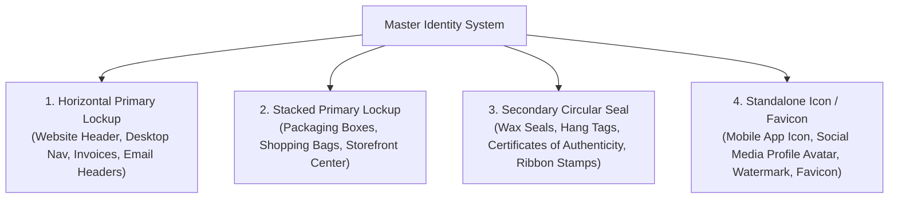

# NAVA CREATIONS — Master Logo Usage & Reproduction Guidelines
## Technical Rules for Print, Digital, Packaging, and Architectural Applications

> **Document Status:** Complete (Phase 1 Deliverable)  
> **Brand:** NAVA CREATIONS  
> **Location:** Bengaluru, Karnataka, India  
> **Classification:** Technical Brand Standards Manual

---

## 1. Overview & Authorized Logo Hierarchy

The NAVA CREATIONS visual identity is an integrated system consisting of four authorized lockups. Each version has been engineered for specific spatial and technical constraints:



---

## 2. Clear Space & Isolation Boundary

The logo must always be isolated from surrounding text, borders, images, and photographic edges by an inviolable boundary:

```
        ┌────────────────────────────────────────────────────────────┐
        │                       CLEAR SPACE [X]                      │
        │     ┌────────────────────────────────────────────────┐     │
        │ [X] │  [ICON]    N A V A                             │ [X] │
        │     │            CREATIONS • BENGALURU               │     │
        │     └────────────────────────────────────────────────┘     │
        │                       CLEAR SPACE [X]                      │
        └────────────────────────────────────────────────────────────┘
        Where [X] = The exact Cap-Height of the letter 'N' in NAVA
```

- **Rule:** Never allow any UI button, headline, packaging fold, or photo edge to encroach into zone `[X]`.
- **Minimum Value:** On digital screens, zone `[X]` must measure at least **16 pixels** on mobile and **24 pixels** on desktop.

---

## 3. Minimum Reproduction Sizes

To ensure that letterforms do not collapse and vector line art remains pristine:

| Format / Asset | Minimum Digital Size | Minimum Physical Print Size |
|---|---|---|
| **Horizontal Primary Logo** | `140px width` (Height ~`35px`) | `38 mm width` |
| **Stacked Primary Logo** | `90px width` (Height ~`80px`) | `25 mm width` |
| **Circular Secondary Seal** | `60px diameter` | `18 mm diameter` |
| **Standalone Icon** | `32px × 32px` (`favicon.svg`) | `10 mm × 10 mm` |

> [!CAUTION]
> **Sub-pixel Warning:** Never render the full horizontal lockup below `140px width`. On mobile headers where space is under `140px`, switch immediately to the **Standalone Icon** (`icon.svg`).

---

## 4. Approved Colorways & Background Pairings

```
┌────────────────────────────────────────────────────────────────────────┐
│ 1. PRIMARY COLORWAY (On Light Surfaces)                                │
│ • Wordmark & Icon Stem: Deep Plum (#5C1D38)                            │
│ • Accent Line & Petals: Antique Gold (#C5A059)                         │
│ • Background: Warm Ivory (#FDFBF7) or Pure White (#FFFFFF)             │
│ • Permitted: Official website, stationery, shipping boxes, invoices    │
├────────────────────────────────────────────────────────────────────────┤
│ 2. REVERSED MONOCHROME (On Dark Surfaces)                              │
│ • Complete Lockup: Warm Ivory (#FDFBF7) or Pure White (#FFFFFF)        │
│ • Background: Deep Plum (#5C1D38) or Rich Charcoal (#1C1917)           │
│ • Permitted: Luxury packaging box sleeve, dark footer, velvet pouch    │
├────────────────────────────────────────────────────────────────────────┤
│ 3. METALLIC FOIL STAMPING (Luxury Physical Applications)               │
│ • Complete Lockup: Hot-Stamped Antique Gold Foil (Curtain Gold / Matte)│
│ • Background: Deep Plum Wibalin paper or Heavy Linen Board             │
│ • Permitted: Exterior of rigid gift boxes, thank-you cards, bag seals  │
├────────────────────────────────────────────────────────────────────────┤
│ 4. MONOCHROME BLACK (High-Utility Print)                               │
│ • Complete Lockup: 100% Process Black (#000000)                        │
│ • Background: White paper or neutral cardboard                         │
│ • Permitted: Thermal shipping labels, GST paper bills, rubber stamps   │
└────────────────────────────────────────────────────────────────────────┘
```

---

## 5. Unacceptable Usages (Strict Violations)

To prevent visual degradation, the following practices are strictly prohibited under all circumstances:

```
❌ 1. DO NOT SKEW OR DISTORT: Never stretch or condense the aspect ratio.
❌ 2. DO NOT RE-COLOR: Never replace brand plum or gold with unapproved neon or corporate colors.
❌ 3. DO NOT SHADOW: Never apply Photoshop drop shadows, glows, or 3D extrusions to the vector mark.
❌ 4. DO NOT ALTER HIERARCHY: Never change the proportion between the icon and the typography.
❌ 5. DO NOT OUTLINE: Never add an artificial stroke around the letterforms.
❌ 6. DO NOT PLACE ON BUSY PHOTOS: Never lay the logo over intricate patterned backgrounds without a soft scrim.
❌ 7. DO NOT USE RETIRED FONTS: Never set "NAVA" in Arial, Times New Roman, Brush Script, or Papyrus.
❌ 8. DO NOT INVERT COLORS INAPPROPRIATELY: Never place a dark plum mark on a dark background.
```

---

## 6. Intellectual Property & Trademark Advisory

> [!IMPORTANT]
> **Statutory Notice Regarding Trademark Clearance:**  
> While all vector marks in this repository have been originally created and designed from geometric first principles by our brand studio, **NAVA CREATIONS must execute a formal, independent trademark availability search prior to commercial adoption.**  
> - **Jurisdiction:** Indian Trademark Registry (Controller General of Patents, Designs and Trade Marks — `ipindia.gov.in`).  
> - **Target Classes:**
>   - **Class 14:** Precious metals and their alloys; jewellery, precious and semi-precious stones; fashion accessories, bangles, bridal ornaments.
>   - **Class 35:** E-commerce retail services, online marketplaces for fashion accessories.
> - **Action Required:** The business owner should instruct a qualified Indian trademark attorney or Intellectual Property professional to conduct an identity search for "NAVA CREATIONS" and "NAVA" across Class 14 and Class 35.

---

*This document serves as the technical benchmark for all reproduction of the NAVA CREATIONS identity.*
