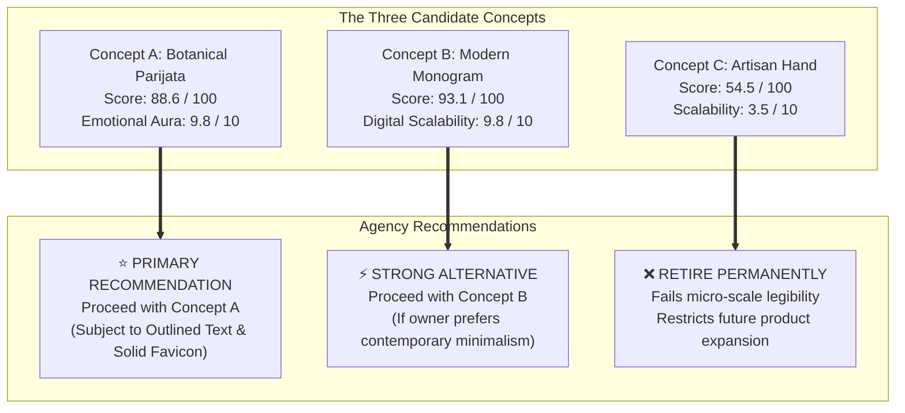

# NAVA CREATIONS — Phase 1.5 Governance & Owner Approval Gate
## Formal Decision Framework, Concept Evaluation, and Production Sign-Off Criteria

> **Document Type:** Governance Decision Gate & Business Owner Sign-Off Framework  
> **Brand Under Review:** NAVA CREATIONS (Bengaluru, Karnataka)  
> **Current Project Phase:** Phase 1.5 Complete — Paused at Governance Gate  
> **Next Project Phase:** Phase 2 (E-Commerce Platform Architecture & Frontend Foundation) — **NOT STARTED**  
> **Target Audience:** NAVA Business Owner, Creative Director, Lead Architect  
> **Date of Issue:** November 2026  

---

## 1. Governance Status Confirmation

```
┌────────────────────────────────────────────────────────────────────────────────────────┐
│ PHASE 1.5 GOVERNANCE STATUS REPORT                                                     │
├──────────────────────────────────────┬─────────────────────────────────────────────────┤
│ Master Review Status                 │ COMPLETED & VERIFIED                            │
│ Assets Directory: assets/branding/   │ 24 Master SVGs + 12 Mockups Inspected           │
│ Review Directory: review/            │ 7 Visual Comparison Boards Created & Validated  │
│ Approved Directory: approved/        │ CURRENTLY EMPTY (STRICT GOVERNANCE LOCK)        │
│ Phase 2 Frontend Engineering Code    │ ZERO COMMITS (NOT STARTED)                      │
│ Gate Condition                       │ AWAITING BUSINESS OWNER SIGN-OFF                │
└──────────────────────────────────────┴─────────────────────────────────────────────────┘
```

> [!IMPORTANT]
> **Strict Governance Rule:** No vector assets have been copied to `assets/branding/approved/`, and no Phase 2 frontend application code has been written. Phase 2 development will begin only after the business owner has reviewed this document and recorded their decisions on the 6 open business gates below.

---

## 2. Executive Concept Recommendation & Decision Matrix

Following comprehensive stress-testing across 7 evaluation boards (Light, Dark, Micro-scale 16–64px, Instagram, Header, Packaging, and Monochrome), the independent review agency provides the following definitive recommendations:



### 2.1 Why Concept A is the Primary Recommendation
- **Brand Aura & Emotion:** In Indian accessories and jewellery commerce, emotion and trust drive purchase conversion. The 5-petal Parijata flower motif, paired with Deep Plum (`#5C1D38`) and Antique Gold accents, evokes sacred festive traditions, bridal beauty, and handcrafted intimacy.
- **Packaging Grandeur:** On rigid bangle boxes and gold foil seals, Concept A delivers an unboxing experience that justifies premium prices and encourages organic customer shares on Instagram.
- **Required Technical Fix:** Must adopt `favicon-solid.svg` for browser tabs to guarantee 16px micro-scale legibility, and all live `<text>` elements must be converted to outlined `<path>` vectors.

### 2.2 Why Concept B is the Technical Alternative
- **Digital Scalability & Clean Modernity:** If the business owner envisions NAVA CREATIONS not strictly as a traditional bridal boutique, but as a sleek, contemporary, international fashion accessories brand, Concept B's interlocking 'NC' monogram is the technically superior choice. It scales flawlessly from a 16px favicon to giant storefront signage with zero distortion.

### 2.3 Why Concept C Must Be Retired
- **Technical Breakdown:** Fails micro-scale legibility below 32px; Kundan stone dots merge into a smudge in thermal shipping labels and small mobile avatars.
- **Category Trap:** Depicting a literal hand wearing a bangle permanently restricts the brand. If NAVA expands into hair accessories, jhumkas, neckpieces, or festive gifts, the logo becomes visually contradictory.

---

## 3. The 6 Critical Business Gates Requiring Owner Decision

Before the design team can finalize production vector assets and hand off tokens to engineering, the business owner must provide binding answers to the following six strategic questions:

```
┌────────────────────────────────────────────────────────────────────────────────────────┐
│ OWNER DECISION MATRIX                                                                  │
├─────┬──────────────────────────┬─────────────────────────────┬─────────────────────────┤
│ No. │ Strategic Decision       │ Option 1                    │ Option 2                │
├─────┼──────────────────────────┼─────────────────────────────┼─────────────────────────┤
│ 1   │ Brand Identity Concept   │ Concept A (Botanical Flora) │ Concept B (Monogram)    │
│ 2   │ Primary Commercial Tier  │ Accessible Luxury (₹1500+)  │ Boutique Craft (₹450+)  │
│ 3   │ Sizing Availability      │ Core Sizes (2.4, 2.6, 2.8)  │ Full Millimeter (2.2-10)│
│ 4   │ Packaging Architecture   │ Two-Tier (Rigid + Kraft)    │ Single Universal Box    │
│ 5   │ Artisan Copy Claims      │ Truthful Curation (Bengaluru│ Verified Atelier/Team   │
│ 6   │ Official Legal Details   │ Sole Proprietorship / GST   │ Unregistered Startup    │
└─────┴──────────────────────────┴─────────────────────────────┴─────────────────────────┘
```

### Detailed Decision Clarifications:

#### Gate 1: Concept Selection
- **Question:** Which visual identity direction will represent NAVA CREATIONS?
  - **[ ] Choice A (Recommended):** Concept A — Botanical Parijata (Temple Ivory, Deep Plum, Antique Gold).
  - **[ ] Choice B:** Concept B — Modern Monogram (Alabaster, Forest Emerald, Champagne Gold).
  - *(Concept C is disqualified from production selection).*

#### Gate 2: Catalog Pricing Tier & Commercial Reality
- **Question:** What is the actual price distribution of your products?
  - **[ ] Option 1 (Accessible Luxury):** Average selling price is ₹1,500 – ₹5,000 (Bridal sets, premium Kundan, elaborate silk work). The website design will feature high-editorial typography, velvet nocturne imagery, and premium unboxing.
  - **[ ] Option 2 (Everyday Boutique Craft):** Average selling price is ₹350 – ₹1,200 (Everyday silk-thread bangles, festive gift sets). The website design will prioritize fast mobile checkout, clear bundle savings, and bulk return-gift tiers.

#### Gate 3: Bangle Sizing Inventory
- **Question:** What sizes can you reliably fulfill without custom manufacturing delays?
  - **[ ] Option 1 (Recommended for Launch):** Standard Indian core sizes only: **2.4 (Small), 2.6 (Medium), 2.8 (Large)**.
  - **[ ] Option 2:** Expanded sizes including petite **2.2** and extended **2.10** (requires owner to confirm inventory or custom lead-time notice of 7–10 days).

#### Gate 4: Packaging Unit Economics
- **Question:** Do you approve the two-tier packaging specification to protect profit margins?
  - **[ ] Approved:** High-value orders (≥ ₹1,800 or Bridal) receive the rigid luxury drawer box (₹135 unit cost). Standard everyday orders (< ₹1,800) receive the premium folding kraft box with gold foil emblem sticker (₹32 unit cost).
  - **[ ] Modified:** Owner to specify acceptable packaging budget per order.

#### Gate 5: Truth in Advertising & Artisan Claims
- **Question:** How should the origin and crafting process be described to comply with Indian e-commerce consumer protection laws?
  - **[ ] Option 1 (Truthful Hand-Finishing):** *"Designed, curated, and hand-finished in Bengaluru, Karnataka"* (Recommended; safe and accurate).
  - **[ ] Option 2 (Full Artisan Workshop):** Claim an in-house atelier only if NAVA directly employs dedicated full-time craftspeople at a registered physical Bengaluru workshop.

#### Gate 6: Missing Statutory Compliance Details
- **Question:** Please supply the official legal business details required for checkout integration, shipping labels, and consumer compliance:
  - Legal Entity Name: `____________________________________`
  - GSTIN (if registered; required for interstate sales): `________________`
  - Official Customer Support Phone / WhatsApp: `________________`
  - Official Customer Support Email: `________________`
  - Physical Return Dispatch Address (Bengaluru): `____________________`

---

## 4. Formal Sign-Off Protocol Before Phase 2 Commencement

When the business owner has reviewed the visual comparison boards and selected their preferred options, sign-off is recorded using the template below:

```markdown
### FORMAL PHASE 1.5 OWNER SIGN-OFF RECORD

Date of Approval: ________________________
Approved Concept: [ ] Concept A (Botanical)   [ ] Concept B (Monogram)
Approved Pricing Tier: [ ] Accessible Luxury   [ ] Boutique Everyday Craft
Approved Launch Sizes: [ ] 2.4, 2.6, 2.8 Only [ ] 2.2 to 2.10 Full Sizing
Approved Packaging Strategy: [ ] Two-Tier Architecture Approved

Business Owner Name: ____________________________________
Signature / Confirmation: _______________________________
```

### Automated Next Actions Upon Owner Sign-Off:
1. **Vector Outlining Script:** The engineering team will run the Bézier outlining pipeline on the approved concept, eliminating all live font dependencies.
2. **Production Asset Staging:** Final, outlined, multi-resolution SVGs and PNG favicons will be moved into `assets/branding/approved/`.
3. **Token Synchronization:** Authoritative `#5C1D38` Deep Plum tokens will be compiled into the frontend build repository.
4. **Phase 2 Authorization:** Phase 2 (Information Architecture, Next.js / Tailwind CSS foundation, and Component Library) will be formally unlocked.

---

> [!CAUTION]
> **Current Project State:** **PAUSED AT PHASE 1.5 GATE.**  
> No Phase 2 code will be created until the business owner records decisions for Gates 1 through 6.

---

*Prepared as a project governance framework. It has not been formally ratified by an independent governance board or approved by the business owner.*
