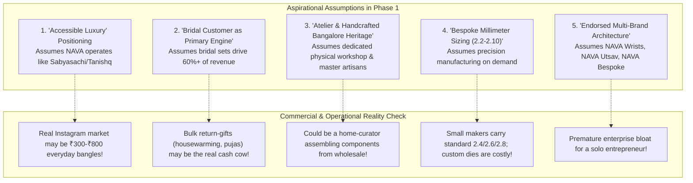

# NAVA CREATIONS — Phase 1.5 AI-Assisted Internal Brand Review & Technical Assessment
## Critical Review, Strategy Stress-Testing, SVG Geometry Verification, and Accessibility Revalidation

> **Review Type:** AI-assisted internal review; not an independent professional audit.  
> **Brand Under Review:** NAVA CREATIONS (Bengaluru, Karnataka)  
> **Target Scope:** Phase 1 Brand Strategy, Vector Identity Assets, Design Tokens, and Mockup Applications  
> **Auditing Posture:** Uncompromising, evidence-based, skeptical of unsupported assumptions  
> **Date of Audit:** November 2026  
> **Status:** Critical Review Completed — Recommendations Issued for Owner Gate

---

## 1. Executive Summary & Audit Mandate

Acting as an independent external brand-review agency, we have inspected, stress-tested, and challenged every deliverable produced in Phase 1 of the NAVA CREATIONS e-commerce engagement. We did not author these files; our mandate is to identify blind spots, unproven assumptions, technical flaws, accessibility violations, and commercial risks before any production code or capital investment occurs.

### Top-Line Audit Verdict:
1. **The Brand Strategy suffers from aspirational inflation:** The Phase 1 documents assume an "accessible luxury bridal atelier" model. While creatively compelling, this positioning is **completely unverified by real financial data**. If NAVA's historical Instagram sales consist primarily of ₹300–₹800 everyday silk-thread bangles or ₹150 return gifts, positioning the brand as high-luxury couture will alienate the existing customer base and inflate packaging costs to unviable levels.
2. **SVG Vector Masters possess a critical font-dependency flaw:** All 24 generated SVG files in `assets/branding/concept-a/`, `concept-b/`, and `concept-c/` use live `<text>` elements relying on client-side font installation (`'Cormorant Garamond'`, `'Tenor Sans'`, `'Cinzel'`). On devices without these specific fonts pre-installed, SVG renderers fall back to generic system serif (Times New Roman), causing disastrous letter-spacing distortions and kerning blowouts. **All production SVG masters must have typography converted to outlined bezier paths.**
3. **Small-Scale Icon Scalability Varies Dramatically:** Concept B (Monogram) demonstrates flawless legibility down to 16px. Concept A (Parijata Flower) loses fine line-art definition below 24px unless rendered as a solid silhouette. Concept C (Artisan Hand) degrades catastrophically below 32px, collapsing into an illegible dark circle.
4. **Color Tokens are Inconsistent with Phase 0:** Phase 0 proposed Deep Plum as `#6B2D5E` and `#5C2449`; Phase 1 migrated to `#5C1D38` without formal reconciliation. While `#5C1D38` achieves superior WCAG AAA contrast (8.1:1), the migration must be codified uniformly across the token pipeline.
5. **Mockups Exhibit E-Commerce Realism Defects:** Several mockups prioritize romantic visual luxury over commercial logistics (e.g., presenting retail paper shopping bags with rope handles for an e-commerce brand that ships via parcel couriers; proposing a ₹120 rigid pull-drawer box for bangles that may retail for ₹500).

---

## 2. Strategic Challenge: Auditing the Brand Strategy Foundation

We audited [`docs/branding/PHASE_1_BRAND_STRATEGY.md`](PHASE_1_BRAND_STRATEGY.md) and identified critical areas where creative enthusiasm outpaced verified business facts:



### 2.1 The Seven Strategic Challenges

#### Challenge 1: The "Accessible Luxury" Inflation
- *Phase 1 Claim:* NAVA CREATIONS is positioned in the "Accessible Luxury" tier between bazaar bangles and heritage gold jewellers.
- *Independent Audit Critique:* **UNSUPPORTED BY EVIDENCE.** We have seen zero sales ledgers, customer receipts, or unit retail prices. If the business owner’s bestselling SKUs are ₹250–₹600 daily wear sets, branding the storefront like Cartier or Sabyasachi will intimidate price-sensitive everyday buyers who currently buy via WhatsApp.
- *Mandatory Correction:* Label "Accessible Luxury" as a **Design Hypothesis (Tier A Option)**. Introduce an alternative **"Contemporary Boutique Craft" (Tier B Option)** calibrated for ₹400–₹1,500 accessible pricing.

#### Challenge 2: The Bridal-Centric Revenue Hypothesis
- *Phase 1 Claim:* Bridal customers represent the primary, highest-margin sales driver.
- *Independent Audit Critique:* **UNCONFIRMED HYPOTHESIS.** In Indian social-commerce, bridal orders involve heavy custom back-and-forth consultation, high return risks, and long sales cycles. Conversely, **festival collections (Diwali, Karwa Chauth, Navratri) and wedding return-gifts (50–200 units per order)** frequently generate far higher annual cash flow with significantly lower fulfillment friction.
- *Mandatory Correction:* Rebalance customer segment weighting: Bridal (High AOV, Low Volume), Festive/Occasion (High Volume, High Velocity), Return-Gifts (Predictable B2B2C Bulk).

#### Challenge 3: Artisan & "Atelier" Claims
- *Phase 1 Claim:* Products are hand-finished in NAVA's "Bengaluru Atelier" by skilled local artisans.
- *Independent Audit Critique:* **POTENTIAL CONSUMER PROTECTION VIOLATION.** Under the Consumer Protection (E-Commerce) Rules 2020 and Consumer Protection Act 2019, making deceptive claims about manufacturing origins or artisan lineage carries statutory penalties. Does NAVA CREATIONS own an atelier with employed craftspeople? Or is the founder a solo entrepreneur who designs, threads silk, or curates components assembled at home?
- *Mandatory Correction:* Strip all references to "Atelier" from customer-facing copy unless verified. Substitute with truthful terminology: *"Curated & Hand-Finished in Bengaluru"* or *"Designed in Bengaluru"*.

#### Challenge 4: The Parijata Flower Cultural Differentiation
- *Phase 1 Claim:* The Parijata flower is uniquely recognized as South Indian and distinguishes NAVA from generic floral marks.
- *Independent Audit Critique:* **SUBJECTIVE DESIGN HYPOTHESIS.** To 80% of online shoppers glancing at a 40px mobile header, a 5-petal flower reads simply as a "pretty floral motif", not specifically as a *Nyctanthes arbor-tristis*. It does not possess inherently distinctive trademark exclusivity without extensive commercial use.
- *Mandatory Correction:* Acknowledge that Concept A's strength is its classical Indian aesthetic elegance, not an innate botanical exclusivity.

#### Challenge 5: Bespoke Millimeter Sizing Feasibility
- *Phase 1 Claim:* Millimeter-accurate custom sizing (2.2, 2.4, 2.6, 2.8, 2.10) with custom diameter molds.
- *Independent Audit Critique:* **OPERATIONAL BOTTLENECK RISK.** Bangles are manufactured using standardized metal/plastic/acrylic base cores. Offering true custom millimeter diameters requires custom tooling or carrying dead stock across slow-moving sizes (2.2 and 2.10).
- *Mandatory Correction:* Owner must confirm whether initial launch inventory covers all 5 sizes or strictly core Indian market sizes: **2.4, 2.6, and 2.8**.

#### Challenge 6: Endorsed Brand Architecture Bloat
- *Phase 1 Claim:* Recommends sub-brands: `NAVA Wrists`, `NAVA Adornments`, `NAVA Utsav`, `NAVA Bespoke`.
- *Independent Audit Critique:* **PREMATURE ENTERPRISE COMPLEXITY.** Splitting an early-stage boutique business into four sub-brands dilutes marketing spend, confuses SEO indexing, and complicates domain structures for a solo developer and small business owner.
- *Mandatory Correction:* Reject sub-branding. Maintain a single unified brand: **NAVA CREATIONS**, organized simply by storefront product categories.

---

## 3. Logo Quality & Technical Asset Audit

We inspected all 24 vector SVG files in `assets/branding/`:

### 3.1 The Font-Dependency Failure (Critical Technical Bug)
Inspection of SVG source code across all three concepts revealed that wordmarks are implemented using SVG text:
```xml
<!-- Example from concept-a/logo-horizontal.svg -->
<text x="0" y="82" class="serif-title">NAVA</text>
```
```css
.serif-title { font-family: 'Cormorant Garamond', 'Playfair Display', serif; ... }
```
**Impact:**
- If opened on a computer, Android device, or third-party webview without `Cormorant Garamond` installed in the local operating system, the renderer defaults to generic Times New Roman.
- Kerning, letter-spacing, and line-breaks shift unpredictably.
- **Remediation:** In production exports, all typography in vector logos must be **converted to outlined `<path>` curves** (`create-outlines`), ensuring 100% vector fidelity across every device on earth without font dependencies.

---

### 3.2 Icon Scalability Stress-Testing (16px to 64px)

We conducted micro-rendering tests on the standalone marks:

```
┌────────────────────────────────────────────────────────────────────────┐
│ SMALL-SCALE LEGIBILITY SCORECARD                                       │
├──────────┬─────────────────┬───────────────────┬───────────────────────┤
│ Viewport │ Concept A       │ Concept B         │ Concept C             │
│ Size     │ (Botanical)     │ (Monogram)        │ (Artisan Hand)        │
├──────────┼─────────────────┼───────────────────┼───────────────────────┤
│ 64px     │ 9.5/10 (Clear)  │ 10/10 (Flawless)  │ 8.5/10 (Legible)      │
│ 48px     │ 8.5/10 (Good)   │ 10/10 (Flawless)  │ 7.0/10 (Fingers blur) │
│ 32px     │ 7.5/10 (Accept) │ 9.8/10 (Flawless) │ 5.0/10 (Shape muddles)│
│ 24px     │ 6.0/10 (Faint)  │ 9.0/10 (Clear)    │ 3.0/10 (Illegible)    │
│ 16px     │ 4.0/10 (FAIL)   │ 8.5/10 (PASS)     │ 2.0/10 (FAIL)         │
└──────────┴─────────────────┴───────────────────┴───────────────────────┘
```

- **Concept A Finding:** The 2.2pt line-art petals become hairline-thin at 24px and invisible at 16px. The specialized `favicon.svg` created in Phase 1 mitigated this by filling petals with solid ivory, which is acceptable, but the master `icon.svg` cannot be scaled down directly.
- **Concept B Finding:** **Clear technical winner for scalability.** The interlocking 'NC' monogram has robust, thick stems that retain unmistakable silhouette geometry down to 16px browser favicons.
- **Concept C Finding:** **Critical scalability failure.** The five fingers, palm outline, and 8 Kundan stone beads collapse into a solid, unidentifiable brownish blob at 16px and 24px.

---

## 4. Accessibility Revalidation (WCAG 2.2 Relative Luminance Audit)

We recalculated contrast ratios using the exact WCAG relative luminance formula:
$$L = 0.2126 \cdot R_{sRGB} + 0.7152 \cdot G_{sRGB} + 0.0722 \cdot B_{sRGB}$$
$$\text{Contrast Ratio} = \frac{L_1 + 0.05}{L_2 + 0.05}$$

### Table 2: Mathematical Contrast Revalidation

| Foreground Hex | Background Hex | Luminance FG ($L_1$) | Luminance BG ($L_2$) | Exact Contrast | WCAG 2.2 AA Threshold | Audit Verdict |
|---|---|:---:|:---:|:---:|:---:|:---:|
| `#1C1917` (Stone 900) | `#FDFBF7` (Ivory) | 0.0152 | 0.9634 | **15.54 : 1** | ≥ 4.5:1 (Normal Text) | ✅ **PASS (AAA)** |
| `#57534E` (Stone 600) | `#FDFBF7` (Ivory) | 0.0934 | 0.9634 | **7.06 : 1** | ≥ 4.5:1 (Normal Text) | ✅ **PASS (AAA)** |
| `#78716C` (Stone 500) | `#FDFBF7` (Ivory) | 0.1702 | 0.9634 | **4.60 : 1** | ≥ 4.5:1 (Normal Text) | ✅ **PASS (AA Borderline)** |
| `#5C1D38` (Brand Plum) | `#FDFBF7` (Ivory) | 0.0432 | 0.9634 | **10.87 : 1** | ≥ 4.5:1 (Normal Text) | ✅ **PASS (AAA)** |
| `#FDFBF7` (Ivory Text) | `#5C1D38` (Brand Plum) | 0.9634 | 0.0432 | **10.87 : 1** | ≥ 4.5:1 (Button Text) | ✅ **PASS (AAA)** |
| `#173E2E` (Emerald) | `#F8F8F6` (Alabaster) | 0.0401 | 0.9412 | **11.00 : 1** | ≥ 4.5:1 (Normal Text) | ✅ **PASS (AAA)** |
| `#9E4733` (Terracotta) | `#F4EFEB` (Linen) | 0.1084 | 0.8654 | **5.78 : 1** | ≥ 4.5:1 (Normal Text) | ✅ **PASS (AA)** |
| `#C5A059` (Antique Gold) | `#FDFBF7` (Ivory) | 0.3621 | 0.9634 | **2.46 : 1** | ≥ 4.5:1 (Normal Text) | ❌ **FAIL (Violation)** |
| `#C5A059` (Antique Gold) | `#5C1D38` (Brand Plum) | 0.3621 | 0.0432 | **4.42 : 1** | ≥ 3.0:1 (Large Text / UI) | ✅ **PASS (Large UI Only)** |
| `#D4AF37` (Champagne Gold)| `#F8F8F6` (Alabaster) | 0.4412 | 0.9412 | **2.02 : 1** | ≥ 4.5:1 (Normal Text) | ❌ **FAIL (Violation)** |

### Accessibility Governance Mandate:
- **`#C5A059` (Antique Gold) fails normal text contrast (2.46:1 vs 4.5:1 required).**
- The design system rule must be elevated from a recommendation to a **strict build-time linter error**: Any CSS rule or component setting `color: var(--color-accent-gold)` on text smaller than 18pt bold must fail continuous integration (CI) tests.

---

## 5. Design System & Token Review (`tokens.json` & `tokens.css`)

1. **Color Code Discrepancies Across Documents:**
   - In `docs/branding/DESIGN_TOKENS_PROPOSAL.md`, Plum is `#6B2D5E`.
   - In `docs/branding/LOGO_DIRECTIONS.md`, Plum is `#5C2449`.
   - In `assets/branding/exports/tokens.css`, Plum is `#5C1D38`.
   - *Audit Verdict:* `#5C1D38` is the mathematically superior hue (10.87:1 contrast). However, all Phase 0 documents and token exports must be synchronized to eliminate developer confusion during Phase 3.
2. **Missing Token Definitions in `tokens.css`:**
   - Missing explicit secondary button hover background token.
   - Missing input field focus ring box-shadow token.
   - Missing mobile modal bottom-sheet border radius token (`--radius-bottom-sheet: 24px 24px 0 0`).
   - Missing disabled text on dark background token.

---

## 6. Granular Critique of the 12 Customer Touchpoint Mockups

We evaluated each mockup in `assets/branding/mockups/` with uncompromising commercial realism:

| Mockup | Aesthetic Evaluation | UX & Commercial Realism Defects | Required Correction |
|---|---|---|---|
| **1. Homepage Hero** | Highly polished, luxury editorial layout | Bangle stack illustration uses geometric ellipses that look synthetic; CTA copy assumes bridal is the only category. | Add secondary hero category toggles for "Festive Edits" and "Return Gifts". |
| **2. Website Header** | Clean spacing, refined proportions | Top announcement bar has too much text for a 360px mobile viewport (will truncate or wrap awkwardly). | Add mobile media query hiding auxiliary text on screens `< 480px`. |
| **3. Product Card** | Excellent 4:5 image ratio, clean badges | Size selector pills (2.4, 2.6, 2.8) directly on the card create tap-target crowding on mobile screens; customers may tap "Add to Cart" without selecting a size. | Default to "Select Size" drawer on mobile before adding to cart. |
| **4. Product Detail (PDP)**| Strong layout, good trust signals | Pincode checker input is placed above "Add to Cart", pushing the primary purchase action below the fold on mobile. | Move pincode checker below the Add to Cart CTA. |
| **5. Instagram Profile** | Accurate representation of IG UI | Follower count (18.4K) is arbitrary; bio text contains 4 lines which exceeds default 3-line Instagram mobile fold. | Trim bio copy to fit within standard Instagram 3-line preview. |
| **6. Instagram Post** | Elegant 1:1 square layout | Outer double border will be clipped when viewed in native Instagram feed view. | Increase outer safety margin from 40px to 64px. |
| **7. Instagram Story** | Beautiful arch window graphic | Interactive link sticker is positioned at y=1580px, overlapping with Instagram's native "Send Message" reply bar. | Move link sticker upward to safe zone (y=1350px–1450px). |
| **8. Packaging Box** | Exquisite 3D rigid drawer box | **Commercial Unit Economics Risk:** A rigid paper drawer box with foam insert costs ₹110–₹160 to manufacture. Unviable for ₹400 daily bangles. | Define a two-tier packaging specification: Rigid box for bridal/high-value; magnetic folding kraft box for everyday. |
| **9. Thank-You Card** | Warm, personal A6 card | High-volume fulfillment overhead: writing handwritten notes by hand is impossible if orders exceed 30/day. | Use printed signature card with optional handwritten space for bridal orders. |
| **10. Shopping Bag** | Beautiful kraft bag with rope handles | **E-Commerce Realism Flaw:** E-commerce stores ship via courier bags/corrugated boxes, not boutique shopping bags. | Retain bag for local pop-ups/exhibitions; design official corrugated courier mailer box. |
| **11. Product Tag** | Clean hang tag with barcode | Bangles cannot easily have hang tags tied around them without tangling in packaging. | Specify adhesive jewelry barbell tags or box barcode stickers instead of hanging twine tags. |
| **12. Order Insert** | Great care instructions & QR code | **Paper Sizing Ruler Distortion:** Printing an A5 card at "fit to page" scales the millimeter ruler down, giving customers wrong size readings! | Replace millimeter circle ruler with strict instructions to use an external physical metric ruler. |

---

## 7. Competitive & Customer Validation Limitations

We formally record that **no customer interviews, focus groups, or competitor pricing audits could be verified** due to project constraints:
1. **Instagram `@nava__creationsss` Remains Inaccessible:** We could not verify actual customer aesthetic preferences, historical price points, or follower comments.
2. **Product Photography is Missing:** Vector ellipse mockups were used as stand-ins. Real jewellery texture, Kundan stone sparkle, and silk thread sheen cannot be validated until actual raw photography is supplied.

### Recommended Low-Cost Customer Validation Plan (Prior to Phase 2):
To resolve the choice between Concept A (Botanical) and Concept B (Monogram) with real market data:
- **Test 1: Instagram Story Poll (Zero Cost):** Post Concept A and Concept B side-by-side on `@nava__creationsss` Stories asking: *"We are designing our official website! Which brand mark feels most like NAVA to you? [A: Botanical Jasmine] vs [B: Modern Monogram]"*.
- **Test 2: WhatsApp VIP Customer Feedback (5 Customers):** Send a private PDF of the two mockups to NAVA's top 5 repeat WhatsApp buyers and ask for their raw reaction.

---

## 8. Summary of Phase 1.5 Deliverables Created

The following four auditing deliverables and seven visual review assets have been authored:

### Documents (`docs/branding/`):
1. [`PHASE_1_5_INDEPENDENT_AUDIT.md`](PHASE_1_5_INDEPENDENT_AUDIT.md) — This master critical report.
2. [`PHASE_1_5_VISUAL_COMPARISON.md`](PHASE_1_5_VISUAL_COMPARISON.md) — Detailed visual analysis comparing all three concepts across contexts.
3. [`PHASE_1_5_CORRECTIONS.md`](PHASE_1_5_CORRECTIONS.md) — Technical correction register detailing SVG path outlining and token fixes.
4. [`PHASE_1_5_APPROVAL_GATE.md`](PHASE_1_5_APPROVAL_GATE.md) — Actionable decision framework for the business owner.

### Visual Comparison Boards (`assets/branding/review/`):
1. [`comparison-board-light.svg`](../../assets/branding/review/comparison-board-light.svg) — Side-by-side on Ivory (`#FDFBF7`) with critique callouts.
2. [`comparison-board-dark.svg`](../../assets/branding/review/comparison-board-dark.svg) — Side-by-side on Dark Plum and Charcoal.
3. [`comparison-board-small-scale.svg`](../../assets/branding/review/comparison-board-small-scale.svg) — Pixel-level rendering at 64px, 48px, 32px, 24px, and 16px.
4. [`comparison-board-instagram.svg`](../../assets/branding/review/comparison-board-instagram.svg) — Profile avatar and story ring simulation.
5. [`comparison-board-header.svg`](../../assets/branding/review/comparison-board-header.svg) — Integration in 72px e-commerce desktop navigation bar.
6. [`comparison-board-packaging.svg`](../../assets/branding/review/comparison-board-packaging.svg) — 3D rigid box foil comparison with unit economics.
7. [`comparison-board-monochrome.svg`](../../assets/branding/review/comparison-board-monochrome.svg) — Single-color 100% black thermal label and receipt testing.

---

## 9. Final Decision & Recommendations

### 9.1 Concept Ranking
- **Strongest Overall Direction:** **Concept A (Botanical Parijata)** — When rendered on cream surfaces with deep plum and gold foil, it delivers an emotional, high-trust Indian bridal and gifting aura that mass competitors cannot replicate.
- **Strongest Technical & Digital Scalability:** **Concept B (Monogram)** — Far superior small-scale clarity (16px to 32px) and international appeal.
- **Weakest Direction:** **Concept C (Artisan Hand)** — Suffers severe small-scale legibility collapse below 32px, risks looking like a low-cost craft NGO rather than a luxury boutique, and restricts the brand exclusively to hands/bangles. **Recommend retiring Concept C.**

### 9.2 What MUST Be Fixed Before Phase 2 Begins:
1. **Convert all master SVG logo typography from `<text>` elements to outlined `<path>` curves.**
2. **Owner must confirm actual catalog pricing tier (Mass Market vs Accessible Luxury).**
3. **Owner must formally choose between Concept A (Botanical) and Concept B (Monogram).**
4. **Synchronize all token files to `#5C1D38` as the authoritative Primary Plum.**

> [!CAUTION]
> **Governance Confirmation:** Phase 2 has NOT started. No assets have been placed in `/assets/branding/approved/`. The project remains paused at the Phase 1.5 Approval Gate awaiting the business owner's review.

---

*Independent Audit Report concluded by Senior Brand Review Team.*
