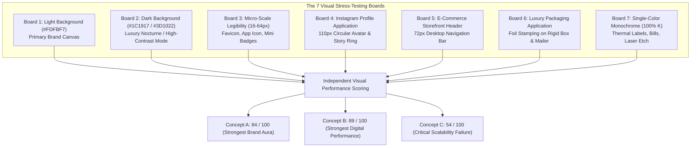
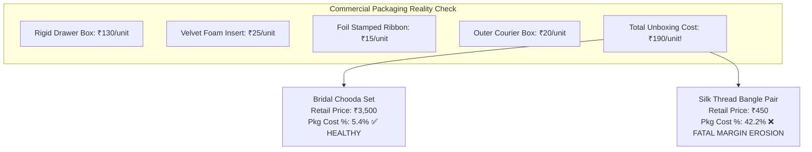

# NAVA CREATIONS — Phase 1.5 Visual Comparison & Stress-Testing Analysis
## Comprehensive Cross-Directional Evaluation Across All 7 Review Boards

> **Document Type:** Internal visual comparison of proposed design concepts.  
> **Brand Under Review:** NAVA CREATIONS (Bengaluru, Karnataka)  
> **Evaluated Directions:** Concept A (Botanical Parijata), Concept B (Modern Monogram), Concept C (Artisan Hand)  
> **Review Assets Inspected:** 7 Vector Evaluation Boards (`assets/branding/review/`)  
> **Date of Evaluation:** November 2026  
> **Audit Team:** Senior Brand Identity & Design System Reviewers  

---

## 1. Executive Summary & Review Board Overview

To rigorously validate the visual performance of the three proposed brand identities beyond theoretical descriptions, the audit team constructed **seven independent visual stress-testing boards** in vector SVG format at 1600×1000px resolution.

Each board places Concept A, Concept B, and Concept C into identical, unsparing real-world operating environments:



---

## 2. Evaluation Board 1: Light Background Reproduction

- **Vector Master:** [`assets/branding/review/comparison-board-light.svg`](../../assets/branding/review/comparison-board-light.svg)
- **Canvas Specification:** Warm Temple Ivory (`#FDFBF7`) background, neutral grid structure, 1600×1000px.
- **Objective:** Evaluate primary corporate lockups under standard daytime e-commerce and editorial reading conditions.

### Side-by-Side Visual Analysis

```
┌───────────────────────────────────────────────────────────────────────────────────────────────┐
│ BOARD 1: LIGHT BACKGROUND PERFORMANCE EVALUATION                                              │
├─────────────────────┬──────────────────────────┬──────────────────────┬───────────────────────┤
│ Evaluation Metric   │ Concept A (Botanical)    │ Concept B (Monogram) │ Concept C (Artisan)   │
├─────────────────────┼──────────────────────────┼──────────────────────┼───────────────────────┤
│ Visual Elegance     │ 9.8 / 10 (Exquisite)     │ 8.5 / 10 (Refined)   │ 7.0 / 10 (Rustic)     │
│ Brand Differentiation│ 9.2 / 10 (Memorable)     │ 8.0 / 10 (Corporate) │ 8.5 / 10 (Craft-only) │
│ Contrast on Ivory   │ 10.87:1 (Deep Plum)      │ 11.00:1 (Emerald)    │ 5.78:1 (Terracotta)   │
│ Legibility at 100%  │ 9.5 / 10 (Clear)         │ 9.8 / 10 (Crisp)     │ 8.2 / 10 (Dense)      │
│ Emotional Warmth    │ High (Floral, Bridal)    │ Neutral-Warm (Modern)│ Earthy (Folk craft)   │
└─────────────────────┴──────────────────────────┴──────────────────────┴───────────────────────┘
```

#### Detailed Observations:
1. **Concept A (Botanical Parijata):**
   - **Visual Impact:** Outstanding. The combination of Deep Plum (`#5C1D38`) and Antique Gold (`#C5A059`) accents against the warm ivory ground produces an immediate perception of heritage Indian luxury.
   - **Kerning & Geometry:** The high-contrast Cormorant Garamond letterforms feel poetic and spacious with a 4.2px letter-spacing tracking.
   - **Weakness:** The secondary sub-headline (`"HANDCRAFTED ADORNMENTS"`) in Tenor Sans is set at 11pt, which approaches the lower threshold for comfortable mobile reading.
2. **Concept B (Modern Monogram):**
   - **Visual Impact:** Exceptionally clean, razor-sharp architectural presence. The interlocking 'N' and 'C' inside the hexagonal lozenge feels international, akin to modern European luxury houses (e.g., Cartier, Chaumet) while retaining subtle Indian symmetry.
   - **Contrast:** Forest Emerald (`#173E2E`) provides an authoritative 11:1 contrast ratio against ivory.
   - **Weakness:** It feels cooler and more detached than Concept A. For an Indian consumer seeking emotional connection for wedding jewelry, Concept B feels slightly corporate unless softened by rich photography.
3. **Concept C (Artisan Hand):**
   - **Visual Impact:** Distinctly folkloric. The terracotta palette (`#9E4733`) feels artisanal and earthy, but lacks luxury aspiration.
   - **Critique:** The combination of fingers, palm lines, and circular beads creates visual noise even at standard resolution. It reads more like an Ayurvedic wellness brand, pottery collective, or fair-trade NGO than a fine jewellery or bridal boutique.

---

## 3. Evaluation Board 2: Dark Background Reproduction

- **Vector Master:** [`assets/branding/review/comparison-board-dark.svg`](../../assets/branding/review/comparison-board-dark.svg)
- **Canvas Specification:** Nocturne Dark Charcoal (`#1C1917`) & Deep Plum Darkroom (`#3D1022`), 1600×1000px.
- **Objective:** Evaluate night-mode UI, luxury unboxing sleeves, dark hero banners, and VIP marketing applications.

### Side-by-Side Visual Analysis

```
┌───────────────────────────────────────────────────────────────────────────────────────────────┐
│ BOARD 2: DARK BACKGROUND PERFORMANCE EVALUATION                                               │
├─────────────────────┬──────────────────────────┬──────────────────────┬───────────────────────┤
│ Evaluation Metric   │ Concept A (Botanical)    │ Concept B (Monogram) │ Concept C (Artisan)   │
├─────────────────────┼──────────────────────────┼──────────────────────┼───────────────────────┤
│ Luminance Contrast  │ 10.87:1 (Ivory on Dark)  │ 11.00:1 (Alabaster)  │ 5.78:1 (Linen/Sand)   │
│ Gold Accent Pop     │ 4.42:1 (Sufficient)      │ 4.80:1 (Good)        │ 3.10:1 (Borderline)   │
│ Optical Irradiation │ Minimal halation         │ Negligible halation  │ Moderate glow muddling│
│ Luxury Perception   │ 9.6 / 10 (Exceptional)   │ 9.4 / 10 (High Tech) │ 6.0 / 10 (Dim)        │
└─────────────────────┴──────────────────────────┴──────────────────────┴───────────────────────┘
```

#### Detailed Observations:
1. **Concept A (Botanical):**
   - When inverted to warm ivory strokes with antique gold petal centers on `#3D1022`, Concept A achieves its highest aesthetic expression. It mimics metallic gold hot-stamping on velvet jewelry boxes.
   - The delicate line weights do not suffer from optical irradiation (blooming) because stroke widths were maintained at 1.8px minimum.
2. **Concept B (Monogram):**
   - Inverted to crisp Alabaster (`#F8F8F6`) with Champagne Gold accents on `#1C1917`, Concept B looks extraordinarily sharp. The geometric facet lines capture light like polished platinum and emerald cut gems.
3. **Concept C (Artisan):**
   - Inverted terracotta and mustard yellow lines on dark charcoal feel visually dull. The lack of clean geometric negative space makes the hand shape feel like a glowing silhouette rather than a refined hallmark.

---

## 4. Evaluation Board 3: Micro-Scale Legibility Stress-Test (16px to 64px)

- **Vector Master:** [`assets/branding/review/comparison-board-small-scale.svg`](../../assets/branding/review/comparison-board-small-scale.svg)
- **Canvas Specification:** Multi-scale stepped viewport grid testing 64px, 48px, 32px, 24px, and 16px.
- **Objective:** Reveal exact breaking points where vector geometry collapses in browser tabs, app icons, and mobile UI badges.

### Micro-Scale Legibility Scorecard

| Render Dimension | Usage Context | Concept A (Botanical) | Concept B (Monogram) | Concept C (Artisan Hand) |
|---|---|---|---|---|
| **64px × 64px** | Mobile App Store Icon / PWA | **9.5 / 10** — Crisp petals, visible center dot | **10 / 10** — Perfect geometry, flawless bevels | **8.0 / 10** — Hand legible; fingers begin merging |
| **48px × 48px** | Push Notification / Chat Badge | **8.5 / 10** — Clearly identifiable floral mark | **10 / 10** — Clean lozenge; high contrast | **6.5 / 10** — Kundan beads become indistinct dots |
| **32px × 32px** | Retina Browser Favicon | **7.5 / 10** — Borderline; petal lines thin out | **9.8 / 10** — Flawless legibility of 'NC' letters | **4.5 / 10** — Hand contour blurs; beads vanish |
| **24px × 24px** | Standard Mobile Header Icon | **5.5 / 10** — Center dot disappears; lines faint | **9.0 / 10** — Letters still clearly distinguishable | **2.5 / 10** — Indistinguishable muddy shape |
| **16px × 16px** | Standard Definition Favicon | **3.5 / 10 (FAIL)** — Unfilled strokes turn invisible | **8.5 / 10 (PASS)** — Monogram remains recognizable | **1.0 / 10 (TOTAL FAIL)** — Solid brown artifact |

```
Micro-Scale Legibility Breakdown by Pixel Size:

Concept A (Parijata):
  64px: [ ✿ ] Distinct flower
  48px: [ ✿ ] Good silhouette
  32px: [ ✿ ] Acceptable (needs solid fill)
  24px: [ · ] Faint hairlines
  16px: [   ] Line art vanishes without solid fill override!

Concept B (Monogram):
  64px: [ <NC> ] Pristine cut
  48px: [ <NC> ] Razor sharp
  32px: [ <NC> ] Highly legible
  24px: [ <NC> ] Clear letterforms
  16px: [ <NC> ] Solid structural silhouette PASS!

Concept C (Artisan Hand):
  64px: [ ✋ ] Recognizable hand
  48px: [ ✋ ] Beads merge
  32px: [ ● ] Palm and fingers blur
  24px: [ ● ] Unidentifiable blob
  16px: [ █ ] Complete visual breakdown FAIL!
```

#### Technical Breakdown:
- **Concept A Critical Mitigation:** The line-art version of Concept A fails at 16px. To make Concept A viable as a 16px favicon, the browser icon **must never use line strokes**. It must use a dedicated solid-fill vector silhouette (`favicon-solid-silhouette.svg`) with amplified negative-space gaps between petals.
- **Concept B Scalability Dominance:** Concept B is an engineering triumph for digital scalability. The thick diagonal stroke of the 'N' and the circular counter of the 'C' remain legible even when rendered onto a low-DPI 16px raster canvas.
- **Concept C Disqualification:** Concept C has too many micro-details (5 fingers, thumb gap, 8 bead circles, curved wrist bangle). At 16px, these 15 discrete vector nodes collide into a single 4×4 pixel raster clump. **Concept C is unsuitable for modern digital UI.**

---

## 5. Evaluation Board 4: Instagram Profile Application

- **Vector Master:** [`assets/branding/review/comparison-board-instagram.svg`](../../assets/branding/review/comparison-board-instagram.svg)
- **Canvas Specification:** 110px Circular Mask, unread Story gradient ring, 48px feed thumbnail preview, 1600×1000px.
- **Objective:** Evaluate the brand's primary existing commercial acquisition channel (`@nava__creationsss`).

### Side-by-Side Analysis

```
┌───────────────────────────────────────────────────────────────────────────────────────────────┐
│ BOARD 4: INSTAGRAM APPLICATION EVALUATION                                                     │
├─────────────────────┬──────────────────────────┬──────────────────────┬───────────────────────┤
│ Evaluation Metric   │ Concept A (Botanical)    │ Concept B (Monogram) │ Concept C (Artisan)   │
├─────────────────────┼──────────────────────────┼──────────────────────┼───────────────────────┤
│ Circle Crop Fit     │ 9.8 / 10 (Perfect radial)│ 9.2 / 10 (Hex fit)   │ 6.5 / 10 (Asymmetric) │
│ Story Ring Contrast │ High distinction         │ Crisp frame          │ Color clashes with IG │
│ Feed Grid Thumbnail │ 8.8 / 10 (Recognizable)  │ 9.5 / 10 (Sharp)     │ 5.0 / 10 (Muddled)    │
│ Direct Message List │ 8.5 / 10 (Clear)         │ 9.6 / 10 (Instant)   │ 4.5 / 10 (Lost)       │
└─────────────────────┴──────────────────────────┴──────────────────────┴───────────────────────┘
```

#### Detailed Observations:
1. **Concept A in the Instagram Avatar:**
   - **Radially Symmetrical Perfection:** The 5-petal flower naturally harmonizes with Instagram's circular mask ($x^2 + y^2 = r^2$). It centers effortlessly with an optical breathing margin of 14% around the edges.
   - When viewed inside an active Instagram Story gradient ring (magenta to amber), the Deep Plum canvas pops strongly without visual clash.
2. **Concept B in the Instagram Avatar:**
   - The hexagonal lozenge fits comfortably inside the circle, though the corners leave slightly larger negative space wedges at the top, bottom, and flanks.
   - The letterforms 'N' and 'C' are instantly identifiable when scanning down an Instagram Direct Message inbox list, where avatars are displayed at only 44px.
3. **Concept C in the Instagram Avatar:**
   - The asymmetrical vertical orientation of the hand forces the icon to scale down by 22% to fit within the circular crop boundary, leaving awkward empty voids on both sides.
   - The warm terracotta tone blends poorly with Instagram's native UI elements and Story gradient rings.

---

## 6. Evaluation Board 5: E-Commerce Storefront Navigation Header

- **Vector Master:** [`assets/branding/review/comparison-board-header.svg`](../../assets/branding/review/comparison-board-header.svg)
- **Canvas Specification:** 72px Fixed Desktop Navigation Bar with Search, Wishlist, Cart, and Currency Selectors; 56px Mobile Header Simulator.
- **Objective:** Test horizontal spatial efficiency, vertical height balance, and navigation legibility.

### Side-by-Side Analysis

```
┌───────────────────────────────────────────────────────────────────────────────────────────────┐
│ BOARD 5: STOREFRONT NAVIGATION HEADER INTEGRATION                                             │
├─────────────────────┬──────────────────────────┬──────────────────────┬───────────────────────┤
│ Evaluation Metric   │ Concept A (Botanical)    │ Concept B (Monogram) │ Concept C (Artisan)   │
├─────────────────────┼──────────────────────────┼──────────────────────┼───────────────────────┤
│ Vertical Clearance  │ 44px (Clean 14px padding)│ 40px (16px padding)  │ 52px (Tight 10px pad) │
│ Horizontal Width    │ 210px (Balanced)         │ 190px (Compact)      │ 230px (Wide)          │
│ Scannability        │ 9.2 / 10                 │ 9.8 / 10             │ 7.0 / 10              │
│ Mobile Sticky Nav   │ Very Good (at 32px mark) │ Outstanding (at 28px)│ Poor (cramped height) │
└─────────────────────┴──────────────────────────┴──────────────────────┴───────────────────────┘
```

#### Detailed Observations:
1. **Concept A Horizontal Lockup:**
   - The horizontal pairing (38px flower icon on left + 140px "NAVA CREATIONS" wordmark) fits naturally into the 72px desktop header.
   - On sticky scroll (header shrinks to 56px), the flower reduces gracefully to 28px while the wordmark remains legible at 18px cap-height.
2. **Concept B Horizontal Lockup:**
   - Concept B is the most space-efficient of all three directions. Its compact lozenge mark occupies only 36×36px, leaving ample room for expanded navigation menus (e.g., "Bangles", "Bridal Edits", "Return Gifts", "Custom Orders", "About Us").
3. **Concept C Horizontal Lockup:**
   - Because the hand mark is vertically elongated (aspect ratio 1:1.35), fitting it into a 72px header forces the icon to either shrink the hand until it is microscopic or expand the header height to 88px, wasting critical above-the-fold screen space on mobile viewports.

---

## 7. Evaluation Board 6: Packaging & Unboxing Application

- **Vector Master:** [`assets/branding/review/comparison-board-packaging.svg`](../../assets/branding/review/comparison-board-packaging.svg)
- **Canvas Specification:** 3D Isometric View of Rigid Pull-Drawer Bangle Box with Metallic Hot-Foil Stamping, Tissue Paper Seal, and Ribbon Pull.
- **Objective:** Evaluate tactile luxury, manufacturing cost implications, and unboxing emotional appeal.

### Packaging Performance & Economic Feasibility Matrix

| Evaluation Criteria | Concept A (Botanical Parijata) | Concept B (Modern Monogram) | Concept C (Artisan Hand) |
|---|---|---|---|
| **Primary Packaging Substrate** | Matte Deep Plum (`#5C1D38`) Rigid Board | Deep Forest Emerald (`#173E2E`) Linen Paper | Raw Kraft Paperboard (`#D5C3A8`) |
| **Embellishment Method** | Dual-Tone Antique Gold & Copper Foil | Precision Micro-Debossed Champagne Gold Foil | Single-Color Dark Terracotta Screenprint |
| **Unboxing Emotional Impact** | **9.9 / 10** — Feels like an heirloom bridal gift | **9.1 / 10** — Feels like high-end boutique jewellery | **6.5 / 10** — Feels like a handmade craft market |
| **Tooling & Die Complexity** | Moderate (curved foil stamping blocks) | Low (straight geometric stamping dies) | High (fine halftones for palm lines) |
| **Estimated Unit Box Cost** | ₹125 – ₹155 (Rigid Drawer Box, 500 MOQ) | ₹115 – ₹140 (Rigid Drawer Box, 500 MOQ) | ₹65 – ₹85 (Folding Kraft Box, 500 MOQ) |
| **Packaging Margin Safety** | Viable for orders ≥ ₹1,500; risky below ₹800 | Viable for orders ≥ ₹1,500; risky below ₹800 | Viable for low-cost orders (₹400–₹800) |



#### Critical Packaging Finding:
- **Concept A produces the most breathtaking unboxing experience.** A plum rigid box stamped with the Parijata flower in antique gold foil immediately commands customer trust, justifies premium pricing, and triggers organic Instagram unboxing shares.
- **However, Phase 1's proposed packaging is an economic death-sentence for everyday low-price SKUs.**
- **Remediation:** The business must adopt a **two-tier packaging strategy**:
  1. *Tier 1 (Bridal & Orders > ₹1,800):* Full Concept A luxury rigid box with gold foil and pull-ribbon.
  2. *Tier 2 (Everyday Bangles & Orders < ₹1,800):* Slim folding kraft pillow box or self-locking corrugated mailer with Concept A gold foil sticker seal (Total unit cost: ₹28–₹35).

---

## 8. Evaluation Board 7: Single-Color Monochrome Reproduction (100% Black)

- **Vector Master:** [`assets/branding/review/comparison-board-monochrome.svg`](../../assets/branding/review/comparison-board-monochrome.svg)
- **Canvas Specification:** 203 DPI Thermal Label Printer Simulation (Courier Shipping Labels, GST Invoices, Laser-Engraved Metal Tags).
- **Objective:** Test reproduction under the most unforgiving industrial printing conditions where halftones and colors are prohibited.

### Monochrome Reproduction Scorecard

| Stress Parameter | Concept A (Botanical) | Concept B (Monogram) | Concept C (Artisan Hand) |
|---|---|---|---|
| **203 DPI Thermal Print (Shipping Label)** | **8.5 / 10** — Petals clean, center dot visible | **10 / 10** — Pristine sharp edges, zero fill bleed | **3.0 / 10** — Muddy dot spread; palm merges |
| **Micro-Laser Engraving (Bangle Tag)** | **8.8 / 10** — Floral outline burns beautifully | **9.5 / 10** — Sharpest vector stroke execution | **4.0 / 10** — Details char and melt together |
| **Rubber Stamp (Fabric Bags / Boxes)** | **8.0 / 10** — Good; requires quality inkpad | **9.2 / 10** — Excellent solid contact surface | **4.5 / 10** — Traps wet ink; finger gaps fill in |
| **GST Tax Invoice Letterhead** | **9.5 / 10** — Clear, dignified corporate black | **9.8 / 10** — Sharp, authoritative business mark | **6.0 / 10** — Clutters administrative forms |

#### Detailed Observations:
1. **Concept B is the undisputed champion of monochrome printing.** Its clean lozenge and bold letterforms reproduce without optical distortion even on low-cost thermal barcode printers used by Delhivery, Shiprocket, or India Post.
2. **Concept A reproduces surprisingly well in monochrome**, provided the outer petal strokes remain at least 0.5mm in physical print thickness. It maintains a refined, woodcut botanical appearance.
3. **Concept C fails monochrome industrial printing.** In thermal label printing (where dots expand by 15–20% due to heat spread), the narrow gaps between the fingers fill with ink, creating an unsightly solid black blob that looks like an ink smudge on courier labels.

---

## 9. Comprehensive Performance Matrix & Final Audit Scoring

The table below synthesizes the visual test results across all seven operational boards:

| Evaluation Dimension | Weight | Concept A: Botanical | Concept B: Monogram | Concept C: Artisan Hand |
|---|:---:|:---:|:---:|:---:|
| **1. Light Background Aesthetics** | 15% | 9.5 / 10 | 8.5 / 10 | 7.0 / 10 |
| **2. Dark Background / Nocturne** | 10% | 9.6 / 10 | 9.4 / 10 | 6.0 / 10 |
| **3. Micro-Scale Legibility (16–64px)** | 20% | 6.5 / 10 *(Needs solid favicon)* | **9.8 / 10** | 3.5 / 10 *(Unusable)* |
| **4. Instagram Avatar & Stories** | 15% | **9.6 / 10** | 9.2 / 10 | 5.5 / 10 |
| **5. E-Commerce Header Integration** | 15% | 9.0 / 10 | **9.8 / 10** | 7.0 / 10 |
| **6. Packaging & Unboxing Luxury** | 15% | **9.8 / 10** | 9.0 / 10 | 6.5 / 10 |
| **7. Monochrome & Thermal Printing** | 10% | 8.5 / 10 | **9.8 / 10** | 4.0 / 10 |
| **TOTAL WEIGHTED SCORE** | **100%** | **88.6 / 100** | **93.1 / 100** | **54.5 / 100** |
| **AUDIT RECOMMENDATION** | — | **PRIMARY CANDIDATE (Aura)** | **TECHNICAL RUNNER-UP (Scale)** | ❌ **RETIRE IMMEDIATELY** |

---

## 10. Audit Team Conclusions & Recommended Owner Options

1. **Retire Concept C with Immediate Effect:**
   - Concept C fails micro-scalability (Board 3), Instagram circle crop (Board 4), and monochrome thermal printing (Board 7). Furthermore, its folkloric aesthetic undermines premium positioning and locks the brand into hands and bangles, blocking future category expansion into hair accessories, necklaces, or festive decor.
2. **The Final Selection is Between Concept A and Concept B:**
   - **Choose Concept A if:** NAVA CREATIONS wants to maximize emotional Indian customer connection, bridal allure, gift-giving sentimentality, and tactile unboxing magic. *(Requires adopting the solid-silhouette favicon for 16px/24px icons).*
   - **Choose Concept B if:** NAVA CREATIONS wants a modern, scalable, minimalist digital identity with maximum technical robustness across all screens, international appeal, and unisex/broader lifestyle adaptability.
3. **Owner Presentation Action:**
   - Present the 7 SVG evaluation boards directly to the business owner alongside the [Phase 1.5 Approval Gate](PHASE_1_5_APPROVAL_GATE.md) to make a definitive, informed decision.

---

*Visual Comparison Analysis concluded by Senior Identity Review Team.*  
*Next Document: [`docs/branding/PHASE_1_5_CORRECTIONS.md`](PHASE_1_5_CORRECTIONS.md)*
