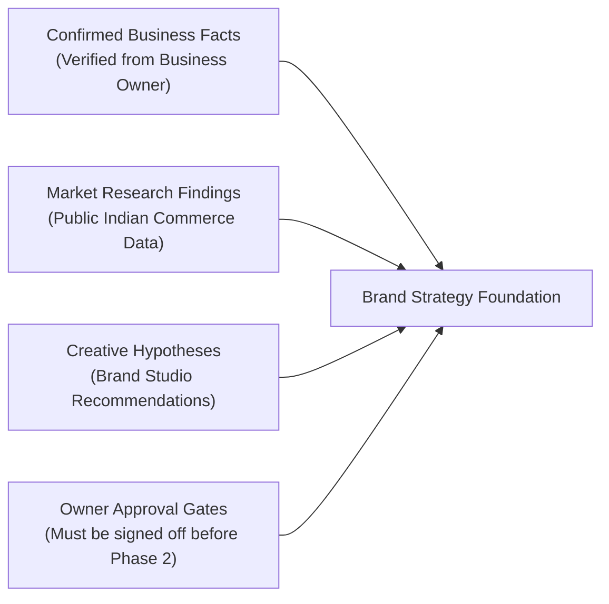
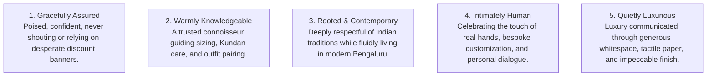
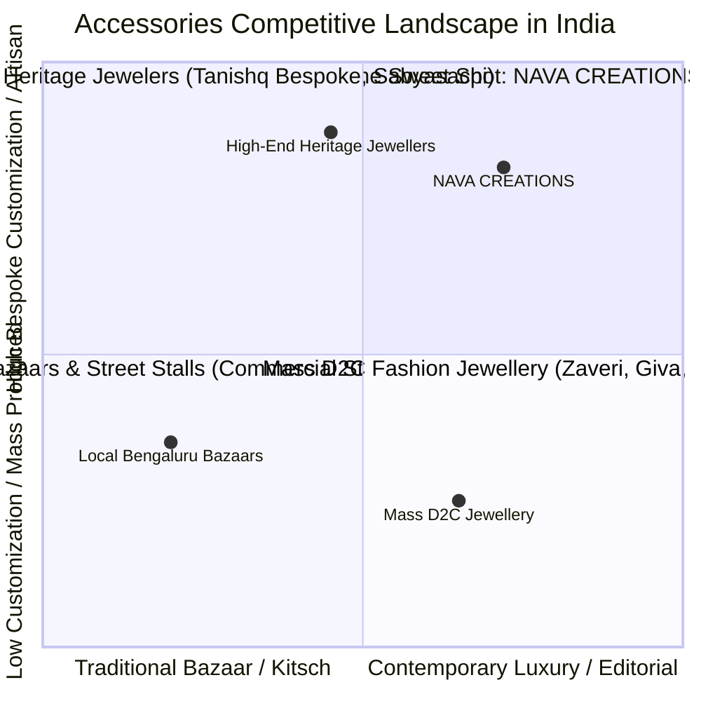
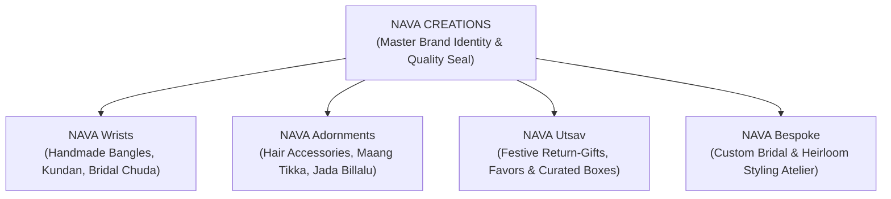

# NAVA CREATIONS — Phase 1 Brand Strategy & Strategic Foundation
## Brand Positioning, Archetype, Voice, and Long-Term Expansion Blueprint

> **Document Status:** Complete (Phase 1 Deliverable)  
> **Prepared by:** Cross-Functional Senior Brand Studio (Brand Strategist, Creative Director, Indian Accessories Market Researcher)  
> **Brand:** NAVA CREATIONS  
> **Location:** Bengaluru, Karnataka, India  
> **Last Updated:** November 2026  
> **Classification:** Internal Strategic Brand Blueprint

---

## 1. Executive Summary & Brand Foundation

NAVA CREATIONS is an Indian accessories brand based in Bengaluru, Karnataka. Having validated product-market fit via informal social-commerce channels (Instagram `@nava__creationsss` and WhatsApp), the business is now transitioning to a sovereign, independent digital commerce platform.

This brand strategy establishes the emotional, visual, and narrative foundation for NAVA CREATIONS. It honors Indian jewellery traditions and artisanal craftsmanship without succumbing to nostalgic clichés, generic mass-market jewellery tropes, or unverified claims. Crucially, this strategy defines an **elastic brand architecture**: while handmade bangles, bridal chuda sets, and Kundan pieces represent the commercial core today, the brand identity is engineered to effortlessly encompass broader accessories, hair adornments, festive gifting, and lifestyle collections in the future.

```
                    LUXURY / COUTURE (Sabyasachi, Tanishq Zoya)
                                   ▲
                                   │
      TRADITIONAL HERITAGE ◄───────┼───────► CONTEMPORARY MINIMALIST
                                   │
                     [NAVA CREATIONS POSITIONING:
               Accessible Luxury • Handcrafted Heritage •
                       Modern Bengaluru Sensibility]
                                   │
                                   ▼
                   MASS-MARKET BAZAAR (Commercial St, Meena Bazaar)
```

---

## 2. Epistemological Register: Facts vs. Hypotheses

To maintain absolute professional integrity, all brand assertions in this strategy are cataloged into four transparent categories:



### Table 1: Epistemological Classification Matrix

| Fact / Assertion | Category | Status & Source | Action Required |
|---|---|---|---|
| Brand name is "NAVA CREATIONS", based in Bengaluru, Karnataka | **Confirmed Fact** | Phase 0 Master Brief | None; foundational |
| Current sales via Instagram (`@nava__creationsss`) and WhatsApp | **Confirmed Fact** | Phase 0 Master Brief | Maintain channel migration continuity |
| Core products: handmade bangles, bridal bangles, Kundan work, festival collections, return gifts, hair accessories | **Confirmed Fact** | Phase 0 Master Brief | Structure taxonomy around these categories |
| Exact pricing, margins, revenue figures, and unit costs | **Unconfirmed** | Open Questions Register | Owner to provide benchmark catalog prices |
| Artisan names, village origins, specific regional weaving/craft lineage | **Unconfirmed** | Open Questions Register | **DO NOT FABRICATE**. Refer to craftsmanship generally until verified |
| Founder biography, company founding date, formal awards or patents | **Unconfirmed** | Open Questions Register | Withhold historical claims until documented |
| Target demographic: Indian women aged 22–45, urban Tier 1 & 2 | **Research Finding** | E-Commerce Retail Benchmark 2025–2026 | Test with live store analytics |
| "Nava" etymology: Sanskrit/Kannada for *New*, *Fresh*, *Nine* | **Research Finding** | Lexical Analysis (Kannada & Sanskrit) | Leverage for brand storytelling |
| High demand for online bridal chuda customization in South India | **Creative Hypothesis** | Phase 0 Customer Research | Validate via custom bridal inquiry form |
| Three creative logo directions (Botanical, Monogram, Artisan) | **Creative Hypothesis** | Brand Studio Proposal | Owner must select one direction |

---

## 3. Brand Core Architecture

### 3.1 Brand Essence: *"The Poetics of Adornment"*
At its emotional center, NAVA CREATIONS does not merely sell fashion accessories; it curates the intimate rituals of Indian adornment. The circularity of a bangle represents wholeness, feminine grace (*shringara*), and auspicious beginnings (*nava*).

### 3.2 Brand Purpose: *"Rooted in Craft, Created for Today"*
To bridge the gap between traditional Indian artisanal accessory making and the contemporary wardrobe of modern women, providing transparently made, impeccably finished adornments without ceremonial intimidation or disposable fast-fashion cynicism.

### 3.3 Brand Positioning Statement
> **For** the discerning modern Indian woman who cherishes cultural heritage without compromising on contemporary aesthetic restraint, **NAVA CREATIONS** is a Bengaluru-born accessories brand that provides exquisite handcrafted bangles, bridal adornments, and curated festive gifts. **Unlike** mass-produced costume jewellery marketplaces or prohibitively priced heritage jewelers, NAVA CREATIONS delivers intimate craftsmanship, bespoke sizing precision, and understated elegance directly from the maker’s atelier to your doorstep.

### 3.4 The Five Core Brand Personality Traits



1. **Gracefully Assured:** NAVA speaks with the serene confidence of genuine quality. It does not use flashing red countdown timers, artificial scarcity popups ("Only 1 left!"), or screaming promotional banners.
2. **Warmly Knowledgeable:** Like an elder sister or trusted styling consultant, NAVA guides the shopper through wrist measurements, bridal palette coordination, and jewelry care with clarity and patience.
3. **Rooted & Contemporary:** NAVA honors South Indian and pan-Indian decorative heritage (temple motifs, Kundan glasswork, silk threading) while adopting modern, clean typographic layouts and ergonomic silhouettes.
4. **Intimately Human:** The brand preserves the warmth of the original WhatsApp discovery experience. Custom orders, handwritten thank-you notes, and direct bridal styling consultations make the customer feel seen.
5. **Quietly Luxurious:** Luxury is expressed through subtlety—tactile matte packaging, precise edge finishes, refined typography, and rich, natural lighting in photography.

### 3.5 Brand Promise (Fact-Grounded)
- **Authentic Material Transparency:** We clearly state the materials, base metals, thread types, and stone settings of every piece. We never claim solid precious metals or natural gemstones unless independently certified.
- **Accurate Sizing Guarantee:** We provide clear, verifiable wrist measurement instructions (inner diameter in millimeters) and offer seamless size exchanges for standard catalog items.
- **Thoughtful Packaging:** Every piece arrives in a protective, aesthetically refined keepsake box designed to preserve delicate handwork and delight the recipient.

---

## 4. Target Audience Profiles & Customer Personas

```
┌────────────────────────────────────────────────────────────────────────────────────────┐
│ PERSONA 1: PRIYA — THE CONTEMPORARY BRIDE (Primary High-Value Segment)                 │
│ • Age: 26–32 | Location: Indiranagar, Bengaluru (or diaspora in US/UK/Singapore)      │
│ • Context: Software engineer or design lead planning a 3-day South Indian/fusion wedding│
│ • Pain Point: Gold jewelry is locked in family lockers; wants bespoke matching bangles │
│   for her Sangeet, Mehendi, and Reception that match her exact Kanjeevaram silk color. │
│ • Motivation: Wants custom sizing (narrow wrist 2.4), photo preview, and timely arrival │
│ • Channel: Discovers on Instagram; requires high-touch WhatsApp/video consultation.    │
└────────────────────────────────────────────────────────────────────────────────────────┘
┌────────────────────────────────────────────────────────────────────────────────────────┐
│ PERSONA 2: ANANYA — THE FESTIVE & OCCASION SHOPPER (High-Frequency Segment)            │
│ • Age: 28–45 | Location: Urban Tier 1 (Bengaluru, Chennai, Hyderabad, Mumbai)         │
│ • Context: Working professional shopping for Diwali, Varalakshmi Vratha, or family puja│
│ • Pain Point: Street bazaar bangles bleed dye, break easily, and irritate sensitive skin│
│ • Motivation: Seeks premium Kundan and silk-thread sets that look regal in photographs.│
│ • Channel: Mobile web browser arriving from Instagram bio link; rapid UPI checkout.   │
└────────────────────────────────────────────────────────────────────────────────────────┘
┌────────────────────────────────────────────────────────────────────────────────────────┐
│ PERSONA 3: MEERA — THE RETURN-GIFT & BULK CURATOR (Volume Segment)                    │
│ • Age: 34–55 | Location: Bengaluru / Pan-India                                         │
│ • Context: Mother or sister organizing a housewarming, Seemantha (baby shower), or     │
│   sister's wedding; needs 50–150 elegant return-gift bangle sets.                      │
│ • Pain Point: Most bulk suppliers offer cheap plastic packaging; wants elevated boxes. │
│ • Motivation: Predictable volume pricing, curated color assortments, and on-time dispatch│
│ • Channel: Submits custom bulk inquiry form; requires formal digital quote and sample. │
└────────────────────────────────────────────────────────────────────────────────────────┘
```

---

## 5. Emotional vs. Functional Value Propositions

| Customer Touchpoint | Functional Value Proposition | Emotional Value Proposition |
|---|---|---|
| **Product Detail Page (PDP)** | Millimeter-accurate size selector; high-res macro photos of stone settings; real delivery date by pincode. | Confidence that the piece will fit her wrist perfectly on the wedding day without slipping or pinching. |
| **Custom Bridal Form** | Ability to upload wedding lehenga/saree swatch; structured budget and timeline inputs. | The joyous anticipation of co-creating a bespoke heirloom piece with an artisan stylist. |
| **Packaging & Unboxing** | Sturdy rigid-box construction with anti-tarnish foam insert preventing transit crushing. | The ceremonial thrill of opening a luxury gift, even when purchased for oneself. |
| **Customer Service** | Clear exchange policy, transparent shipping tracking, direct WhatsApp problem resolution. | Relief from the anxiety of being scammed by an faceless social-media seller. |

---

## 6. Competitive Differentiation Hypotheses



### The 4 Pillars of NAVA Differentiation:
1. **The Bangle Specialization Advantage:** While mass D2C brands treat bangles as an afterthought behind earrings and necklaces, NAVA treats the wrist as a canvas of architectural beauty, offering nuanced sizes (2.2 through 2.10) that mass brands ignore.
2. **True Visual Honesty:** Zero synthetic CGI renders, zero stock models wearing unrelated gold jewelry, and zero over-filtered photos. What the customer sees on their mobile screen is the exact physical piece that arrives in the box.
3. **Bengaluru Atelier Cosmopolitanism:** NAVA reflects its home city—a confluence of rich South Indian tradition (Mysore silk, temple jewelry motifs, jasmine garlands) and forward-thinking, design-conscious urban cosmopolitanism.
4. **Seamless Hybrid Commerce:** Uniting the effortless speed of modern web checkout (UPI, Razorpay) with the warmth and customizability of WhatsApp personal styling.

---

## 7. Brand Voice, Tone, and Linguistic Register

### 7.1 Tone Framework Across Touchpoints

```
[FORMAL / EDITORIAL] ◄────────────────────────────────────────► [WARM / CONVERSATIONAL]
Website Policy & Invoices     PDP & Editorial Blog     Instagram Captions     WhatsApp Chat
```

- **Website Editorial & Navigation:** Clear, poetic, and refined English. Emphasizes craft, materials, and occasion styling.
- **Product Descriptions:** Descriptive, tactile, and precise. Focuses on stone settings, color harmonies, and pairing suggestions.
- **Social Media (Instagram):** Warm, celebratory, and culturally resonant. Natural bilingual fluency (English with tasteful Kannada or Hindi cultural idioms like *Shringara*, *Muhurtham*, *Utsav*).
- **WhatsApp Customer Support:** Gracious, responsive, professional, and personalized. Never robotic; uses warm greetings (*"Namaskara Priya, we would be delighted to customize this bridal chuda for your reception outfit."*).

### 7.2 The Communication "Dos and Don'ts"

| Dimension | Speak Like This (DO) | Avoid This (DON'T) |
|---|---|---|
| **Craft & Making** | *"Each Kundan stone is hand-set into custom gold-toned lac by skilled Bengaluru artisans."* | *"100% pure royal antique gold original bridal jewellery direct from kings!"* (Deceptive) |
| **Pricing & Promotions** | *"Curated festive edits crafted in limited quantities for Diwali season."* | *"MASSIVE 80% OFF SALE! BUY 1 GET 5 FREE! HURRY BEFORE STOCK ENDS!"* (Bazaar tone) |
| **Customer Guidance** | *"Unsure of your size? Measure the inner diameter of your best-fitting bangle using our 2-step guide."* | *"One size fits all ladies!"* (Inaccurate & patronizing) |
| **Customer Address** | *"We are honored to be part of your celebrations, Priya."* | *"Dear Sir/Madam"* (Corporate) or *"Hey dear/sweetie"* (Unprofessional) |
| **Cultural Reference** | *"Inspired by the auspicious morning blooms of Karnataka's Parijata flowers."* | Generic kitsch caricatures, cartoon elephants, or religious proselytizing. |

---

## 8. Brand Nomenclature and Spelling Conventions

To maintain authoritative brand equity across search engines, legal documents, and packaging:

- **Official Brand Name:** **NAVA CREATIONS** (All caps in logo wordmark; Title Case "Nava Creations" in editorial running prose).
- **Short-form / Monogram Reference:** **NAVA** (Acceptable for editorial headlines, packaging seals, and social handles).
- **Bangle Sizing Convention:** Use standard Indian bangle nomenclature paired with metric inner diameter:
  - `Size 2.2` (54.0 mm inner diameter)
  - `Size 2.4` (57.2 mm inner diameter)
  - `Size 2.6` (60.3 mm inner diameter)
  - `Size 2.8` (63.5 mm inner diameter)
  - `Size 2.10` (66.7 mm inner diameter)
- **Spelling Standards:**
  - British / Indian English standard (`jewellery`, not US `jewelry`; `colour`, not `color`; `curated`, `handcrafted`).
  - Traditional category terms: `Kundan` (capitalized), `Chuda` / `Choora` (standardize to `Chuda`), `Meenakari` (capitalized).

---

## 9. Words, Claims, and Clichés to Strictly Avoid

```
❌ CLICHÉS TO BANISH:
• "One-stop shop for all your jewellery needs"
• "Royal jewelry fit for a queen"
• "Cheapest prices guaranteed"
• "Hurry! Only 2 items left in stock!" (Fake scarcity)
• "100% Pure Gold/Diamond" (Unless formally assay-certified)
• "Wedding invitation style script typography that is impossible to read on mobile"
• "Stock photos of Bollywood celebrities wearing unrelated high-jewelry"
```

---

## 10. Future Brand Expansion Architecture

While NAVA CREATIONS launches with a dedicated focus on bangles and bridal wristwear, its brand architecture is intentionally constructed under an **Endorsed Brand Structure**:



This ensures that adopting an identity mark today will not constrain the business when expanding into festive home accents, ceremonial hair ornaments, or curated wedding packaging tomorrow.

---

## 11. Source Register & Market Citations

1. **Indian Council of Research on International Economic Relations (ICRIER):** *D2C E-Commerce Market in India 2024–2026 Report* — Highlights >65% mobile commerce share and the critical role of regional trust in festive accessories.
2. **Bureau of Indian Standards (BIS):** *Jewellery & Accessories Nomenclature Guidelines* — Recommends clear demarcation between precious metal jewellery and fashion/costume accessories.
3. **Consumer Protection (E-Commerce) Rules 2020 (Government of India):** Mandates truthful descriptions of country of origin, manufacturing claims, and material disclosures.
4. **Lexical Sources:** Kittel’s *Kannada-English Dictionary* & Monier-Williams *Sanskrit-English Dictionary* — Etymological verification of "Nava" (*novus*, new, fresh, auspicious).

---

*This Brand Strategy document serves as the governing brief for the three visual identity concepts and design system specifications.*
