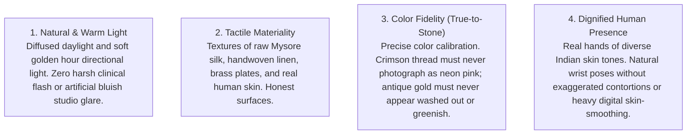

# NAVA CREATIONS — Photography & Art Direction Manual
## Editorial Guidelines, Studio Lighting, Composition, and Visual Integrity Rules

> **Document Status:** Complete (Phase 1 Deliverable)  
> **Brand:** NAVA CREATIONS (Bengaluru, Karnataka)  
> **Target Audience:** Commercial Photographers, Content Creators, E-Commerce Merchandisers  
> **Classification:** Creative Production Standard

---

## 1. Visual Integrity & Truth-in-Commerce Rule

> [!CRITICAL]
> **Zero Synthetic Product Substitution Policy:**  
> Indian jewellery and bridal accessories are bought for milestone life occasions. Customers evaluate stone cuts, thread dye tones, and kada thickness. **At no point shall AI-generated synthetic jewellery images be published in the commercial production catalogue as substitutes for real NAVA CREATIONS products.**  
> - Generative AI may be used strictly for early concept moodboards (and must be visibly watermarked *"Concept Moodboard Only"*).
> - Every item listed on the commercial website must be photographed from actual, physically finished stock produced in the Bengaluru atelier.

---

## 2. Core Photography Pillars & Aesthetic Character

NAVA CREATIONS photography combines the warm, natural lighting of an Indian morning atelier with the crisp, disciplined focus of high-end editorial jewellery styling:



---

## 3. Studio Lighting & Camera Specifications

### 3.1 Lighting Setup
- **Primary Key Light:** Large softbox (120cm octabox) diffused through a 1.5-stop silk scrim, positioned at 45 degrees to replicate soft natural window light.
- **Fill Light / Reflector:** Silver/white foam bounce board on the opposite side to gently illuminate shadow details on Kundan stone facets without washing out contrast.
- **Accent Hairline Light:** Subtle strip light overhead to highlight the metallic sheen of gold kadas and the subtle sheen of silk threading.
- **Color Temperature Target:** Strictly calibrated between **`5200K – 5500K`** (Daylight balanced).

### 3.2 Camera & Lens Standards
- **Sensor:** Full-Frame Mirrorless (Sony A7R series, Canon R5, or Nikon Z7) delivering minimum 45 Megapixel resolution for sharp zooming.
- **Primary Lenses:**
  - `90mm – 105mm f/2.8 Macro` for extreme close-ups of stone settings and thread weaves.
  - `50mm f/1.4 or f/1.8` for lifestyle wristwear and overhead flat-lays.
- **Aperture Settings:**
  - Macro Detail Shots: `f/8 – f/11` to maintain depth-of-field across the entire curvature of the bangle. Focus-stacking (3–5 frames) is recommended for broad bridal sets.
  - Lifestyle Editorial Shots: `f/2.8 – f/4` to create gentle background falloff while keeping the jewelry in sharp focus.

---

## 4. Backgrounds & Textural Surfaces

All studio backgrounds must reinforce the warm, artisanal palette of NAVA CREATIONS:

```
┌────────────────────────────────────────────────────────────────────────┐
│ APPROVED BACKGROUND MATERIALS & SURFACES                               │
├────────────────────────────────────────────────────────────────────────┤
│ 1. Raw Mysore & Tussar Silk: Deep crimson, olive green, warm ivory     │
│ 2. Unbleached Linen & Kora Cotton: Tactile neutral fabric backdrop     │
│ 3. Honed Travertine & Sandstone: Warm mineral stone slabs (matte)      │
│ 4. Antique Brass & Copper Trays: Authentic patina plates (unpolished)  │
│ 5. Hand-poured Ceramic Tiles: Warm bone white and terracotta clay      │
├────────────────────────────────────────────────────────────────────────┤
│ ❌ PROHIBITED BACKGROUNDS:                                             │
│ • Pure sterile clinical white (#FFFFFF paper roll with no shadow)      │
│ • High-gloss acrylic / plastic reflection sheets                       │
│ • Artificial synthetic silk with cheap synthetic shine                 │
│ • Busy, overwhelming flower beds that distract from product geometry   │
└────────────────────────────────────────────────────────────────────────┘
```

---

## 5. Composition & Shot List Guidelines (5 Core Shots per SKU)

For every product variant listed on the storefront, the photographer must deliver a standard package of **5 high-resolution photographs** formatted to **4:5 portrait ratio**:

```
┌────────────────────────────────────────────────────────────────────────┐
│ SHOT 1: THE HERO PROFILE (4:5 Ratio)                                   │
│ • Setup: Complete bangle set standing upright or resting angled on a   │
│   warm ivory travertine stone. Clean, distraction-free view.           │
│ • Purpose: Category page thumbnail and initial PDP hero view.          │
├────────────────────────────────────────────────────────────────────────┤
│ SHOT 2: THE MACRO DETAIL (Close-Up)                                    │
│ • Setup: 100mm macro view focusing on Kundan stone prongs, Meenakari   │
│   enameling, and silk thread terminations.                             │
│ • Purpose: Proves craftsmanship quality and builds buying trust.       │
├────────────────────────────────────────────────────────────────────────┤
│ SHOT 3: WORN ON WRIST (Human Context)                                  │
│ • Setup: Bangles worn on a real woman's wrist, resting naturally on    │
│   a silk saree pleat or lap. Natural skin texture (no plastic blur).   │
│ • Purpose: Demonstrates proportion, scale, and stacking thickness.     │
├────────────────────────────────────────────────────────────────────────┤
│ SHOT 4: OVERHEAD CURATION (Flat-Lay)                                   │
│ • Setup: 90-degree top-down view showing individual bangles separated  │
│   to illustrate the full anatomy of the set (kadas, spacers, accents). │
│ • Purpose: Clarifies exactly how many pieces are included in the box.  │
├────────────────────────────────────────────────────────────────────────┤
│ SHOT 5: UNBOXING & PACKAGING PRESENTATION                              │
│ • Setup: The bangles nestled inside the official NAVA plum keepsake    │
│   drawer box with ribbon pull and velvet cushion.                      │
│ • Purpose: Reinforces the gifting and luxury unboxing experience.      │
└────────────────────────────────────────────────────────────────────────┘
```

---

## 6. Digital Asset Organization & Naming Taxonomy

To streamline automated ingestion into Cloudinary and the Next.js e-commerce media pipeline, all photographic files must adhere to the standardized naming structure:

```
Structure:
[category]_[product-slug]_[variant-size]_[shot-type]_[sequence].[ext]

Examples:
brd_padmavati-chuda_2-6_hero_01.webp
brd_padmavati-chuda_2-6_macro_02.webp
brd_padmavati-chuda_2-6_wrist_03.webp
brd_padmavati-chuda_2-6_flatlay_04.webp
brd_padmavati-chuda_2-6_packaging_05.webp
```

### Technical Export Specifications:
- **Master Archive Format:** Uncompressed 16-bit TIFF or DNG in Adobe RGB color space.
- **Web Production Master:** 2400 × 3000px, 8-bit JPEG, sRGB color space, quality 92%.
- **Automated CDN Delivery:** Cloudinary converts on-the-fly to **AVIF** and **WebP** (`f_auto,q_auto:good`) for sub-second mobile loading times.

---

*This photography guide is binding for all official commercial imagery produced for NAVA CREATIONS.*
