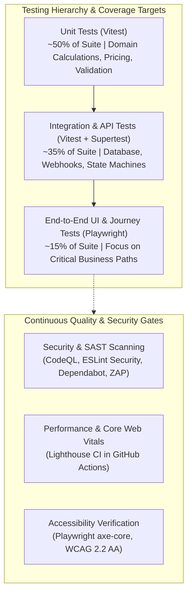
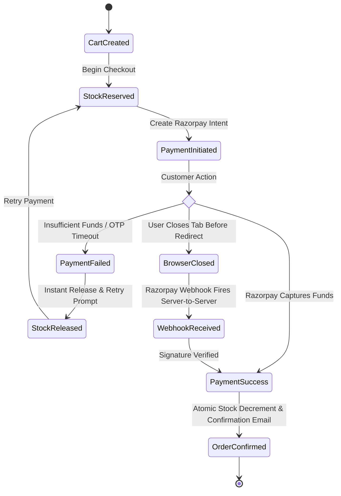

# NAVA CREATIONS — Quality Assurance, Testing Strategy & Release Engineering Plan
## End-to-End Verification, Critical Failure Scenarios, Security Testing, and Deployment Governance

> **Document Status:** Complete (Phase 0 Deliverable)  
> **Author:** QA & Release Engineer, Senior Full-Stack Engineer, Application Security Engineer  
> **Target Audience:** Engineering Team, Product Owner, External Auditors  
> **Last Updated:** November 2026  
> **Classification:** Operational & Quality Assurance Blueprint

---

## 1. Quality Assurance Philosophy & Testing Pyramid

NAVA CREATIONS is an e-commerce platform processing real financial transactions, binding customer orders, and managing scarce artisan inventory. Software failures directly jeopardize customer trust, bridal timelines, and business revenue.

Our testing strategy follows the classical **Testing Pyramid**, optimized for high confidence, fast feedback loops, and maintainability for a lean development team:



### Coverage & Quality Gates:
- **Financial & Payment Logic:** **100% branch and statement coverage** (GST calculations, discounts, coupons, shipping thresholds, Razorpay webhook signature validation).
- **Inventory & Order State Machine:** **100% state-transition coverage** (reservation timeouts, concurrent decrement locks, order lifecycle status transitions).
- **Domain Business Rules:** **>85% coverage** (Zod validation schemas, pricing rules, size chart matching).
- **Storefront & Admin UI:** Critical flow coverage via Playwright automated browser tests.

---

## 2. Tooling & Test Automation Stack

| Testing Discipline | Selected Tool / Framework | Justification for NAVA Architecture |
|---|---|---|
| **Unit & Integration Testing** | **Vitest** | Native TypeScript & ESM support, 10x faster execution than Jest, seamless Next.js App Router mocking |
| **End-to-End (E2E) Automation** | **Playwright** | Multi-browser headless testing (Chromium, WebKit, Firefox), native mobile viewport emulation (iPhone / Pixel), resilient auto-waiting |
| **API & Route Handler Testing** | **Native Vitest + fetch** | Tests Next.js Route Handlers and Server Actions directly with real test PostgreSQL database |
| **Accessibility (a11y)** | **@axe-core/playwright** | Automated DOM accessibility scanning against WCAG 2.2 AA standards on every page render |
| **Performance Testing** | **Lighthouse CI (LHCI)** | Enforces Core Web Vitals budgets (LCP ≤ 2.5s, INP ≤ 200ms, CLS ≤ 0.1) in GitHub Actions PR gates |
| **Security SAST / Dependency** | **CodeQL + npm audit** | Static vulnerability analysis and automated npm supply-chain vulnerability alerts |
| **Mocking / External Services** | **MSW (Mock Service Worker)** | Deterministic interception of Razorpay, Shiprocket, and Resend HTTP calls during test execution |

---

## 3. The 15 Critical Business Failure Scenarios

The following 15 high-risk scenarios must have automated test specifications and manual acceptance test passes prior to any production launch.



### Detailed Scenario Specifications

#### Scenario 1: Product Creation by Admin with Multi-Variants and SKU
- **Test Type:** E2E (Playwright) + Integration
- **Precondition:** Authenticated as `Product Manager` or `Owner`.
- **Action:** Create "Meenakari Bridal Chuda Set" with 3 sizes (2.4, 2.6, 2.8), 2 colour finishes (Gold, Rose Gold), distinct SKUs, images, cost price, and stock levels.
- **Expected Outcome:** 6 distinct variant rows inserted into `product_variants` and `inventory_items`; audit log captures `PRODUCT_CREATED` with user ID; product is hidden from storefront until status is set to `PUBLISHED`.
- **Pass/Fail Criteria:** Pass if storefront search indexes the published variants and inventory reflects exact per-SKU allocation.

#### Scenario 2: Product Price Modification Does Not Mutate Historical Orders
- **Test Type:** Integration (Vitest + Prisma)
- **Precondition:** Order #1001 contains Product A purchased at ₹1,499 with 3% GST.
- **Action:** Admin modifies Product A price to ₹1,899 and archives the variant.
- **Expected Outcome:** Historical Order #1001 retains snapshot `{ "price": 1499, "gst_rate": 0.03, "sku": "BAN-01" }` in `order_items.product_snapshot`; customer invoice generation reproduces the exact ₹1,499 figure.
- **Pass/Fail Criteria:** Pass if no column in `orders` or `order_items` changes value following the product update.

#### Scenario 3: Product Archival Without Breaking Customer Order History
- **Test Type:** Integration + E2E
- **Precondition:** Customer has Order #1002 containing Variant B.
- **Action:** Admin clicks "Archive Product" for Variant B (sets `deleted_at = NOW()`).
- **Expected Outcome:** Variant B is removed from public catalogue, category pages, and search autocomplete; customer's order history page (`/account/orders`) displays Variant B with historical title, thumbnail, and "Archived" badge without 500 errors.
- **Pass/Fail Criteria:** Storefront product route returns 404; customer order detail returns 200 with complete snapshot details.

#### Scenario 4: Customer Checkout Happy Path (UPI / Card)
- **Test Type:** E2E (Playwright with Razorpay Mock)
- **Precondition:** Customer adds Bangle Size 2.6 (Stock: 5) to cart.
- **Action:** Enters valid Bengaluru shipping address, proceeds to payment, completes mock Razorpay payment (`payment.captured`).
- **Expected Outcome:** Order state transitions to `PAID`; available stock decrements to 4; confirmation email sent via Resend; user redirected to `/checkout/order-confirmation/[id]`.
- **Pass/Fail Criteria:** Order record exists with valid `razorpay_payment_id`, tracking milestone initialized, cart cleared.

#### Scenario 5: Invalid / Expired Coupon Rejection
- **Test Type:** Unit + Integration
- **Precondition:** Coupon `FESTIVAL10` exists: requires ₹2,000 minimum order, expires 2026-11-01, max 100 uses.
- **Action:** Customer attempts to apply `FESTIVAL10` on a ₹1,500 cart on 2026-11-10.
- **Expected Outcome:** Server returns 422 Unprocessable Entity with message: *"Coupon expired or minimum order value of ₹2,000 not met."* Subtotal remains un-discounted.
- **Pass/Fail Criteria:** Pass if zero discount is applied and no database record in `coupon_usages` is created.

#### Scenario 6: Payment Failure and Automatic Stock Reservation Release
- **Test Type:** Integration
- **Precondition:** Stock for SKU-01 is 1. Customer initiates checkout; reservation created with 15-minute TTL.
- **Action:** Customer fails bank 3D-Secure OTP; Razorpay emits `payment.failed`.
- **Expected Outcome:** Webhook handler marks `payment_attempts.status = 'FAILED'`; stock reservation is immediately released (`stock_reservations.status = 'RELEASED'`); available stock returns to 1 for other shoppers.
- **Pass/Fail Criteria:** Pass if a concurrent shopper can immediately add SKU-01 to cart following payment failure.

#### Scenario 7: Payment Success with Browser Closed Prior to Redirect
- **Test Type:** Integration
- **Precondition:** Customer completes UPI payment on their mobile PhonePe app but closes their browser tab before redirecting back to NAVA.
- **Action:** Razorpay asynchronously posts `order.paid` webhook to `/api/webhooks/razorpay`.
- **Expected Outcome:** Server verifies HMAC-SHA256 signature, sets `orders.status = 'PAID'`, decrements inventory, and dispatches confirmation email/WhatsApp with the order link. When customer reopens the site, order shows as confirmed in their account.
- **Pass/Fail Criteria:** Order is successfully confirmed and fulfilled without requiring any client browser redirect.

#### Scenario 8: Duplicate Webhook Delivery (Idempotency Enforcement)
- **Test Type:** Integration
- **Precondition:** Order #1005 is paid. Razorpay retries webhook `evt_test_12345` three times due to transient network latency.
- **Action:** Server receives the identical webhook payload 3 consecutive times.
- **Expected Outcome:** First request processes transaction and inserts `evt_test_12345` into `payment_events`; 2nd and 3rd requests detect existing event ID, log idempotent skip, and immediately return HTTP 200 OK.
- **Pass/Fail Criteria:** Pass if inventory is decremented exactly once and only one confirmation email is dispatched.

#### Scenario 9: Race Condition — Two Buyers Competing for Final Stock Item
- **Test Type:** Integration (Concurrent Promise.all in Vitest)
- **Precondition:** SKU-LUX-01 has exactly `stock_quantity = 1`.
- **Action:** Buyer A and Buyer B simultaneously submit checkout payment creation requests at the exact same millisecond.
- **Expected Outcome:** Database row-level locking (`SELECT FOR UPDATE`) grants the reservation lock to Buyer A; Buyer B's transaction detects zero available stock and gracefully returns HTTP 409 Conflict: *"Item just went out of stock"*.
- **Pass/Fail Criteria:** Pass if exactly one order is created, zero negative inventory occurs, and no double-charging takes place.

#### Scenario 10: Cash on Delivery (COD) Placement and Cancellation
- **Test Type:** E2E
- **Precondition:** Customer selects COD for a ₹1,200 bangle order.
- **Action:** Customer completes SMS/WhatsApp OTP verification, places order; cancels 2 hours later prior to dispatch.
- **Expected Outcome:** Initial order status is `AWAITING_FULFILLMENT`; upon customer cancellation, status transitions to `CANCELLED`, inventory is restored to available, and Shiprocket dispatch request is aborted.
- **Pass/Fail Criteria:** Pass if inventory is restored and no courier AWB is generated.

#### Scenario 11: Refund Triggered via Payment Gateway API
- **Test Type:** Integration
- **Precondition:** Order #1008 is `PAID` (₹2,500) via Razorpay.
- **Action:** Admin clicks "Issue Full Refund" with reason "Customer requested return within 48 hours".
- **Expected Outcome:** Server calls Razorpay `POST /v1/payments/{id}/refund`; upon success, creates record in `refunds` table, updates `orders.status = 'REFUNDED'`, and sends refund confirmation email to customer.
- **Pass/Fail Criteria:** Pass if Razorpay mock verifies refund amount matches order amount and internal ledger balances to zero.

#### Scenario 12: Customer Return & Exchange Lifecycle Management
- **Test Type:** E2E Admin & Storefront
- **Precondition:** Order #1010 marked `DELIVERED` 2 days ago.
- **Action:** Customer submits exchange request: "Size 2.4 is too tight; exchange for Size 2.6". Admin reviews photo, approves exchange, and schedules reverse pickup.
- **Expected Outcome:** Order status transitions to `EXCHANGE_REQUESTED` → `EXCHANGE_APPROVED` → `REVERSE_PICKUP_SCHEDULED`. Upon warehouse return receipt, new shipment for Size 2.6 is dispatched.
- **Pass/Fail Criteria:** Pass if both legs of shipment tracking are recorded in database with complete audit history.

#### Scenario 13: Unauthorised Admin Access Attempt (Role-Based Access Control)
- **Test Type:** Security / Integration
- **Precondition:** User is authenticated as `Support Staff`.
- **Action:** Attempt to call `POST /api/admin/products` or access `/admin/settings/financials`.
- **Expected Outcome:** Server middleware and Server Actions reject request with HTTP 403 Forbidden; security event logged in `audit_logs` capturing user ID, IP address, and attempted endpoint.
- **Pass/Fail Criteria:** Pass if zero database modifications occur and access is strictly denied.

#### Scenario 14: Malicious File Upload Prevention
- **Test Type:** Security / API
- **Precondition:** Customer custom bridal inquiry form accepts outfit reference photos.
- **Action:** Attacker uploads a PHP script disguised as `photo.jpg.php` with MIME type `image/jpeg`, and an oversized 50MB file.
- **Expected Outcome:** Server performs deep binary inspection (magic bytes check), rejects the PHP extension, enforces 10MB limit, and rejects with HTTP 400 Bad Request.
- **Pass/Fail Criteria:** Pass if file is rejected before reaching storage and zero executable files reside on server.

#### Scenario 15: Customer Data Request (DPDPA Right to Access & Anonymization)
- **Test Type:** Integration / Compliance
- **Precondition:** Registered customer requests data export and account erasure under India's DPDP Act 2023.
- **Action:** Admin executes customer privacy export and anonymization job.
- **Expected Outcome:** Customer PII (name, email, phone, stored addresses) is exported to encrypted JSON for customer download; account is anonymized (`anonymized_user_782@deleted.local`); historical completed orders retain legally required tax and financial snapshots for statutory accounting without exposing PII.
- **Pass/Fail Criteria:** Pass if all live marketing and profile PII is erased while GST tax audit integrity is maintained.

---

## 4. Staging Environment & Release Governance

```mermaid
flowchart LR
    Dev[Local Developer Machine] -->|Git Push| FeatureBranch[Feature Branch PR]
    FeatureBranch -->|GitHub Actions| CI[Lint + Vitest + Playwright + LHCI]
    CI -->|Automatic PR Deploy| Preview[Vercel Preview Environment\n+ Neon Branch Database]
    Preview -->|QA Approval & Merge| Main[Main Branch]
    Main -->|Automated Deployment| Staging[Staging Environment\n(Test Gateway & Synthetic Data)]
    Staging -->|Owner Acceptance Sign-Off| Prod[Production Environment\n(Live Gateway, Real Customers)]
```

### 4.1 Environment Configuration Matrix
| Environment | Hosting / URL | Database | Gateway Mode | Courier Integration | Purpose |
|---|---|---|---|---|---|
| **Local Dev** | `localhost:3000` | Local Docker Postgres or Neon Dev Branch | Razorpay Test Mode | Shiprocket Sandbox | Feature development & unit testing |
| **Preview** | `*.vercel.app` (PR specific) | Ephemeral Neon Database Branch | Razorpay Test Mode | Mock Courier API | Peer review, visual regression |
| **Staging** | `staging.navacreations.in` | Dedicated Staging PostgreSQL | Razorpay Test Mode | Shiprocket Staging | End-to-end rehearsal, business owner sign-off |
| **Production** | `navacreations.in` | Neon Primary High-Availability Postgres | Razorpay Live Mode | Shiprocket Live | Real commercial operations |

---

## 5. Deployment, Rollback & Incident Response Plan

### 5.1 Zero-Downtime Database Migration Protocol
Because Next.js serverless functions scale dynamically across Vercel edge nodes, database migrations must maintain backwards compatibility:
1. **Expand and Contract Pattern:** Never rename or delete a database column in the same deployment where code changes occur.
   - *Step 1 (Expand):* Add new nullable column or table via Prisma migration. Deploy code that writes to both old and new columns.
   - *Step 2 (Migrate):* Backfill historical data via migration script.
   - *Step 3 (Contract):* Deploy code that reads solely from new column. Drop legacy column in subsequent migration.
2. **Pre-Deployment Migration Hook:** GitHub Actions executes `pnpm prisma migrate deploy` against the target database before promoting Vercel build to live traffic.

### 5.2 Rollback Strategy
- **Instant Frontend Rollback:** Vercel maintains instant immutable rollbacks. If a fatal runtime bug occurs, clicking "Rollback" in Vercel restores the previous build artifact in **< 15 seconds**.
- **Database Rollback:** Handled via forward-fixing migrations (`down` migration scripts authored and validated in staging before production release).

### 5.3 Incident Severity & Escalation Matrix
| Severity Level | Operational Impact | Target Acknowledgment | Target Resolution | Escalation Path |
|---|---|---|---|---|
| **P0 (Critical)** | Checkout broken, payment webhooks failing, site down | **< 15 minutes** | **< 2 hours** | Lead Developer + Business Owner |
| **P1 (High)** | Inventory allocation errors, order tracking unavailable, email delivery failing | **< 1 hour** | **< 6 hours** | Lead Developer |
| **P2 (Medium)** | Admin report export error, visual glitch on desktop, blog CMS issue | **< 4 hours** | **< 24 hours** | Developer |
| **P3 (Low)** | Minor copy error, cosmetic styling inconsistency | **< 24 hours** | Next scheduled release | Backlog |

---

## 6. Disaster Recovery & Backup Restoration Protocol

- **Automated Backup Schedule:** Daily full snapshot of Neon PostgreSQL database taken at 03:00 AM IST with 30-day point-in-time recovery (PITR).
- **Target Metrics:**
  - **Recovery Time Objective (RTO):** < 1 hour to fully restore database and application services.
  - **Recovery Point Objective (RPO):** < 5 minutes of transactional data loss via write-ahead logging (WAL).
- **Disaster Recovery Drill:** Every quarter, the development team must execute a manual restoration of the latest backup snapshot into an isolated sandbox database, validating that record counts in `orders`, `order_items`, and `users` match production exactly.

---

*This QA, testing, and release blueprint represents the production readiness criteria for NAVA CREATIONS Phase 4 through launch.*
