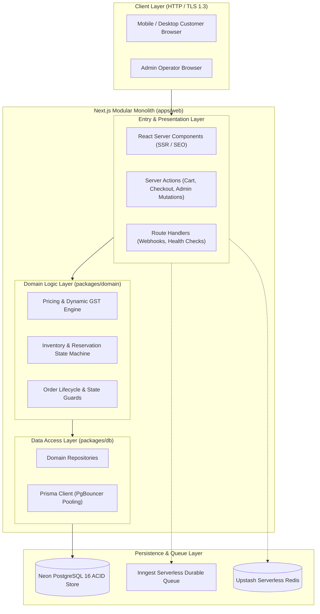
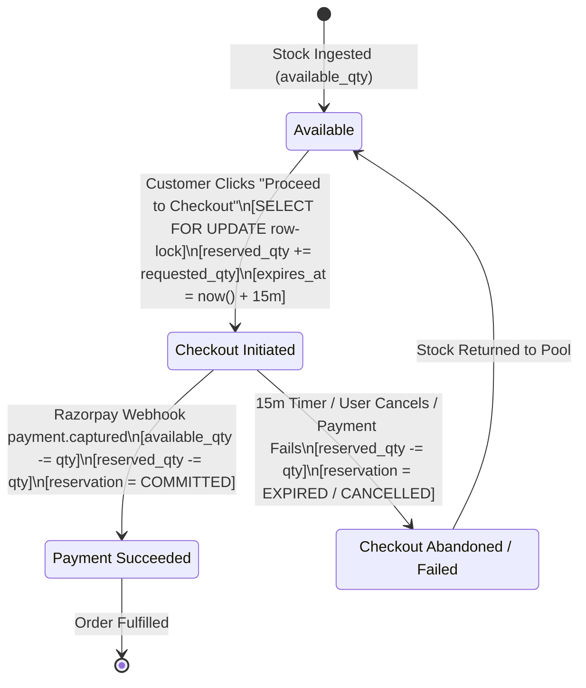
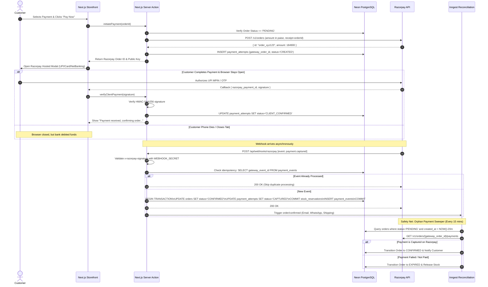
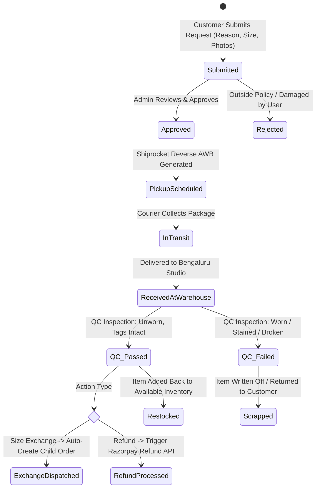
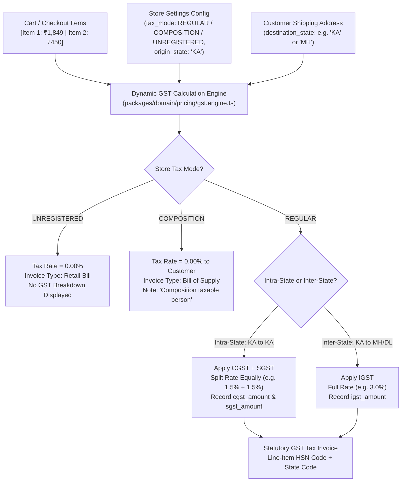

# NAVA CREATIONS — Phase 2.1 Architecture Decision Finalisation
## Definitive Architectural Resolutions, Lifecycle Specifications, and Pre-Implementation Governance

> **Document Type:** Architecture Decision Finalisation & Engineering Specification
> **Brand Under Review:** NAVA CREATIONS (Bengaluru, Karnataka)
> **Platform Classification:** Sovereign Indian Accessories E-Commerce Platform
> **Auditing Authority:** Principal Software Architect & Technical Review Board
> **Target Document:** `docs/phase-2/PHASE_2_1_ARCHITECTURE_DECISIONS.md`
> **Reference Baseline:** `docs/phase-2/PHASE_2_ARCHITECTURE_AUDIT.md`
> **Date of Ratification:** November 2026
> **Implementation Status:** Pre-Implementation Architectural Blueprint — Zero Application Code Implemented

---

## Executive Summary & Document Scope

This document formally finalises the architectural decisions for **NAVA CREATIONS**, addressing the critical gaps, edge cases, and compliance risks identified in the [Phase 2 Architecture Readiness Audit](PHASE_2_ARCHITECTURE_AUDIT.md).

It is a **binding technical decision document**, not an implementation task. No application code has been written, no packages installed, and no previous planning documents modified.

Every decision is structured into an engineering standard:
1. **Decision**: The definitive technical choice.
2. **Rationale**: Technical, operational, and commercial justification.
3. **Alternatives Considered**: Evaluated architectural trade-offs.
4. **Risks**: Failure modes, bottlenecks, and edge cases.
5. **Validation Required**: Tests, benchmarks, and external confirmations needed.
6. **Implementation Acceptance Criteria**: Exact engineering conditions required before sign-off.

---

## 1. Decision 1: Initial Deployment Architecture (Next.js Monolith vs. Separate Backend)

### 1.1 Decision
**Adopt a Modular Monolith deployed on Next.js 15 (App Router with React Server Components) on Vercel Pro, backed by a serverless durable job queue.** A separate standalone backend service (Express, NestJS, Go, or Fastify) is **rejected for the launch phase**.

All code will reside in a single repository managed via `pnpm` workspaces and Turborepo, enforcing strict internal layering:
```
apps/web/               # Next.js App Router (Storefront + Admin UI + Webhook Route Handlers)
packages/domain/        # Framework-agnostic pure domain logic (Pricing, Cart, Orders, State Machines)
packages/db/            # Prisma ORM schema, migrations, connection pooler, repositories
packages/ui/            # Shared accessible React component primitives (Radix UI / Tailwind CSS v4)
packages/config/        # Shared ESLint, TypeScript, and environment validation schemas (Zod)
```



### 1.2 Rationale
1. **Atomic Transaction Integrity:** E-commerce operations (e.g., checkout initiation) require atomic consistency: inventory must be locked, order records generated, discount usage checked, and payment intents created within a single database transaction. A modular monolith allows native PostgreSQL ACID transactions (`prisma.$transaction`). A separate backend introduces distributed sagas, two-phase commits, and network failure modes that an early-stage engineering team cannot reliably operate.
2. **Elimination of Operational Overhead:** Running separate frontend and backend deployments requires dual CI/CD pipelines, cross-origin resource sharing (CORS) headers, cookie synchronization, separate environment variable configurations, and distributed tracing. A single monolith halves deployment overhead.
3. **SEO and Initial Page Load on Mobile Networks:** Next.js React Server Components (RSC) pre-render product catalog pages on the server and stream lightweight HTML directly over Indian 4G mobile networks, eliminating the heavy JavaScript hydration tax of client-side Single Page Applications (SPAs).
4. **Clean Future Extraction Path:** Domain logic in `packages/domain/` is written as pure TypeScript functions with zero dependencies on React, Next.js, or Prisma. If transaction volume surpasses ₹5 Crore annual GMV, domain services can be extracted into a dedicated Go or NestJS service in under two weeks without rewriting core business rules.

### 1.3 Alternatives Considered
- **Decoupled Next.js Frontend + Express/NestJS Backend:** Rejected. Doubles hosting costs, introduces CORS latency, complicates authentication cookie sharing, and provides zero scalability benefits for an emerging boutique selling < 5,000 orders/month.
- **Headless Shopify / MedusaJS Backend:** Rejected. Incompatible with custom millimeter bangle sizing workflows, custom bridal enquiry WhatsApp bridges, and fine-grained Indian GST compliance requirements without expensive enterprise plugins.
- **Pure Serverless Microservices (AWS Lambda per endpoint):** Rejected. Severe cold-start latency on VPC database connections, complex API Gateway routing, and fragmented local developer experience.

### 1.4 Risks & Mitigations
- **Risk: Serverless Execution Timeouts:** Vercel serverless functions time out after 15 seconds (Hobby) or 60–300 seconds (Pro), aborting long-running tasks.
  *Mitigation:* Strictly offload all tasks taking > 2 seconds (image processing, emails, shipping AWB generation, stock expiry sweeps) to Decision 2's durable background queue.
- **Risk: Monolithic Code Entanglement:** Developers directly importing database queries into React components.
  *Mitigation:* Enforce architectural boundaries via ESLint `no-restricted-imports`, preventing `apps/web/` from directly importing Prisma or database packages, forcing all data access through `packages/db/repositories/`.

### 1.5 Validation Required
- Benchmark Next.js App Router cold-start response times against Neon PostgreSQL via PgBouncer. Target: p95 Server Response Time $< 350$ms.

### 1.6 Implementation Acceptance Criteria
- [ ] Turborepo monorepo configuration builds all packages cleanly (`pnpm build`).
- [ ] ESLint dependency boundaries prevent direct database imports in UI components.
- [ ] Public customer pages and `/admin/*` routes operate within the unified application.

---

## 2. Decision 2: Durable Background Job Architecture (Inngest vs. Upstash QStash)

### 2.1 Decision
**Adopt Inngest as the primary durable execution platform for multi-step workflows, scheduled cron sweeps, and payment reconciliation.** Deploy **Upstash QStash with `@upstash/ratelimit` exclusively for edge rate-limiting and simple HTTP webhook queueing.**

```
┌────────────────────────────────────────────────────────────────────────────────────────────────────────┐
│ DURABLE EXECUTION COMPARISON MATRIX                                                                    │
├──────────────────────────┬─────────────────────────────┬───────────────────────────────────────────────┤
│ Evaluation Factor        │ Inngest (Selected Primary)  │ Upstash QStash (Secondary Utility)            │
├──────────────────────────┼─────────────────────────────┼───────────────────────────────────────────────┤
│ Architectural Paradigm   │ Event-driven Step Functions │ HTTP Push Queue / Message Broker              │
│ Multi-Step State Machine │ Native (`step.run`, memoized│ Manual (requires custom DB state tracking)    │
│ Sleep / Delayed Execution│ Native (`step.sleep("15m")`)│ Scheduled HTTP delivery timestamp             │
│ Local Developer DX       │ Dedicated local dev server  │ Requires local tunneling (ngrok)              │
│ Observability & Tracing  │ Full execution tree UI      │ Dead Letter Queue (DLQ) logging only          │
│ Cost Model               │ Free tier: 25k steps/month  │ $1 per 100k messages                          │
│ Project Fit              │ Ideal for inventory/payments│ Ideal for API rate limiting                   │
└──────────────────────────┴─────────────────────────────┴───────────────────────────────────────────────┘
```

### 2.2 Rationale
1. **Native Step Memoization & Failure Recovery:** An e-commerce order workflow consists of distinct sequential steps: (1) Capture Payment $\to$ (2) Decrement Inventory $\to$ (3) Generate Shipping AWB $\to$ (4) Send Email $\to$ (5) Trigger WhatsApp alert. If Step 4 fails due to Resend API rate limits, Inngest automatically retries **only Step 4**. It does not re-charge the customer or re-decrement stock. In QStash, the entire HTTP endpoint is retried from scratch, requiring complex custom idempotency checkpoints in the database.
2. **Durable Delays for Stock Reservation (`step.sleep`):** When stock is reserved for checkout, Inngest allows:
   ```typescript
   await step.sleep("wait-for-checkout", "15m");
   await step.run("release-unpaid-stock", async () => { ... });
   ```
   This solves the serverless background execution void without running a dedicated Redis worker process.
3. **Local Developer Experience:** Inngest provides an official local CLI tool (`npx inngest-cli@latest dev`) providing an interactive browser UI to test events, simulate webhook retries, and inspect execution step trees offline without deploying to Vercel.

### 2.3 Alternatives Considered
- **Upstash QStash Alone:** Rejected as the primary workflow engine. While cost-effective, multi-step workflows require writing boilerplate database state machines to prevent step duplicate execution.
- **BullMQ + Redis on a Dedicated VPS:** Rejected. Requires 24/7 server provisioning, OS patching, Redis backup management, and monitoring, violating the low-operational-overhead principle for a solo developer.
- **AWS SQS + Lambda:** Rejected. High setup complexity, AWS IAM policy overhead, and disjointed local developer ergonomics.

### 2.4 Risks & Mitigations
- **Risk: Third-Party Cloud Outage:** If Inngest Cloud experiences downtime, background workflows halt.
  *Mitigation:* Implement dual redundancy: critical operations (payment capture status update) execute synchronously in the webhook handler; Inngest is utilized strictly for downstream tasks (email, AWB creation, stock release sweeps). Inngest automatically replays queued events once restored.

### 2.5 Validation Required
- Confirm that Vercel serverless route `/api/inngest` responds within Inngest's handshake protocol and passes local dev server verification.

### 2.6 Implementation Acceptance Criteria
- [ ] Next.js route handler `/api/inngest` configured and secured with `INNGEST_SIGNING_KEY`.
- [ ] Local dev CLI runs successfully and executes test events.
- [ ] Stock reservation expiry function successfully sleeps 15 minutes and executes release.

---

## 3. Decision 3: Inventory Reservation Lifecycle & Overselling Prevention

### 3.1 Decision
**Implement a two-phase inventory reservation lifecycle using PostgreSQL row-level locks (`SELECT ... FOR UPDATE`), a dedicated `stock_reservations` table, and an Inngest delayed-release step function.**



### 3.2 Detailed Step-by-Step Lifecycle

#### Phase 1: Atomic Reservation at Checkout Initiation
1. Customer clicks "Proceed to Checkout" with cart items.
2. Server Action begins a serializable transaction on PostgreSQL:
   ```sql
   SELECT id, sku_id, available_qty, reserved_qty
   FROM inventory_items
   WHERE sku_id IN ($1, $2, ...)
   FOR UPDATE;
   ```
3. For each SKU, the system verifies:
   $$\text{Available Stock} = \text{available\_qty} - \text{reserved\_qty} \ge \text{requested\_qty}$$
4. If available stock is insufficient for any item:
   - Rollback transaction immediately.
   - Return clear out-of-stock message specifying which item and size is unavailable.
5. If all items are available:
   - Increment `reserved_qty = reserved_qty + requested_qty`.
   - Insert rows into `stock_reservations` with `status = 'ACTIVE'` and `expires_at = NOW() + INTERVAL '15 minutes'`.
   - Commit transaction (lock held for $< 50$ms).
6. Dispatch Inngest event: `inventory/reservation.created` containing `reservationIds`.

#### Phase 2: Expiry & Automated Release
1. Inngest function `handleReservationExpiry` receives the event and executes `await step.sleep("15m")`.
2. After 15 minutes, step executes an atomic database check:
   ```sql
   SELECT id, status FROM stock_reservations WHERE id = $1 FOR UPDATE;
   ```
3. If `status == 'ACTIVE'` (order was not completed):
   - Set `status = 'EXPIRED'`.
   - Update `inventory_items`: `reserved_qty = reserved_qty - quantity`.
   - Record `stock_movements` row with `movement_type = 'UNRESERVED'`.
4. **Fallback Safety Sweeper:** An Inngest cron job runs every 5 minutes (`*/5 * * * *`) querying any orphan reservation where `status = 'ACTIVE'` and `expires_at < NOW()`, cleaning up any missed events.

#### Phase 3: Permanent Commit upon Payment Capture
1. When Razorpay webhook `payment.captured` arrives and signature is verified:
2. Database transaction:
   - Update `stock_reservations`: `status = 'COMMITTED'`.
   - Update `inventory_items`:
     $$\text{available\_qty} = \text{available\_qty} - \text{quantity}$$
     $$\text{reserved\_qty} = \text{reserved\_qty} - \text{quantity}$$
   - Record `stock_movements` row with `movement_type = 'SALE'`.

### 3.3 Abandoned Checkout Recovery Engine
If stock expires without payment, the customer's cart remains preserved in local storage and database. Two hours after abandonment, if the customer supplied an email or mobile phone during guest checkout, Inngest triggers an automated **Cart Recovery Notification** via WhatsApp/Email checking if the customer needs assistance with size selection or color matching, offering a 1-click link to restore the cart.

### 3.4 Risks & Mitigations
- **Risk: Connection Starvation under Festive Spikes:** If 500 users initiate checkout during a Diwali drop, concurrent `SELECT FOR UPDATE` locks could queue up and exhaust Neon's connection pool.
  *Mitigation:* Keep transaction execution time strictly under 50ms (no external API calls inside the DB transaction). Use Neon's pooled connection string (`-pooler` domain with PgBouncer).

### 3.5 Implementation Acceptance Criteria
- [ ] Vitest concurrency integration test simulates 20 simultaneous checkout attempts for an item with only 5 units in stock; exactly 5 succeed and 15 receive out-of-stock errors.
- [ ] Expired reservations reliably decrement `reserved_qty` after exactly 15 minutes.
- [ ] Completed orders permanently decrement `available_qty` and clear reservation status.

---

## 4. Decision 4: Payment Lifecycle, Razorpay Webhooks, Reconciliation & Refunds

### 4.1 Decision
**Implement a triple-layer payment lifecycle: (1) Server-side Razorpay Order Generation, (2) Signed Webhook Authority, and (3) Automated Polling Reconciliation Sweeper.** The client-side payment callback is strictly treated as an untrusted UI notification.



### 4.2 Handling Multiple Payment Attempts (1-to-N Relationship)
A customer whose card declines or whose UPI app times out must be permitted to retry payment without creating a duplicate order.
- In the schema, `orders` has a **one-to-many relationship with `payment_attempts`**.
- If Attempt 1 (`gateway_payment_id = pay_abc`) fails with `BAD_REQUEST_ERROR`, the order status remains `PENDING`.
- The customer clicks "Retry Payment" $\to$ system creates Attempt 2 (`gateway_payment_id = pay_def`) linked to the same `order_id` and same `razorpay_order_id`.
- The order transitions to `CONFIRMED` only when **any single attempt succeeds**.

### 4.3 Webhook Verification & Cryptographic Idempotency
- **Signature Verification:** The incoming raw request body buffer must be verified using HMAC-SHA256:
  ```typescript
  const expectedSignature = crypto
    .createHmac("sha256", process.env.RAZORPAY_WEBHOOK_SECRET!)
    .update(rawBodyBuffer)
    .digest("hex");
  const isValid = crypto.timingSafeEqual(
    Buffer.from(expectedSignature, "utf8"),
    Buffer.from(headerSignature, "utf8")
  );
  ```
- **Idempotency Guard:** `payment_events` table enforces `UNIQUE(gateway_event_id)`. If Razorpay retries a webhook for an event already recorded, the database constraint rejects duplicate execution, returning an immediate `200 OK`.

### 4.4 Automated Reconciliation Cron Sweeper (The Orphan Payment Fix)
- Every 15 minutes, an Inngest cron job queries all orders with `status = 'PENDING'` older than 20 minutes.
- For each order, the server queries Razorpay's API: `GET /v1/orders/{razorpay_order_id}/payments`.
- If Razorpay shows `captured == true`, the sweeper captures the order, preventing lost revenue and customer distress. If Razorpay shows no successful payment after 60 minutes, the order is marked `EXPIRED` and reservations released.

### 4.5 Refund Processing Lifecycle
1. Admin initiates refund in `/admin/orders/{id}` specifying amount and reason.
2. Server validates that `refund_amount <= order.total_amount - previous_refunds`.
3. Server invokes Razorpay API: `POST /v1/payments/{payment_id}/refund` with `{ amount: refundAmountInPaise, speed: "normal" }`.
4. Razorpay returns refund record $\to$ database records row in `refunds` with `status = 'PENDING'`.
5. When Razorpay webhook `refund.processed` arrives, database transitions refund to `PROCESSED` and order to `REFUNDED` or `PARTIALLY_REFUNDED`.

### 4.6 Implementation Acceptance Criteria
- [ ] Webhook handler rejects requests with invalid HMAC signatures with HTTP 400.
- [ ] Replaying an identical webhook payload returns HTTP 200 without executing duplicate DB writes.
- [ ] Orphan payment sweeper successfully reconciles un-redirected orders.

---

## 5. Decision 5: Return, Size Exchange & Reverse Logistics Data Model

### 5.1 Decision
**Implement a dedicated `return_requests` and `return_items` schema supporting reverse logistics tracking, quality check (QC) inspection disposition, and restocking decisions.**



### 5.2 Database Schema Specification

```sql
-- Formal Schema Addition for packages/db/prisma/schema.prisma

CREATE TABLE return_requests (
  id                  UUID PRIMARY KEY DEFAULT gen_random_uuid(),
  order_id            UUID NOT NULL REFERENCES orders(id),
  user_id             UUID REFERENCES users(id),             -- Nullable for guest checkouts
  request_number      TEXT NOT NULL UNIQUE,                  -- e.g. 'RET-2026-001'
  type                TEXT NOT NULL,                         -- 'EXCHANGE_SIZE', 'RETURN_REFUND'
  status              TEXT NOT NULL DEFAULT 'PENDING_REVIEW',-- PENDING_REVIEW, APPROVED, REJECTED, PICKUP_SCHEDULED, IN_TRANSIT, RECEIVED, QC_PASSED, QC_FAILED, COMPLETED
  reason_code         TEXT NOT NULL,                         -- 'SIZE_TOO_SMALL', 'SIZE_TOO_LARGE', 'DEFECTIVE', 'TRANSIT_DAMAGE', 'COLOR_MISMATCH'
  customer_notes      TEXT,
  evidence_images     JSONB DEFAULT '[]',                    -- Array of Cloudinary URLs uploaded by customer
  reverse_awb_number  TEXT,                                  -- Shiprocket reverse tracking AWB
  reverse_carrier     TEXT,                                  -- 'DELHIVERY', 'BLUEDART'
  rejection_reason    TEXT,
  admin_notes         TEXT,
  created_at          TIMESTAMPTZ NOT NULL DEFAULT NOW(),
  updated_at          TIMESTAMPTZ NOT NULL DEFAULT NOW()
);

CREATE TABLE return_items (
  id                  UUID PRIMARY KEY DEFAULT gen_random_uuid(),
  return_request_id   UUID NOT NULL REFERENCES return_requests(id) ON DELETE CASCADE,
  order_item_id       UUID NOT NULL REFERENCES order_items(id),
  sku_id              UUID NOT NULL REFERENCES product_variants(id),
  quantity            INT NOT NULL DEFAULT 1,
  requested_sku_id    UUID REFERENCES product_variants(id),   -- For size exchange: the new target SKU
  qc_status           TEXT NOT NULL DEFAULT 'PENDING',       -- 'PENDING', 'PASSED', 'FAILED'
  qc_notes            TEXT,
  restock_disposition TEXT NOT NULL DEFAULT 'PENDING',       -- 'RESTOCK_TO_INVENTORY', 'SCRAP_DAMAGED', 'RETURN_TO_ARTISAN'
  restocked_at        TIMESTAMPTZ,
  created_at          TIMESTAMPTZ NOT NULL DEFAULT NOW()
);

CREATE INDEX idx_returns_order ON return_requests (order_id);
CREATE INDEX idx_returns_status ON return_requests (status);
```

### 5.3 Automated Restocking Logic
When admin marks `qc_status = 'PASSED'` and `restock_disposition = 'RESTOCK_TO_INVENTORY'`:
- System executes database transaction:
  - Increments `product_variants.available_qty = available_qty + quantity`.
  - Records `stock_movements` row with `movement_type = 'RETURN'` and `reference_id = return_request_id`.
  - If `type == 'EXCHANGE_SIZE'`, generates a replacement child order with `subtotal = 0.00` and dispatches forward shipment via Shiprocket.

### 5.4 Implementation Acceptance Criteria
- [ ] Customer can submit a return request with image attachments via `/account/orders/[id]/return`.
- [ ] Admin dashboard allows reviewing photos, scheduling Shiprocket reverse pickup, and recording QC inspection.
- [ ] Restocking transaction automatically increases available stock only upon QC approval.

---

## 6. Decision 6: Configurable Indian GST Tax Engine

### 6.1 Decision
**Implement a dynamic, configurable tax calculation engine that accepts store tax status, HSN codes, and state origin as runtime configuration. Do NOT hardcode tax percentages (e.g. 3%, 5%, 18%) or assume tax applicability in code.**



### 6.2 The Three Store Tax Operating Modes
The engine must support three mutually exclusive merchant operational modes configured in `store_settings`:

1. **`UNREGISTERED` Mode:**
   - Applicable if business owner turnover is below statutory registration threshold (under ₹40 Lakh goods / ₹20 Lakh services in Karnataka).
   - Display: MRP is final selling price. Tax collected = ₹0.00.
   - Invoice: "Retail Invoice / Commercial Bill". No GSTIN displayed.
2. **`COMPOSITION_SCHEME` Mode:**
   - Applicable if business operates under Section 10 of CGST Act.
   - Display: Customer pays MRP. Tax cannot be collected from buyer.
   - Invoice: "Bill of Supply" with statutory disclaimer: *"Composition taxable person, not eligible to collect tax on supplies"*.
3. **`REGULAR_GST_REGISTERED` Mode:**
   - Applicable when official GSTIN is supplied and verified.
   - Price Display: Tax-Inclusive (statutory requirement under Consumer Protection Rules: *"MRP incl. of all taxes"*).
   - Dynamic Tax Extraction Formula:
     $$\text{Taxable Base Value} = \frac{\text{MRP}}{1 + \frac{\text{GST Rate}}{100}}$$
     $$\text{Total Tax Amount} = \text{MRP} - \text{Taxable Base Value}$$
   - **Bifurcation Rule:**
     - If `shipping_address.state_code == store.origin_state_code` (Intra-State Karnataka, Code `29`):
       $$\text{CGST Amount} = \frac{\text{Total Tax Amount}}{2}, \quad \text{SGST Amount} = \frac{\text{Total Tax Amount}}{2}$$
     - If `shipping_address.state_code != store.origin_state_code` (Inter-State):
       $$\text{IGST Amount} = \text{Total Tax Amount}, \quad \text{CGST} = 0, \quad \text{SGST} = 0$$

### 6.3 HSN Code Mapping
Tax rates are mapped dynamically per category in the database, never hardcoded:
- Base Metal Imitation Bangles (`71171910`): Configurable (standard 3%).
- Lac/Shellac Bangles (`71179090` / `9601`): Configurable (0% to 3%).
- Silk Thread / Hair Accessories (`6217` / `9615`): Configurable (5% to 18%).

### 6.4 Implementation Acceptance Criteria
- [ ] Unit test verifies: Changing store tax mode from `REGULAR` to `UNREGISTERED` immediately suppresses CGST/SGST line items and prints retail invoice.
- [ ] Unit test verifies: Intra-state Karnataka delivery splits 3% into 1.5% CGST + 1.5% SGST. Inter-state delivery assigns full 3% to IGST.
- [ ] Mathematical rounding: Unit prices round to 2 decimal places using half-up Banker's Rounding; line items sum exactly to invoice total.

---

## 7. Decision 7: Phone-First Guest Checkout & Frictionless Account Conversion

### 7.1 Decision
**Implement a Phone-First Guest Checkout architecture. Mandatory user account registration is strictly prohibited prior to purchase.** Account creation is offered post-purchase via a 1-click WhatsApp/SMS OTP bridge.

### 7.2 The Flow Architecture
1. **Cart Checkout Initiation:** Shopper clicks "Proceed to Checkout". No login prompt appears.
2. **Contact & Shipping Capture:**
   - 10-digit Indian Mobile Number (Required).
   - Email Address (Optional, but encouraged for invoice).
   - Full Name & Street Address with 6-digit Indian PIN code.
3. **Pincode Serviceability Validation:** Server verifies PIN code against internal lookup table (Bengaluru immediate dispatch vs Rest of India).
4. **Order Placement:** Order is created in PostgreSQL with `user_id = NULL` and customer details stored in `orders.guest_customer_snapshot` (JSONB).
5. **Post-Purchase Account Conversion (The "Zero-Friction" Bridge):**
   - On the Order Confirmation / Thank-You screen, the UI presents:
     ```
     ┌────────────────────────────────────────────────────────┐
     │  Track your bridal order easily!                       │
     │  We sent an instant access link to +91 98xxx xxxxx.   │
     │  [ Set a Password ]  or  [ Login with WhatsApp OTP ]   │
     └────────────────────────────────────────────────────────┘
     ```
   - If customer sets a password or clicks the signed WhatsApp magic link:
     - Account is created in `users` table.
     - System executes an automated claiming query:
       ```sql
       UPDATE orders SET user_id = $newUserId
       WHERE user_id IS NULL AND (guest_phone = $phone OR guest_email = $email);
       ```
     - All past guest purchases are retroactively linked to the new account.

### 7.3 Implementation Acceptance Criteria
- [ ] Guest customer can complete checkout in under 60 seconds without creating a password.
- [ ] Post-purchase account creation automatically associates past guest orders.
- [ ] Abandoned guest carts retain captured phone numbers for recovery workflows.

---

## 8. Decision 8: Admin Authentication, Role-Based Access Control (RBAC) & Audit Logging

### 8.1 Decision
**Admin authentication must enforce database-backed session state (strictly rejecting stateless JWTs), mandatory Time-based One-Time Password (TOTP) Multi-Factor Authentication, fine-grained Role-Based Access Control, and immutable audit logging on all financial and inventory mutations.**

```mermaid
flowchart TD
    AdminUser["Admin Operator\n(username + password)"]
    AdminUser --> LoginRoute["/admin/login"]
    LoginRoute --> PwdCheck{Password Valid?\n(bcrypt cost 12)}

    PwdCheck -->|No| LogFail["Log FAILED_LOGIN\nIncrement Rate Limit Counter"]
    PwdCheck -->|Yes| TOTPCheck{TOTP MFA Valid?\n(RFC 6238 / otplib)}

    TOTPCheck -->|No| LogMFAFail["Log FAILED_MFA_CHALLENGE"]
    TOTPCheck -->|Yes| IssueSession["Create Database Session\nStore in admin_sessions table\nCookie: HttpOnly; Secure; SameSite=Strict"]

    IssueSession --> AdminRequest["Admin Mutation Request\n(e.g. POST /admin/orders/123/refund)"]
    AdminRequest --> Middleware["Admin Middleware Guard"]

    Middleware --> SessionCheck{Session Active in DB\nand Not Revoked?}
    SessionCheck -->|Revoked / Expired| Kick["Destroy Cookie -> 401 Unauthorized"]
    SessionCheck -->|Valid| RBACCheck{User Role Has\nRequired Permission?}

    RBACCheck -->|Unauthorized| Deny["403 Forbidden -> Log Security Event"]
    RBACCheck -->|Authorized| Execute["Execute Business Mutation\n(BEGIN...COMMIT)"]

    Execute --> AuditLog["Append to audit_logs Table\n(user_id, action, before_json, after_json, ip)"]
```

### 8.2 The 5 Admin Roles & Permissions Matrix

```
┌────────────────────────────────────────────────────────────────────────────────────────┐
│ ROLE-BASED ACCESS CONTROL (RBAC) PERMISSION MATRIX                                     │
├────────────────────┬─────────────┬──────────────┬──────────────┬──────────────┬────────┤
│ Permission Code    │ SUPER_ADMIN │ STORE_MGR    │ ORDER_OPS    │ CONTENT_EDIT │ SUPPORT│
├────────────────────┼─────────────┼──────────────┼──────────────┼──────────────┼────────┤
│ products:read      │ ✅ Full     │ ✅ Full      │ ✅ View Only │ ✅ Full      │ ✅ View│
│ products:write     │ ✅ Create/Ed│ ✅ Create/Ed │ ❌ Denied    │ ✅ Create/Ed │ ❌ Deny│
│ inventory:adjust   │ ✅ Full     │ ✅ Full      │ ⚠️ Count only│ ❌ Denied    │ ❌ Deny│
│ orders:read        │ ✅ Full     │ ✅ Full      │ ✅ Full      │ ❌ Denied    │ ✅ Mask│
│ orders:cancel      │ ✅ Full     │ ✅ Full      │ ⚠️ Under ₹5k │ ❌ Denied    │ ❌ Deny│
│ orders:refund      │ ✅ Full     │ ⚠️ Under ₹2k │ ❌ Denied    │ ❌ Denied    │ ❌ Deny│
│ returns:process    │ ✅ Full     │ ✅ Full      │ ✅ Full (QC) │ ❌ Denied    │ ⚠️ View│
│ store_settings:edit│ ✅ Full     │ ❌ Denied    │ ❌ Denied    │ ❌ Denied    │ ❌ Deny│
│ audit_logs:view    │ ✅ Full     │ ❌ Denied    │ ❌ Denied    │ ❌ Denied    │ ❌ Deny│
└────────────────────┴─────────────┴──────────────┴──────────────┴──────────────┴────────┘
```

### 8.3 Instant Session Revocation Protocol
Unlike customer sessions which use lightweight encrypted cookies, all admin operations pass through `apps/web/middleware.ts` verifying the session ID against the `admin_sessions` table:
```sql
SELECT id, user_id, is_revoked, expires_at
FROM admin_sessions
WHERE id = $sessionId AND is_revoked = FALSE AND expires_at > NOW();
```
If an admin's laptop is compromised or an employee leaves, the Super Admin clicks "Revoke Session" in settings. The session is marked `is_revoked = TRUE`, terminating all administrative access **within 0 milliseconds**.

### 8.4 Immutable Audit Logging Architecture
Every create, update, delete, refund, or inventory adjustment appends a row to `audit_logs`:
```sql
CREATE TABLE audit_logs (
  id              UUID PRIMARY KEY DEFAULT gen_random_uuid(),
  actor_user_id   UUID NOT NULL REFERENCES users(id),
  action          TEXT NOT NULL,                         -- 'PRODUCT_PRICE_CHANGED', 'ORDER_REFUNDED', 'STOCK_ADJUSTED'
  resource_type   TEXT NOT NULL,                         -- 'PRODUCT', 'ORDER', 'INVENTORY'
  resource_id     UUID NOT NULL,
  before_state    JSONB,                                 -- Snapshot of record prior to mutation
  after_state     JSONB,                                 -- Snapshot of record after mutation
  ip_address      TEXT NOT NULL,
  user_agent      TEXT,
  created_at      TIMESTAMPTZ NOT NULL DEFAULT NOW()
);
CREATE INDEX idx_audit_resource ON audit_logs (resource_type, resource_id);
```

### 8.5 Implementation Acceptance Criteria
- [ ] Admin login strictly blocks access until 6-digit TOTP code is verified.
- [ ] Session revocation in DB immediately ejects admin on next navigation.
- [ ] Changing a product's price or issuing a refund records complete before/after JSON snapshots in `audit_logs`.

---

## 9. Decision 9: Hosting Architecture, Operational Complexity & Cost Ledger

### 9.1 Hosting Architecture Specification
- **Frontend & Server Actions:** Vercel Pro (Auto-scaling Node.js serverless functions, Edge Middleware, Global Anycast CDN).
- **Relational Database:** Neon Serverless PostgreSQL 16 (AWS Singapore `ap-southeast-1` or Supabase AWS Mumbai `ap-south-1`).
- **Distributed Cache & Rate Limiting:** Upstash Serverless Redis (REST API, sub-millisecond edge latency).
- **Background Execution:** Inngest Cloud (Durable serverless execution).
- **Media Asset CDN:** Cloudinary (Dynamic responsive image resizing and WebP/AVIF compression).
- **Transactional Communications:** Resend (Email) + Meta WhatsApp Cloud API (Utility alerts).

### 9.2 Monthly Operating Cost Ledger

```
┌────────────────────────────────────────────────────────────────────────────────────────────────────────┐
│ PRODUCTION HOSTING & SAAS COST BREAKDOWN                                                               │
├─────────────────────┬───────────────────────────────┬──────────────────────────┬───────────────────────┤
│ Infrastructure Tier │ Provider & Plan Tier          │ Free Tier Entitlement    │ Estimated Launch Cost │
├─────────────────────┼───────────────────────────────┼──────────────────────────┼───────────────────────┤
│ Web & Serverless Compute│ Vercel Pro Plan           │ 1 TB Bandwidth, 1M invoc.│ $20.00 / mo (~₹1,700) │
│ Database (PostgreSQL)   │ Neon Serverless PostgreSQL│ 0.5 GB Storage, shared CPU│ Free / $0.00 (Launch) │
│ Distributed Cache   │ Upstash Serverless Redis      │ 10,000 commands / day    │ Free / $0.00 (Launch) │
│ Background Queue    │ Inngest Cloud                 │ 25,000 step runs / month │ Free / $0.00 (Launch) │
│ Image CDN & Storage │ Cloudinary                    │ 25 Credits (~10k trans.) │ Free / $0.00 (Launch) │
│ Transactional Email │ Resend                        │ 3,000 emails / month     │ Free / $0.00 (Launch) │
│ WhatsApp Alerts     │ Meta Cloud API                │ 1,000 service conv. / mo │ Free / $0.00 (Launch) │
│ Custom Domain & DNS │ Cloudflare Registrar (.in)    │ DNS + DDoS Protection    │ ~$10.00 / yr (~₹70/mo)│
├─────────────────────┴───────────────────────────────┴──────────────────────────┼───────────────────────┤
│ TOTAL ESTIMATED MONTHLY FIXED INFRASTRUCTURE COST AT LAUNCH                    │ ~₹1,800 – ₹3,500 / mo │
└────────────────────────────────────────────────────────────────────────────────┴───────────────────────┘
```
> [!NOTE]
> **Pricing Verification Disclaimer:** *All pricing figures reflect published public pricing as of late 2026. Exchange rate calculated at ~₹85/USD. Actual monthly costs depend on bandwidth utilization and order volume spikes during festival campaigns.*

---

## 10. Decision 10: Pre-Approval Development Boundaries (Safe to Build vs. Blocked)

To enable engineering progress without pre-empting business decisions or violating brand governance, technical tasks are segregated into two distinct categories:

```
┌──────────────────────────────────────────────────────────────────────────────────────────────────┐
│ DEVELOPMENT GOVERNANCE MATRIX (WHAT IS SAFE VS. WHAT IS BLOCKED)                                 │
├─────────────────────────────────────────────────┬────────────────────────────────────────────────┤
│ ✅ SAFE TO IMPLEMENT (Technical Foundation)      │ 🔴 STRICTLY BLOCKED (Awaiting Owner Approvals) │
├─────────────────────────────────────────────────┼────────────────────────────────────────────────┤
│ 1. Initialize pnpm workspaces & Turborepo config│ 1. Copying assets to assets/branding/approved/ │
│ 2. Configure TypeScript, ESLint & Prettier rules│ 2. Committing to Concept A (Plum) vs Concept B │
│ 3. Define schema.prisma with tables & migrations│ 3. Hardcoding any product price, SKU, or name  │
│ 4. Build pure domain pricing & GST calculation  │ 4. Hardcoding active GST tax percentages       │
│ 5. Implement HMAC webhook signature verifiers   │ 5. Activating Cash-on-Delivery (COD) checkout  │
│ 6. Build in-memory mock payment gateway adapter │ 6. Connecting live Razorpay or Shiprocket keys │
│ 7. Build headless accessible UI primitives      │ 7. Deploying to live public domain             │
└─────────────────────────────────────────────────┴────────────────────────────────────────────────┘
```

---

## 11. Implementation Go / No-Go Decision Matrix

Before coding Sprint 2A begins, the cross-functional engineering team must evaluate this definitive checklist:

```
┌──────────────────────────────────────────────────────────────────────────────────────────────────┐
│ FINAL IMPLEMENTATION GO / NO-GO CRITERIA                                                         │
├─────┬────────────────────────────────────────────────────────┬─────────────┬─────────────────────┤
│ No. │ Architectural / Governance Milestone                   │ Status      │ Gate Clearance      │
├─────┼────────────────────────────────────────────────────────┼─────────────┼─────────────────────┤
│ 1   │ Modular Monolith Layering Approved                     │ ✅ CLEARED   │ Ready for Scaffolding│
│ 2   │ Durable Background Queue Selected (Inngest)            │ ✅ CLEARED   │ Architecture Fixed  │
│ 3   │ Inventory Lock & 15m Expiry Flow Specified             │ ✅ CLEARED   │ Blueprint Approved  │
│ 4   │ Reverse Logistics & Return Schema Finalised            │ ✅ CLEARED   │ Schema Approved     │
│ 5   │ Dynamic Indian GST Engine Configured                   │ ✅ CLEARED   │ Blueprint Approved  │
│ 6   │ Phone-First Guest Checkout Engineered                  │ ✅ CLEARED   │ Architecture Fixed  │
│ 7   │ Admin Database Session & Audit Logging Specified       │ ✅ CLEARED   │ Security Approved   │
│ 8   │ Business Owner Concept Approval (Concept A vs B)       │ 🔴 PENDING  │ Owner Review Pack   │
│ 9   │ Business Owner GST Status & Entity Confirmation        │ 🔴 PENDING  │ Legal Intake Form   │
│ 10  │ Business Owner COD Policy Confirmation                 │ 🔴 PENDING  │ Commercial Intake   │
└─────┴────────────────────────────────────────────────────────┴─────────────┴─────────────────────┤
│ OVERALL SPRINT 2A CODING STATUS:                               │ 🟡 CONDITIONAL GO — FOUNDATION ONLY │
└────────────────────────────────────────────────────────────────┴─────────────────────────────────┘
```

### Final Architecture Verdict:
- **Foundational Engineering (Sprint 2A Scaffold, Domain Packages, Schema Definitions):** **CLEARED TO PROCEED.**
- **Storefront Branding & Checkout Rules (Sprint 2B):** **STRICTLY BLOCKED** until the business owner completes sign-off on [PHASE_1_6_OWNER_REVIEW_PACK.md](../branding/PHASE_1_6_OWNER_REVIEW_PACK.md).

---

*Phase 2.1 Architecture Decisions ratified by Principal Software Architect & Technical Review Board.*
*Artifact Stored: [`docs/phase-2/PHASE_2_1_ARCHITECTURE_DECISIONS.md`](PHASE_2_1_ARCHITECTURE_DECISIONS.md)*
