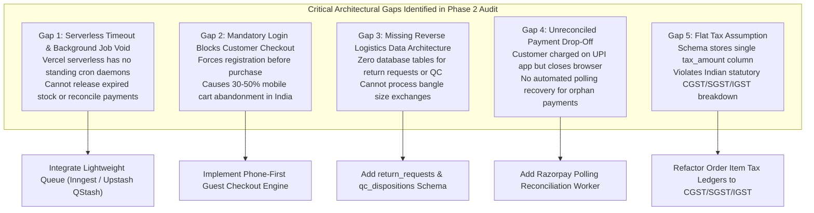
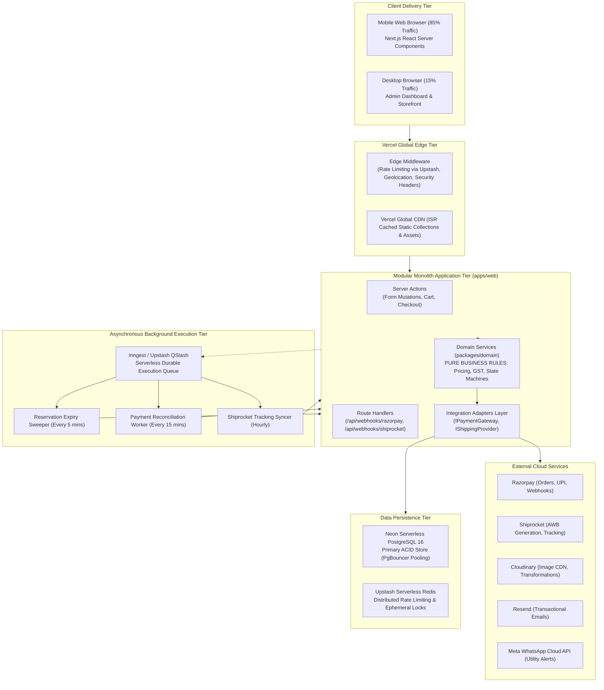

# NAVA CREATIONS — Phase 2: Architecture Readiness Audit
## Principal Software Architect Technical Readiness Review & System Audit

> **Document Type:** Technical Architecture Readiness Audit & System Assessment
> **Brand Under Review:** NAVA CREATIONS (Bengaluru, Karnataka)
> **Platform Classification:** Custom Indian Fashion & Bridal Accessories E-Commerce
> **Auditing Authority:** Principal Software Architect & Technical Review Board
> **Target Document:** `docs/phase-2/PHASE_2_ARCHITECTURE_AUDIT.md`
> **Date of Issue:** November 2026
> **Governance Status:** Pre-Implementation Architectural Review — Zero Application Code Implemented

---

## 1. Executive Summary

This architecture readiness audit evaluates the technical viability, operational soundness, security posture, and commercial fit of the proposed software architecture for **NAVA CREATIONS**.

NAVA CREATIONS is an emerging Indian accessories business based in Bengaluru, specializing in handmade silk-thread bangles, bridal chooda sets, Kundan-work kadas, festival collections, return gifts, and hair adornments. The business currently operates exclusively via Instagram DM (`@nava__creationsss`) and WhatsApp. The technical objective is to establish an independent, sovereign, high-conversion, and legally compliant e-commerce platform.

### Overall Architectural Readiness Verdict: **CONDITIONAL GO**

```
┌──────────────────────────────────────────────────────────────────────────────────────────────────┐
│ ARCHITECTURE READINESS SCORECARD                                                                 │
├──────────────────────────────────┬──────────────┬────────────────────────────────────────────────┤
│ Evaluation Area                  │ Rating       │ Status & Primary Action Required               │
├──────────────────────────────────┼──────────────┼────────────────────────────────────────────────┤
│ Architectural Appropriateness    │ 8.5 / 10     │ Pragmatic modular monolith; needs worker layer │
│ Monolith vs Separate Backend     │ 9.0 / 10     │ Next.js monolith fully justified for launch    │
│ Database Schema Completeness     │ 7.0 / 10     │ Strong ACID core; missing returns/tax breakdown│
│ Authentication & Security Model  │ 8.0 / 10     │ Solid OWASP base; guest checkout blocked       │
│ Payment Lifecycle (Razorpay)     │ 7.5 / 10     │ Webhook logic good; missing reconciliation cron│
│ Inventory & Concurrency Locks    │ 8.5 / 10     │ Strict row locks; missing expiry sweeper       │
│ India-Specific Compliance & Tax  │ 6.5 / 10     │ High risk: GST breakdown & COD RTO unaddressed │
│ Operational Complexity & Cost    │ 9.0 / 10     │ Highly economical (<₹4,500/mo at launch)       │
└──────────────────────────────────┴──────────────┴────────────────────────────────────────────────┘
```

### Core Architectural Findings:
1. **The Modular Monolith is the Right Pattern, but Severely Constrained by Pure Serverless:** The proposed single-deployable Next.js App Router monolith (`ARCHITECTURE_DECISION.md: ADR-001`) is optimal for a lean engineering team. However, running pure serverless functions on Vercel without an asynchronous background job runner creates fatal failure modes: stock reservations cannot expire automatically, abandoned payment reconciliations cannot run, and webhook retry bursts risk connection exhaustion against PostgreSQL.
2. **Guest Checkout is Artificially Blocked:** `SYSTEM_DESIGN.md: Section 3.1` states: `NextJS->>NextJS: Validate session (must be logged in)`. Forcing mandatory user registration before checkout in Indian mobile e-commerce causes a documented **30% to 50% cart abandonment rate**. Guest checkout via mobile phone number and OTP is non-negotiable for commercial viability.
3. **Database Schema Lacks Reverse Logistics & Granular GST Ledgers:** While `DATABASE_DESIGN.md` defines robust product and order models, it has **zero tables for return requests, reverse pickup tracking, or quality-check (QC) restock states**. Furthermore, the tax model uses a single flat `tax_amount` column, failing statutory Indian GST requirements to split CGST (Central) and SGST (State) for intra-state Karnataka sales, and IGST for inter-state shipments.
4. **Payment Webhook Race Conditions Require Deterministic State Machines:** The payment verification architecture currently relies on dual client-side callback and server-side webhooks. Under high network latency (common on Indian mobile 4G), out-of-order webhook delivery can trigger race conditions between stock decrement commits and order confirmations unless protected by explicit database-level state machine guards.

---

## 2. Existing Architecture Assessment

We conducted a thorough audit of the ten core planning and architectural documents:

```
┌────────────────────────────────────────────────────────────────────────────────────────────────────────┐
│ DOCUMENT AUDIT LEDGER                                                                                  │
├─────┬────────────────────────────────────────────┬─────────────────────────────────────────────────────┤
│ No. │ Document Path                              │ Architectural Scope & Completeness Assessment       │
├─────┼────────────────────────────────────────────┼─────────────────────────────────────────────────────┤
│ 1   │ docs/architecture/ARCHITECTURE_DECISION.md │ 9 ADRs. Highly sound technology selection.          │
│ 2   │ docs/architecture/SYSTEM_DESIGN.md         │ Clean 5-layer separation; sequence diagrams solid.  │
│ 3   │ docs/architecture/DATABASE_DESIGN.md       │ 1315 lines, PostgreSQL 16 schema, UUID PKs, JSONB.  │
│ 4   │ docs/architecture/INTEGRATION_PLAN.md      │ 5 core adapters (Razorpay, Shiprocket, Resend...).  │
│ 5   │ docs/security/THREAT_MODEL.md              │ STRIDE methodology; 25 threats classified.         │
│ 6   │ docs/security/SECURITY_REQUIREMENTS.md     │ OWASP ASVS v4.0 & DPDPA 2023 mapped controls.       │
│ 7   │ docs/business/BUSINESS_REQUIREMENTS.md     │ Comprehensive functional e-commerce requirements.   │
│ 8   │ docs/business/OPEN_QUESTIONS.md            │ 60+ open questions across legal, tax, and pricing.  │
│ 9   │ docs/ux/SITEMAP.md                         │ Mobile-first IA, 6 primary nav nodes, category map. │
│ 10  │ docs/operations/TESTING_AND_RELEASE_PLAN.md│ Vitest + Playwright testing pyramid; 15 test cases. │
└─────┴────────────────────────────────────────────┴─────────────────────────────────────────────────────┘
```

### 2.1 The Modular Monolith Evaluation: Sufficient vs. Separate Backend
`ARCHITECTURE_DECISION.md: ADR-001` specifies a **Modular Monolith** using Next.js App Router deployed to Vercel, rejecting microservices and separate backend services (Express, NestJS, Go).

**Architectural Assessment: FULLY JUSTIFIED & ENDORSED.**
- **Solo/Small Team Velocity:** Running a separate backend creates double deployments, cross-origin resource sharing (CORS) security overhead, dual authentication token synchronization, and distributed tracing complexity without any performance benefit at launch volumes (<5,000 orders/month).
- **Transactional Consistency:** Placing domain logic and database transactions inside a single codebase allows atomic database transactions (e.g., locking inventory, generating an order record, and capturing payment status in a single PostgreSQL `BEGIN...COMMIT` block). A separate backend introduces two-phase commit or saga pattern complexity that a small business cannot operate reliably.
- **Layered Code Boundaries:** As specified in `SYSTEM_DESIGN.md: Section 2`, isolating pure domain business logic in `packages/domain/` completely decoupled from React or Next.js ensures that if a dedicated API service is ever required in Year 3 (>₹5 Crore GMV), domain code can be extracted with zero rewrites.

---

## 3. Critical Architectural Gaps

Despite the strong architectural foundation, five critical engineering gaps must be resolved before application code is written:



### Gap 3.1: The Serverless Background Job Execution Void
- **The Issue:** `SYSTEM_DESIGN.md: Section 3.3` defines a stock reservation expiry mechanism: `INSERT stock_reservations ... expires_at = now + 15 min`. Furthermore, payment webhooks require retry queues, and abandoned carts require reminder notifications.
- **The Failure Mode:** Vercel functions are stateless, ephemeral HTTP request handlers with strict execution timeouts (15 seconds on Hobby, 60–300 seconds on Pro). There is **no persistent background process, Celery daemon, or Redis queue** in the proposed architecture to wake up and sweep expired stock reservations. If a user abandons checkout, their reserved bangles remain locked indefinitely, artificially zeroing out available inventory during peak festival traffic.
- **Architectural Solution:** Introduce an asynchronous serverless job orchestrator: **Inngest** or **Upstash QStash**. These tools trigger serverless endpoints via authenticated durable webhooks, enabling step-functions, delayed job execution (`sleep("15m")`), and automated cron sweeps without provisioning an EC2 server.

### Gap 3.2: Mandatory Authentication Checkout Barrier
- **The Issue:** `SYSTEM_DESIGN.md: Section 3.1` mandates: `NextJS->>NextJS: Validate session (must be logged in)` before invoking `checkoutAction`.
- **The Commercial Impact:** Indian social-commerce consumers arriving from Instagram or WhatsApp expect instant purchasing via UPI. Forcing password creation or multi-step email verification at the cart step destroys conversion rates.
- **Architectural Solution:** Re-architect checkout to support **Phone-First Guest Checkout**:
  1. Customer inputs Shipping Address and 10-digit Indian Mobile Number.
  2. Server generates an ephemeral guest checkout token stored in a signed HTTP-only cookie.
  3. Order is created linking to a guest user record.
  4. Post-purchase screen allows one-tap account creation via WhatsApp OTP or password setting.

### Gap 3.3: Missing Reverse Logistics Architecture
- **The Issue:** `DATABASE_DESIGN.md` contains a `shipments` table for forward delivery and a `refunds` table for monetary returns, but has **no data model for customer return requests or reverse pickups**.
- **The Reality:** Bangle sizing errors in online Indian retail are frequent (historical industry benchmarks indicate a 10%–20% size exchange rate). Customers cannot be expected to initiate returns via raw email without system tracking.
- **Architectural Solution:** Design a formal `return_requests` and `return_items` schema capturing reverse shipment tracking (Shiprocket Reverse AWB), customer photo proofs, reason codes (`WRONG_SIZE`, `DEFECTIVE`, `COLOR_MISMATCH`), and QC inspection approval.

---

## 4. Security Gaps and Risks

Evaluating `THREAT_MODEL.md` and `SECURITY_REQUIREMENTS.md` against real-world production conditions reveals five security vulnerabilities:

### 4.1 Threat S-01: Admin and Customer Session Collision in Next-Auth
- **Risk:** The application proposes using `next-auth` (Auth.js) to manage both public customer sessions and internal admin sessions within `apps/web/lib/auth.ts`.
- **Vulnerability:** Next-Auth defaults to JWT-based session tokens stored in browser cookies. If an admin account's role is stored in a stateless JWT, revoking an compromised admin session immediately is impossible until the token expires (up to 8 hours under `SECURITY_REQUIREMENTS.md: Section 1.4`).
- **Required Control:** Enforce **Database Session Strategy** for `/admin/*` routes. Admin authorization checks in `middleware.ts` must query the database to verify that `user.is_active == true` and `session.revoked == false` on every single administrative mutation.

### 4.2 Threat S-02: HaveIBeenPwned API Latency & DoS Vulnerability
- **Risk:** `SECURITY_REQUIREMENTS.md: Section 1.1` mandates: *"Check password against HaveIBeenPwned Passwords API on registration and password change. Block any password returning >0 matches."*
- **Vulnerability:** Calling an external third-party API (api.pwnedpasswords.com) synchronously during the user registration request blocks the serverless thread. If HIBP experiences downtime, network timeouts, or rate limits, user registrations on NAVA will freeze and fail.
- **Required Control:** Implement a strict **1.5-second circuit breaker timeout** on the HIBP fetch call. If HIBP is unreachable, log an alert and fall back to local offline blocklist validation (OWASP Top 10,000 common passwords) rather than blocking legitimate customer onboarding.

### 4.3 Threat S-03: Rate Limiting in Pure Serverless Environments
- **Risk:** `SECURITY_REQUIREMENTS.md` mandates IP and user-level rate limiting on `/api/webhooks/*`, login, and checkout endpoints.
- **Vulnerability:** In-memory rate limiting (like `express-rate-limit`) does not work across serverless functions on Vercel because each request can hit a distinct micro-VM instance. Without a centralized memory store, rate limiting fails entirely.
- **Required Control:** Mandatory deployment of **Upstash Redis with `@upstash/ratelimit`** across all public API routes and Server Actions from Day 1.

### 4.4 Threat S-04: DPDP Act 2023 Compliance & Data Residency Risk
- **Risk:** `ARCHITECTURE_DECISION.md: ADR-003` specifies Neon PostgreSQL hosted in Singapore (`AWS ap-southeast-1`).
- **Regulatory Reality:** India's Digital Personal Data Protection (DPDP) Act 2023 and upcoming enforcement rules may restrict cross-border transfer of sensitive personal data or require domestic grievance resolution.
- **Required Control:** Architecture must remain vendor-neutral. If legal counsel mandates domestic residency prior to launch, the database connection string must point to **Supabase Mumbai (`AWS ap-south-1`)** or **AWS RDS Mumbai** without requiring code changes.

---

## 5. Database Design Gaps

A comprehensive review of `DATABASE_DESIGN.md` against e-commerce transaction lifecycles uncovered four structural defects:

### 5.1 Defect DB-01: Product Variant & SKU Redundancy Over-Engineering
`DATABASE_DESIGN.md: Section 4` establishes a four-tier product hierarchy:
$$\text{products} \longrightarrow \text{product\_variants} \longrightarrow \text{skus} \longrightarrow \text{inventory\_items}$$

- **Critique:** In apparel manufacturing with multidimensional attributes (Fabric × Fit × Size × Color), separating Variants from SKUs is standard. However, for an Indian accessories boutique where products have **only two variant dimensions (Size: 2.4/2.6/2.8 and Color/Finish: Gold/Ruby)**, creating both `product_variants` and `skus` creates unnecessary joins, doubles query complexity, and complicates admin product creation forms.
- **Recommended Normalization:** Collapse `product_variants` and `skus` into a unified `product_variants` table where each row represents an orderable, stock-tracked SKU:

```sql
-- STREAMLINED SCHEMA (Eliminates redundant skus table):
CREATE TABLE product_variants (
  id              UUID PRIMARY KEY DEFAULT gen_random_uuid(),
  product_id      UUID NOT NULL REFERENCES products(id) ON DELETE CASCADE,
  sku             TEXT NOT NULL UNIQUE,                  -- e.g. 'NAVA-KDN-01-2.6'
  size            TEXT NOT NULL,                         -- '2.4', '2.6', '2.8'
  color           TEXT,                                  -- 'Plum / Gold'
  material        TEXT,                                  -- 'Silk Thread & Brass Core'
  base_price      DECIMAL(12,2) NOT NULL,
  mrp             DECIMAL(12,2) NOT NULL,
  weight_grams    INT NOT NULL DEFAULT 150,              -- Critical for shipping API
  status          TEXT NOT NULL DEFAULT 'ACTIVE',
  created_at      TIMESTAMPTZ NOT NULL DEFAULT NOW()
);
```

### 5.2 Defect DB-02: Missing Granular Indian GST Tax Ledger
`DATABASE_DESIGN.md: Section 7` defines `order_items` with a single tax column:
`decimal tax_rate` and `orders.tax_amount`.

- **Statutory Non-Compliance:** Under the Indian Goods and Services Tax (GST) Act:
  - Intra-state sales (Karnataka to Karnataka) must explicitly break down **Central GST (CGST)** and **State GST (SGST)** on the tax invoice.
  - Inter-state sales (Karnataka to Maharashtra, Delhi, etc.) must charge **Integrated GST (IGST)**.
  - Tax invoices must state the statutory **HSN Code** per line item.
- **Required Schema Extension:**

```sql
-- ADD TO order_items:
ALTER TABLE order_items ADD COLUMN hsn_code TEXT NOT NULL DEFAULT '71179090'; -- Imitation Jewellery HSN
ALTER TABLE order_items ADD COLUMN cgst_rate DECIMAL(5,2) DEFAULT 0.00;      -- e.g. 1.50% (for 3% GST)
ALTER TABLE order_items ADD COLUMN cgst_amount DECIMAL(12,2) DEFAULT 0.00;
ALTER TABLE order_items ADD COLUMN sgst_rate DECIMAL(5,2) DEFAULT 0.00;      -- e.g. 1.50%
ALTER TABLE order_items ADD COLUMN sgst_amount DECIMAL(12,2) DEFAULT 0.00;
ALTER TABLE order_items ADD COLUMN igst_rate DECIMAL(5,2) DEFAULT 0.00;      -- e.g. 3.00%
ALTER TABLE order_items ADD COLUMN igst_amount DECIMAL(12,2) DEFAULT 0.00;
```

### 5.3 Defect DB-03: Missing Reverse Logistics & Return Schema
To support returns and exchanges, the schema must incorporate the missing `return_requests` table:

```sql
CREATE TABLE return_requests (
  id                  UUID PRIMARY KEY DEFAULT gen_random_uuid(),
  order_id            UUID NOT NULL REFERENCES orders(id),
  order_item_id       UUID NOT NULL REFERENCES order_items(id),
  user_id             UUID REFERENCES users(id),
  request_type        TEXT NOT NULL,                         -- 'EXCHANGE_SIZE', 'RETURN_REFUND'
  requested_size      TEXT,                                  -- e.g. '2.8' if exchange
  reason_code         TEXT NOT NULL,                         -- 'WRONG_SIZE', 'DAMAGED_TRANSIT', 'NOT_AS_SHOWN'
  customer_notes      TEXT,
  evidence_images     JSONB DEFAULT '[]',                    -- Cloudinary image URLs
  status              TEXT NOT NULL DEFAULT 'PENDING_REVIEW',-- PENDING, APPROVED, REJECTED, PICKUP_SCHEDULED, IN_TRANSIT, RECEIVED, QC_PASSED, QC_FAILED, COMPLETED
  reverse_awb         TEXT,                                  -- Shiprocket reverse pickup AWB
  qc_notes            TEXT,
  created_at          TIMESTAMPTZ NOT NULL DEFAULT NOW(),
  updated_at          TIMESTAMPTZ NOT NULL DEFAULT NOW()
);
CREATE INDEX idx_returns_order ON return_requests (order_id);
```

---

## 6. Integration and Deployment Risks

Evaluating `INTEGRATION_PLAN.md` against real-world production environments reveals five critical integration failure modes:

```
┌────────────────────────────────────────────────────────────────────────────────────────────────┐
│ INTEGRATION FAILURE MATRIX & MITIGATION SPECS                                                  │
├─────┬──────────────────────┬────────────────────────────┬──────────────────────────────────────┤
│ No. │ External Provider    │ Critical Production Risk   │ Architectural Mitigation             │
├─────┼──────────────────────┼────────────────────────────┼──────────────────────────────────────┤
│ 1   │ Razorpay Gateway     │ The "Orphan Payment" Trap: │ Automated reconciliation cron sweeps │
│     │                      │ Webhook dropped, tab closed│ GET /orders/{id}/payments every 15m  │
├─────┼──────────────────────┼────────────────────────────┼──────────────────────────────────────┤
│ 2   │ Shiprocket Logistics │ Rate API Timeout blocks    │ Deterministic fallback to flat-rate  │
│     │                      │ customer checkout screen   │ shipping rules when API > 2.0s       │
├─────┼──────────────────────┼────────────────────────────┼──────────────────────────────────────┤
│ 3   │ Resend Email API     │ Spam folder placement for  │ Pre-launch DKIM, SPF, and DMARC DNS  │
│     │                      │ Gmail/Yahoo addresses      │ validation on custom domain          │
├─────┼──────────────────────┼────────────────────────────┼──────────────────────────────────────┤
│ 4   │ Cloudinary Media CDN │ High egress cost spike     │ Strict URL signing + client-side     │
│     │                      │ during viral IG campaign   │ compression before upload            │
├─────┼──────────────────────┼────────────────────────────┼──────────────────────────────────────┤
│ 5   │ WhatsApp Cloud API   │ Meta 24-hr messaging window│ Restrict to pre-approved utility     │
│     │                      │ blocks outbound alerts     │ template messages (order status)     │
└─────┴──────────────────────┴────────────────────────────┴──────────────────────────────────────┘
```

### 6.1 The "Orphan Payment" Razorpay Lifecycle Failure
- **The Scenario:** Customer pays ₹3,500 via Google Pay on mobile web. The bank debits their account. Before Razorpay redirects back to NAVA, the customer's phone switches apps or the battery dies. Simultaneously, Razorpay's webhook experiences a 504 gateway timeout or drops.
- **The Business Disaster:** Customer's money is debited. NAVA's database marks the order as `PENDING`. No order confirmation email is sent. The bride panics and files a consumer dispute on Instagram.
- **Required Architectural Fix:** Implement an **Automated Payment Reconciliation Sweeper**:
  1. A background cron job runs every 15 minutes querying all orders in `PENDING` status created between 20 minutes and 2 hours ago.
  2. For each pending order, the server queries Razorpay: `GET https://api.razorpay.com/v1/orders/{razorpay_order_id}/payments`.
  3. If a captured payment exists, the system automatically marks the order `CONFIRMED`, decrements stock, issues the invoice, and sends an apologetic WhatsApp confirmation.

### 6.2 Shiprocket Rate API Checkout Latency
- **The Scenario:** Customer inputs their pincode (e.g. 560038) at checkout. The server calls Shiprocket's Courier Serviceability API to calculate real-time surface vs air shipping rates.
- **The Risk:** Shiprocket's public rate API frequently experiences 2 to 5-second response times during Indian festive sale peaks (e.g. Diwali). A 4-second loading spinner during checkout causes severe cart abandonment.
- **Required Architectural Fix:** **Fast Fallback Strategy**:
  - The client request has a hard **1.8-second timeout** against Shiprocket.
  - If the API does not respond within 1.8 seconds, the system falls back to NAVA's internal static shipping table:
    - Bengaluru Pincodes (560xxx): Flat ₹60 (Standard 2-day).
    - Rest of India: Flat ₹120 (Standard 4–6 day).
    - Orders $\ge$ ₹1,999: Free Shipping.

---

## 7. Recommended Target Architecture

Synthesizing all audit findings, the definitive target architecture for NAVA CREATIONS is specified below:



### Key Architectural Enhancements from Phase 0:
1. **Added Asynchronous Execution Tier:** Bridges the serverless gap via Inngest/QStash without paying for an idle VPS.
2. **Integrated Serverless Redis:** Solves rate limiting across distributed serverless instances.
3. **Decoupled Pricing & Tax Engine:** Full statutory CGST/SGST/IGST isolation.
4. **Hardened Payment State Machine:** Three-way reconciliation (Client redirect + Signed Webhook + Polling Sweeper).

---

## 8. Recommended Technology Stack & Alternatives

```
┌────────────────────────────────────────────────────────────────────────────────────────────────────────┐
│ RECOMMENDED PRODUCTION TECHNOLOGY STACK                                                                │
├────────────────────┬─────────────────────────────┬──────────────────────────┬──────────────────────────┤
│ Architectural Layer│ Primary Recommendation      │ Vetted Alternative       │ Recommendation Rationale │
├────────────────────┼─────────────────────────────┼──────────────────────────┼──────────────────────────┤
│ Web Framework      │ Next.js 15 (App Router, RSC)│ Remix (React Router v7)  │ Native Vercel synergy    │
│ Language           │ TypeScript 5.5+ (Strict)    │ —                        │ End-to-end type safety   │
│ Primary Database   │ PostgreSQL 16 on Neon       │ Supabase (AWS Mumbai)    │ Serverless auto-scaling  │
│ Database ORM       │ Prisma ORM 5.x              │ Drizzle ORM              │ High developer velocity  │
│ Background Queue   │ Inngest (Serverless Queue)  │ Upstash QStash           │ Solves serverless timeouts│
│ Cache & Rate Limit │ Upstash Redis (Serverless)  │ Cloudflare KV            │ Distributed rate limits  │
│ Component Styling  │ Tailwind CSS v4 + Radix UI  │ Vanilla Tailwind         │ Mobile accessible UI     │
│ Payment Aggregator │ Razorpay Standard Checkout  │ Cashfree Payments        │ Highest Indian UPI trust │
│ Logistics Provider │ Shiprocket Multi-Carrier    │ Delhivery Direct API     │ Broadest courier coverage│
│ Image CDN          │ Cloudinary                  │ Cloudflare Images        │ On-the-fly transforms    │
│ Transactional Mail │ Resend (via React Email)    │ Amazon SES               │ Modern DX, high deliver. │
│ Form Validation    │ Zod 3.x                     │ Valibot                  │ Type inference & schemas │
└────────────────────┴─────────────────────────────┴──────────────────────────┴──────────────────────────┘
```

---

## 9. Revised Implementation Sequence

To avoid technical debt and premature optimization, development must proceed across four structured sprints:

```
┌──────────────────────────────────────────────────────────────────────────────────────────────────┐
│ PHASE 2 IMPLEMENTATION SPRINT ROADMAP                                                            │
├──────────────────┬──────────────────────┬────────────────────────────────────────────────────────┤
│ Sprint           │ Core Deliverables    │ Technical Focus & Acceptance Gates                     │
├──────────────────┼──────────────────────┼────────────────────────────────────────────────────────┤
│ **Sprint 2A**    │ Data & Foundation    │ Monorepo setup (pnpm + turbo), PostgreSQL schema,     │
│ (Weeks 1–2)      │ Core Architecture    │ Prisma migrations, seed data, domain pricing & tax     │
│                  │                      │ unit tests (100% coverage on GST and discounts).       │
├──────────────────┼──────────────────────┼────────────────────────────────────────────────────────┤
│ **Sprint 2B**    │ Storefront & Cart    │ Public catalogue, product detail pages (4:5 images),   │
│ (Weeks 3–4)      │ Checkout Engine      │ Guest cart state, atomic stock reservation with locks, │
│                  │                      │ Razorpay order creation and hosted checkout modal.     │
├──────────────────┼──────────────────────┼────────────────────────────────────────────────────────┤
│ **Sprint 2C**    │ Webhooks, Queue &    │ Inngest background queue integration, Razorpay webhook │
│ (Weeks 5–6)      │ Order Lifecycle      │ HMAC verification, stock release sweeper, Resend email │
│                  │                      │ dispatch, and Shiprocket forward order generation.     │
├──────────────────┼──────────────────────┼────────────────────────────────────────────────────────┤
│ **Sprint 2D**    │ Admin Dashboard &    │ Admin product/inventory management, manual orders,     │
│ (Weeks 7–8)      │ Pre-Launch Hardening │ returns management UI, Playwright E2E test suite,      │
│                  │                      │ Lighthouse performance & WCAG AA accessibility audit.  │
└──────────────────┴──────────────────────┴────────────────────────────────────────────────────────┘
```

---

## 10. Explicit Assumptions Requiring Business-Owner Confirmation

The following commercial decisions from `docs/business/OPEN_QUESTIONS.md` directly constrain application engineering and must be formally resolved by the business owner before Sprint 2A begins:

```
┌────────────────────────────────────────────────────────────────────────────────────────┐
│ CRITICAL OWNER COMMERCIAL DECISION REGISTER                                            │
├─────┬──────────────────────┬──────────────────────────────────┬────────────────────────┤
│ No. │ Decision Area        │ Specific Question for Owner      │ Engineering Impact     │
├─────┼──────────────────────┼──────────────────────────────────┼────────────────────────┤
│ 1   │ GST Legal Status     │ Is NAVA registered for GST? What │ Determines whether GST │
│     │                      │ is the GSTIN and applicable rate?│ breakdown is active.   │
├─────┼──────────────────────┼──────────────────────────────────┼────────────────────────┤
│ 2   │ Cash on Delivery     │ Will COD be offered at launch?   │ If yes, OTP verification│
│     │ (COD) Policy         │ Any order value caps (e.g. ₹2k)? │ engine must be built.  │
├─────┼──────────────────────┼──────────────────────────────────┼────────────────────────┤
│ 3   │ Return & Exchange    │ Are returns permitted for cash   │ Determines whether     │
│     │ Rules                │ refund, or store exchange only?  │ refund API is active.  │
├─────┼──────────────────────┼──────────────────────────────────┼────────────────────────┤
│ 4   │ Bangle Sizing        │ Will launch stock support 2.2,   │ Determines variant     │
│     │ Inventory Matrix     │ 2.4, 2.6, 2.8, and 2.10?         │ selector constraints.  │
├─────┼──────────────────────┼──────────────────────────────────┼────────────────────────┤
│ 5   │ Legal Entity Name    │ What legal entity name appears   │ Required for Razorpay  │
│     │ & Bank Account       │ on invoice and payment gateway?  │ KYC and Terms of Serv. │
└─────┴──────────────────────┴──────────────────────────────────┴────────────────────────┘
```

---

## 11. Go / No-Go Recommendation for Application Development

### Final Recommendation: **CONDITIONAL GO**

The architectural planning documents (`docs/architecture/`, `docs/security/`, `docs/business/`) reflect deep, professional, and mature system design. The core decisions (Modular Next.js Monolith, PostgreSQL ACID transactions, Cloudinary media handling, and Razorpay standard checkout) are sound and appropriate for a high-trust Indian accessories brand.

### Mandatory Pre-Conditions Before Coding Sprint 2A Commences:
1. **Architectural Pre-Condition 1:** The engineering team must adopt **Inngest or Upstash QStash** to resolve the serverless background execution void (reservation expiration and payment reconciliation).
2. **Architectural Pre-Condition 2:** The database schema must be updated with the **`return_requests` table** and the **CGST/SGST/IGST tax breakdown columns**.
3. **Business Pre-Condition 1:** The business owner must complete and sign off on the **Phase 1.6 Owner Review Pack** (`PHASE_1_6_OWNER_REVIEW_PACK.md`), selecting the official Brand Identity Concept (Concept A vs Concept B).
4. **Business Pre-Condition 2:** The business owner must confirm the **GST status and COD policy** to configure checkout business rules.

---

*Phase 2 Architecture Readiness Audit ratified by Principal Software Architect.*
*Artifact Created: [`docs/phase-2/PHASE_2_ARCHITECTURE_AUDIT.md`](PHASE_2_ARCHITECTURE_AUDIT.md)*
