# NAVA CREATIONS — PHASE 2 BUSINESS ACCEPTANCE CHECKLIST
## Small-Business Commerce Operations & Atelier Owner Acceptance Register

**Business Entity:** NAVA CREATIONS (Bengaluru, Karnataka, India)  
**Atelier Specialization:** Handcrafted Bridal Glass, Velvet, Kundan Bangles & Antique Gold Kadas  
**Milestone:** Phase 2 Master Commerce Foundation  
**Governance Framework:** Google Elephant-Goldfish Model (EGM)  
**Date of Audit:** 2026-11-12  

---

## 1. Business Operational Workflows Audit

This checklist evaluates the end-to-end operational viability of the platform from the perspective of the business owner and atelier operations team.

```mermaid
graph TD
    subgraph Customer Experience
        C1["Browse Handcrafted Catalog by Size & Collection"] --> C2["Add Bangles to Shopping Bag"]
        C2 --> C3["Checkout via Sovereign UPI QR or COD"]
        C3 --> C4["Submit 12-Digit Bank UTR Reference"]
        C4 --> C5["Live Order Tracking & Status Updates"]
    end
    
    subgraph Store Manager Operations
        M1["Inspect Daily Orders in Admin Portal"] --> M2["Match UTR against BharatPe App Statement"]
        M2 --> M3["Click 'Verify Bank Credit' (Transitions Order to Confirmed)"]
        M3 --> M4["Pack Bangles in Velvet Keepsake Box"]
        M4 --> M5["Assign Courier AWB & Dispatch Order"]
    end
```

---

## 2. Business Capability Acceptance Register

| # | Business Operational Capability | Acceptance Criteria | Platform Status | Production Verification Method |
|---|---|---|---|---|
| **BAC-01** | **Artisanal Size Selection** | Customers can choose standard Indian bangle sizes (2.4, 2.6, 2.8) with stock visibility per size. | **ACCEPTED** | Product detail page renders size selector; stock tracked per `ProductVariant`. |
| **BAC-02** | **Server-Authoritative Pricing** | Selling prices and compare-at MRPs are calculated on the server; client manipulation is impossible. | **ACCEPTED** | `PricingEngine` and `OrderService` recalculate subtotals from catalog source of truth. |
| **BAC-03** | **Zero-MDR Sovereign UPI QR** | Customer receives official NPCI UPI QR code and intent link for direct bank transfer without aggregator fees. | **ACCEPTED** | `PaymentService.generateUpiInstructions` generates valid `upi://pay` URI with BharatPe details. |
| **BAC-04** | **Fraud-Resistant UTR Submission**| Customer enters 12-digit Indian Bank UTR. Submission does NOT automatically mark order confirmed. | **ACCEPTED** | Customer status moves to `Payment Under Verification`; duplicates flagged for audit. |
| **BAC-05** | **Store Owner Ledger Verification**| Store manager inspects bank account, enters verified transaction reference, and unlocks order for packing. | **ACCEPTED** | `/admin/orders` provides interactive "Verify Bank Credit" modal recording unique bank reference. |
| **BAC-06** | **Owner-Governed COD Policy** | Cash on Delivery available with clear ₹5,000 ceiling, provisional policy disclosure, and separate collection tracking. | **ACCEPTED** | `createCodOrder` enforces ceiling and separates fulfillment (`DELIVERED`) from payment (`COLLECTED`). |
| **BAC-07** | **Courier Dispatch & AWB Tracking**| Atelier staff assigns courier partner (e.g. Delhivery, BlueDart) and records tracking AWB for customer lookup. | **ACCEPTED** | Admin order detail modal permits updating status to `SHIPPED` and assigning AWB tracking code. |
| **BAC-08** | **Artisan WhatsApp Concierge** | Customers can tap "Order on WhatsApp" from the cart with pre-filled message text detailing selected bangles. | **ACCEPTED** | `CartPage` provides prominent WhatsApp concierge link alongside web checkout. |
| **BAC-09** | **Bespoke Consultation Enquiries** | Customers can request custom bangle sizing or bridal hampers via web form; leads appear on admin dashboard. | **ACCEPTED** | `/contact` routes to `/api/enquiries` and appears on `/admin/enquiries` with status triage. |
| **BAC-10** | **Pre-Dispatch Cancellation Restock**| If a bridal order is cancelled before dispatch, reserved stock is automatically returned to the atelier inventory. | **ACCEPTED** | `cancelPreDispatchOrder` validates pre-dispatch state and restores available stock. |

---

## 3. Artisanal Packaging & Customer Experience Standards

- **Velvet Keepsake Box Packaging:**
  Customer checkout form captures special instructions (e.g., `"Please pack in maroon bridal velvet gift box"`), which are persisted and displayed prominently on the store manager packing slip.
- **PIN Code Validation:**
  Checkout enforces valid 6-digit Indian Postal PIN codes, preventing delivery dispatch failures with logistics partners.
- **GST Exemption Transparency:**
  In accordance with MSME threshold rules for unregistered artisanal businesses, invoices explicitly reflect `taxMode: 'UNREGISTERED'` with 0% tax, ensuring complete tax compliance.

---

## 4. Acceptance Sign-Off Summary

- **Functional Business Tests:** 12 / 12 PASS (`orders-checkout.spec.ts`)
- **Payment & Bank Flow Tests:** 14 / 14 PASS (`payment-integration.spec.ts`)
- **Store Manager Security:** 15 / 15 PASS (`security-remediation.spec.ts`)
- **Overall Business Acceptance Verdict:** **APPROVED FOR FIRST LAUNCH**
