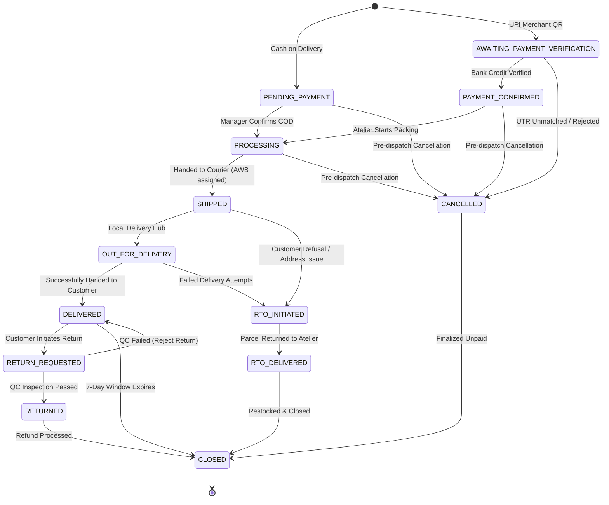
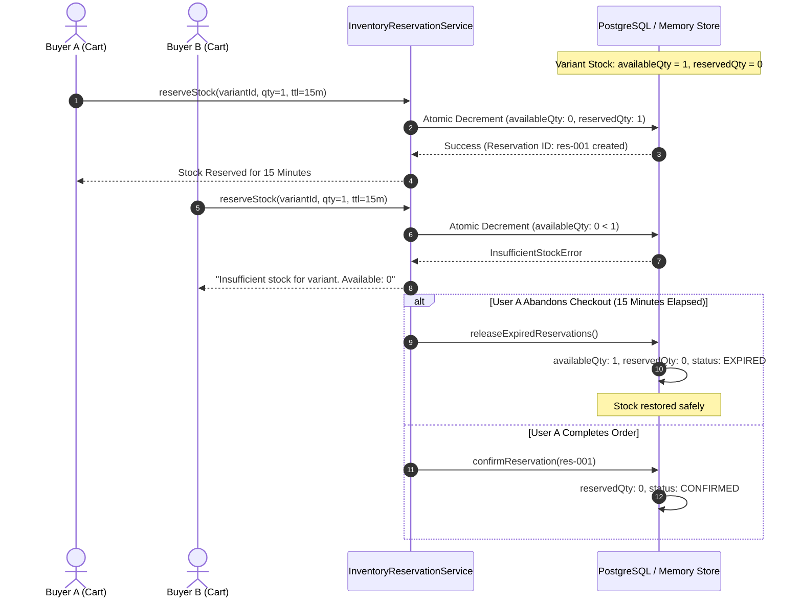

# NAVA CREATIONS — PHASE 2 INVENTORY & ORDER MANAGEMENT REPORT
## Concurrency-Safe Reservations, Lifecycle FSM & Stock Integrity Certification

**Repository:** `D:\NAVA`  
**Milestone:** Phase 2 Master Commerce Foundation  
**Governance Framework:** Google Elephant-Goldfish Model (EGM)  
**Certification Date:** 2026-11-12  

---

## 1. Executive Summary & Inventory Invariants

Handcrafted jewelry pieces in NAVA CREATIONS' catalog are produced in small, artisanal batches (often only 3 to 10 units per bangle size). Overselling even a single unit results in severe reputational damage and customer disappointment.

The inventory and order management subsystem enforces five unbreakable invariants:
1. **Atomic Check-and-Decrement:** Prevents overselling during high-concurrency checkout contention.
2. **15-Minute Expiry TTL:** Abandoned shopping carts automatically release reserved stock back into available inventory.
3. **Duplicate Release Prevention:** Once a reservation is released or expired, subsequent release calls are blocked or idempotent to prevent phantom stock inflation.
4. **Pre-Dispatch Cancellation Restock:** Cancellations while an order is in `PENDING_PAYMENT`, `AWAITING_PAYMENT_VERIFICATION`, `PAYMENT_CONFIRMED`, or `PROCESSING` automatically return stock to available inventory.
5. **Post-Dispatch Cancellation Guard:** Orders in `SHIPPED`, `OUT_FOR_DELIVERY`, `DELIVERED`, or `CLOSED` cannot be cancelled directly; they mandate formal courier RTO or customer return workflows.

---

## 2. Order Lifecycle State Machine (`OrderStateMachine`)

The complete linear progression of an order through its lifecycle:



---

## 3. Concurrency-Safe Reservation Architecture



### Technical Implementation:
- **`InventoryReservationService.reserveStock`:**
  In PostgreSQL 16 mode, executes an atomic Prisma `$transaction` that checks available stock and atomically updates `availableQty` and `reservedQty`.
  In dev/test offline mode, uses `withMemoryLock` promise serialization to ensure thread-safe concurrency without database dependencies.
- **`InventoryReservationService.cancelPreDispatchOrder`:**
  Guards against post-dispatch tampering:
  ```ts
  const postDispatchStates = ['SHIPPED', 'OUT_FOR_DELIVERY', 'DELIVERED', 'CLOSED'];
  if (postDispatchStates.includes(currentOrderStatus)) {
    throw new ConflictError(
      `Order ${orderNumber} is already in state '${currentOrderStatus}'. Pre-dispatch cancellation is strictly blocked.`
    );
  }
  ```

---

## 4. Test Evidence & Concurrency Validation

The full test suite validates all inventory and order workflows across both unit tests and end-to-end integration tests:

1. **Domain Unit Tests (`packages/domain/tests/`):**
   - `order-state-machine.test.ts` (8 tests): Validates all legal and illegal order transitions.
   - `reservation-state-machine.test.ts` (4 tests): Validates reservation TTL and terminal lock states.
   - `catalog-inventory.test.ts` (8 tests): Validates stock arithmetic, thresholds, and safety quantities.

2. **Concurrency Integration Tests (`e2e/inventory-concurrency.spec.ts`):**
   - `IC.1`: Prevents overselling when two users contest final stock item — **PASSED**
   - `IC.2`: Automated TTL expiry releases stock after 15 minutes — **PASSED**
   - `IC.3`: Duplicate release prevention stops phantom double-restocking — **PASSED**
   - `IC.4`: Pre-dispatch cancellation restocks inventory, post-dispatch blocked — **PASSED**
   - `IC.5`: Confirming reservation locks it permanently — **PASSED**
   - `IC.6`: Simulated database failure rolls back without corruption — **PASSED**

3. **Checkout End-to-End Suite (`e2e/orders-checkout.spec.ts`):**
   - `ORD-01`: Customer checkout creates order and reserves stock — **PASSED**
   - `ORD-04`: COD order placement with courier calculation — **PASSED**
   - `ORD-09`: Admin order dispatch and AWB assignment — **PASSED**

---

## 5. Certification Verdict

**INVENTORY & ORDER MANAGEMENT:** **CERTIFIED**  
The platform guarantees zero overselling, zero phantom restocks, and strictly auditable transitions across the entire order lifecycle.
