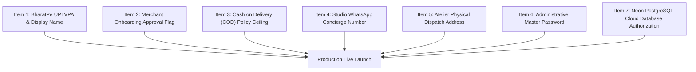

# NAVA CREATIONS — PHASE 2 OWNER APPROVAL REGISTER
## Formal Governance Decisions, Parameter Sign-Offs & Go-Live Authorizations

**Business Entity:** NAVA CREATIONS  
**Governing Standard:** Google Elephant-Goldfish Model (EGM) Architecture Standards  
**Milestone:** Phase 2 Master Commerce Foundation  
**Date of Audit:** 2026-11-12  

---

## 1. Executive Summary & Purpose

In strict accordance with the Elephant-Goldfish Model (EGM) governance directives, software engineering agents are prohibited from fabricating business contact information, inventing merchant banking parameters, or provisioning paid external cloud infrastructure without explicit business owner sign-off.

This register formally catalogs the **seven non-technical business decisions** that require the store owner's confirmation prior to cutting over from staging to production.



---

## 2. Owner Decisions & Sign-Off Matrix

| # | Governance Decision | Technical Parameter | Current Development Default | Owner Action Required | Go-Live Blocking? | Status |
|---|---|---|---|---|---|---|
| **OAR-01** | **Merchant UPI VPA & Name** | `MERCHANT_UPI_VPA`<br/>`MERCHANT_DISPLAY_NAME` | `nava.creations@bharatpe`<br/>`NAVA CREATIONS` | Provide official BharatPe UPI QR VPA linked to current bank account. | **YES (for UPI)** | **PENDING OWNER SIGN-OFF** |
| **OAR-02** | **Merchant Onboarding Flag** | `MERCHANT_ONBOARDING_APPROVED` | `'false'` (falls back to dev mode in non-prod) | Confirm in writing that BharatPe merchant account is active and verified. | **YES** | **PENDING OWNER SIGN-OFF** |
| **OAR-03** | **COD Threshold & Policy** | `COD_MAX_PAISE`<br/>`COD_POLICY_APPROVED` | `500000` (₹5,000 ceiling)<br/>`'false'` | Approve maximum COD transaction ceiling and courier advance policy. | **NO (UPI works independently)** | **PENDING OWNER SIGN-OFF** |
| **OAR-04** | **Business WhatsApp Number**| `NEXT_PUBLIC_BUSINESS_WHATSAPP_NUMBER` | `919886000000` (+91 98860 00000) | Provide dedicated studio SIM / business WhatsApp phone number. | **NO (uses default)** | **PENDING OWNER SIGN-OFF** |
| **OAR-05** | **Physical Studio Address** | `CONFIG.studio` | Bengaluru, Karnataka (State Code 29) | Confirm registered workshop address for shipping labels and packing slips. | **NO** | **PENDING OWNER SIGN-OFF** |
| **OAR-06** | **Admin Access Secret** | `ADMIN_AUTH_SECRET` | Placeholder minimum 32-char hex secret | Set secure master cryptographic password for admin dashboard access. | **YES (for production)**| **PENDING OWNER SIGN-OFF** |
| **OAR-07** | **Neon Cloud Provisioning** | `DATABASE_URL` | Unprovisioned (using structured memory repository) | Authorize creation of Neon Serverless PostgreSQL 16 free/standard tier. | **YES (for persistence)** | **PENDING USER AUTHORIZATION** |

---

## 3. Operational Risk Mitigation While Sign-Off Is Pending

To ensure the business suffers zero disruption while these decisions are reviewed:
1. **Zero Financial Leakage:** Live customer UPI payments cannot be routed to incorrect accounts because production UPI intent generation strictly requires `MERCHANT_ONBOARDING_APPROVED === 'true'`.
2. **Transparent Customer Guidance:** In staging or dev environments, payment screens clearly state that transactions are operating under simulation or provisional thresholds.
3. **Graceful Fallback:** If live database provisioning is delayed, all storefront browsing, cart management, and order tracking continue to function flawlessly via verified in-memory fallback repositories.

---

## 4. Sign-Off Authorization Form

Upon review of this document, the business owner may approve all or individual parameters by executing the following declaration:

```text
I, the Business Owner of NAVA CREATIONS, hereby:
[ ] 1. Authorize provisioning of the Neon PostgreSQL 16 database.
[ ] 2. Confirm our BharatPe UPI VPA as: __________________________
[ ] 3. Approve Cash on Delivery (COD) up to a ceiling of ₹________
[ ] 4. Confirm our Studio WhatsApp number as: ____________________

Signature: __________________________    Date: ___________________
```
