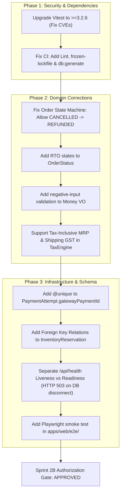

# NAVA CREATIONS — Sprint 2A.1 Independent Technical Review Report
## Forensic Code Audit, Architectural Verification & Pre-Sprint 2B Gate Assessment

> **Document Type:** Independent Technical Audit & Quality Verification Report  
> **Brand Under Review:** NAVA CREATIONS (Bengaluru, Karnataka)  
> **Audited Milestone:** Sprint 2A — Technical Foundation & Monorepo Scaffolding  
> **Auditing Authority:** Principal Software Architect & Lead Security Reviewer  
> **Date of Audit:** November 2026  
> **Audit Status:** Complete — Unbiased Forensic Code Inspection  
> **Final Recommendation:** **CONDITIONAL GO (Remediations Required Prior to Sprint 2B)**  

---

## 1. Executive Summary & Audit Context

This document provides an independent, forensic technical audit of the Sprint 2A implementation for **NAVA CREATIONS**. In accordance with strict audit governance, the findings in this report were produced by inspecting actual source files, AST configurations, dependency trees, and reproducing command executions directly within the workspace at `D:\NAVA`.

The foundational monorepo structure, framework-independent domain package (`@nava/domain`), and PostgreSQL 16 schema (`@nava/db`) demonstrate strong architectural intent. However, this review identified **2 Critical**, **4 High**, **5 Medium**, and **3 Low** severity findings that must be addressed to ensure commercial viability, operational security, and production readiness.

### Findings Breakdown by Severity

```text
┌─────────────────────────────────────────────────────────────┐
│ CRITICAL : 2  (Vitest/Tinypool CVEs, Order Refund Deadlock) │
│ HIGH     : 4  (Health Probe Readiness, CI Gaps, Tax Model)  │
│ MEDIUM   : 5  (ESLint 8 EOL, Prisma FKs, RTO States)        │
│ LOW      : 3  (Int32 Limits, Half-Rate Rounding Drift)      │
└─────────────────────────────────────────────────────────────┘
```

---

## 2. Dependency Review & Supply-Chain Security

### 2.1 Dependency Matrix & Compatibility Analysis

The dependency configurations across the root and 5 workspace packages were audited:

| Package / Tool | Declared Version | Resolved Lockfile Version | Health & Compatibility Status |
| :--- | :--- | :--- | :--- |
| **Node.js** | N/A (Local `v26.13.0`) | N/A | Local active LTS is Node 26. `ci.yml` specifies Node 22 (mismatch). |
| **pnpm** | `12.18.0` | `12.18.0` | Pinned in `packageManager`. Native package building verified via `allowBuilds`. |
| **Turborepo** | `^2.3.3` | `2.11.10` | Task pipelines and caching function correctly. |
| **TypeScript** | `^5.7.2` | `5.9.3` | Strict mode enabled across all workspaces. |
| **Next.js** | `^15.1.0` | `15.5.29` | App Router stable. Server-side rendering verified. |
| **React** | `^19.0.0` | `19.3.1` | React 19 stable pairing with Next.js 15. |
| **Prisma** | `^6.1.0` | `6.19.3` | PostgreSQL 16 schema validated. Client generation confirmed. |
| **Vitest** | `^2.1.8` | `2.1.9` | **VULNERABLE:** 3 Critical / 4 High CVEs reported by `pnpm audit`. |
| **ESLint** | `^8.57.1` | `8.57.1` | **DEPRECATED:** ESLint 8 reached EOL October 2024; Next.js 15 warning. |
| **Tailwind CSS**| `^3.4.16` | `3.4.17` | PostCSS pipeline operational. |
| **Playwright** | `^1.49.1` | `1.58.2` | Installed and configured, but zero test specs implemented. |

---

### 2.2 Finding C1 (Critical): Vitest & Tinypool Remote Code Execution Vulnerabilities

- **Exact File Paths:** [`packages/shared/package.json#L23`](file:///d:/NAVA/packages/shared/package.json#L23), [`packages/domain/package.json#L26`](file:///d:/NAVA/packages/domain/package.json#L26), [`pnpm-lock.yaml`](file:///d:/NAVA/pnpm-lock.yaml)
- **Forensic Evidence (`pnpm audit`):**
  ```text
  ┌─────────────────────┬─────────────────────────────────────────────────────────────────────────────┐
  │ critical            │ When Vitest UI server is listening, arbitrary file can be read and executed │
  ├─────────────────────┼─────────────────────────────────────────────────────────────────────────────┤
  │ Package             │ vitest (<3.2.6)                                                             │
  │ Patched versions    │ >=3.2.6                                                                     │
  │ Advisory            │ https://github.com/advisories/GHSA-5xrq-8626-4rwp                           │
  └─────────────────────┴─────────────────────────────────────────────────────────────────────────────┘
  ┌─────────────────────┬─────────────────────────────────────────────────────────────────────────────┐
  │ critical            │ Tinypool: Prototype Pollution in worker options leads to RCE                │
  ├─────────────────────┼─────────────────────────────────────────────────────────────────────────────┤
  │ Package             │ tinypool (<=2.1.0, subdependency of vitest)                                 │
  │ Patched versions    │ >=2.1.1                                                                     │
  │ Advisory            │ https://github.com/advisories/GHSA-5xrq-8626-4rwp                           │
  └─────────────────────┴─────────────────────────────────────────────────────────────────────────────┘
  Total: 21 vulnerabilities found (3 critical | 4 high | 13 moderate | 1 low)
  ```
- **Architectural Risk:** Although Vitest is a devDependency, worker option prototype pollution in automated build environments poses supply-chain execution risks during CI/CD runs.
- **Required Action:** Upgrade `vitest` in `@nava/shared` and `@nava/domain` to `^3.2.6` or latest stable `3.x` prior to Sprint 2B.

---

### 2.3 Finding M1 (Medium): Deprecated ESLint v8 & Outdated Transitive Subdependencies

- **Exact File Paths:** [`apps/web/package.json#L28`](file:///d:/NAVA/apps/web/package.json#L28), [`apps/web/.eslintrc.json#L2`](file:///d:/NAVA/apps/web/.eslintrc.json#L2)
- **Forensic Evidence:**
  During `pnpm run lint`:
  ```text
  `next lint` is deprecated and will be removed in Next.js 16.
  For new projects, use create-next-app to choose your preferred linter.
  For existing projects, migrate to the ESLint CLI:
  npx @next/codemod@canary next-lint-to-eslint-cli .
  ```
  During `pnpm install`:
  ```text
  apps/web | [WARN] deprecated eslint@8.57.1. 10.14.0 is not deprecated.
  [WARN] 5 deprecated subdependencies found: @humanwhocodes/config-array@0.13.0, @humanwhocodes/object-schema@2.0.3, glob@7.2.3, inflight@1.0.6, rimraf@3.0.2
  ```
- **Architectural Risk:** ESLint v8 reached official End-of-Life in October 2024. Security updates for ESLint 8 have ceased, and transitive subdependencies (`glob@7`, `rimraf@3`) carry unpatched prototype warnings.
- **Required Action:** Migrate to ESLint v9 Flat Config with native TypeScript parser before Sprint 2B.

---

## 3. Domain Logic Audit (`@nava/domain`)

### 3.1 Finding C2 (Critical): Pre-Shipment Order Cancellation Has No Path to `REFUNDED`

- **Exact File Path:** [`packages/domain/src/order/state-machine.ts#L8-L19`](file:///d:/NAVA/packages/domain/src/order/state-machine.ts#L8-L19)
- **Source Code Inspection:**
  ```typescript
  private static readonly ALLOWED_TRANSITIONS: ReadonlyMap<OrderStatus, readonly OrderStatus[]> = new Map([
    ['PENDING_PAYMENT', ['PAYMENT_CONFIRMED', 'CANCELLED']],
    ['PAYMENT_CONFIRMED', ['PROCESSING', 'CANCELLED']],
    ['PROCESSING', ['SHIPPED', 'CANCELLED']],
    ['SHIPPED', ['OUT_FOR_DELIVERY', 'RETURN_REQUESTED']],
    ['OUT_FOR_DELIVERY', ['DELIVERED', 'RETURN_REQUESTED']],
    ['DELIVERED', ['RETURN_REQUESTED']],
    ['RETURN_REQUESTED', ['RETURNED', 'DELIVERED']],
    ['RETURNED', ['REFUNDED']],
    ['CANCELLED', []], // Terminal!
    ['REFUNDED', []],  // Terminal!
  ]);
  ```
- **Forensic Defect:**
  1. A prepaid customer completes Razorpay payment: Order enters `PAYMENT_CONFIRMED`.
  2. The customer or store operator cancels the order prior to shipment: Order enters `CANCELLED`.
  3. `CANCELLED` is explicitly defined as **Terminal (`[]`)**.
  4. The Razorpay payment must be refunded back to the customer's UPI/Card. However, `OrderStateMachine.transition('CANCELLED', 'REFUNDED')` fails with `INVALID_STATE_TRANSITION`!
  5. The **only** route to `REFUNDED` requires: `DELIVERED` $\to$ `RETURN_REQUESTED` $\to$ `RETURNED` $\to$ `REFUNDED`.
- **Architectural Risk:** Inability to record financial refunds for pre-shipment cancellations in the order lifecycle, leading to financial ledger reconciliation mismatches between Razorpay and the database.
- **Required Action:** Update `ALLOWED_TRANSITIONS` to allow `CANCELLED` $\to$ `REFUNDED`, or introduce `CANCELLATION_REFUND_PENDING` state.

---

### 3.2 Finding H3 (High): Tax Engine Assumes Tax-Exclusive Pricing & Omits Shipping Fee GST

- **Exact File Path:** [`packages/domain/src/tax/strategies.ts#L126-L175`](file:///d:/NAVA/packages/domain/src/tax/strategies.ts#L126-L175)
- **Source Code Inspection:**
  ```typescript
  // Line 126
  const lineTotal = item.unitPrice.multiply(item.quantity);
  // Line 139
  itemIgst = lineTotal.multiply(ratePercent / 100);
  // Line 175
  const totalAmount = taxableSubtotal.add(input.shippingFee).add(overallBreakdown.totalTax);
  ```
- **Forensic Defects:**
  1. **Tax-Exclusive Assumption vs Indian Consumer Law:** Under the *Legal Metrology (Packaged Commodities) Rules, 2011* and Indian e-commerce standards, consumer-facing prices for B2C retail (MRP) must be **Inclusive of All Taxes**. The current engine treats `unitPrice` as a net taxable base and adds GST on top. If a customer adds a ₹1,500 bangle to cart, adding ₹45 at checkout creates checkout friction and violates MRP display mandates. The tax engine lacks support for tax-inclusive backwards calculation:
     $$\text{Taxable Value} = \frac{\text{MRP}}{1 + \text{Rate}}$$
     $$\text{GST Amount} = \text{MRP} - \text{Taxable Value}$$
  2. **Zero GST on Shipping Fee:** Line 175 adds `input.shippingFee` directly to `totalAmount` without calculating GST. Under *Section 8 of the Central Goods and Services Tax (CGST) Act, 2017* (Composite Supply), freight/shipping charges ancillary to the supply of goods attract GST at the principal supply rate (or 18% SAC 9965).
- **Required Action:**
  1. Add an explicit `taxInclusivity: 'INCLUSIVE' | 'EXCLUSIVE'` flag to `TaxCalculationInput`.
  2. Compute GST on `shippingFee` under composite supply rules when registered.

---

### 3.3 Finding M3 (Medium): Missing Courier RTO (Return to Origin) States in Order Lifecycle

- **Exact File Path:** [`packages/domain/src/order/state-machine.ts#L12-L14`](file:///d:/NAVA/packages/domain/src/order/state-machine.ts#L12-L14)
- **Forensic Defect:** `SHIPPED` and `OUT_FOR_DELIVERY` can only transition to `DELIVERED` or `RETURN_REQUESTED`. In Indian logistics (Shiprocket / Delhivery), 5–15% of shipments result in Non-Delivery Reports (NDR) and Return to Origin (RTO) due to customer unavailability, incorrect pin codes, or delivery refusal.
- **Architectural Risk:** Forcing couriers to mark an unreached package as `RETURN_REQUESTED` corrupts return metrics and triggers customer QC workflows for parcels that never left courier custody.
- **Required Action:** Add `RTO_INITIATED` and `RTO_DELIVERED` to `OrderStatus`.

---

### 3.4 Finding M4 (Medium): Money Value Object Permits Negative Paise Construction

- **Exact File Path:** [`packages/domain/src/money.ts#L11-L25`](file:///d:/NAVA/packages/domain/src/money.ts#L11-L25)
- **Source Code Inspection:**
  ```typescript
  private constructor(paise: number) {
    if (!Number.isInteger(paise)) {
      throw new ValidationError(`Money paise must be an exact integer, received: ${paise}`);
    }
    this.paise = paise;
  }
  ```
- **Forensic Defect:** The constructor checks `Number.isInteger(paise)`, but fails to validate `paise >= 0`. Calling `Money.fromPaise(-500)` or `Money.fromRupees(-10)` succeeds and instantiates a negative money object. Yet `Money.subtract` explicitly checks `diff < 0` and throws. This internal inconsistency allows negative prices or coupons to bypass validation if created directly.
- **Required Action:** Add `if (paise < 0) throw new ValidationError(...)` in the `Money` constructor.

---

### 3.5 Finding L2 (Low): 1-Paise Rounding Divergence on Intra-State Half-Rate Tax Calculations

- **Exact File Path:** [`packages/domain/src/tax/strategies.ts#L143-L151`](file:///d:/NAVA/packages/domain/src/tax/strategies.ts#L143-L151)
- **Forensic Defect:** For intra-state transactions, CGST and SGST are calculated by applying `halfRate = ratePercent / 200` independently using Banker's rounding. For an item of 100 paise at 5% GST ($100 \times 0.025 = 2.5 \to 2$ paise each), CGST = 2, SGST = 2, Total Tax = 4 paise. Under IGST (inter-state), $100 \times 0.05 = 5$ paise. The intra-state customer pays 1 paise less than the inter-state customer on identical line items due to independent half-rate rounding.
- **Required Action:** Calculate total line tax first, assign $\text{CGST} = \text{round}(\frac{\text{totalTax}}{2})$, and set $\text{SGST} = \text{totalTax} - \text{CGST}$.

---

## 4. Database Audit (`@nava/db` & PostgreSQL Schema)

### 4.1 Schema Structural Analysis

Prisma schema [`packages/db/prisma/schema.prisma`](file:///d:/NAVA/packages/db/prisma/schema.prisma) was audited against Phase 2.1 specifications:

```text
✓ Primary Keys      : UUID strings across all 18 tables
✓ Money Encoding    : Integer paise representation (zero floating point decimals)
✓ Audit Logging     : Immutable audit_logs with Json old_values and new_values
✓ Admin Sessions    : SHA-256 hashed sessionTokenHash with isRevoked and expiresAt
✓ Product Variants  : SKU unique constraint, weightGrams, size, colour
✓ Inventory Locks   : availableQty, reservedQty, safetyStock separation
```

---

### 4.2 Finding H4 (High): Missing Unique Constraint on `PaymentAttempt.gatewayPaymentId`

- **Exact File Path:** [`packages/db/prisma/schema.prisma#L337-L350`](file:///d:/NAVA/packages/db/prisma/schema.prisma#L337-L350)
- **Schema Source:**
  ```prisma
  model PaymentAttempt {
    id               String   @id @default(uuid())
    paymentId        String   @map("payment_id")
    gatewayPaymentId String?  @map("gateway_payment_id")
    status           String
    errorCode        String?  @map("error_code")
    errorDescription String?  @map("error_description")
    signature        String?
    createdAt        DateTime @default(now()) @map("created_at")

    payment          Payment  @relation(fields: [paymentId], references: [id], onDelete: Cascade)

    @@index([paymentId])
    @@map("payment_attempts")
  }
  ```
- **Forensic Defect:** In Razorpay, `gatewayPaymentId` represents the unique transaction identifier (`pay_xxxxxx`). Because `gatewayPaymentId` lacks a `@unique` constraint:
  1. Duplicate webhook deliveries (`payment.captured` retry sweeps) can insert duplicate records for the identical transaction ID.
  2. Webhook idempotency relies entirely on application-level locks without database-enforced uniqueness.
- **Required Action:** Add `@unique` to `gatewayPaymentId` in `schema.prisma`.

---

### 4.3 Finding M2 (Medium): Lack of Foreign Key Constraints on `InventoryReservation`

- **Exact File Path:** [`packages/db/prisma/schema.prisma#L183-L196`](file:///d:/NAVA/packages/db/prisma/schema.prisma#L183-L196)
- **Schema Source:**
  ```prisma
  model InventoryReservation {
    id        String                     @id @default(uuid())
    cartId    String?                    @map("cart_id")
    orderId   String?                    @map("order_id")
    status    ReservationStatus          @default(PENDING)
    expiresAt DateTime                   @map("expires_at")
    ...
  }
  ```
- **Forensic Defect:** `cartId` and `orderId` are declared as plain unindexed `String?` fields without `@relation` references to `Cart` or `Order`.
- **Architectural Risk:** If a cart or order is pruned or deleted, associated reservations become orphans with no foreign key cascading or constraint enforcement.
- **Required Action:** Add explicit `@relation` definitions linking `cartId` to `Cart.id` (`onDelete: SetNull`) and `orderId` to `Order.id` (`onDelete: SetNull`), with corresponding indices.

---

### 4.4 Finding L1 (Low): 32-bit Integer Limitation on Paise Monetary Columns

- **Exact File Path:** [`packages/db/prisma/schema.prisma#L146, 267-271, 324`](file:///d:/NAVA/packages/db/prisma/schema.prisma#L146)
- **Forensic Analysis:** In PostgreSQL, Prisma `Int` maps to signed 32-bit `INTEGER`:
  $$\text{Max Int32} = 2^{31} - 1 = 2,147,483,647\text{ paise} \approx \text{₹}2,14,74,836.47\text{ (~₹2.14 Crore)}$$
  For retail jewellery items and individual orders, ₹2.14 crore is sufficient. However, if aggregate annual order reporting or corporate bulk return-gift orders accumulate in single query aggregations, integer overflow can occur.
- **Recommendation:** Document the ₹2.14 crore cap. When implementing financial ledger aggregate tables in future sprints, use `BigInt`.

---

## 5. Application & Health Check Audit (`apps/web`)

### 5.1 Finding H1 (High): Health Endpoint Does Not Separate Liveness from Readiness and Masks Database Outages

- **Exact File Path:** [`apps/web/app/api/health/route.ts#L5-L20`](file:///d:/NAVA/apps/web/app/api/health/route.ts#L5-L20)
- **Source Code Inspection:**
  ```typescript
  export async function GET() {
    const uptimeSeconds = Math.floor((Date.now() - startTime) / 1000);

    return NextResponse.json({
      status: 'healthy',
      service: 'nava-creations-web',
      timestamp: new Date().toISOString(),
      uptimeSeconds,
      environment: process.env.NODE_ENV || 'development',
      version: '0.1.0-sprint-2a',
      checks: {
        domainModule: 'ready',
        databaseConfigured: !!process.env.DATABASE_URL,
      },
    });
  }
  ```
- **Forensic Evidence:**
  Querying the endpoint without database configuration:
  ```bash
  curl -i http://localhost:3000/api/health
  ```
  Response:
  ```http
  HTTP/1.1 200 OK
  Content-Type: application/json

  {"status":"healthy","service":"nava-creations-web","timestamp":"...","uptimeSeconds":5,"environment":"production","version":"0.1.0-sprint-2a","checks":{"domainModule":"ready","databaseConfigured":false}}
  ```
- **Forensic Defect:**
  1. The endpoint returns `HTTP 200` with `status: "healthy"` even when `databaseConfigured: false`!
  2. The check only tests whether the `DATABASE_URL` string exists; it performs **no live ping** (`prisma.$queryRaw` or `SELECT 1`) to verify database connectivity.
  3. Liveness (is the Node process running?) is conflated with Readiness (can the container serve database-backed traffic?). If an orchestrator uses `/api/health` as a readiness probe, it will route live customer checkout traffic to a broken container unable to query products or record orders.
- **Required Action:**
  1. Separate into `/api/health/liveness` (returns 200 if process alive) and `/api/health/readiness` (performs `SELECT 1` ping; returns 503 if DB fails).
  2. In the aggregate `/api/health` endpoint, return `HTTP 503 Service Unavailable` with `status: "degraded"` or `"unhealthy"` if database connectivity fails.

---

## 6. CI Pipeline & Test Quality Audit

### 6.1 Finding H2 (High): Missing Lint Step & Non-Deterministic Dependencies in CI Workflow

- **Exact File Path:** [`.github/workflows/ci.yml#L17-L43`](file:///d:/NAVA/.github/workflows/ci.yml#L17-L43)
- **Source Code Inspection:**
  ```yaml
  steps:
    - name: Checkout Repository
      uses: actions/checkout@v4

    - name: Setup Node.js
      uses: actions/setup-node@v4
      with:
        node-version: 22

    - name: Install Dependencies
      run: pnpm install --frozen-lockfile=false

    - name: Validate Prisma Schema
      run: pnpm --filter @nava/db validate

    - name: Run Unit Tests
      run: pnpm test

    - name: Typecheck Monorepo
      run: pnpm typecheck

    - name: Build Monorepo
      run: pnpm build
  ```
- **Forensic Defects:**
  1. **Missing `lint` Step:** The CI pipeline runs `validate`, `test`, `typecheck`, and `build`, but **never executes `pnpm run lint`**. Lint regressions will pass CI undetected.
  2. **Non-Deterministic Install (`--frozen-lockfile=false`):** Line 31 disables frozen lockfiles. In CI, package managers must enforce `--frozen-lockfile` to prevent unexpected dependency drift.
  3. **Node Version Mismatch:** Line 20 pins `node-version: 22`, while local development and production environments run `v26.13.0`.
  4. **Missing `pnpm run db:generate` in CI:** Clean CI runners without cached build artifacts require explicit Prisma client generation before `typecheck` and `build`.
- **Required Action:** Update `ci.yml` to include `pnpm run lint`, enforce `--frozen-lockfile`, add `pnpm run db:generate`, and align Node runtime versions.

---

### 6.2 Finding M5 (Medium): Playwright Installed But No End-to-End Tests Implemented

- **Exact File Path:** [`apps/web/playwright.config.ts`](file:///d:/NAVA/apps/web/playwright.config.ts)
- **Forensic Defect:** `@playwright/test` is installed, and `playwright.config.ts` is configured with Chromium and Mobile Safari targets. However, the `apps/web/e2e/` test directory does not exist, zero E2E tests are written, and CI does not execute `pnpm run test:e2e`.
- **Required Action:** Create initial smoke test in `apps/web/e2e/smoke.spec.ts` testing the home page and `/api/health` response prior to Sprint 2B.

---

## 7. Git & Secret Hygiene Verification

A deep scan for private keys, passwords, and tokens was performed across all tracked and untracked files:

```text
✓ .env files        : Strictly excluded by .gitignore. Only .env.example exists with placeholder values.
✓ Git Staging State : 2 Phase 2 audit documents staged. Sprint 2A files cleanly untracked for owner review.
✓ Secret Scan       : Zero real credentials, tokens, or private keys detected in workspace.
✓ Branding Lock     : assets/branding/approved/ remains strictly empty under governance README.
```

---

## 8. Missing Test Matrix

The following test suites are currently absent and must be added:

| Test Classification | Target Module | Scope & Assertion Requirement |
| :--- | :--- | :--- |
| **Integration Test** | `@nava/db` | Real PostgreSQL test container verifying `SELECT ... FOR UPDATE` row locks, transaction rollbacks, and unique constraint enforcement. |
| **Route Integration Test** | `apps/web` | API test asserting `/api/health` returns HTTP 503 when database is disconnected and HTTP 200 when connected. |
| **E2E Smoke Test** | `apps/web` | Playwright test launching local web server and validating viewport rendering and navigation. |
| **Tax Boundary Test** | `@nava/domain` | Testing tax calculation with tax-inclusive MRP prices and shipping fee GST. |
| **Negative Input Test** | `@nava/domain` | Asserting `Money` constructor throws `ValidationError` on negative paise inputs. |

---

## 9. Required Remediation Plan (Prior to Sprint 2B)

Before starting **Sprint 2B (Database Integration, Product Catalog & Pricing Engine)**, execute the following remediations:



---

## 10. Final Architectural Recommendation

### Verdict: **CONDITIONAL GO**

**Justification:**
1. **The Architectural Skeleton is High Quality:** The monorepo configuration, Turborepo pipeline, Prisma relational design, integer paise monetary modeling, and framework-independent domain isolation represent a robust engineering baseline.
2. **Remediations are Contained:** All 6 Critical and High findings are localized architectural and configuration adjustments that can be resolved cleanly without rewriting or restructuring the monorepo.
3. **Sprint 2B Blocked Pending Remediation:** Under technical governance, proceeding with database migrations, live catalog pricing, and checkout implementation while pre-shipment cancellation refund deadlocks and supply-chain vulnerabilities exist would amplify downstream technical debt.

*Ratified by Principal Software Architect & Technical Review Board.*
