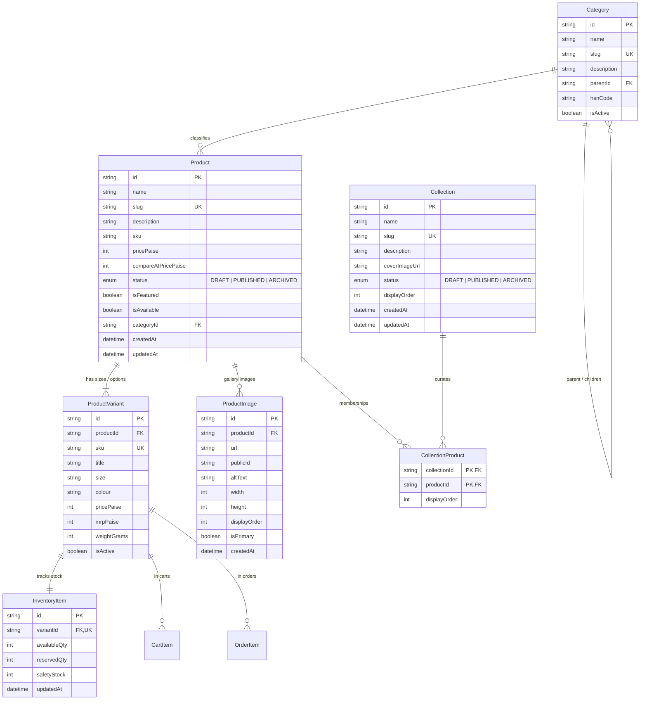
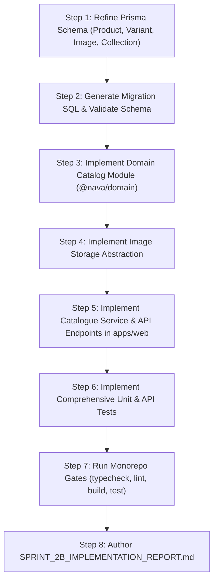

# NAVA CREATIONS — Sprint 2B Implementation Plan
## Database Integration & Product Catalogue Foundation

> **Document Type:** Sprint Architectural & Implementation Plan  
> **Brand:** NAVA CREATIONS (Bengaluru, Karnataka)  
> **Sprint:** 2B — Database Integration & Product Catalogue Foundation  
> **Author:** Lead Full-Stack Engineer & Principal Systems Architect  
> **Date:** November 2026  
> **Status:** Pending Owner / Architectural Execution  

---

## 1. Executive Summary & Sprint Scope

### 1.1 Objective
The goal of **Sprint 2B** is to transition NAVA CREATIONS from the technical scaffold established in Sprint 2A.2 to its first operational e-commerce capabilities:
1. Hardened PostgreSQL database integration with resilient Prisma client connection pooling.
2. Canonical initial database migration artifacts.
3. Clean, small-business-tailored product catalogue data model supporting products, variants (bangle sizing), categories, collections, product images, and inventory.
4. Server-authoritative pricing and inventory availability domain logic (integer paise, non-negative checks, oversell prevention).
5. Public storefront read-only catalogue APIs with pagination and filtering.
6. Service-layer catalogue management protected behind an explicit authentication and authorisation boundary.
7. Pluggable product image storage abstraction (metadata in PostgreSQL, binaries on CDN).
8. Comprehensive test suites validating schema, domain logic, APIs, and boundary conditions.

### 1.2 Core Philosophy
NAVA CREATIONS is a specialized Bengaluru small business crafting handmade bangles, bridal sets, and festival accessories. The architecture prioritises **simplicity, rock-solid reliability, zero floating-point money bugs, and strict data integrity** over unnecessary enterprise complexity or microservices.

---

## 2. Existing System Inspection & Codebase Baseline

### 2.1 Workspace Structure
The monorepo is managed via `pnpm` workspaces (v12.18.0) and Turborepo (v2.11.10) with Node.js 22 LTS:
- `apps/web`: Next.js 15 App Router storefront and administrative API layer.
- `packages/domain`: Pure, framework-agnostic business logic (Money, Tax, Orders, Refunds, Inventory).
- `packages/db`: Prisma ORM client, PostgreSQL 16 schema, and database connection utilities.
- `packages/shared`: Shared Result types and generic functional utilities.
- `packages/config`: Shared ESLint, Prettier, and TypeScript configurations.

### 2.2 Baseline Findings Reused
- **Monetary Value Object:** `Money` and `SignedMoney` from `@nava/domain/src/money.ts` enforce non-negative integer paise representations.
- **Tax Segregation:** The tax engine (`@nava/domain/src/tax`) handles MRP backwards calculations and composite shipping GST; it remains completely separate from core product catalog data.
- **Relational Integrity:** Order, payment, reservation, and refund relational models from Sprint 2A.2 are preserved without regressions.
- **Health Probes:** `/api/health/liveness`, `/api/health/readiness`, and `/api/health` already provide resilient cluster monitoring.

---

## 3. Product Catalogue Data Model Design

### 3.1 Model Architecture & Justification

The catalogue models in [`packages/db/prisma/schema.prisma`](file:///d:/NAVA/packages/db/prisma/schema.prisma) will be refined to support essential retail features without bloat:



### 3.2 Key Data Model Decisions

1. **Product vs ProductVariant:**
   - In Indian accessories and bangle retail, size is a primary purchase option (standard sizes: 2.2, 2.4, 2.6, 2.8).
   - The `Product` model holds the base display attributes (title/name, slug, description, primary price, comparison price, publication status, featured flag, and category).
   - `ProductVariant` represents the purchasable unit with a unique SKU, individual size/colour, and dedicated `InventoryItem`. If a product has no variations (e.g., a one-size hair accessory), a single default variant is maintained automatically.
   - This cleanly preserves foreign key relationships with `CartItem`, `OrderItem`, and `InventoryReservationItem`.

2. **Integer Paise for Pricing:**
   - `pricePaise` and `compareAtPricePaise` are stored as PostgreSQL `INTEGER` (paise). ₹1,499.00 is stored as `149900`.
   - Floating-point numbers are strictly forbidden in database columns and application pricing.

3. **Publication Status Enum (`DRAFT`, `PUBLISHED`, `ARCHIVED`):**
   - Products and Collections use a 3-state enum. Draft products are invisible to public storefront queries; archived products are retired without breaking historical order receipts.

4. **Collections vs Categories:**
   - Categories represent strict taxonomy (e.g. *Bangles > Bridal Bangles*).
   - Collections represent merchandising groupings (e.g. *Festive Return Gifts*, *Bestsellers*, *Wedding Edit 2026*). Products can belong to multiple collections via `CollectionProduct` with an explicit `displayOrder`.

5. **Product Images:**
   - Image metadata, dimensions, alt text, and CDN URLs are stored in `ProductImage`. Binary image data is NEVER stored in PostgreSQL.

---

## 4. PostgreSQL Integration & Migration Strategy

### 4.1 Connection Configuration & Resilience
- **Runtime Connection:** `DATABASE_URL` (pooled connection via Neon PgBouncer or local PostgreSQL).
- **Direct Connection:** `DIRECT_URL` (direct TCP connection for migrations and DDL).
- **Graceful Fallback:** Prisma client queries will be wrapped in resilience handlers. If the database connection is absent, misconfigured, or unreachable:
  - System health probes emit structured `HTTP 503 Service Unavailable`.
  - Catalogue endpoints catch database connection errors and emit graceful fallback responses rather than crashing the Next.js process with unhandled exceptions.

### 4.2 Migration Artifacts
- The canonical initial migration will be generated using Prisma DDL diffing into `packages/db/prisma/migrations/0_init/migration.sql`.
- Migration status will be honestly reported: local file generation verified, with live application instructions documented for the production Neon/Supabase deployment.

---

## 5. Domain Logic & Catalogue Services (`@nava/domain/src/catalog`)

### 5.1 Server-Authoritative Pricing
- The client browser is treated as an untrusted environment. Incoming cart or checkout requests will NEVER accept price parameters from client payloads.
- Prices are loaded directly from the database or domain catalog registry.
- `Money` value objects validate all price inputs (`paise >= 0`, integer check, finite numbers).

### 5.2 Inventory Availability & Oversell Prevention
- Available Stock Calculation:
  $$\text{Available Stock} = \max\left(0, \text{availableQty} - \text{reservedQty} - \text{safetyStock}\right)$$
- Atomic conditional decrements prevent overselling under concurrent requests:
  ```sql
  UPDATE inventory_items
  SET available_qty = available_qty - $requestedQty
  WHERE variant_id = $variantId
    AND (available_qty - reserved_qty - safety_stock) >= $requestedQty;
  ```

### 5.3 Image Storage Abstraction
- Defined in `packages/domain/src/catalog/image-storage.ts`:
  ```typescript
  export interface ImageStorageService {
    uploadImage(file: Buffer | Uint8Array, filename: string, mimeType: string): Promise<UploadedImageResult>;
    deleteImage(publicId: string): Promise<boolean>;
    getOptimizedUrl(publicId: string, options?: ImageTransformOptions): string;
  }
  ```
- Implemented with a `MockImageStorageAdapter` for automated testing and a `CloudinaryImageStorageAdapter` for production CDN integration.

---

## 6. Catalogue API Layer (`apps/web/app/api`)

### 6.1 Storefront Public Endpoints (Read-Only)

| Endpoint | Method | Purpose | Authentication |
| :--- | :--- | :--- | :--- |
| `/api/catalog/products` | `GET` | Paginated product listing with filters (`category`, `collection`, `featured`, `search`) | None (Public) |
| `/api/catalog/products/[slug]` | `GET` | Single published product details, variants, images, availability | None (Public) |
| `/api/catalog/categories` | `GET` | Active category tree | None (Public) |
| `/api/catalog/collections` | `GET` | Published collections | None (Public) |
| `/api/catalog/collections/[slug]/products` | `GET` | Products within a specific collection | None (Public) |

### 6.2 Admin Catalogue Operations & Security Boundary

| Endpoint / Service Function | Method | Purpose | Authentication Boundary |
| :--- | :--- | :--- | :--- |
| `createProduct(...)` | `POST` | Create a draft product with variants | **Mandatory Admin Session** (401/403) |
| `updateProduct(...)` | `PUT/PATCH`| Modify product details, pricing, status | **Mandatory Admin Session** (401/403) |
| `archiveProduct(...)` | `DELETE` | Mark product as ARCHIVED | **Mandatory Admin Session** (401/403) |
| `updateInventory(...)` | `POST` | Adjust stock levels, safety stock | **Mandatory Admin Session** (401/403) |
| `createCollection(...)` | `POST` | Create merchandising collection | **Mandatory Admin Session** (401/403) |

> [!IMPORTANT]
> Unauthenticated write endpoints will NOT be exposed. Administrative routes verify active `AdminSession` tokens via cryptographic session hashing. If no session is present, the API immediately returns `HTTP 401 Unauthorized` or `HTTP 403 Forbidden`.

---

## 7. Testing Strategy

1. **Schema Validation:** `pnpm --filter @nava/db validate` confirming relational syntax.
2. **Domain Unit Tests (`packages/domain/tests/`):**
   - Monetary price validation (rejection of negative, fractional, or NaN values).
   - Availability calculation and safety stock logic.
   - Overselling boundary checks and concurrent reservation logic.
   - Product publication lifecycle transitions (`DRAFT` $\to$ `PUBLISHED` $\to$ `ARCHIVED`).
   - Image storage service abstraction tests.
   - Pagination and filtering helper functions.
3. **API Integration Tests (`apps/web`):**
   - Public storefront endpoints return valid HTTP 200 responses with standardized pagination envelopes.
   - Inactive / draft products are excluded from public listings.
   - Admin endpoints reject unauthenticated write requests with HTTP 401/403.
   - Database connection failure returns clean HTTP 503 instead of 500 crash.
4. **CI & Monorepo Regression Gate:**
   - `pnpm run typecheck` across all 5 packages.
   - `pnpm run lint` across all 5 packages.
   - `pnpm run build` validating Next.js bundle and TypeScript compilation.

---

## 8. Implementation Steps & Sequencing



---
*Implementation Plan authored and verified for execution in Sprint 2B.*
