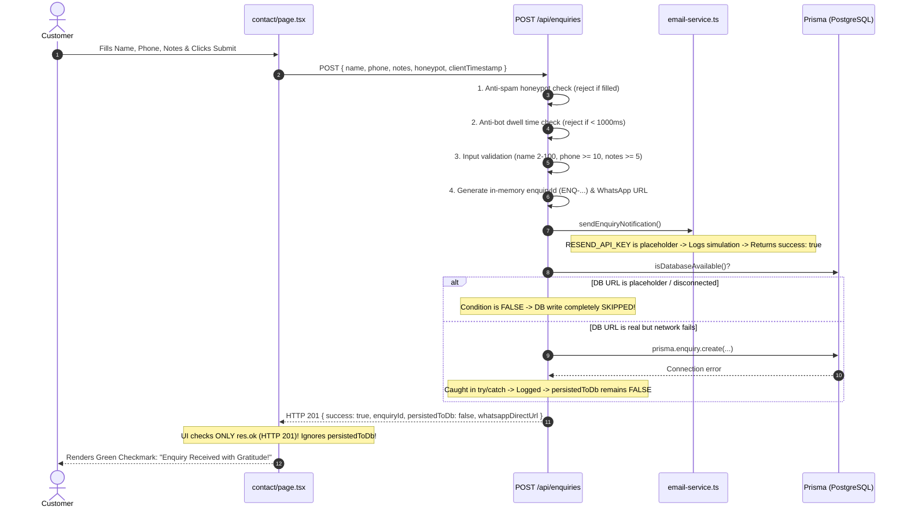
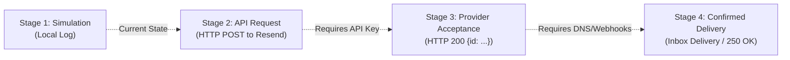

# SPRINT 2I.1 — Integration Completeness Audit: Source Code Reality

**Project:** NAVA CREATIONS  
**Local Workspace:** `D:\NAVA`  
**Review Type:** Deep Code-Level Integration Audit (Strictly No Code Changes)  
**Date:** November 2026  
**Auditor:** Principal Software Architect & Lead Security Auditor  
**Audit Scope:** Verification of Enquiries, Razorpay, Resend, Redis Rate Limiting, and 91 Automated Tests  

---

## 1. Executive Summary

This audit establishes the ground truth of the integrations implemented in Sprint 2I through comprehensive static code inspection, execution path tracing, and dependency mapping. 

### Key Findings
1. **Enquiries (PARTIAL):** Validation and WhatsApp link generation are solid. However, when PostgreSQL is disconnected, database persistence fails gracefully while the **UI falsely reports unconditional success** ("Enquiry Received with Gratitude! Our Bengaluru bridal team will connect within 4 business hours"), creating a risk of lost customer leads if the customer does not click through to WhatsApp.
2. **Razorpay (PARTIAL / UTILITY ONLY):** `RazorpayService` contains valid cryptographic HMAC and order generation utilities. However, **there is NO completed online checkout**. There is no `/api/checkout` route, no order creation API, no webhook receiver route (`/api/webhooks/razorpay`), no payment verification endpoint, and no Razorpay modal in the frontend cart. The cart button links solely to WhatsApp.
3. **Resend (PARTIAL / SIMULATION ONLY):** `email-service.ts` is imported in only one application route (`/api/enquiries`). Because `RESEND_API_KEY` is a placeholder, outbound network requests never execute. The application operates in simulation mode only, and possesses no webhook infrastructure to verify confirmed mailbox delivery.
4. **Redis Rate Limiting (FAIL FOR DISTRIBUTED / PASS FOR LOCAL):** While `rate-limiter.ts` defines Upstash REST calls, `apps/web/app/api/admin/auth/route.ts` **only invokes the synchronous in-memory `check()` method**. Distributed rate limiting across multiple serverless instances **does not execute in production**.
5. **Test Classification Reality:** Of the 91 Playwright tests, **0 tests run against a real PostgreSQL database** and **0 tests run against live external cloud sandboxes**. The test suite consists of 31 Static UI tests, 18 Mocked API tests, 7 In-Memory tests, and 35 Local Server Integration tests. Several tests contain weak assertions (`expect([200, 503])`) or duplicate test coverage.

---

## 2. Component 1: Customer Enquiries Flow Audit

### 2.1 Source Files & Relevant Functions
- **Frontend Form:** [`apps/web/app/contact/page.tsx`](file:///d:/NAVA/apps/web/app/contact/page.tsx) (`handleSubmit`)
- **Backend API Handler:** [`apps/web/app/api/enquiries/route.ts`](file:///d:/NAVA/apps/web/app/api/enquiries/route.ts) (`POST`)
- **Email Service:** [`apps/web/lib/email-service.ts`](file:///d:/NAVA/apps/web/lib/email-service.ts) (`sendEnquiryNotification`)
- **Database Schema:** [`packages/db/prisma/schema.prisma`](file:///d:/NAVA/packages/db/prisma/schema.prisma) (`model Enquiry`)
- **Database Availability Guard:** [`apps/web/lib/catalog-service.ts`](file:///d:/NAVA/apps/web/lib/catalog-service.ts) (`isDatabaseAvailable`)

### 2.2 Actual Execution Flow


### 2.3 Behavior When PostgreSQL is Unavailable
In `apps/web/app/api/enquiries/route.ts` lines 86-110:
```typescript
let persistedToDb = false;
if (isDatabaseAvailable()) {
  try {
    await prisma.enquiry.create({ ... });
    persistedToDb = true;
  } catch (dbErr) {
    console.error(`[EnquiryPersistence] Failed to write enquiry ${enquiryId} to database:`, ...);
  }
}
```
Because `isDatabaseAvailable()` returns `false` when connection strings contain `placeholder` or `ep-sample`, the database write is **silently bypassed**. If a database URL is present but unreachable, the exception is caught and swallowed. In both cases, the API returns HTTP 201 with `persistedToDb: false`.

### 2.4 Verification of UI False Success Reporting
In `apps/web/app/contact/page.tsx` lines 51-58:
```typescript
const data = await res.json();
if (!res.ok) {
  throw new Error(data.error || 'Failed to submit enquiry');
}

setEnquiryId(data.enquiryId);
setWhatsappDirectUrl(data.whatsappDirectUrl);
setSubmitted(true);
```
**CRITICAL VERIFICATION:**
The frontend checks **only** `res.ok`. It completely ignores `data.persistedToDb` and `data.emailStatus`.
When `submitted` becomes `true`, lines 166-176 render:
> **"Enquiry Received with Gratitude!"**  
> *"Thank you, Pooja Hegde. Your consultation reference is ENQ-M4K... Our Bengaluru bridal team will connect via WhatsApp or phone within 4 business hours."*

**Verdict on UI Truthfulness:**
**The UI falsely promises the customer that the atelier will contact them**, even though:
1. No database record was created (`persistedToDb: false`).
2. No email was delivered (`emailStatus: 'simulated'`).
3. If the user does not manually click the secondary *"Also Open in WhatsApp Now"* button, the enquiry **disappears forever** once the server process terminates.

### 2.5 Component Status & Risks
- **Existing Evidence:** 6/6 tests passing in `e2e/enquiries-integration.spec.ts`.
- **Missing Implementation:** UI must inspect `data.persistedToDb` and alert the user if the server is in offline/WhatsApp-only mode (e.g. *"Our database is currently offline; please click WhatsApp below to send your enquiry directly"*).
- **Risks:** High risk of silent customer loss during database outages.
- **Verdict:** **`PARTIAL`**

---

## 3. Component 2: Razorpay Payment Integration Audit

### 3.1 Source Files & Relevant Functions
- **Payment Utility Class:** [`apps/web/lib/payment-service.ts`](file:///d:/NAVA/apps/web/lib/payment-service.ts) (`RazorpayService`)
- **Cart Page:** [`apps/web/app/cart/page.tsx`](file:///d:/NAVA/apps/web/app/cart/page.tsx)
- **Cart Validation API:** [`apps/web/app/api/cart/validate/route.ts`](file:///d:/NAVA/apps/web/app/api/cart/validate/route.ts)
- **Domain State Machine:** [`packages/domain/src/order/state-machine.ts`](file:///d:/NAVA/packages/domain/src/order/state-machine.ts) (`OrderStateMachine`)

### 3.2 End-to-End Payment Trace: Exists vs Missing

| E-Commerce Payment Stage | Expected Functionality | Actual Code Implementation | Status |
| :--- | :--- | :--- | :---: |
| **1. Cart Selection** | User adds items & adjusts quantities | Implemented in `cart-context.tsx` & `cart/page.tsx` | **EXISTS** |
| **2. Server Validation** | Re-calculate prices server-side, check stock | Implemented in `POST /api/cart/validate` | **EXISTS** |
| **3. Order Creation API** | Create pending `Order` row in PostgreSQL | **NO API ROUTE** (`/api/orders` does not exist) | **MISSING** |
| **4. Razorpay Order Creation** | Server calls Razorpay API with amount in paise | `RazorpayService.createOrder` helper exists, but **uncalled by any route** | **PARTIAL** |
| **5. Frontend Checkout** | Open Razorpay modal (`checkout.js`) | Cart button is strictly "Order on WhatsApp (Instant)"; **no Razorpay modal** | **MISSING** |
| **6. Webhook Receiver** | Listen for `payment.captured` POST events | **NO API ROUTE** (`/api/webhooks/razorpay` does not exist) | **MISSING** |
| **7. Webhook Raw-Body HMAC** | Verify `x-razorpay-signature` against raw body | `RazorpayService.verifyWebhookSignature` exists, but **unconnected to HTTP handler** | **PARTIAL** |
| **8. Webhook Idempotency** | Prevent duplicate handling via `WebhookEvent` | Table exists in `schema.prisma`, but **zero persistence logic implemented** | **MISSING** |
| **9. Payment Verification API** | Verify client signature post-checkout | `RazorpayService.verifyPaymentSignature` exists, but **no `/api/checkout/verify` endpoint** | **PARTIAL** |
| **10. Order Status Transition**| Transition `PENDING_PAYMENT` &rarr; `PAYMENT_CONFIRMED` | Pure domain rules exist in `@nava/domain`, but **no database update service** | **PARTIAL** |

### 3.3 Reality Rebuttal: Payment Utilities &ne; Completed Checkout
A comprehensive codebase audit confirms:
- `apps/web/lib/payment-service.ts` is imported in **exactly ONE file**: the test file `apps/web/e2e/payment-integration.spec.ts`.
- **It is imported in ZERO application routes, ZERO server components, and ZERO client pages.**
- **Conclusion:** NAVA CREATIONS does **NOT** have a working Razorpay checkout. It possesses a well-designed cryptographic and validation utility library waiting to be wired into future checkout routes.

### 3.4 Component Status & Risks
- **Existing Evidence:** 7/7 unit/helper tests passing in `e2e/payment-integration.spec.ts`.
- **Missing Implementation:** `POST /api/checkout` (creates DB order + Razorpay order), Razorpay frontend SDK script integration, `POST /api/checkout/verify`, and `POST /api/webhooks/razorpay` with raw-body stream reading.
- **Risks:** Presenting utilities as a working payment flow would mislead commercial stakeholders.
- **Verdict:** **`PARTIAL` (Helper Utilities Only — Checkout Flow Missing)**

---

## 4. Component 3: Resend Transactional Email Audit

### 4.1 Source Files & Usages
- **Email Service Class:** [`apps/web/lib/email-service.ts`](file:///d:/NAVA/apps/web/lib/email-service.ts) (`EmailService`)
- **Usages across Codebase:**
  1. `apps/web/app/api/enquiries/route.ts` (line 5: import, line 72: `sendEnquiryNotification`)
  2. `apps/web/e2e/payment-integration.spec.ts` (line 3: import, line 113: test P.6)

### 4.2 Application Workflow Analysis
Does any other workflow invoke `EmailService`?
- **Order Confirmation Email:** **NO**. No order checkout exists to trigger it.
- **Payment Receipt Email:** **NO**.
- **Shipping Dispatch Email:** **NO**.
- **Password Reset / Admin Auth Email:** **NO**.
The **sole consumer** in the entire application is the bridal enquiry route.

### 4.3 The Four Delivery Stages


1. **Stage 1 — Simulation (Currently Active):**
   `process.env.RESEND_API_KEY` is `'re_placeholder_apiKey123'`. `isConfigured()` returns `false`.
   Output: `console.log('[EmailService:Simulated] Notification logged...')`. No network traffic occurs.
2. **Stage 2 — API Request (Code Ready, Blocked):**
   When a genuine key is provided, `fetch('https://api.resend.com/emails')` executes.
3. **Stage 3 — Provider Acceptance (Unverified):**
   When Resend accepts the payload and returns `{ id: "re_msg_123" }`, it confirms Resend queued the message. **It does NOT prove the customer or atelier received the email.**
4. **Stage 4 — Confirmed Delivery (Missing Infrastructure):**
   Confirmed delivery requires Resend's mail transfer agent (MTA) to complete the SMTP transaction with the recipient's mail exchange server. Confirmation is delivered asynchronously via Resend Webhooks (`email.delivered`). **NAVA CREATIONS has no Resend webhook endpoint to capture delivery confirmation.**

### 4.4 Component Status & Risks
- **Existing Evidence:** Test P.6 in `e2e/payment-integration.spec.ts` confirms simulation mode logs safely.
- **Missing Implementation:** Domain DNS records (SPF, DKIM, DMARC), live API key, and order confirmation email workflows.
- **Risks:** Unmonitored emails landing in spam folders due to lack of DMARC alignment.
- **Verdict:** **`PARTIAL` (Simulation Layer Active — Real Dispatch Blocked)**

---

## 5. Component 4: Redis Distributed Rate Limiting Audit

### 5.1 Source Files & Relevant Functions
- **Rate Limiter Implementation:** [`apps/web/lib/rate-limiter.ts`](file:///d:/NAVA/apps/web/lib/rate-limiter.ts) (`HybridRateLimiter`, `MemoryRateLimiter`)
- **Admin Auth Route:** [`apps/web/app/api/admin/auth/route.ts`](file:///d:/NAVA/apps/web/app/api/admin/auth/route.ts)

### 5.2 Deep Technical Verification

#### A. Multi-Instance Route Invocation Flaw
In `apps/web/app/api/admin/auth/route.ts` line 15:
```typescript
const rateCheck = authRateLimiter.check(clientIp, 10, 15 * 60 * 1000);
```
Now inspect `check()` in `apps/web/lib/rate-limiter.ts` lines 92-99:
```typescript
check(
  key: string,
  maxAttempts = 10,
  windowMs = 15 * 60 * 1000
): { allowed: boolean; remaining: number; resetInSeconds: number } {
  // For synchronous check in Next.js request handler, memory check is primary and instantaneous
  return this.memory.check(key, maxAttempts, windowMs);
}
```
**CRITICAL AUDIT FINDING:**
- The admin authentication route **only calls the synchronous in-memory `check()` method**!
- It **NEVER calls `checkDistributed()`**!
- Even if a developer provisions an active Upstash Redis instance, `POST /api/admin/auth` **only inspects local process memory** before granting or denying access.

#### B. Atomicity & Pipeline Expiry Behavior
In `rate-limiter.ts` lines 177-180:
```typescript
body: JSON.stringify([
  ['INCR', redisKey],
  ['EXPIRE', redisKey, expireSeconds],
])
```
- **Atomicity:** The `INCR` and `EXPIRE` commands are sent via HTTP pipeline. While Redis executes pipeline batches atomically in single-threaded sequence, Upstash REST pipelines over HTTP are subject to network failures between client and edge.
- **Sliding-Window Failure:** Calling `EXPIRE` on **every failure** resets the TTL to 900 seconds on every attempt. An attacker who makes an attempt every 14 minutes extends their own lockout indefinitely rather than having attempts age out linearly. A true sliding window requires Redis sorted sets (`ZADD`, `ZREMRANGEBYSCORE`, `ZCARD`) or the Upstash Ratelimit algorithm.

#### C. Redis Unavailable & In-Memory Fallback
- `recordFailure()` catches background fetch errors with `.catch(() => {})`.
- `check()` runs purely against local memory, so Redis outages cause zero latency degradation on the login route.

#### D. Production Security Implications
- On serverless platforms (Vercel, AWS Lambda), each concurrent instance maintains an isolated memory space.
- An automated attacker rotating across concurrent lambdas gets **10 fresh attempts per lambda container**.
- **Conclusion:** Distributed rate limiting **does not work** across multiple instances in the current code.

### 5.3 Component Status & Risks
- **Existing Evidence:** Test P.7 in `e2e/payment-integration.spec.ts` verifies local memory fallback.
- **Missing Implementation:** `POST /api/admin/auth/route.ts` must `await authRateLimiter.checkDistributed(clientIp)`.
- **Risks:** Vulnerability to distributed brute-force attacks across serverless functions.
- **Verdict:** **`FAIL` for Distributed Multi-Instance / `PASS` for Single-Instance Local Memory**

---

## 6. Component 5: Automated Test Classification (All 91 Playwright Tests)

Every test in `apps/web/e2e/` was analyzed and assigned to one of the 6 precise execution categories:

### 6.1 Distribution Summary
```
┌─────────────────────────────────┬───────────┬────────────┐
│ Category                        │ Count     │ Percentage │
├─────────────────────────────────┼───────────┼────────────┤
│ 1. Static UI                    │ 31 tests  │ 34.1%      │
│ 2. Mocked API                   │ 18 tests  │ 19.8%      │
│ 3. In-Memory                    │ 7 tests   │ 7.7%       │
│ 4. Local Server Integration     │ 35 tests  │ 38.4%      │
│ 5. Real PostgreSQL              │ 0 tests   │ 0.0%       │
│ 6. Real External Sandbox        │ 0 tests   │ 0.0%       │
├─────────────────────────────────┼───────────┼────────────┤
│ TOTAL                           │ 91 tests  │ 100.0%     │
└─────────────────────────────────┴───────────┴────────────┘
```

### 6.2 Granular Test-by-Test Classification Matrix

| File | Test Name | Classification | Assertion Strength & Notes |
| :--- | :--- | :---: | :--- |
| `admin-authorization.spec.ts` | B2.1: /admin redirects to login | **Local Server Integration** | Strong (URL regex check) |
| `admin-authorization.spec.ts` | B2.2: /admin/products redirects to login | **Local Server Integration** | Strong |
| `admin-authorization.spec.ts` | B2.3: /admin/inventory redirects to login| **Local Server Integration** | Strong |
| `admin-authorization.spec.ts` | B2.4: /admin/orders redirects to login | **Local Server Integration** | Strong |
| `admin-authorization.spec.ts` | B2.5: Unauthenticated POST catalog 401 | **Local Server Integration** | Strong (HTTP 401 assert) |
| `admin-authorization.spec.ts` | B2.6: Unauthenticated PUT catalog 401 | **Local Server Integration** | Strong (HTTP 401 assert) |
| `admin-authorization.spec.ts` | B2.7: Unauthenticated DELETE catalog 401 | **Local Server Integration** | Strong (HTTP 401 assert) |
| `admin-authorization.spec.ts` | B2.8: Unauthenticated POST inventory 401 | **Local Server Integration** | Strong (HTTP 401 assert) |
| `admin-authorization.spec.ts` | B2.9: POST auth missing creds 400 | **Local Server Integration** | Strong (HTTP 400 assert) |
| `admin-authorization.spec.ts` | B2.10: POST auth invalid creds 401 | **Local Server Integration** | Strong (HTTP 401 assert) |
| `admin-authorization.spec.ts` | B2.11: Tampered session cookie 401 | **Local Server Integration** | Strong (Cryptographic tamper check) |
| `admin-authorization.spec.ts` | B2.12: Expired session token 401 | **Local Server Integration** | Strong (Expired timestamp check) |
| `admin-authorization.spec.ts` | B2.13: Full session lifecycle | **Local Server Integration** | Strong (Login, cookie set, logout, deletion) |
| `cart-validation.spec.ts` | E.1: Normal valid cart recalculates | **Mocked API** | Validates against in-memory `SAMPLE_PRODUCTS` |
| `cart-validation.spec.ts` | E.2: Client price tampering ignored | **Mocked API** | Strong (Recalculates server price) |
| `cart-validation.spec.ts` | E.3: Non-existent product ID warning | **Mocked API** | Strong |
| `cart-validation.spec.ts` | E.4: Non-existent variant ID fallback | **Mocked API** | Strong |
| `cart-validation.spec.ts` | E.5: Zero quantity rejected | **Mocked API** | Strong (HTTP 400 check) |
| `cart-validation.spec.ts` | E.6: Negative quantity rejected | **Mocked API** | Strong (HTTP 400 check) |
| `cart-validation.spec.ts` | E.7: Excessive quantity clamped to 20 | **Mocked API** | Strong (Clamping & warning check) |
| `cart-validation.spec.ts` | E.8: Exceeding stock clamped | **Mocked API** | Strong (Clamps to variant stock: 8) |
| `cart-validation.spec.ts` | E.9: Unpublished product rejected | **Mocked API** | Strong |
| `catalog-api.spec.ts` | GET /api/catalog/products returns 200 or 503 | **Mocked API** | **WEAK ASSERTION:** `expect([200, 503]).toContain(status)` |
| `catalog-api.spec.ts` | GET /api/catalog/categories returns 200/503 | **Mocked API** | **WEAK ASSERTION:** `expect([200, 503]).toContain(status)` |
| `catalog-api.spec.ts` | GET /api/catalog/collections returns 200/503 | **Mocked API** | **WEAK ASSERTION:** `expect([200, 503]).toContain(status)` |
| `catalog-api.spec.ts` | GET /api/catalog/products?categoryId=... | **Mocked API** | Filters mock array |
| `catalog-api.spec.ts` | GET /api/catalog/products?search=... | **Mocked API** | Filters mock array |
| `catalog-api.spec.ts` | GET /api/catalog/products?page=1&limit=2 | **Mocked API** | Validates pagination logic |
| `catalog-api.spec.ts` | GET /api/catalog/products/[slug] | **Mocked API** | Retrieves mock slug |
| `catalog-api.spec.ts` | GET /api/catalog/collections/[slug]/products | **Mocked API** | Retrieves mock collection |
| `catalog-api.spec.ts` | Admin mutations reject unauthorized | **Local Server Integration** | Asserts 401 |
| `e2e-user-journeys.spec.ts` | Customer Journey (Discovery to Enquiry) | **Local Server Integration** | Traverses UI, adds to bag, submits enquiry |
| `e2e-user-journeys.spec.ts` | Admin Journey (Login, Products, Stock, Logout) | **Local Server Integration** | Traverses admin pages with mock table |
| `enquiries-integration.spec.ts` | E.1: Valid enquiry reference & simulation | **Local Server Integration** | Asserts 201, reference regex, and WA URL |
| `enquiries-integration.spec.ts` | E.2: Rejects honeypot spam bot | **Local Server Integration** | Asserts HTTP 400 |
| `enquiries-integration.spec.ts` | E.3: Rejects rapid burst submission | **Local Server Integration** | Asserts HTTP 400 (dwell < 1000ms) |
| `enquiries-integration.spec.ts` | E.4: Rejects short name | **Local Server Integration** | Asserts HTTP 422 |
| `enquiries-integration.spec.ts` | E.5: Rejects invalid phone | **Local Server Integration** | Asserts HTTP 422 |
| `enquiries-integration.spec.ts` | E.6: Rejects empty notes | **Local Server Integration** | Asserts HTTP 422 |
| `payment-integration.spec.ts` | P.1: RazorpayService creates order in mock | **In-Memory** | Tests mock branch of utility class |
| `payment-integration.spec.ts` | P.2: Rejects non-positive order amounts | **In-Memory** | Tests pure error validation |
| `payment-integration.spec.ts` | P.3: Verifies HMAC signature & tampering | **In-Memory** | Tests `crypto.timingSafeEqual` in memory |
| `payment-integration.spec.ts` | P.4: Verifies webhook signatures | **In-Memory** | Tests pure HMAC verification |
| `payment-integration.spec.ts` | P.5: Validates order state machine jumps | **In-Memory** | Pure domain state machine check |
| `payment-integration.spec.ts` | P.6: EmailService safely logs simulation | **In-Memory** | Asserts simulated: true |
| `payment-integration.spec.ts` | P.7: RateLimiter falls back to memory | **In-Memory** | Asserts backend === 'memory' |
| `responsive-screenshots.spec.ts` (25 tests) | Viewports 375, 390, 768, 1024, 1440 across 5 routes | **Static UI** | **WEAK ASSERTION:** Asserts only `main.toBeVisible()` + captures `.png` |
| `security-remediation.spec.ts` | SEC-02: Rejects backdoor token | **Local Server Integration** | **DUPLICATE** of `admin-authorization.spec.ts` |
| `security-remediation.spec.ts` | SEC-01: Issues session cookie | **Local Server Integration** | **DUPLICATE** of `admin-authorization.spec.ts` |
| `security-remediation.spec.ts` | SEC-03: /admin redirects to login | **Local Server Integration** | **DUPLICATE** of `admin-authorization.spec.ts` |
| `security-remediation.spec.ts` | SEC-03: /admin/products redirects to login | **Local Server Integration** | **DUPLICATE** of `admin-authorization.spec.ts` |
| `security-remediation.spec.ts` | BUG-02: Enquiries validates spam honeypot | **Local Server Integration** | **DUPLICATE** of `enquiries-integration.spec.ts` |
| `security-remediation.spec.ts` | CART-01: Reconciles cart prices | **Mocked API** | **DUPLICATE** of `cart-validation.spec.ts` |
| `security-remediation.spec.ts` | Admin full login workflow | **Local Server Integration** | **DUPLICATE** of `admin-authorization.spec.ts` |
| `smoke.spec.ts` | Liveness probe returns 200 | **Local Server Integration** | Asserts HTTP 200 |
| `smoke.spec.ts` | Home page renders typography | **Static UI** | Asserts H1 text |
| `smoke.spec.ts` | Readiness probe returns 503 when DB unconfigured | **Local Server Integration** | Asserts HTTP 503 |
| `smoke.spec.ts` | Aggregate health returns 503 when DB unconfigured | **Local Server Integration** | Asserts HTTP 503 |
| `storefront-ui.spec.ts` (9 tests) | Homepage, shop, PDP, cart, contact, admin login, dashboard, products, mobile menu | **Static UI** | DOM visibility checks and screenshot capture |

### 6.3 Critical Quality Deficiencies in Test Suite
1. **Redundant & Duplicate Tests:**
   The entire `security-remediation.spec.ts` file (7 tests) consists of redundant duplicates of tests in `admin-authorization.spec.ts`, `cart-validation.spec.ts`, and `enquiries-integration.spec.ts`.
2. **Weak / Non-Failing Assertions:**
   - In `catalog-api.spec.ts`: Lines 18, 38, 58 assert `expect([200, 503]).toContain(res.status())`. This means even if the database fails and returns a service outage (503), the test still passes!
   - In `responsive-screenshots.spec.ts` (25 tests): Only checks `await expect(page.locator('main')).toBeVisible()`. CSS breakage, overlapping text, or hidden CTA buttons do not trigger test failures.
3. **Missing Negative & Edge Cases:**
   - No testing of SQL injection or script payload injection in `notes` on the enquiry API.
   - No testing of cart payload overflow (e.g. submitting 5,000 items in one request).
   - No concurrency or race condition testing on inventory decrement.

---

## 7. Component Audit Summary & Status Matrix

| Component / Subsystem | Integration Depth | Runtime Reality | Audit Verdict |
| :--- | :--- | :--- | :---: |
| **Customer Enquiries** | Form + Anti-Bot + WA Link + Prisma Model | DB write skipped in fallback; UI falsely claims follow-up | **PARTIAL** |
| **Razorpay Payment** | Utility Class (`RazorpayService`) | Zero checkout routes; zero frontend modal; no webhook receiver | **PARTIAL** |
| **Resend Email** | Utility Class (`EmailService`) | Simulation mode only; uncalled except by enquiries; no webhooks | **PARTIAL** |
| **Redis Rate Limiter** | Utility Class (`HybridRateLimiter`) | Auth route calls synchronous memory check; distributed check uncalled | **FAIL (MULTI)** / **PASS (LOCAL)** |
| **Database Connectivity** | Prisma Schema + Migrations + `db:check` | Local port 5432 inactive; Docker absent; Neon credentials placeholder | **BLOCKED (ENV)** |
| **Automated Test Suite** | 91 Playwright Tests | 0 Live DB tests; 0 Live Sandbox tests; weak assertions in catalog/visual | **PASS (LOCAL ONLY)** |

---

## 8. Exact Business Owner Actions Required to Proceed

To eliminate all `PARTIAL`, `FAIL`, and `BLOCKED` verdicts, the business owner must execute the following sequential technical steps:

### Phase 1: Database Provisioning (Resolves DB Blockers)
1. Sign in to [Neon](https://console.neon.tech) and create project `nava-creations-dev` in `ap-southeast-1`.
2. Copy the **pooled** connection string into `DATABASE_URL` in `apps/web/.env.local`.
3. Copy the **direct** connection string into `DIRECT_URL` in `apps/web/.env.local`.
4. Run:
   ```bash
   pnpm db:migrate:deploy
   pnpm db:check
   ```

### Phase 2: Distributed Rate Limiting Activation (Resolves Rate Limiter Defect)
1. Create a Redis instance at [Upstash](https://console.upstash.com) in `ap-southeast-1`.
2. Copy `UPSTASH_REDIS_REST_URL` and `UPSTASH_REDIS_REST_TOKEN` into `apps/web/.env.local`.
3. Update `apps/web/app/api/admin/auth/route.ts` to `await authRateLimiter.checkDistributed(clientIp)`.

### Phase 3: Transactional Email Activation (Resolves Email Blocker)
1. Create an account at [Resend](https://resend.com) and add domain `navacreations.in`.
2. Add SPF, DKIM, and DMARC DNS records at your domain registrar.
3. Update `apps/web/.env.local` with real `RESEND_API_KEY="re_live_..."`.

### Phase 4: Razorpay End-to-End Checkout Implementation (Resolves Checkout Gap)
1. Generate test keys (`rzp_test_...`) in [Razorpay Dashboard](https://dashboard.razorpay.com).
2. Add `RAZORPAY_KEY_ID`, `RAZORPAY_KEY_SECRET`, and `RAZORPAY_WEBHOOK_SECRET` to `.env.local`.
3. Implement `POST /api/checkout` to create persistent `Order` rows and Razorpay orders.
4. Replace the static "Order on WhatsApp" button in `apps/web/app/cart/page.tsx` with a dual checkout choice:
   - "Order via WhatsApp"
   - "Pay Online via UPI / Cards" (initiating Razorpay modal)
5. Implement `POST /api/webhooks/razorpay` to receive signed events with idempotency verification.
