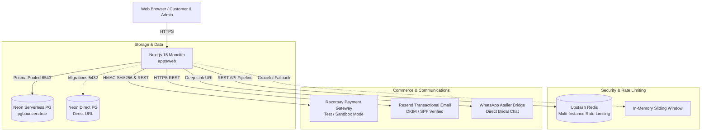

# SPRINT 2I — Infrastructure Setup & Environment Integration Guide

**Project:** NAVA CREATIONS  
**Local Workspace:** `D:\NAVA`  
**Date:** November 2026  
**Author:** DevOps, Backend & Production Reliability Team  
**Status:** READY FOR OPERATIONAL PROVISIONING  

---

## 1. Architecture Overview

NAVA CREATIONS operates as a high-performance modular monolith built on **Next.js 15 App Router**, **React 19**, **TypeScript**, **Tailwind CSS**, and **Prisma ORM**. To transition from local automated testing to verified cloud infrastructure, the platform interfaces with four managed cloud services:



---

## 2. Environment Variables & Secret Governance

### 2.1 File Separation & Security Policies
1. **`.env.local` (Local Environment Secrets):**
   - Strictly git-ignored by `.gitignore` (`.env` and `.env.*` excluded).
   - Verified via `git check-ignore .env.local apps/web/.env.local` (confirmed ignored).
   - Holds developer and test-mode credentials. Never committed to version control.
2. **`.env.example` (Public Repository Template):**
   - Committed to version control. Contains **only sanitized placeholders** (e.g. `re_placeholder_apiKey123`, `rzp_test_placeholderKeyId`).
3. **Automated Credential Masking:**
   - Database connection strings are audited via `pnpm db:check` which replaces usernames, passwords, and tokens with `*****` before logging.

---

## 3. PostgreSQL Database Setup Guide (Neon / Cloud PostgreSQL)

Prisma in NAVA CREATIONS uses a dual-connection architecture required by serverless PostgreSQL providers:
- **`DATABASE_URL` (Pooled Connection):** Connects through PgBouncer connection pooler on port 6543 for transactional web queries.
- **`DIRECT_URL` (Direct Connection):** Direct TCP connection to PostgreSQL on port 5432 for schema migrations, DDL, and advisory locks.

### 3.1 Provisioning Steps (Business Owner Action)
1. Navigate to [Neon Console](https://console.neon.tech) and create a project named `nava-creations-dev`.
2. Select region `ap-southeast-1 (Singapore)` for low-latency routing to Bengaluru.
3. Under **Dashboard > Connection Details**, copy:
   - **Pooled connection string** (enable `Pooled connection` checkbox).
   - **Direct connection string** (uncheck `Pooled connection`).
4. Update `apps/web/.env.local`:
   ```bash
   DATABASE_URL="postgresql://[user]:[password]@[endpoint]-pooler.ap-southeast-1.aws.neon.tech/neondb?sslmode=require&pgbouncer=true"
   DIRECT_URL="postgresql://[user]:[password]@[endpoint].ap-southeast-1.aws.neon.tech/neondb?sslmode=require"
   ```
5. Deploy database migrations safely:
   ```bash
   pnpm db:migrate:deploy
   ```
6. Verify live connectivity:
   ```bash
   pnpm db:check
   ```

---

## 4. Multi-Instance Rate Limiting Setup Guide (Upstash Redis)

To protect administrative routes (`POST /api/admin/auth`) against brute-force attacks across serverless functions or container clusters:

### 4.1 Architecture
- **Primary:** Upstash Redis REST API using pipelined `INCR` and `EXPIRE` commands.
- **Fallback:** In-memory sliding-window limiter ([`apps/web/lib/rate-limiter.ts`](file:///d:/NAVA/apps/web/lib/rate-limiter.ts)) activates automatically if Redis is unconfigured or experiences network latency.

### 4.2 Configuration Steps
1. Create a serverless database at [Upstash Console](https://console.upstash.com) in `ap-southeast-1`.
2. Copy the REST URL and REST Token into `.env.local`:
   ```bash
   UPSTASH_REDIS_REST_URL="https://[unique-id].upstash.io"
   UPSTASH_REDIS_REST_TOKEN="[token]"
   ```

---

## 5. Transactional Email Setup Guide (Resend)

NAVA CREATIONS uses [`apps/web/lib/email-service.ts`](file:///d:/NAVA/apps/web/lib/email-service.ts) via zero-dependency native `fetch` to `https://api.resend.com/emails`.

### 5.1 Verification Requirements
1. Sign up at [Resend](https://resend.com) and retrieve an API key starting with `re_`.
2. Add domain `navacreations.in` in Resend and configure DNS records:
   - **SPF:** `v=spf1 include:resend.com ~all`
   - **DKIM:** `resend._domainkey.navacreations.in` (CNAME)
   - **DMARC:** `_dmarc.navacreations.in` (`v=DMARC1; p=none;`)
3. Set environment variables in `.env.local`:
   ```bash
   RESEND_API_KEY="re_live_..."
   EMAIL_FROM="NAVA Atelier <atelier@navacreations.in>"
   STUDIO_NOTIFICATION_EMAIL="orders@navacreations.in"
   ```
4. **Test Protection:** When `RESEND_API_KEY` contains `placeholder` or is omitted, the email service automatically operates in **Safe Simulation Mode**, logging simulated dispatch without making external network calls.

---

## 6. Razorpay Payment Sandbox Setup Guide

### 6.1 Test Sandbox Mode Requirements
1. Access [Razorpay Dashboard](https://dashboard.razorpay.com) and toggle to **Test Mode**.
2. Generate API Keys (**Settings > API Keys**).
3. Set in `.env.local`:
   ```bash
   RAZORPAY_KEY_ID="rzp_test_..."
   RAZORPAY_KEY_SECRET="..."
   RAZORPAY_WEBHOOK_SECRET="..."
   ```
4. **Security Guarantees:**
   - Keys must begin with `rzp_test_`. Live keys (`rzp_live_`) are forbidden in development.
   - All amounts are computed authoritatively on the server in paise.
   - Browser callbacks are never trusted without constant-time HMAC-SHA256 signature verification (`crypto.timingSafeEqual`).
