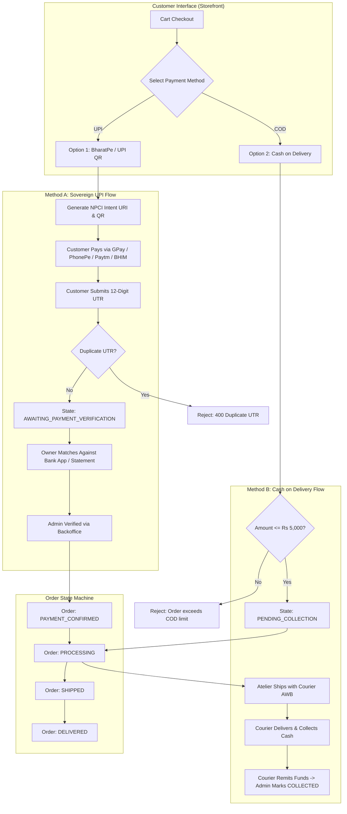

# NAVA CREATIONS — Sprint 2J Payment Architecture
## Sovereign India-First Payment Architecture (Zero-MDR, UPI Intent & Cash on Delivery)

**Document Version:** 1.0.0  
**Date:** 2026-11-11  
**Project:** NAVA CREATIONS (`D:\NAVA`)  
**Scope:** Payment Gateway Removal, Sovereign Merchant UPI Specification, Cash on Delivery Lifecycle, and Audit Provenance  

---

## 1. Context & Business Rationale

### 1.1 The Problem with Conventional Payment Gateways
Traditional e-commerce platforms default to third-party payment gateways such as Razorpay, PayU, or Cashfree. For a nascent small-scale artisanal jewelry brand, this introduces several severe drawbacks:
1. **Unapproved Merchant Discount Rates (MDR):** Standard card and net banking transactions incur 2.0% – 3.0% MDR + 18% GST per transaction.
2. **Setup, Onboarding & Platform Overhead:** Gateways mandate commercial agreements, complex KYC/AML onboarding, fixed integration lock-in, and proprietary webhook dependencies.
3. **External Failure Vectors & Security Scope:** Gateway outages, webhook replay attacks, signature verification edge cases, and client-side iframe injection vulnerabilities inflate architectural complexity.
4. **Explicit Business Directive:** The business owner explicitly mandated that **Razorpay is NOT approved and must NOT be used**. No payment gateway with platform fees or percentage MDR is to be assumed.

### 1.2 The Sovereign Alternative: India-First Zero-Fee Commerce
The Government of India and the National Payments Corporation of India (NPCI) have made Unified Payments Interface (UPI) P2M (Person-to-Merchant) transactions completely zero-MDR for merchants. By utilizing a confirmed **BharatPe Merchant UPI QR** or direct bank UPI handle alongside **Cash on Delivery (COD)**, NAVA CREATIONS achieves:
- **0% Platform Fees:** 100% of customer payments settle directly into the business's current account.
- **Immediate Cash Flow:** Direct settlement without 2–3 day gateway rolling reserves.
- **Zero Third-Party Vendor Lock-In:** Independent of proprietary gateway SDKs or contracts.
- **Absolute PCI-DSS Exemption:** Zero cardholder data touches the server or client applications.

---

## 2. Architecture Overview



---

## 3. Specification of Payment Methods

### 3.1 Method A: BharatPe Merchant UPI QR / Manual UPI

#### A. NPCI Universal Intent Specification
The system produces standard RFC-compliant UPI deep links readable by any UPI app on Android, iOS, or web:
```
upi://pay?pa={vpa}&pn={merchantName}&tr={orderNumber}&tn={orderTag}&am={rupees}&cu=INR
```
- **`pa` (Payee VPA):** Configured merchant UPI ID (e.g., `bharatpe.909090@icici` or atelier VPA).
- **`pn` (Payee Name):** Legal trading name (`NAVA CREATIONS`).
- **`tr` (Transaction Reference):** Unique order number (`ORD-20261111-001`).
- **`tn` (Transaction Note):** Human-identifiable reconciliation tag (`NAVA-ORD20261111001`).
- **`am` (Amount):** Exact amount formatted in two decimal places (`₹3,499.00`).
- **`cu` (Currency):** `INR`.

#### B. Anti-Replay Attack & UTR Validation
To prevent fraudulent users from submitting previously settled transaction IDs or guessing random numbers:
1. **Format Validation:** Regular expression `/^[0-9A-Za-z]{12,22}$/` ensures conformance to Indian banking standards (UTR length is 12 digits for UPI/IMPS; up to 22 characters for NEFT/RTGS).
2. **Deduplication Constraint:** The database schema enforces a unique constraint on `upiTransactionRef`. If a UTR is submitted that already exists in the system under another order, it is rejected immediately with HTTP 400.
3. **Pending Verification State:** Submitting a UTR transitions the payment to `AWAITING_VERIFICATION` and order to `AWAITING_PAYMENT_VERIFICATION`. It does **not** confirm the order.

#### C. Store Owner Manual Verification Workflow
1. The store owner or manager logs into the private backoffice (`/admin/orders`).
2. Orders awaiting payment verification are highlighted.
3. The owner opens their BharatPe merchant app or business bank account statement to check for a credit of matching amount and UTR.
4. Clicking **Verify Payment** records:
   - `verifiedByUserId`: User ID of the logged-in administrator.
   - `verifiedAt`: Precise timestamp.
   - Transitions Payment to `VERIFIED` and Order to `PAYMENT_CONFIRMED`.
5. If the UTR does not exist or amount is incorrect, clicking **Reject** transitions Payment to `REJECTED` and Order to `CANCELLED`, automatically releasing inventory reservations.

---

### 3.2 Method B: Cash on Delivery (COD)

#### A. Business Rules & Fraud Prevention
COD carries inherent return-to-origin (RTO) risks for small businesses. NAVA CREATIONS mitigates this with strict business logic:
1. **Order Ceiling:** Capped at ₹5,000.00 (`CONFIG.payment.codMaxPaise = 500000`). Orders above ₹5,000 must be prepaid via UPI.
2. **Customer Contact Validation:** Valid 10-digit Indian mobile number required before COD confirmation.
3. **Optional Handling Surcharge:** Configurable courier handling fee (`CONFIG.payment.codCourierChargePaise`) added to total.

#### B. Collection & Courier Reconciliation
1. COD orders enter state `PENDING_COLLECTION`.
2. Order proceeds to `PROCESSING` and `SHIPPED` with a designated logistics partner (e.g. Delhivery, BlueDart, India Post Speed Post).
3. The courier delivers the parcel, collects cash, and provides an Air Waybill (AWB) remittance report.
4. In the admin backoffice, the store manager records collection:
   - `courierAwb`: The tracking/consignment number.
   - `collectedBy`: Logistics partner name.
   - `collectedAt`: Timestamp of remittance.
   - Transitions Payment from `PENDING_COLLECTION` to `COLLECTED`.

---

### 3.3 Method C: Direct Net Banking Acquiring (Deferred)

Net banking is an important payment rail in India, but standard implementations rely on third-party aggregators charging 1.5%–2.0% MDR.

- **Current Status:** Deferred (`PaymentService.isNetBankingSupported() === false`).
- **Activation Criteria:**
  1. The business owner must evaluate and approve direct corporate net banking acquiring (e.g. ICICI Corporate E-Collections / HDFC SmartHub Vyapar direct API).
  2. The contract must guarantee zero percentage fees or an acceptable nominal flat fee.
  3. Complete API credentials and sandbox environments must be provided by the bank.

---

## 4. Audit Trail & Provenance Specifications

Every state transition leaves an immutable record in `OrderStatusHistory`:
- `id`: Unique audit record identifier.
- `orderId`: Reference to parent order.
- `fromStatus`: Previous order status.
- `toStatus`: Next order status.
- `changedBy`: Administrator ID or system service tag.
- `reason`: Structured explanation (e.g. `"UPI Payment verified [UTR: 432109876543]"`).
- `createdAt`: High-precision UTC timestamp.

---

## 5. Summary of Architectural Guarantees

1. **Zero External Gateway Dependency:** Monorepo builds and runs 100% cleanly without Razorpay, Stripe, or PayU.
2. **Zero Platform Fees:** 100% margin retention for the business owner.
3. **Integer Mathematics:** Absolute prevention of fractional paise rounding bugs.
4. **Zero PCI Scope:** No cardholder data stored, processed, or transmitted.
5. **Deterministic State Modeling:** Formal state machines prevent unauthorized transitions.
