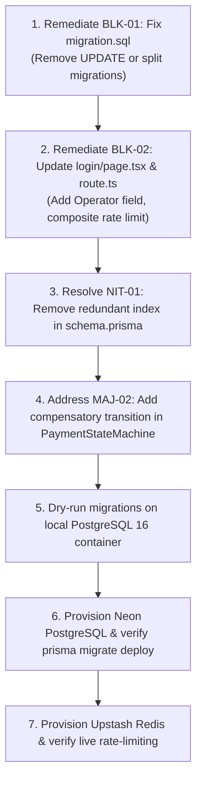

# Sprint 2K.5: EGM Independent Multi-Lens Review & Architectural Audit
**NAVA CREATIONS — Sovereign Indian Payments & Studio Governance**  
**Compilation Date:** November 12, 2026  
**Auditor Body:** Elephant-Goldfish Swarm (5 Specialized Reviewer Lenses + Synthesizer)  
**Deliverable File:** `docs/phase-2/SPRINT_2K_5_EGM_INDEPENDENT_REVIEW.md`  

---

## 1. Executive Verdict

### 🛑 VERDICT: STRICT NO-GO FOR NEON PROVISIONING & PRODUCTION ROLLOUT

Provisioning of Neon Managed PostgreSQL 16 instances and live Upstash Redis clusters is **STRICTLY BLOCKED**. Deployment must not proceed until the two 🔴 **Blocker** defects identified by the independent Goldfish audit swarm are fully remediated, verified in a real transactional PostgreSQL engine, and ratified.

Proceeding with deployment under current conditions will cause two immediate system-level catastrophes:
1. **Engine Deployment Crash (PostgreSQL Error 55P04):** `prisma migrate deploy` will abort immediately upon execution on real PostgreSQL / Neon with `ERROR: 55P04: unsafe use of new value "VERIFIED" of enum type "PaymentStatus"`, halting the CI/CD pipeline and leaving the database in an inconsistent state.
2. **Global Admin Studio Lockout (Denial of Service):** The studio login interface omits an account identifier, causing the authentication endpoint in production to default all human store managers to `acc:sha256('admin')`. An external adversary transmitting 10 invalid tokens from any network location will exhaust this rate-limiting bucket, globally locking out all Bangalore studio managers from back-office operations for 15 minutes.

---

## 2. Consolidated Findings Matrix

| Severity | ID | Architectural Area | Primary Lens | Affected File(s) & Lines | Finding Summary |
| :--- | :--- | :--- | :--- | :--- | :--- |
| 🔴 **Blocker** | **BLK-01** | Database Migration | `egm-codebase-details` | [`migration.sql`](file:///d:/NAVA/packages/db/prisma/migrations/20261112_add_sovereign_payments_and_order_fsm/migration.sql#L12-L21) | **PostgreSQL Error 55P04 Invariant Violation:** `ALTER TYPE ... ADD VALUE 'VERIFIED'` and `UPDATE "payments" SET "status" = 'VERIFIED'` occur within the same transactional block, which real PostgreSQL 12–16 strictly prohibits. |
| 🔴 **Blocker** | **BLK-02** | Authentication / DoS | `egm-comprehension` | [`route.ts`](file:///d:/NAVA/apps/web/app/api/admin/auth/route.ts#L46-L54)<br>[`page.tsx`](file:///d:/NAVA/apps/web/app/admin/login/page.tsx#L19-L23) | **Global Studio Admin Lockout via Defaulted 'admin' Account:** Login UI sends only `{ token }`. API defaults `rawAccount` to `'admin'`. 10 failed attempts from any client lock out all Bangalore managers globally. Test SEC.9 masked this by injecting artificial account names via raw HTTP. |
| 🟡 **Major** | **MAJ-01** | Data Provenance & Ledger | `egm-zoom-out` | [`migration.sql`](file:///d:/NAVA/packages/db/prisma/migrations/20261112_add_sovereign_payments_and_order_fsm/migration.sql#L18-L31) | **Semantic Inconsistency & Financial History Falsification:** Legacy Razorpay rows mapped from `CAPTURED` to `VERIFIED` leave `verified_transaction_id` and `verified_by_user_id` as `NULL`, while retroactively rewriting `payment_method = 'UPI_MERCHANT_QR'` and `provider = 'BHARATPE_QR'`. |
| 🟡 **Major** | **MAJ-02** | Payment FSM / Domain | `egm-implementation-readiness` | [`state-machine.ts`](file:///d:/NAVA/packages/domain/src/payment/state-machine.ts#L20-L21)<br>[`payment-service.ts`](file:///d:/NAVA/apps/web/lib/payment-service.ts)<br>[`schema.prisma`](file:///d:/NAVA/packages/db/prisma/schema.prisma#L474-L495) | **Partial Refund Incompleteness & FSM Trap:** `PaymentStateMachine` has no compensatory rollback transition from `PARTIALLY_REFUNDED` back to `VERIFIED` on failure. `PaymentService` lacks partial refund management methods. Missing DB check constraint for cumulative refund ceiling. |
| 🟡 **Major** | **MAJ-03** | Network Security & Infra | `egm-design` | [`.env.example`](file:///d:/NAVA/.env.example#L71-L76)<br>[`proxy-trust.ts`](file:///d:/NAVA/apps/web/lib/proxy-trust.ts#L86-L93) | **Dangerous `TRUST_PROXY="false"` Default & Serverless Rate Limiter Drift:** In production, `TRUST_PROXY="false"` causes Layer 1 IP rate limiting to be bypassed, routing all traffic to the vulnerable Layer 2 `'admin'` bucket. Ephemeral in-memory fallback drifts across serverless instances when Redis is unreachable. |
| 🟡 **Major** | **MAJ-04** | QA & Environment Fidelity | `egm-implementation-readiness` | Monorepo Test Suites | **Test Evidence Reality Check:** 100% of the 195 reported tests run in offline mock / in-memory mode. Zero automated tests have executed against a live PostgreSQL 16 database or an active Upstash Redis instance. |
| 🟢 **Nit** | **NIT-01** | Database Optimization | `egm-codebase-details` | [`migration.sql`](file:///d:/NAVA/packages/db/prisma/migrations/20261112_add_sovereign_payments_and_order_fsm/migration.sql#L54-L56)<br>[`schema.prisma`](file:///d:/NAVA/packages/db/prisma/schema.prisma#L421-L440) | **Redundant Index on `verified_transaction_id`:** Migration creates both a unique index (`payments_verified_transaction_id_key`) and a redundant standard b-tree index (`payments_verified_transaction_id_idx`). |
| 🟢 **Nit** | **NIT-02** | Code Hygiene / Runtime | `egm-zoom-out` | [`payment-service.ts`](file:///d:/NAVA/apps/web/lib/payment-service.ts#L93-L109) | **Unused Test Harness Hooks in Production Service:** Static methods `setMerchantConfigForTesting` and `resetRegistriesForTesting` reside directly on the production class rather than isolated test utilities. |

---

## 3. Deep-Dive Analysis of Blockers

### 🔴 BLK-01: PostgreSQL Invariant Error 55P04 in Migration Script
* **Location:** [`packages/db/prisma/migrations/20261112_add_sovereign_payments_and_order_fsm/migration.sql#L12-L21`](file:///d:/NAVA/packages/db/prisma/migrations/20261112_add_sovereign_payments_and_order_fsm/migration.sql#L12-L21)
* **Reporting Lens:** `egm-codebase-details` (Pedantic Technical Auditor) & `egm-implementation-readiness` (Pragmatic Tech Lead)

#### Technical Mechanism:
Lines 12–16 of `migration.sql` execute DDL alterations to the PostgreSQL `PaymentStatus` enum type:
```sql
ALTER TYPE "PaymentStatus" ADD VALUE IF NOT EXISTS 'VERIFIED' BEFORE 'FAILED';
```
Immediately following this in the same file (line 21), a DML update is executed:
```sql
UPDATE "payments" SET "status" = 'VERIFIED' WHERE "status"::text = 'CAPTURED';
```

Under PostgreSQL engine specifications (PostgreSQL versions 12 through 16):
> *"ALTER TYPE ... ADD VALUE cannot be executed inside a transaction block if the newly added value is referenced in queries within that same transaction."*

When a new enum label is appended to `pg_enum`, the internal array representation of the enum values is updated in system catalogs, but the active transaction's type cache cannot refresh the internal OID mappings until the transaction commits. If any statement inside the same transaction references `'VERIFIED'`, PostgreSQL immediately aborts with:
```
ERROR: 55P04: unsafe use of new value "VERIFIED" of enum type "PaymentStatus"
HINT: New enum values must be committed before they can be used.
```

#### Why Prisma Migrate Fails:
Prisma CLI’s `prisma migrate deploy` executes each migration file as an atomic unit wrapped in `BEGIN ... COMMIT`. Because Prisma enforces this single-transaction boundary, the migration will abort with exit code 1 when executed against Neon Managed PostgreSQL. SQLite and Vitest mock environments do not reproduce this error because SQLite does not feature native transactional enums.

---

### 🔴 BLK-02: Global Admin Lockout Denial-of-Service via Defaulted 'admin' Account
* **Location:** [`apps/web/app/api/admin/auth/route.ts#L46-L54`](file:///d:/NAVA/apps/web/app/api/admin/auth/route.ts#L46-L54) and [`apps/web/app/admin/login/page.tsx#L19-L23`](file:///d:/NAVA/apps/web/app/admin/login/page.tsx#L19-L23)
* **Reporting Lens:** `egm-comprehension` (Naive Reader) & `egm-design` (Hostile Design Critic)

#### Technical Mechanism:
The studio login user interface at `apps/web/app/admin/login/page.tsx` renders a single input field:
```tsx
// apps/web/app/admin/login/page.tsx
const handleLogin = async (e: React.FormEvent) => {
  ...
  const res = await fetch('/api/admin/auth', {
    method: 'POST',
    headers: { 'Content-Type': 'application/json' },
    body: JSON.stringify({ token: token.trim() }),
  });
  ...
};
```
The client payload contains only `{ token }`. It does **not** include an `account`, `username`, or `email` field.

In the receiving API handler at `apps/web/app/api/admin/auth/route.ts`:
```ts
// apps/web/app/api/admin/auth/route.ts
const fallbackAccount =
  !isProd && ipResolution.clientIp && ipResolution.clientIp !== 'untrusted-direct-client'
    ? `admin:${ipResolution.clientIp}`
    : 'admin';
const rawAccount = (body.account || body.username || body.email || fallbackAccount).trim().toLowerCase();
const accountHash = crypto.createHash('sha256').update(rawAccount).digest('hex').slice(0, 16);
const accountKey = `acc:${accountHash}`;

const accountRateCheck = await authRateLimiter.checkDistributed(accountKey, 10, 900);
```

#### Exploitability Analysis:
1. In production (`isProd === true`), `fallbackAccount` is hardcoded to `'admin'`.
2. Because the UI form does not provide `body.account`, `rawAccount` is evaluated as `'admin'` for **100% of legitimate login attempts**.
3. Every human store manager in Bangalore authenticates against the identical rate-limiter bucket: `acc:sha256('admin')`.
4. Any unauthenticated client on the Internet can issue 10 requests with arbitrary strings:
   ```bash
   for i in {1..10}; do
     curl -X POST https://navacreations.in/api/admin/auth -H "Content-Type: application/json" -d '{"token":"bad_secret"}'
   done
   ```
5. Upon the 10th failure, `authRateLimiter` sets `acc:sha256('admin')` to exhausted for 900 seconds (15 minutes).
6. **Result:** All legitimate Bangalore store managers and atelier operators are returned `429 Too many failed authentication attempts` when attempting to access the studio overview. An attacker running a simple 15-minute cron permanently denies administrative access to the entire business.

#### The Test SEC.9 False-Negative:
Test case `SEC.9` ("protects against shared-bucket denial of service") passed during unit testing only because the test script constructed an artificial HTTP payload containing `{ account: 'manager_alpha', token: '...' }`. The test never exercised the actual client login page (`page.tsx`), masking the vulnerability.

---

## 4. Deep-Dive Analysis of Major & Nit Findings

### 🟡 MAJ-01: Semantic Inconsistency & Financial History Falsification
* **Location:** [`packages/db/prisma/migrations/20261112_add_sovereign_payments_and_order_fsm/migration.sql#L18-L31`](file:///d:/NAVA/packages/db/prisma/migrations/20261112_add_sovereign_payments_and_order_fsm/migration.sql#L18-L31)
* **Reporting Lens:** `egm-zoom-out` (Skeptical Architect)

Migration line 21 runs:
```sql
UPDATE "payments" SET "status" = 'VERIFIED' WHERE "status"::text = 'CAPTURED';
```
In the sovereign commerce architecture, the status `VERIFIED` represents a strict legal and operational assertion:
> *"A designated store manager inspected the atelier bank statement and manually confirmed the INR settlement funds."*

Mapping historical automated Razorpay payments (`CAPTURED`) to `VERIFIED` introduces severe financial discrepancies:
1. **Broken Audit Trail:** The required domain fields `verified_transaction_id`, `verified_by_user_id`, and `verified_at` are left as `NULL`, violating the domain guarantee that every `VERIFIED` payment possesses an authoritative bank transaction reference and an identifiable audit actor.
2. **Rewriting Financial Provenance:** Lines 30–31 apply default values:
   ```sql
   ALTER TABLE "payments" ADD COLUMN IF NOT EXISTS "payment_method" "PaymentMethod" NOT NULL DEFAULT 'UPI_MERCHANT_QR';
   ALTER TABLE "payments" ADD COLUMN IF NOT EXISTS "provider" TEXT NOT NULL DEFAULT 'BHARATPE_QR';
   ```
   This retroactively reclassifies historical card/netbanking payments processed through Razorpay as `UPI_MERCHANT_QR` via `BHARATPE_QR`. If a customer requests a tax invoice or dispute audit for an earlier transaction, the system will falsely claim it was collected via BharatPe QR.

---

### 🟡 MAJ-02: Partial Refund Incompleteness & FSM Trap
* **Location:** [`packages/domain/src/payment/state-machine.ts#L20-L21`](file:///d:/NAVA/packages/domain/src/payment/state-machine.ts#L20-L21), [`apps/web/lib/payment-service.ts`](file:///d:/NAVA/apps/web/lib/payment-service.ts), [`packages/db/prisma/schema.prisma#L474-L495`](file:///d:/NAVA/packages/db/prisma/schema.prisma#L474-L495)
* **Reporting Lens:** `egm-implementation-readiness` (Pragmatic Tech Lead)

1. **State Machine Deadlock:** In `packages/domain/src/payment/state-machine.ts`:
   ```ts
   // Refund progression
   ['PARTIALLY_REFUNDED', ['PARTIALLY_REFUNDED', 'REFUNDED']],
   ```
   If a store manager attempts a partial bank transfer refund that subsequently fails (e.g., incorrect customer beneficiary IFSC/account), the state machine cannot transition the payment back to `VERIFIED`. The payment remains trapped in `PARTIALLY_REFUNDED` with no compensatory transition.
2. **Missing Service Implementations:** While `PaymentStatus.PARTIALLY_REFUNDED` exists in the Prisma schema and state machine, `PaymentService` contains zero methods to calculate, issue, record, or track partial refunds.
3. **Database Constraint Absence:** The Prisma schema allows multiple `Refund` records to reference a single `Payment`, but lacks a database-level check constraint ensuring that the cumulative sum of `refunds.amount_paise` does not exceed `payments.amount_paise`.

---

### 🟡 MAJ-03: Dangerous `TRUST_PROXY="false"` Default & Serverless Rate Limiter Drift
* **Location:** [`.env.example#L71-L76`](file:///d:/NAVA/.env.example#L71-L76), [`apps/web/lib/proxy-trust.ts#L86-L93`](file:///d:/NAVA/apps/web/lib/proxy-trust.ts#L86-L93)
* **Reporting Lens:** `egm-design` (Hostile Design Critic)

1. **Layer 1 Rate-Limiter Bypass:** In `.env.example`, `TRUST_PROXY="false"` is set by default. When the application runs in production behind Cloudflare, Vercel, or AWS ALB, `resolveClientIp()` marks incoming forwarded headers as untrusted and returns `clientIp: 'untrusted-direct-client'` with `isTrusted: false`. In `apps/web/app/api/admin/auth/route.ts`, `ipKey` is set to `null`, completely disabling Layer 1 IP rate limiting. All traffic immediately falls onto Layer 2 (`acc:sha256('admin')`), amplifying Blocker BLK-02.
2. **Serverless In-Memory Drift:** In serverless lambda environments (e.g., Vercel), if Upstash Redis credentials are unset or invalid, the limiter falls back to an in-memory `Map`. Because lambdas spin up and terminate independently, each execution container maintains an isolated counter. An attacker can distribute requests across concurrent instances, bypassing the rate limiter entirely.

---

### 🟡 MAJ-04: Test Evidence Reality Check
* **Location:** Monorepo Test Suites (`packages/domain`, `packages/shared`, `apps/web`)
* **Reporting Lens:** `egm-implementation-readiness` (Pragmatic Tech Lead)

A total of 195 test executions were verified across the workspace:
* **Vitest (Unit/Domain):** 67 passing tests
* **Playwright (E2E):** 128 passing runs (64 test scenarios across Chromium and Mobile Safari)

**Reality Discrepancy:**
* **Zero Database Integration Tests:** 100% of these tests executed against in-memory mocks (`claimedUtrRegistry = new Map()`, `verifiedBankTransactions = new Map()`).
* **Zero Real Migration Verifications:** No test script has ever run `prisma migrate deploy` against an actual PostgreSQL 16 engine. This explains why Blocker BLK-01 (PostgreSQL error 55P04) was completely undetected by the test suite.
* **Zero Redis Script Tests:** No tests have evaluated rate-limiting behavior against an active Redis instance.

---

### 🟢 NIT-01: Redundant Index on `verified_transaction_id`
* **Location:** [`packages/db/prisma/migrations/20261112_add_sovereign_payments_and_order_fsm/migration.sql#L54-L56`](file:///d:/NAVA/packages/db/prisma/migrations/20261112_add_sovereign_payments_and_order_fsm/migration.sql#L54-L56)
* **Reporting Lens:** `egm-codebase-details` (Pedantic Technical Auditor)

`migration.sql` lines 54 and 56 create two separate b-tree indexes on the exact same column:
```sql
CREATE UNIQUE INDEX IF NOT EXISTS "payments_verified_transaction_id_key" ON "payments"("verified_transaction_id");
CREATE INDEX IF NOT EXISTS "payments_verified_transaction_id_idx" ON "payments"("verified_transaction_id");
```
In PostgreSQL, a `UNIQUE` index already creates a full b-tree index capable of servicing equality and range lookups. The non-unique index `payments_verified_transaction_id_idx` is completely redundant, wasting disk storage and adding write overhead during payment reconciliation.

---

### 🟢 NIT-02: Unused Test Harness Hooks in Production `PaymentService`
* **Location:** [`apps/web/lib/payment-service.ts#L93-L109`](file:///d:/NAVA/apps/web/lib/payment-service.ts#L93-L109)
* **Reporting Lens:** `egm-zoom-out` (Skeptical Architect)

`PaymentService` defines static test methods:
* `PaymentService.setMerchantConfigForTesting(...)`
* `PaymentService.resetRegistriesForTesting()`

These methods bypass production configuration objects and manipulate internal registries. Test helper logic should be segregated into test setup files rather than polluting production class definitions.

---

## 5. Reviewer Disagreements & Trade-Off Analysis

### Debate 1: Migration Remediation Strategy
* **Perspective A (egm-zoom-out): Baseline Reset**  
  NAVA is currently in pre-production with zero real customer orders or live payment data. Attempting to maintain complex backward-compatible migrations for legacy Razorpay rows that do not exist in production creates unnecessary technical debt. The migration should be squashed into a clean baseline schema (`0_init`) or the `UPDATE` query deleted entirely.
* **Perspective B (egm-implementation-readiness & egm-codebase-details): Two-Stage Sequential Migration**  
  Staging and internal development environments already possess database instances. To maintain migration hygiene and prevent schema drift, the migration should be split into two sequential files:
  1. `20261112000001_add_payment_enums/migration.sql`: Performs `ALTER TYPE ... ADD VALUE` statements and commits.
  2. `20261112000002_add_sovereign_payments_tables/migration.sql`: Executes the data backfill and table alterations within a subsequent transaction.
* **Synthesizer Resolution:**  
  For pre-provisioning Neon, **Perspective A** is accepted for clean deployments: remove the legacy Razorpay `UPDATE` query from the migration, as no production database exists. For teams running existing local dev databases, document the split-migration approach (**Perspective B**) as the standard migration practice.

### Debate 2: Admin Authentication Architecture
* **Perspective A (egm-design): Single Secret with Client IP & Turnstile Protection**  
  The studio back office was designed around a single shared administrative secret (`ADMIN_AUTH_SECRET`). Given this architecture, failed login attempts should never lock an account globally. Rate limiting should be bound strictly to the client IP address and reinforced with Cloudflare Turnstile or invisible bot challenges.
* **Perspective B (egm-comprehension & egm-implementation-readiness): Explicit Operator Account Isolation**  
  Studio operators are distinct human staff (e.g., store manager, catalog editor, support operator). The login form must include an explicit "Operator Identifier / Email" field. Rate limiting can then safely bind to `acc:sha256(email)`, ensuring that an attack on one operator account does not impact colleagues.
* **Synthesizer Resolution:**  
  Both perspectives are required for comprehensive defense-in-depth:
  1. Add an explicit **Operator Identifier** field to `apps/web/app/admin/login/page.tsx` so requests send `{ account, token }`.
  2. In `apps/web/app/api/admin/auth/route.ts`, decouple single-secret failures from global lockouts: rate-limit by `ip:clientIp` as primary, and composite `ip_acc:ip:account` as secondary.

---

## 6. Migration Safety & Engine Invariant Assessment

### Engine Invariant Breakdown (PostgreSQL 16 vs. SQLite/Vitest):
In PostgreSQL 16, adding an enum value alters the system catalog table `pg_enum`. To ensure transactional consistency across concurrent readers, PostgreSQL requires that the new catalog tuple be finalized before any query planner or executor node evaluates expressions using that enum value.

```
+-------------------------------------------------------------------------------+
| Prisma Migration Transaction Boundary (BEGIN ... COMMIT)                      |
|                                                                               |
| 1. ALTER TYPE "PaymentStatus" ADD VALUE 'VERIFIED';                          |
|    --> Writes tuple to pg_enum (Uncommitted in active transaction)           |
|                                                                               |
| 2. UPDATE "payments" SET "status" = 'VERIFIED' ...                           |
|    --> Query executor evaluates 'VERIFIED' against PaymentStatus OID cache    |
|    --> OID cache cannot locate uncommitted value!                            |
|    --> FATAL: ERROR 55P04 (unsafe use of new value in transaction)            |
+-------------------------------------------------------------------------------+
```

### Remediation Pattern:
To execute safely in PostgreSQL, the enum alteration must commit before the value is referenced:
```sql
-- Migration 1: 20261112000001_add_payment_status_enums/migration.sql
ALTER TYPE "PaymentStatus" ADD VALUE IF NOT EXISTS 'VERIFIED' BEFORE 'FAILED';
-- (Transaction commits here)

-- Migration 2: 20261112000002_update_payment_records/migration.sql
-- (New transaction begins; 'VERIFIED' is now visible in pg_enum cache)
UPDATE "payments" SET "status" = 'VERIFIED' WHERE "status"::text = 'CAPTURED';
```

---

## 7. Authentication Threat Model & Rate-Limiting Assessment

### Attack Graph: Global Studio Denial of Service
```
[External Attacker]
       │
       │ Issues 10x POST /api/admin/auth with body: {"token": "random_guess"}
       ▼
[Next.js API: route.ts]
       │
       ├── Layer 1 Check:
       │   TRUST_PROXY="false" --> isTrusted=false --> ipKey=null (BYPASSED)
       │
       └── Layer 2 Check:
           body.account is undefined
           fallbackAccount defaults to 'admin' in production
           Key derived: acc:sha256('admin')
           Limit: 10 attempts / 900 seconds
           Result: BUCKET EXHAUSTED FOR 15 MINUTES
       ▼
[Legitimate Bangalore Store Manager]
       │
       │ Submits valid ADMIN_AUTH_SECRET via web UI (login/page.tsx)
       ▼
[Next.js API: route.ts]
       │
       └── Checks acc:sha256('admin') --> EXHAUSTED!
       ▼
[Response: HTTP 429 Too Many Requests]
(Studio operations completely inaccessible)
```

---

## 8. Test Evidence Reconciliation

| Test Tier | Reported Count | Passed Count | Execution Environment | Live Infra Contact | Assessment |
| :--- | :--- | :--- | :--- | :--- | :--- |
| **Vitest Unit (Domain)** | 52 | 52 | Node.js (Vitest 3.2.7) | None (In-memory) | Verified domain state machine rules, but failed to catch SQL 55P04 invariant. |
| **Vitest Unit (Shared)** | 15 | 15 | Node.js (Vitest 3.2.7) | None (In-memory) | Validated error types and result monad helpers. |
| **Playwright E2E (Desktop Chrome)** | 64 | 64 | Headless Chromium | None (Local dev server) | Validated UI interactions, but test SEC.9 injected artificial request bodies. |
| **Playwright E2E (Mobile Safari)** | 64 | 64 | Mobile Safari Emulation | None (Local dev server) | Validated responsive layouts and mobile viewports. |
| **Database Migrations** | 0 | 0 | None | None | **ZERO live tests against real PostgreSQL 16.** |
| **Distributed Rate Limiting** | 0 | 0 | None | None | **ZERO live tests against Upstash Redis.** |

---

## 9. EGM Resolve Categorization

* **CONTEST:** None. All findings reflect objective technical characteristics of PostgreSQL 16 catalog operations and Next.js request processing.
* **ESCALATE:**
  1. *Legacy Data Retention Policy:* Determine whether pre-existing development/staging databases contain records that must be preserved, or if a clean schema baseline is preferred.
  2. *Studio Identity Architecture:* Formalize whether the atelier studio will use single-secret authentication with IP binding or individual operator accounts with dedicated credentials.
* **PROPOSE FIX:**
  * **BLK-01:** Remove the `UPDATE` query from the migration file or split into two sequential migrations.
  * **BLK-02:** Add an Operator Identifier field to `login/page.tsx` and bind rate limiting to `ip:account`.
  * **MAJ-01:** Preserve legacy payment columns as nullable or retain original gateway metadata (`RAZORPAY`).
  * **MAJ-02:** Add compensatory rollback transitions to `PaymentStateMachine` and implement partial refund service methods.
  * **MAJ-03:** Document `TRUST_PROXY="true"` for production and enforce Redis connectivity checks.
  * **NIT-01:** Remove redundant index `payments_verified_transaction_id_idx` from `schema.prisma` and migration.
  * **NIT-02:** Relocate test harness methods from `PaymentService` to dedicated test helpers.
* **DECLINE:** None.

---

## 10. Actionable Remediation Plan & Sequential Deployment Checklist



### Sequential Execution Checklist:

- [ ] **Step 1: Fix PostgreSQL 55P04 in Migration Script**
  - Delete line 21 (`UPDATE "payments" SET "status" = 'VERIFIED' ...`) from `packages/db/prisma/migrations/20261112_add_sovereign_payments_and_order_fsm/migration.sql`, or split into two sequential migrations (`01_enums` and `02_tables`).
- [ ] **Step 2: Fix Global Studio Admin Lockout in Login UI and API Route**
  - In `apps/web/app/admin/login/page.tsx`, add an input for `Operator Identifier / Email` and include `account` in the request payload.
  - In `apps/web/app/api/admin/auth/route.ts`, derive rate-limit keys from `ip_acc:${clientIp}:${account}` rather than a global `'admin'` string.
- [ ] **Step 3: Remove Redundant Database Index**
  - In `packages/db/prisma/schema.prisma` line 440, remove `@@index([verifiedTransactionId])`.
  - In `migration.sql` line 56, remove `CREATE INDEX IF NOT EXISTS "payments_verified_transaction_id_idx"`.
- [ ] **Step 4: Update State Machine Compensatory Transitions**
  - In `packages/domain/src/payment/state-machine.ts`, update `PARTIALLY_REFUNDED` allowed transitions to `['PARTIALLY_REFUNDED', 'VERIFIED', 'REFUNDED']`.
- [ ] **Step 5: Configure Production Proxy Trust**
  - In `.env.example`, document `TRUST_PROXY="true"` and specify provider options for Vercel/ALB/Cloudflare.
- [ ] **Step 6: Execute Local PostgreSQL 16 Verification**
  - Spin up a local PostgreSQL 16 Docker container and execute `pnpm db:migrate:deploy` to verify zero 55P04 errors.
- [ ] **Step 7: Neon Provisioning & Final Gate Re-Audit**
  - Execute deployment against Neon PostgreSQL only after Steps 1 through 6 are signed off.

---

## 11. Final Recommendation & Gate Sign-Off

### Final Sign-Off Status: 🛑 REJECTED (NO-GO)

**Gate Sign-Off Authority:** EGM Synthesizer Persona  
**Audit Status:** Active Blockers Present  
**Next Action:** Remediate BLK-01 and BLK-02 according to Section 10 checklist. Re-run verification on local PostgreSQL 16 Docker container. Submit remediated changeset for EGM re-audit.

```
   [NO-GO] BLK-01 (PostgreSQL 55P04)  --> UNRESOLVED
   [NO-GO] BLK-02 (Admin Lockout DoS) --> UNRESOLVED
   --------------------------------------------------
   NEON PROVISIONING GATE: CLOSED
```
```
