# SPRINT 2L — BUSINESS GAP ANALYSIS & OPERATIONAL REALITY
**Project:** NAVA CREATIONS  
**Milestone:** Sprint 2L — Master System Audit & Advanced Verification  
**Evaluation Date:** November 2026  
**Auditor:** Principal Business Architect & E-Commerce Operations Specialist  
**Target Repository:** `D:\NAVA`  
**Git HEAD:** `c403636`  
**Branch:** `main` (tracking `origin/main`)  
**Operating Mode:** Commercial Feasibility Audit & India-Specific Retail Analysis

---

## 1. Executive Summary & Boutique Context

NAVA CREATIONS is not a mass-market, fast-fashion e-commerce catalog selling ₹500 t-shirts. 

It is an **artisan-founded, high-end bespoke jewellery atelier based in Bangalore, India**, specializing in:
- Handcrafted 22K/18K Temple Jewellery,
- Royal Antique Jadau, Kundan, and Uncut Diamond (Polki) choker sets,
- Custom bridal trousseau commissions ranging from **₹15,000 to ₹2,50,000+ per order**.

This high Average Order Value (AOV), combined with the business owner's strict directive to **avoid third-party gateway platform fees and MDR (no Razorpay, no unapproved SaaS subscriptions)**, fundamentally dictates what is commercially viable, legally compliant, and technically appropriate.

---

## 2. The Commerce Dichotomy: WhatsApp Concierge vs Self-Service Web Checkout

Our Sprint 2L system assessment uncovered a stark reality:
- The website's `/cart` drawer currently redirects customers to **WhatsApp** with a pre-formatted message.
- The web checkout (`/checkout`), automated order placement (`/api/orders`), and sovereign BharatPe UPI QR generator (`/api/payments`) exist only as headless code and automated test scripts.

### Strategic Evaluation: Is This Disconnect Actually a Strategic Advantage?

In the Indian fine jewellery sector, high-ticket purchases are almost never completed via cold self-service checkouts. Customers demand:
1. Purity reassurance (BIS Hallmarking certificate verification, gross vs net gold weight, stone weight deductions).
2. Video consultation or high-resolution close-ups of the craftsmanship.
3. Customisation discussions (necklace thread dori vs chain, bangle sizing, gemstone color coordination).
4. Direct personal relationship with the jeweller before parting with ₹50,000 to ₹2,00,000.

### Strategic Recommendation for Launch Phases:
- **Phase 1 (Immediate Boutique Launch):** Formalize and optimize **Model A (WhatsApp Concierge)**. It requires zero complex checkout forms, leverages the high-trust personal interaction essential for luxury jewellery, and is already 95% complete on the storefront.
- **Phase 2 (Growth & Standardization):** Wire up **Model B (Self-Service Sovereign Web Checkout)** for ready-to-ship, lower-ticket items (silver temple jewellery, ₹5,000–₹25,000 range), while routing high-ticket bridal pieces (₹50,000+) through WhatsApp consultation.

---

## 3. High-Value Payment Realities in India

The business mandate explicitly requires:
- No Razorpay or paid third-party payment gateways (zero platform fee / zero MDR).
- BharatPe Merchant QR as the initial sovereign UPI collection candidate.
- Manual UTR verification by store administrators.
- Support for Cash on Delivery (COD).

### 3.1 BharatPe UPI QR & NPCI Limits
- **NPCI Limits on UPI:** Standard peer-to-merchant (P2M) UPI transactions carry a daily cap of ₹1,00,000 (extended to ₹2,00,000 or ₹5,00,000 only for verified categories like hospitals and educational institutions, which does not apply to luxury retail).
- **Impact on NAVA CREATIONS:** 
  - For pieces priced under ₹1,00,000: BharatPe dynamic UPI QR works smoothly.
  - For bridal sets priced at ₹1,50,000 to ₹2,50,000: **A single UPI QR scan will be rejected by NPCI / customer bank apps due to per-transaction limits.**
  - **Operational Workaround Required:** Customers purchasing bridal sets must pay via split payments (two separate UPI transfers) or direct **Bank Account Transfer (NEFT / RTGS / IMPS)** directly to the studio's Current Account.
  - **System Requirement:** The payment and order models must support multiple payment receipts/UTRs against a single high-ticket order.

### 3.2 The COD Reality Check for Fine Jewellery
- **The Risk:** Cash on Delivery for high-value jewellery is an extreme commercial liability in India.
- **Courier COD Limits:** Standard couriers (Delhivery, Blue Dart, Shiprocket) cap COD collection at ₹20,000 to ₹50,000 per shipment.
- **Refusal-to-Deliver (RTO) Fraud:** Non-delivery or customer refusal on high-ticket jewellery results in transit risk, insurance complications, and high courier return fees.
- **Recommendation:**
  - Cap COD at a maximum of ₹10,000.
  - Require a non-refundable booking deposit (e.g. 20% via UPI) before dispatching any bespoke piece.
  - Orders above ₹25,000 must strictly be prepaid via UPI or direct bank transfer.

---

## 4. Priority Classification Matrix (P0 to P4)

To prevent scope creep and guide remaining engineering work, all features and requirements are classified into five strict tiers:

| Tier | Meaning | Criteria for NAVA CREATIONS |
| :--- | :--- | :--- |
| **P0: Launch Blocker** | Absolute prerequisite. Launching without this exposes the business to legal liability, security breach, or operational collapse. | BLK-01 (DB migration fix), BLK-02 (Admin login DoS fix), Legal & BIS Hallmarking disclosures, Studio WhatsApp number configuration. |
| **P1: Essential Fast-Follow** | Must be delivered immediately after launch to enable sustainable day-to-day operations. | Real PostgreSQL (Neon) activation, Upstash Redis rate limiting, Resend transactional emails, Order UTR matching UI. |
| **P2: Post-Launch Growth** | Valued operational enhancements that can wait until first customer transactions are flowing. | Automated Web Checkout UI (`/checkout`), Shiprocket courier webhook tracking, customer order status lookup. |
| **P3: Nice-to-Have** | Long-term digital conveniences that do not affect the initial boutique model. | Multi-admin RBAC, customer loyalty points, gift card balance system, dynamic currency switcher. |
| **P4: Over-Engineered / Anti-Pattern**| Features that actively harm the boutique business model or violate owner directives. | Third-party paid gateways (Razorpay), customer digital wallet top-ups, unvetted COD on ₹1,00,000 jewellery, fully automated checkout without artisan consultation. |

### Classification of Current Repository Capabilities:

| Feature / Subsystem | Current Status | Assigned Priority | Rationale |
| :--- | :--- | :--- | :--- |
| **PostgreSQL 55P04 Migration Split** | Broken (BLK-01) | **P0 (Blocker)** | Database cannot be deployed without this fix. |
| **Admin Login DoS Remediation** | Broken (BLK-02) | **P0 (Blocker)** | Store owner can be locked out by a single bad actor. |
| **Consumer Protection Legal Disclosures** | Missing | **P0 (Blocker)** | Mandatory under Indian E-Commerce Rules 2020. |
| **BIS Hallmarking & Purity Disclosures** | Incomplete | **P0 (Blocker)** | Statutory requirement under Bureau of Indian Standards. |
| **WhatsApp Order Dispatch Flow** | 95% Complete | **P0 (Blocker)** | Primary Phase 1 sales conversion channel. |
| **Neon Free Database Activation** | Unprovisioned | **P1 (Essential)** | Moves persistence from memory to managed cloud DB. |
| **Upstash Redis Rate Limiting** | Unprovisioned | **P1 (Essential)** | Prevents serverless lambda rate limit drift. |
| **Resend Email Domain Verification** | Unprovisioned | **P1 (Essential)** | Ensures order receipts don't land in spam. |
| **Customer Web Checkout Form (`/checkout`)**| Missing | **P2 (Growth)** | Not required for WhatsApp Phase 1 concierge launch. |
| **Shiprocket API Automated Label Generation**| Manual | **P2 (Growth)** | Studio manager can manually book couriers initially. |
| **Razorpay / Stripe Gateway Integration** | Disabled | **P4 (Anti-Pattern)**| Violates owner directive of zero MDR / zero fees. |
| **Customer Digital Wallet** | None | **P4 (Anti-Pattern)**| Unnecessary regulatory overhead under RBI PPI rules. |

---

## 5. India-Specific Owner Approval & Onboarding Checklist

Before NAVA CREATIONS can publicly accept customer payments or ship precious jewellery, the business owner must provide and confirm the following statutory, financial, and operational credentials:

```mermaid
flowchart LR
    subgraph Legal["1. Legal & Regulatory"]
        L1["GSTIN Registration\n(Bespoke Jewellery 3%)"]
        L2["BIS Hallmarking License\n(22K / 18K Certification)"]
        L3["Grievance Officer Name\n& Contact Details"]
    end

    subgraph Financial["2. Banking & UPI"]
        F1["Current Bank Account\n(Bank Name, Account, IFSC)"]
        F2["BharatPe Merchant Onboarding\n(Verified Merchant VPA)"]
        F3["Daily UPI Collection Limit\n(Confirm Bank P2M Cap)"]
    end

    subgraph Logistics["3. Courier & Comms"]
        C1["Valuable Cargo Partner\n(Sequel / BVC / Shiprocket)"]
        C2["Transit Insurance Policy\n(Covering Precious Jewellery)"]
        C3["Resend Domain DNS\n(SPF, DKIM, DMARC)"]
        C4["Official Studio WhatsApp\n(Business App Number)"]
    end

    Legal --> Financial --> Logistics
```

### 1. Legal & Statutory Readiness (Mandatory under Indian Law)
- [ ] **Entity Legal Name & GSTIN:** Verify active GSTIN registered under the correct HSN code for precious jewellery (`7113` - Articles of jewellery of precious metal).
- [ ] **BIS Hallmarking Registration:** Display official BIS Hallmark identification mark and studio license number on the website footer and product detail pages.
- [ ] **Statutory E-Commerce Compliance:** Under the **Consumer Protection (E-Commerce) Rules, 2020**, the website must explicitly publish:
  - Registered physical office address in Bangalore.
  - Named **Grievance Officer** with telephone number and email address.
  - Explicit Return, Refund, and Exchange timelines (e.g. 7-day exchange for unworn jewellery; custom bespoke pieces non-refundable).
  - Country of Origin (India) clearly indicated on all product listings.

### 2. Banking & Payment Readiness
- [ ] **Current Account Verification:** Confirm official Current Account details for direct RTGS/NEFT wire transfers for high-ticket orders (> ₹1,00,000).
- [ ] **BharatPe Merchant Onboarding:**
  - Owner must complete KYC on BharatPe Merchant app.
  - Confirm the exact UPI Virtual Payment Address (VPA, e.g. `bharatpe.98XXXXXXXX@icici`).
  - Verify that website merchant collections are permitted under their merchant tier without unexpected MDR.
  - Test a real ₹10 UPI payment and verify that bank credit SMS / notification arrives within 60 seconds.

### 3. Precious Logistics & Insurance Readiness
- [ ] **Secure Logistics Account:** Normal couriers do NOT insure gold and precious stones. Standard surface or air packages that go missing are compensated at only ₹1,000–₹5,000.
  - Onboard with a specialist precious cargo courier: **Sequel Logistics**, **BVC Logistics**, or Shiprocket's insured jewellery courier partners.
- [ ] **Transit Insurance:** Confirm that the studio holds an active marine transit insurance policy covering doorstep delivery of fine jewellery against theft or loss in transit.

### 4. Digital Infrastructure & Communications
- [ ] **Official WhatsApp Business Account:** Register the studio's primary telephone number on WhatsApp Business with automated greeting, studio hours, and catalog links.
- [ ] **Custom Domain & Email Verification:**
  - Verify DNS records (`SPF`, `DKIM`, `DMARC`, `MX`) for transactional emails via Resend.
  - Ensure sender address is branded (e.g. `concierge@navacreations.com` or `studio@navacreations.com`).

---

## 6. Synthesis: Recommended Launch Strategy

The optimal path forward for NAVA CREATIONS is a **Two-Stage Rollout**:

### Stage 1: "Atelier Concierge" Launch (Immediate Target)
- Resolve BLK-01 (Database migration split) and BLK-02 (Admin login DoS).
- Provision Neon Free PostgreSQL and Upstash Redis.
- Keep the Storefront's `/cart` $\to$ WhatsApp flow as the primary checkout conversion channel.
- Store manager manually logs orders and bespoke enquiries in the `/admin` dashboard.
- Customers pay via BharatPe UPI QR or Direct RTGS/NEFT wire transfer shared during WhatsApp consultation.
- **Zero code required for complex web checkout forms; 100% focused on personal luxury customer conversion.**

### Stage 2: "Sovereign Web Checkout" Rollout (Future Follow-Up)
- Build a dedicated `/checkout` form for catalog silver/ready-to-ship items under ₹25,000.
- Wire the checkout form to the existing `/api/orders` and `/api/payments` endpoints.
- Allow customers to self-scan the BharatPe QR on-screen and input their 12-digit UTR directly on the site.
- Admin verifies the UTR in `/admin/payments` before automated dispatch.
