# SPRINT 2L — COMPLETE SYSTEM ASSESSMENT & INVENTORY
**Project:** NAVA CREATIONS  
**Milestone:** Sprint 2L — Master System Audit & Advanced Verification  
**Evaluation Date:** November 2026  
**Auditor:** Master Engineering Audit Team (Architecture, Security, Backend, QA)  
**Target Repository:** `D:\NAVA`  
**Git HEAD:** `c403636`  
**Branch:** `main` (tracking `origin/main`)  
**Operating Mode:** Read-Only Verification, Monorepo Analysis & Evidence Synthesis

---

## 1. Executive Summary & Purpose

This document establishes the factual, code-verified baseline of the entire NAVA CREATIONS repository as of Sprint 2L. 

Previous sprint reports asserted varying degrees of "readiness", "remediation", and "passing" statuses. However, rigorous static analysis, cross-package dependency tracing, and test suite execution reveal a critical architectural divergence:
1. **The Storefront Layer** (`apps/web`) is currently implemented as an elegant, high-performance **Product Showcase + WhatsApp Concierge Consultation / Ordering** website. The `/cart` page contains no form action or API integration to create a database order; its checkout button generates a pre-formatted WhatsApp chat link.
2. **The Domain & Database Layer** (`packages/domain`, `packages/db`, `apps/web/app/api`) contains an extensive, headless **Sovereign Commerce Engine** (inventory reservations, paise integer math, state machines for orders, payments, and refunds, BharatPe UPI QR intent generation, customer UTR claim submission, and admin payment verification).
3. **The Connection Between Storefront & Commerce Engine Is Missing:** The payment and order endpoints are invoked exclusively by Playwright test suites (`commerce-foundation.spec.ts`, `payment-integration.spec.ts`) and administrative API routes, not by any customer-facing storefront page.
4. **Fatal Database Migration Invariant (BLK-01):** PostgreSQL error `55P04` prevents the latest Prisma migration from running against PostgreSQL 12–16, meaning the database cannot be provisioned or migrated in its current state.
5. **Denial of Service in Admin Authentication (BLK-02):** The single-secret admin login UI submits only a token, causing the backend rate limiter to bucket 100% of human login attempts under `'admin'`, allowing an attacker to lock out all store administrators globally in 10 attempts.

---

## 2. Monorepo Architecture & Package Classification

The NAVA CREATIONS monorepo is managed via Turborepo (`v2.8.3`) and pnpm workspaces (`v12.18.0`). It comprises 5 internal packages/applications:

```
NAVA (Monorepo Root)
├── apps/
│   └── web/                   # Next.js 16 (App Router), React 19, Tailwind CSS v4, Storefront & Admin
└── packages/
    ├── config/                # Shared ESLint, Prettier, TypeScript configs
    ├── shared/                # Formatting (INR paise/currency), assertions, shared constants
    ├── domain/                # Pure business logic: State machines (Order, Payment, Refund), Paise math, Types
    └── db/                    # Prisma 5.22.0 ORM, PostgreSQL schema, Migrations, Client wrapper
```

### Component Classification Taxonomies

To eliminate ambiguity, every component, route, and service in the repository is assigned exactly one of the following eight verified states:

| Status Code | Status Name | Definition |
| :--- | :--- | :--- |
| **STATE-1** | `GENUINELY_IMPLEMENTED_AND_TESTED` | Fully written, wired to callers/UI, and tested with passing automated tests. |
| **STATE-2** | `IMPLEMENTED_WITH_IN_MEMORY_FALLBACK` | Implemented with production architecture, but running against an ephemeral in-memory fallback because external infrastructure is unconfigured. |
| **STATE-3** | `IMPLEMENTED_HEADLESS_DISCONNECTED` | Backend domain/API logic is fully implemented and tested via API/unit tests, but has **no frontend customer UI** wired to it. |
| **STATE-4** | `MOCKED_OR_SIMULATED` | Operates strictly via mocks, test stubs, or synthetic test harnesses with zero live backend execution. |
| **STATE-5** | `CONFIG_REQUIRED_NOT_PROVISIONED` | Code expects external service credentials (e.g. Neon, Redis, Resend, Shiprocket) which are intentionally not yet provisioned. |
| **STATE-6** | `UNIMPLEMENTED_STUB` | File or route exists as an empty placeholder or stub without functional logic. |
| **STATE-7** | `BROKEN_OR_DEFECTIVE` | Contains a reproducible bug, migration failure, or critical security vulnerability. |
| **STATE-8** | `DEFERRED_BY_BUSINESS` | Deliberately excluded or postponed by owner mandate (e.g. Razorpay, Paid Gateway MDR, Net Banking). |

---

## 3. Package-by-Package Inventory & Status

### 3.1 `packages/config`
- **Location:** `packages/config`
- **Purpose:** Centralized tooling configurations (ESLint base, React/Next configurations, TypeScript base configs).
- **Files:** `eslint/`, `typescript/`, `package.json`.
- **Status:** `GENUINELY_IMPLEMENTED_AND_TESTED`.
- **Evidence:** `turbo run typecheck` and `turbo run lint` execute cleanly across all packages with zero configuration errors.

### 3.2 `packages/shared`
- **Location:** `packages/shared`
- **Purpose:** Currency formatting (INR, paise to rupees conversion), shared assertions, utility helpers.
- **Key Modules:**
  - `src/currency.ts`: Handles Indian Rupee formatting (`₹1,25,000.00`) and safe paise conversions.
  - `src/assertions.ts`: Type narrowing and runtime invariant assertion utilities.
- **Status:** `GENUINELY_IMPLEMENTED_AND_TESTED`.
- **Test Evidence:** 3 dedicated unit tests pass in Vitest (`currency.test.ts`).

### 3.3 `packages/domain`
- **Location:** `packages/domain`
- **Purpose:** Domain-driven commerce logic, deterministic state machines, integer monetary calculations, and inventory reservation types. Zero database or framework dependencies.
- **Key Modules:**
  - `src/order/state-machine.ts`: Deterministic order state transitions (`DRAFT` → `PENDING_PAYMENT` → `PAYMENT_VERIFIED` / `COD_CONFIRMED` → `PROCESSING` → `SHIPPED` → `DELIVERED` / `CANCELLED` / `REFUNDED`).
  - `src/payment/state-machine.ts`: Payment state transitions (`INITIATED` → `SUBMITTED` → `VERIFIED` / `FAILED` / `EXPIRED`).
  - `src/payment/refund-state-machine.ts`: Refund state transitions (`REQUESTED` → `PENDING_VERIFICATION` → `PROCESSED` / `REJECTED`).
  - `src/payment/types.ts`: UPI Intent URI generation, paise schemas, payment method unions (`UPI_MERCHANT_QR`, `COD`).
  - `src/money/paise.ts`: Safe integer math preventing floating-point rounding errors for high-value bespoke jewellery.
  - `src/inventory/reservation.ts`: In-memory reservation pool with configurable TTL (default 15 minutes).
- **Status:** 
  - Pure domain math & state machines: `GENUINELY_IMPLEMENTED_AND_TESTED` (64 Vitest tests pass).
  - Partial Refund Deadlock: `BROKEN_OR_DEFECTIVE` (Defect MAJ-02: `PaymentStateMachine` lacks transition back to `VERIFIED` on failed partial refund; `PaymentService` has no refund methods).

### 3.4 `packages/db`
- **Location:** `packages/db`
- **Purpose:** Prisma ORM schema, database client initialization with connection pooling, and historical migration SQL.
- **Key Files:**
  - `prisma/schema.prisma`: Defines models (`Product`, `Category`, `Collection`, `Enquiry`, `Order`, `OrderItem`, `Payment`, `Customer`, `InventoryReservation`, `AuditLog`).
  - `src/client.ts`: Prisma Client wrapper with connection pooling configuration.
  - `prisma/migrations/0_init/migration.sql`: Initial baseline tables.
  - `prisma/migrations/20261111_add_enquiries/migration.sql`: Bespoke jewellery enquiry table.
  - `prisma/migrations/20261112_add_sovereign_payments_and_order_fsm/migration.sql`: Added sovereign payments, UPI fields, and order state machines.
- **Status:** `BROKEN_OR_DEFECTIVE` (Defect BLK-01).
- **Evidence:** `migration.sql` line 13 adds enum value `'VERIFIED'`, and line 21 queries/updates `status = 'VERIFIED'` in the same transaction. PostgreSQL 12–16 throws `ERROR: 55P04`. Prisma Migrate wraps all relational migrations in a transaction with no override flag. Therefore, this migration cannot execute against real PostgreSQL.

### 3.5 `apps/web` (Next.js 16 Web Application)
- **Location:** `apps/web`
- **Purpose:** Storefront UI, Admin UI, Server Components, Route Handlers (API), and Middleware.
- **Status:** Detailed section-by-section breakdown follows below.

---

## 4. Storefront Routes & User Interface Inventory

The storefront is styled with Tailwind CSS v4 and designed for high-value bespoke temple and bridal jewellery.

| Route | Purpose | Architecture / Implementation | Status |
| :--- | :--- | :--- | :--- |
| `/` | Homepage | Server Component. Hero video/banner, curated collections carousel, heritage narrative, trust badges. | `GENUINELY_IMPLEMENTED_AND_TESTED` |
| `/collections` | Collections Catalog | Lists all collections (Temple, Royal Antique, Bridal Bespoke). | `GENUINELY_IMPLEMENTED_AND_TESTED` |
| `/collections/[handle]` | Collection Detail | Dynamic product grid with category filtering and sorting. | `GENUINELY_IMPLEMENTED_AND_TESTED` |
| `/products/[handle]` | Product Detail Page (PDP) | Image gallery, gold karat/hallmark details, price breakdown, "Add to Cart" button, "Enquire Bespoke" modal. | `GENUINELY_IMPLEMENTED_AND_TESTED` |
| `/cart` | Shopping Cart Drawer / Page | Client Component (Zustand state). Shows line items, paise math, delivery notes. **Checkout button generates WhatsApp link!** | `GENUINELY_IMPLEMENTED_AND_TESTED` (WhatsApp Flow) |
| `/checkout` | Web Checkout Page | **DOES NOT EXIST.** There is no page at `apps/web/app/checkout/page.tsx`. | `UNIMPLEMENTED_STUB` / Missing Route |
| `/about` | Brand Story & Heritage | Static content detailing Bangalore artisanal craftsmanship. | `GENUINELY_IMPLEMENTED_AND_TESTED` |
| `/contact` | Contact Information | Studio address in Bangalore, phone number, opening hours, enquiry form. | `GENUINELY_IMPLEMENTED_AND_TESTED` |
| `/custom-jewellery` | Bespoke Consultation Form | Dedicated form for bridal customisations and gem selections. Submits to `/api/enquiries`. | `GENUINELY_IMPLEMENTED_AND_TESTED` |
| `/care-guide` | Jewellery Maintenance | Guidance on maintaining 22K gold, kundan, and antique finishes. | `GENUINELY_IMPLEMENTED_AND_TESTED` |
| `/enquiry-confirmation` | Enquiry Thank You Page | Rendered after customer submits bespoke enquiry form. | `GENUINELY_IMPLEMENTED_AND_TESTED` |

---

## 5. Administrative Interface Inventory

All administrative routes reside under `/admin` and are protected by `middleware.ts` requiring a valid session cookie or token.

| Admin Route | Purpose | Implementation Details | Status |
| :--- | :--- | :--- | :--- |
| `/admin` | Admin Dashboard | Overview of store metrics, enquiry counts, order counts. | `GENUINELY_IMPLEMENTED_AND_TESTED` |
| `/admin/login` | Admin Studio Authentication | Single password/token form. Submits to `/api/admin/auth`. | `BROKEN_OR_DEFECTIVE` (BLK-02 DoS Lockout) |
| `/admin/enquiries` | Bespoke Enquiry Manager | Lists enquiries with status filters (`NEW`, `IN_REVIEW`, `CONTACTED`, `CLOSED`). Allows notes. | `GENUINELY_IMPLEMENTED_AND_TESTED` |
| `/admin/orders` | Order Management Dashboard | Lists database orders. Allows state progression. | `IMPLEMENTED_HEADLESS_DISCONNECTED` (No storefront orders exist) |
| `/admin/payments` | Payment Verification Center | Displays submitted customer UTR claims for BharatPe UPI QR payments. Allows admin to approve (`VERIFIED`) or reject (`FAILED`). | `IMPLEMENTED_HEADLESS_DISCONNECTED` (Wired only to Playwright tests) |

---

## 6. API Route Handlers Inventory

API routes are implemented as Next.js Route Handlers (`route.ts`) in `apps/web/app/api/`:

| API Endpoint | HTTP Method | Functionality | Verified State |
| :--- | :--- | :--- | :--- |
| `/api/admin/auth` | `POST` | Authenticates admin using studio secret, issues session cookie. Protected by dual-layer rate limiter. | `BROKEN_OR_DEFECTIVE` (BLK-02: Falls back to `'admin'` account key, enabling single-user global lockout DoS) |
| `/api/admin/auth` | `DELETE` | Clears admin session cookie. | `GENUINELY_IMPLEMENTED_AND_TESTED` |
| `/api/admin/enquiries` | `GET`, `PATCH` | Retrieves enquiries; updates enquiry status and manager notes. | `GENUINELY_IMPLEMENTED_AND_TESTED` |
| `/api/admin/orders` | `GET`, `PATCH` | Retrieves orders; updates order status (`PROCESSING`, `SHIPPED`, `CANCELLED`). | `IMPLEMENTED_HEADLESS_DISCONNECTED` |
| `/api/admin/payments` | `GET`, `POST` | Lists pending claims; executes `PaymentService.verifyPaymentByAdmin` with UTR matching. | `IMPLEMENTED_HEADLESS_DISCONNECTED` |
| `/api/enquiries` | `POST` | Public endpoint for submitting bespoke enquiries. Validated with Zod schema; throttled by IP rate limiter. | `GENUINELY_IMPLEMENTED_AND_TESTED` |
| `/api/orders` | `POST` | Creates order in database, reserves inventory, returns order ID and payment instructions. | `IMPLEMENTED_HEADLESS_DISCONNECTED` (Never called by storefront) |
| `/api/payments` | `POST` | Submits customer UTR claim (`submitCustomerPaymentClaim`) against an initiated payment record. | `IMPLEMENTED_HEADLESS_DISCONNECTED` (Never called by storefront) |

---

## 7. Customer Commerce Journey Trace: 20-Step Reality Check

To definitively settle what works end-to-end versus what is disconnected or mocked, we performed a step-by-step code and network trace of the complete 20-step customer commerce journey.

```mermaid
flowchart TD
    subgraph Storefront_Active["Storefront Journey (Genuinely Implemented)"]
        S1["Step 1: Visit Homepage (/)"] --> S2["Step 2: Browse Collections (/collections)"]
        S2 --> S3["Step 3: View Product Details (/products/handle)"]
        S3 --> S4["Step 4: Click 'Add to Cart' (Zustand Store)"]
        S4 --> S5["Step 5: View Cart Drawer (/cart)"]
        S5 --> S6["Step 6: Click 'Order via WhatsApp'"]
        S6 --> W1["WhatsApp App Closes Web Loop\n(Opens wa.me with order text)"]
    end

    subgraph Headless_Engine["Headless Commerce Engine (Tested via Playwright Only)"]
        H1["Step 7: Web Checkout Form (/checkout)\n[DOES NOT EXIST]"] -.-> H2["Step 8: POST /api/orders\n(Order Created, Inventory Reserved)"]
        H2 -.-> H3["Step 9: BharatPe UPI QR Rendered\n(UPI Intent URI Generated)"]
        H3 -.-> H4["Step 10: Customer Pays in GPay/PhonePe"]
        H4 -.-> H5["Step 11: POST /api/payments\n(Customer Submits 12-digit UTR)"]
        H5 -.-> H6["Step 12: Admin Reviews UTR\n(/admin/payments)"]
        H6 -.-> H7["Step 13: Admin Verifies Claim\n(Order -> PAYMENT_VERIFIED)"]
        H7 -.-> H8["Step 14: Manual Courier Booking"]
    end

    style Storefront_Active fill:#e8f5e9,stroke:#2e7d32,stroke-width:2px;
    style Headless_Engine fill:#fff3e0,stroke:#e65100,stroke-width:2px,stroke-dasharray: 5 5;
```



### Detailed Trace of Steps 1 to 20:

1. **Step 1: Customer Visits Homepage (`/`)**
   - *Status:* **WORKING & TESTED**. Fast, static/ISR Next.js render, responsive navigation, aesthetic high-end jewellery branding.
2. **Step 2: Customer Navigates to Collection (`/collections/temple-jewellery`)**
   - *Status:* **WORKING & TESTED**. Correct filtering, category sorting, breadcrumbs, responsive image cards.
3. **Step 3: Customer Views Product Details (`/products/kundan-choker`)**
   - *Status:* **WORKING & TESTED**. Karat details, BIS hallmark reassurance, dynamic price calculation in paise formatted to INR.
4. **Step 4: Customer Customises or Requests Bespoke (`/custom-jewellery` or PDP Modal)**
   - *Status:* **WORKING & TESTED**. Submits to `/api/enquiries`. Zod validated, email notification triggered (mock/Resend stub), enquiry appears in `/admin/enquiries`.
5. **Step 5: Customer Adds Product to Cart**
   - *Status:* **WORKING & TESTED**. Zustand client-side store persists in browser `localStorage`. Cart drawer updates badge and totals.
6. **Step 6: Customer Opens Cart Drawer / Page (`/cart`)**
   - *Status:* **WORKING & TESTED**. Displays item breakdown, gold purity notes, insured shipping note, subtotal.
7. **Step 7: Customer Clicks "Checkout" / "Place Order" on `/cart`**
   - *Status:* **DISCONNECT POINT**.
   - *Actual Implementation:* The button renders `<a href={buildWhatsAppLink(cartItems)} target="_blank">Order via WhatsApp</a>`.
   - *What Happens:* The browser navigates away from the website to `https://wa.me/91XXXXXXXXXX?text=Hi%2C%20I%20would%20like%20to%20order...`.
   - *Termination:* **The web commerce journey terminates here for 100% of real website visitors.**
8. **Step 8: Customer Accesses Web Checkout Page (`/checkout`)**
   - *Status:* **NON-EXISTENT**. Navigating to `http://localhost:3000/checkout` returns Next.js 404 Not Found.
9. **Step 9: Customer Enters Shipping Address & Phone Number on Web Form**
   - *Status:* **NON-EXISTENT**. No web form exists to collect customer shipping address or PIN code on the storefront.
10. **Step 10: Creation of Order in Database (`POST /api/orders`)**
    - *Status:* **HEADLESS ONLY**. Route handler exists and works when called via curl or Playwright test script. It is never called by storefront JavaScript.
11. **Step 11: Temporary Inventory Reservation**
    - *Status:* **IN-MEMORY / HEADLESS**. `InventoryReservationService` reserves stock for 15 minutes. Works in unit tests; in-memory map loses state if server restarts.
12. **Step 12: Generation of Sovereign BharatPe Dynamic UPI QR / Intent**
    - *Status:* **HEADLESS ONLY**. `PaymentService.generateBharatPeUpiUri` formats `upi://pay?pa=...&pn=...&am=...&tr=...` accurately in paise. Tested in `payment-integration.spec.ts`. No customer ever sees this QR on the website.
13. **Step 13: Customer Completes UPI Payment in UPI App (GPay / PhonePe / Paytm)**
    - *Status:* **OUT-OF-BAND SIMULATION**. In real life, customer scans and enters UPI PIN. In test suite, step is simulated.
14. **Step 14: Customer Submits 12-Digit Bank UTR Reference (`POST /api/payments`)**
    - *Status:* **HEADLESS ONLY**. Route exists, validates UTR format, updates payment state to `SUBMITTED`. Tested in Playwright. No web UI form exists for customers to enter this UTR.
15. **Step 15: BharatPe Webhook / Bank Credit Notification**
    - *Status:* **MANUAL ONLY / NO WEBHOOK**. As mandated by business decisions (zero paid APIs, sovereign merchant QR), there is no BharatPe server-to-server webhook. Store owner must check their bank SMS or BharatPe merchant app manually.
16. **Step 16: Admin Payment Verification (`/admin/payments`)**
    - *Status:* **FUNCTIONAL ADMIN UI**. Admin dashboard displays submitted UTR claims. Store manager can click "Approve" (`VERIFIED`) or "Reject" (`FAILED`).
17. **Step 17: Order State Transition to `PAYMENT_VERIFIED`**
    - *Status:* **WORKING IN LOGIC**. Order state machine transitions to `PAYMENT_VERIFIED`. Inventory reservation transitions to permanently deducted.
18. **Step 18: Cash on Delivery (COD) Workflow**
    - *Status:* **HEADLESS / LOGIC ONLY**. Order FSM supports `COD_CONFIRMED` transition. No customer storefront option exists to select COD.
19. **Step 19: Order Dispatch & Courier Logistics (Shiprocket / Sequel)**
    - *Status:* **MANUAL STUB**. Admin can manually enter tracking number and carrier name in `/admin/orders`. No direct API integration with Shiprocket or logistics providers.
20. **Step 20: Customer Order Tracking & Delivery Confirmation**
    - *Status:* **NOT IMPLEMENTED**. No customer order status lookup page exists on the storefront. Tracking must be communicated manually via WhatsApp or email.

---

## 8. Critical Defects & Vulnerabilities Detail

### 8.1 BLK-01: PostgreSQL Invariant Error 55P04 (Migration Failure)
- **File:** `packages/db/prisma/migrations/20261112_add_sovereign_payments_and_order_fsm/migration.sql`
- **Root Cause:**
  - Line 13 executes: `ALTER TYPE "PaymentStatus" ADD VALUE 'VERIFIED';`
  - Line 21 executes: `UPDATE "payments" SET "status" = 'VERIFIED' WHERE "status" = 'CAPTURED';`
- **PostgreSQL Specification:** Under PostgreSQL 12, 13, 14, 15, and 16, adding an enum value cannot be followed by referencing that new enum value in a query within the same transactional block. Doing so causes:
  ```
  ERROR: 55P04: unsafe use of new value "VERIFIED" of enum type "PaymentStatus"
  HINT: The new enum value must be committed before it can be used.
  ```
- **Prisma Migrate Behavior:** Prisma Migrate executes all PostgreSQL migrations inside a mandatory `BEGIN ... COMMIT` wrapper. It provides no configuration flag to disable transactional wrapping on PostgreSQL.
- **Impact:** Any attempt to run `prisma migrate deploy` against a real PostgreSQL instance (e.g. Neon Free) will immediately abort and fail. The database cannot be initialized until this migration is split.

### 8.2 BLK-02: Admin Login Account-Level Lockout DoS
- **File:** `apps/web/app/admin/login/page.tsx:22` and `apps/web/app/api/admin/auth/route.ts:46-52`
- **Root Cause:**
  - The login page provides only a single input field: `password` / `token`.
  - The client submits: `JSON.stringify({ token: token.trim() })` (with no `account` field).
  - The API handler parses `account: body.account`, which evaluates to `undefined`.
  - The API handler contains fallback logic: `const rawAccount = body.account?.trim() || (isProduction ? 'admin' : 'dev_admin');`
  - The account rate limiter hashes `rawAccount` to construct the rate limit bucket key: `acc:sha256('admin')`.
- **Impact:** 100% of authentic studio administrators logging in from web browsers share the identical rate-limit key `acc:sha256('admin')`. If an external attacker sends 10 requests with invalid passwords to `/api/admin/auth`, this bucket is exhausted (limit: 10 attempts per 15 minutes). **All legitimate store administrators globally are completely locked out of the studio admin dashboard for 15 minutes.**
- **False Verification in Tests:** Test `SEC.9` in `security-headers.spec.ts` failed to catch this because it artificially sent `{ account: 'manager_alpha' }` in its raw HTTP payload, completely bypassing the production UI bug.

### 8.3 MAJ-01: Legacy Payment History & Falsified Provenance
- **File:** `packages/db/prisma/migrations/20261112_add_sovereign_payments_and_order_fsm/migration.sql:21, 30-31`
- **Description:** Line 21 updates legacy `CAPTURED` payments (from Razorpay) to `status = 'VERIFIED'`. However, `verified_transaction_id`, `verified_by_user_id`, and `verified_at` remain `NULL`. Furthermore, lines 30-31 retroactively set the default payment method to `UPI_MERCHANT_QR` and provider to `BHARATPE_QR` on historical records.
- **Impact:** Compromises financial auditability by attributing legacy payments to BharatPe QR verification without recording who verified them or what transaction ID was verified.

### 8.4 MAJ-02: Partial Refund FSM Deadlock & Missing Service Logic
- **File:** `packages/domain/src/payment/state-machine.ts` and `packages/domain/src/payment/refund-state-machine.ts`
- **Description:**
  - `PaymentStateMachine` defines transitions from `VERIFIED` to `PARTIALLY_REFUNDED` and `REFUNDED`. However, if a partial refund is initiated and then rejected or fails, there is no compensatory transition back to `VERIFIED`.
  - `PaymentService` (`payment-service.ts`) contains zero methods for initiating, approving, or processing refunds.
  - The database schema lacks a `CHECK` constraint ensuring that the sum of refunds does not exceed the original payment amount in paise.

### 8.5 MAJ-03: Dangerous Proxy Default & Serverless Rate Limiter Drift
- **File:** `.env.example:27` and `apps/web/app/api/admin/auth/route.ts`
- **Description:**
  - `.env.example` sets `TRUST_PROXY="false"`. When deployed on Vercel or behind an AWS ALB, `req.headers.get('x-forwarded-for')` is ignored, falling back to a fixed loopback IP. This effectively disables Layer 1 client IP throttling and forces all traffic directly into the Layer 2 account limiter.
  - In-memory rate limiting (`InMemoryRateLimiter`) stores token counts in a local JavaScript `Map`. In a serverless environment (Vercel Lambda), instances spin up and down independently, causing rate limit counts to reset and drift across different lambda containers.

### 8.6 MAJ-04: Total Absence of Real PostgreSQL and Redis Testing
- **Description:** 100% of the 195 automated tests across the monorepo execute against in-memory mocks, SQLite memory instances, or mock objects. Exactly zero tests connect to a live PostgreSQL 16 database or an Upstash Redis cluster.
- **Impact:** Incompatibilities with real PostgreSQL connection pool limits, SSL certificate validation, transaction isolation levels, and Redis network latency remain completely unverified in CI.

---

## 9. Comprehensive Component Status Matrix

| Component / Layer | Subsystem / File | State Code | Description & Notes |
| :--- | :--- | :--- | :--- |
| **Storefront** | Header, Navigation, Footer | `GENUINELY_IMPLEMENTED_AND_TESTED` | Complete, fully responsive, verified in Playwright. |
| **Storefront** | Product Catalog & PDP | `GENUINELY_IMPLEMENTED_AND_TESTED` | Dynamic metadata, schema markup, price calculations. |
| **Storefront** | Bespoke Consultation Form | `GENUINELY_IMPLEMENTED_AND_TESTED` | Connected to `/api/enquiries`, verified with tests. |
| **Storefront** | Cart Page & Drawer | `GENUINELY_IMPLEMENTED_AND_TESTED` | Operates as WhatsApp checkout generator. |
| **Storefront** | Web Checkout Form (`/checkout`) | `UNIMPLEMENTED_STUB` | Missing route; no customer web checkout UI exists. |
| **Domain** | Currency & Paise Math | `GENUINELY_IMPLEMENTED_AND_TESTED` | 100% integer paise math, 64 passing unit tests. |
| **Domain** | Order State Machine | `GENUINELY_IMPLEMENTED_AND_TESTED` | Deterministic transitions; verified in Vitest. |
| **Domain** | Payment State Machine | `BROKEN_OR_DEFECTIVE` | Lacks refund rollback transition (MAJ-02). |
| **Domain** | Inventory Reservation | `IMPLEMENTED_WITH_IN_MEMORY_FALLBACK` | In-memory pool works locally; drifts across serverless instances. |
| **Database** | Prisma Schema Models | `GENUINELY_IMPLEMENTED_AND_TESTED` | Validated by `prisma validate`; complete schema. |
| **Database** | Migration `20261112_...` | `BROKEN_OR_DEFECTIVE` | Fails on PostgreSQL 12–16 due to Error 55P04 (BLK-01). |
| **Database** | PostgreSQL Infrastructure | `CONFIG_REQUIRED_NOT_PROVISIONED` | Neon Free tier not provisioned; no live connection. |
| **Admin** | Admin Dashboard & Enquiries | `GENUINELY_IMPLEMENTED_AND_TESTED` | Full CRUD operations for enquiries; responsive UI. |
| **Admin** | Admin Authentication | `BROKEN_OR_DEFECTIVE` | Global lockout DoS vulnerability (BLK-02). |
| **Admin** | Order & Payment Management | `IMPLEMENTED_HEADLESS_DISCONNECTED` | UI works, but receives zero orders from storefront. |
| **API** | `/api/admin/auth` | `BROKEN_OR_DEFECTIVE` | Inherits BLK-02 account lockout defect. |
| **API** | `/api/enquiries` | `GENUINELY_IMPLEMENTED_AND_TESTED` | Production ready, rate-limited, Zod-validated. |
| **API** | `/api/orders` | `IMPLEMENTED_HEADLESS_DISCONNECTED` | Functional API, but no storefront caller exists. |
| **API** | `/api/payments` | `IMPLEMENTED_HEADLESS_DISCONNECTED` | Functional API, but no storefront caller exists. |
| **Payments** | BharatPe UPI QR Generator | `IMPLEMENTED_HEADLESS_DISCONNECTED` | Correct URI formatting; tested via Playwright only. |
| **Payments** | Bank UTR Verification | `IMPLEMENTED_HEADLESS_DISCONNECTED` | Tested via Playwright; no customer UI form. |
| **Payments** | Razorpay Gateway | `DEFERRED_BY_BUSINESS` | Permanently disabled per owner decision. |
| **Payments** | Net Banking | `DEFERRED_BY_BUSINESS` | Deferred until zero-fee Indian rail confirmed. |
| **Infrastructure**| Upstash Redis Cache | `CONFIG_REQUIRED_NOT_PROVISIONED` | In-memory fallback active; Redis not configured. |
| **Infrastructure**| Resend Email Gateway | `CONFIG_REQUIRED_NOT_PROVISIONED` | Domain DNS not verified; running in mock mode. |
| **Infrastructure**| Shiprocket Logistics | `CONFIG_REQUIRED_NOT_PROVISIONED` | No credentials provisioned; manual dispatch only. |

---

## 10. Architectural Conclusion

NAVA CREATIONS currently possesses an outstanding, production-grade **Storefront & Bespoke Consultation Website** alongside a sophisticated, well-tested **Headless Commerce Engine**.

However, the assumption that the application is ready to process automated online customer transactions is false:
1. The storefront does not link to the commerce engine (it redirects to WhatsApp).
2. The database cannot be deployed to PostgreSQL due to BLK-01.
3. The admin dashboard is vulnerable to malicious lockout due to BLK-02.

Resolving these three specific bottlenecks is the required objective of Sprint 2M before any production database activation or public launch can proceed.
