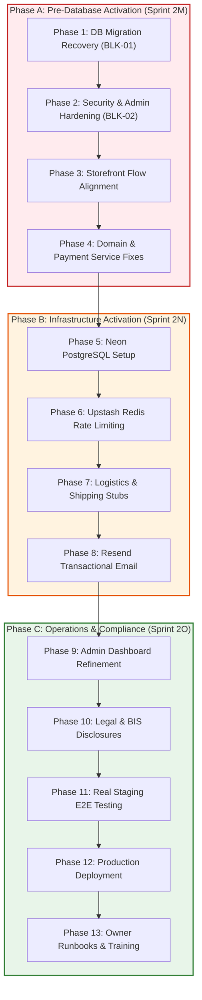

# SPRINT 2L — MASTER REMAINING WORK BACKLOG & ROADMAP
**Project:** NAVA CREATIONS  
**Milestone:** Sprint 2L — Master System Audit & Advanced Verification  
**Evaluation Date:** November 2026  
**Auditor:** Principal Software Architect & Technical Program Manager  
**Target Repository:** `D:\NAVA`  
**Git HEAD:** `c403636`  
**Branch:** `main` (tracking `origin/main`)  
**Operating Mode:** Strategic Engineering Roadmap & Task Specification

---

## 1. Executive Overview

This master backlog defines the complete, prioritized inventory of all remaining engineering, architectural, operational, and legal tasks required to take NAVA CREATIONS from its current audit baseline to a safe, compliant, and commercially viable production launch.

Tasks are grouped into **13 Roadmap Phases** and assigned strict priorities:
- **P0: Launch Blocker** (Must be resolved before any customer access or database activation)
- **P1: Essential Fast-Follow** (Must be completed immediately for operational stability)
- **P2: Post-Launch Growth** (Planned for future feature releases)
- **P3: Nice-to-Have** (Backlog for post-launch enhancement)
- **P4: Anti-Pattern** (Excluded / Deferred per owner decisions)

Every task includes its **Task ID, Priority, Description, Reason, Dependencies, Acceptance Criteria, Verification Method, Complexity (S/M/L/XL), and Target Milestone**.

---

## 2. Master Phase-by-Phase Backlog



---

### Phase 1: Database Migration Recovery & PostgreSQL 16 Invariant Resolution

#### Task DB-01: Split Prisma Migration to Eliminate PostgreSQL Error 55P04
- **Priority:** **P0 (Launch Blocker)**
- **Complexity:** Medium (M)
- **Milestone:** Sprint 2M
- **Dependencies:** None
- **Description:** Split `20261112_add_sovereign_payments_and_order_fsm` into two sequential Prisma migrations:
  1. `2026111201_add_payment_enums/migration.sql`: Contains only `ALTER TYPE "PaymentStatus" ADD VALUE ...`.
  2. `2026111202_apply_sovereign_payments/migration.sql`: Contains table alterations, constraints, indexes, and data updates.
- **Reason:** PostgreSQL 12–16 throws `ERROR: 55P04: unsafe use of new value "VERIFIED" of enum type "PaymentStatus"` when a newly added enum value is queried or updated in the same transaction. Prisma Migrate wraps all PostgreSQL migrations in a mandatory transaction.
- **Acceptance Criteria:**
  - `migration.sql` in `20261112_...` is removed or replaced by the two sequential directories.
  - Running `prisma migrate dev` or `prisma migrate deploy` against a clean PostgreSQL 16 database completes with zero errors.
  - `_prisma_migrations` records both steps as cleanly applied.
- **Verification Method:** Test against a local PostgreSQL 16 Docker container using `pnpm --filter @nava/db exec prisma migrate deploy`.

#### Task DB-02: Fix Legacy Payment Provenance & Drop Redundant Index
- **Priority:** **P1 (Essential)**
- **Complexity:** Small (S)
- **Milestone:** Sprint 2M
- **Dependencies:** Task DB-01
- **Description:**
  1. Retain legacy Razorpay payments as `CAPTURED` or map them to `LEGACY_MIGRATED` instead of `VERIFIED` with `NULL` audit fields. Do not retroactively set their provider to `BHARATPE_QR` (MAJ-01).
  2. Drop the redundant b-tree index `payments_verified_transaction_id_idx` since `payments_verified_transaction_id_key` already creates a unique index on that exact column (NIT-01).
- **Reason:** Preserves audit trail integrity and eliminates index bloat.
- **Acceptance Criteria:** Historical rows retain true provenance; schema contains only the unique index.
- **Verification Method:** Inspect generated schema and run SQL query plan check.

---

### Phase 2: Security & Admin Authentication Hardening

#### Task SEC-01: Remediate Admin Login Global Account Lockout DoS
- **Priority:** **P0 (Launch Blocker)**
- **Complexity:** Medium (M)
- **Milestone:** Sprint 2M
- **Dependencies:** None
- **Description:** Redesign the admin authentication rate-limiting architecture:
  - Option A: Add an explicit `Operator ID / Email` field to `apps/web/app/admin/login/page.tsx` so each manager has their own independent rate-limit bucket.
  - Option B: For single-secret studio mode, eliminate the fallback `acc:sha256('admin')` bucket entirely. Rate-limit authentication strictly by Client IP (Layer 1) and optional Cloudflare Turnstile CAPTCHA.
- **Reason:** Prevents any external actor from locking out all store administrators globally by sending 10 invalid requests (BLK-02).
- **Acceptance Criteria:**
  - Malicious login attempts from IP `X` with wrong passwords lock out only IP `X`.
  - Authentic studio managers on IP `Y` can continue logging in without interruption.
  - E2E Playwright test reproduces and verifies isolation without injecting artificial account strings.
- **Verification Method:** Dedicated Playwright test simulating concurrent attacker and legitimate user sessions.

#### Task SEC-02: Correct Reverse-Proxy Header Configuration
- **Priority:** **P1 (Essential)**
- **Complexity:** Small (S)
- **Milestone:** Sprint 2M
- **Dependencies:** Task SEC-01
- **Description:** Update `.env.example` to set `TRUST_PROXY="true"` for production Vercel/Cloudflare deployments. Validate that `x-forwarded-for` uses the rightmost trusted proxy IP rather than naive first-element splitting if spoofable.
- **Reason:** Prevents rate-limiter bypass and IP collapse to `127.0.0.1` (MAJ-03).
- **Acceptance Criteria:** Real client IP is correctly extracted in serverless route handlers.
- **Verification Method:** Unit test `extractClientIp()` with various header permutations.

---

### Phase 3: Storefront & Checkout Architecture Reconciliation

#### Task STR-01: Formalize WhatsApp Concierge Checkout Flow (Phase 1)
- **Priority:** **P0 (Launch Blocker)**
- **Complexity:** Small (S)
- **Milestone:** Sprint 2M
- **Dependencies:** None
- **Description:** Optimize the existing `/cart` WhatsApp checkout generator:
  - Add customer name and delivery city input to the cart drawer before opening WhatsApp.
  - Format the WhatsApp message with clear product SKU, gold purity (e.g. 22K), selected size/length, and subtotal in rupees.
  - Display reassurance banner on `/cart`: *"High-value bridal orders are confirmed via personalized WhatsApp consultation to verify purity, sizing, and insured delivery."*
- **Reason:** Aligns customer expectations with the luxury bespoke jewellery buying experience while eliminating the immediate need for a complex self-service checkout form.
- **Acceptance Criteria:** Customer can specify customisation details in cart, clicks WhatsApp, and lands in studio chat with complete order specification.
- **Verification Method:** Playwright browser test verifying generated WhatsApp URL encoding.

#### Task STR-02: Self-Service Sovereign Web Checkout Route (Phase 2 Fast-Follow)
- **Priority:** **P2 (Growth)**
- **Complexity:** Large (L)
- **Milestone:** Sprint 2P
- **Dependencies:** Task DB-01, Task SEC-01
- **Description:** Create `apps/web/app/checkout/page.tsx`:
  - Form collecting shipping address, state, and PIN code.
  - Payment method selector: "Instant UPI (BharatPe QR)" or "Direct Bank Transfer (NEFT/RTGS)".
  - Displays dynamic BharatPe UPI QR generated by `PaymentService`.
  - Input field for customer to submit their 12-digit bank UTR reference.
  - Calls `POST /api/orders` and `POST /api/payments`.
- **Reason:** Provides automated checkout for lower-ticket ready-to-ship silver and gift items.
- **Acceptance Criteria:** End-to-end checkout places database order, reserves inventory, and records payment claim.
- **Verification Method:** Playwright E2E browser test completing full checkout flow.

---

### Phase 4: Order & Payment Domain Service Completion

#### Task DOM-01: Remediate Partial Refund FSM Deadlock & Database Checks
- **Priority:** **P1 (Essential)**
- **Complexity:** Medium (M)
- **Milestone:** Sprint 2M
- **Dependencies:** Task DB-01
- **Description:**
  1. In `packages/domain/src/payment/state-machine.ts`, add compensatory transition from `PARTIALLY_REFUNDED` back to `VERIFIED` if a partial refund is rejected or cancelled (MAJ-02).
  2. In `packages/db/prisma/schema.prisma`, add a `CHECK` constraint ensuring `refunded_amount_paise <= amount_paise`.
  3. In `apps/web/src/services/payment-service.ts`, implement `initiateRefund` and `approveRefund` service methods.
  4. Remove test hooks `setMerchantConfigForTesting` from production classes (NIT-02).
- **Reason:** Restores financial domain integrity and prevents stuck payment states.
- **Acceptance Criteria:** Vitest tests verify rollback from failed partial refund; `PaymentService` exposes refund operations.
- **Verification Method:** Vitest unit tests in `packages/domain`.

---

### Phase 5: Production Database Provisioning (Neon Free Tier)

#### Task INF-01: Provision Neon PostgreSQL & Configure Connection Pooling
- **Priority:** **P1 (Essential)**
- **Complexity:** Medium (M)
- **Milestone:** Sprint 2N
- **Dependencies:** Task DB-01
- **Description:**
  - Create Neon Free tier project in Asia Pacific (Singapore `ap-southeast-1` or Mumbai `ap-south-1` for lowest latency to Bangalore).
  - Configure pooled connection string (`-pooler.postgres.neon.tech`) for Next.js serverless functions and direct connection string for Prisma migrations.
  - Set `DATABASE_URL` and `DIRECT_URL` in production environment.
  - Execute `prisma migrate deploy` and verify schema tables.
- **Reason:** Replaces in-memory data with persistent cloud database.
- **Acceptance Criteria:** Prisma connects cleanly, runs migrations, and handles connection pooling without connection exhaustion.
- **Verification Method:** Scripted database health-check test running `prisma.$queryRaw\`SELECT 1\``.

---

### Phase 6: Production Cache & Distributed Rate Limiting (Upstash Redis)

#### Task INF-02: Provision Upstash Redis & Wire Distributed Limiter
- **Priority:** **P1 (Essential)**
- **Complexity:** Medium (M)
- **Milestone:** Sprint 2N
- **Dependencies:** Task SEC-01
- **Description:**
  - Provision serverless Upstash Redis database (Asia-Pacific / Singapore or Mumbai).
  - Configure `UPSTASH_REDIS_REST_URL` and `UPSTASH_REDIS_REST_TOKEN`.
  - Wire Upstash Redis client into `apps/web/src/lib/rate-limit.ts`, replacing the ephemeral `InMemoryRateLimiter` in production.
- **Reason:** Ensures distributed rate limiting across Vercel serverless lambda containers, preventing rate limiter drift and memory leaks (MAJ-03).
- **Acceptance Criteria:** Rate limit counts persist across multiple independent HTTP requests and lambda cold starts.
- **Verification Method:** Automated test firing 12 requests across separate node instances and verifying consistent HTTP 429 response.

---

### Phase 7: Logistics & Shipping Integration

#### Task LOG-01: Precious Cargo Courier Integration & Dispatch Workflows
- **Priority:** **P1 (Essential)**
- **Complexity:** Medium (M)
- **Milestone:** Sprint 2N
- **Dependencies:** None
- **Description:**
  - Implement courier dispatch modal in `/admin/orders`: allows studio manager to select courier partner (**Sequel Logistics**, **BVC Logistics**, or **Shiprocket**), enter AWB/tracking number, and record transit insurance policy number.
  - Automatically transition order state from `PROCESSING` to `SHIPPED`.
- **Reason:** Luxury jewellery requires specialist valuable-cargo couriers with transit insurance rather than standard parcel carriers.
- **Acceptance Criteria:** Admin can assign AWB tracking; order moves to `SHIPPED`; notification is staged.
- **Verification Method:** Playwright admin test completing courier assignment.

---

### Phase 8: Communications & Transactional Notifications

#### Task COM-01: Resend Transactional Email Domain Setup & Templates
- **Priority:** **P1 (Essential)**
- **Complexity:** Medium (M)
- **Milestone:** Sprint 2N
- **Dependencies:** None
- **Description:**
  - Configure Resend API credentials (`RESEND_API_KEY`).
  - Add DNS records (`SPF`, `DKIM`, `DMARC`) on studio domain.
  - Implement branded React Email templates for:
    1. Bespoke Enquiry Acknowledgment.
    2. Order Confirmation with UPI Payment Instructions / Invoice.
    3. Payment Received & Verified Confirmation.
    4. Order Dispatched with Insured Courier Tracking Link.
- **Reason:** Establishes professional, high-trust brand communication and avoids spam folders.
- **Acceptance Criteria:** Emails render crisply across Gmail, Apple Mail, and Outlook; deliverability passes DKIM check.
- **Verification Method:** Send test email to staging inbox and inspect mail headers.

---

### Phase 9: Admin Operations Dashboard Completion

#### Task ADM-01: Payment Verification Audit Trail & UTR Matcher UI
- **Priority:** **P1 (Essential)**
- **Complexity:** Medium (M)
- **Milestone:** Sprint 2N
- **Dependencies:** Task DB-01, Task SEC-01
- **Description:** Enhance `/admin/payments`:
  - Display incoming customer UTR claims alongside customer name, order total in INR, and submission timestamp.
  - Provide one-click "Verify & Confirm Payment" button which prompts for the admin's operator name/ID and logs `verified_by_user_id` and `verified_at`.
  - Provide "Reject Claim" button with reason dropdown (e.g. "UTR not found in bank statement", "Amount mismatch").
- **Reason:** Empowers studio manager to reconcile bank credits safely without touching the database directly.
- **Acceptance Criteria:** Verifying a payment records full audit metadata and automatically transitions order to `PAYMENT_VERIFIED`.
- **Verification Method:** Playwright admin test executing verification and inspecting database record.

---

### Phase 10: Legal, Compliance & Mandatory Consumer Disclosures

#### Task LEG-01: India E-Commerce Compliance & BIS Hallmarking Disclosures
- **Priority:** **P0 (Launch Blocker)**
- **Complexity:** Small (S)
- **Milestone:** Sprint 2M
- **Dependencies:** None
- **Description:**
  - Create `/terms`, `/privacy`, `/shipping-policy`, and `/refund-policy` pages.
  - Under Indian Consumer Protection (E-Commerce) Rules 2020, publish:
    - Registered legal entity name, Bangalore studio address, and GSTIN.
    - Named Grievance Officer with official telephone and email.
    - Clear 7-day exchange and cancellation policy.
    - Country of Origin: India.
  - Add BIS Hallmarking identification explanation and studio BIS license number on footer and PDPs.
- **Reason:** Statutory legal requirement in India; prevents regulatory penalties and builds consumer trust.
- **Acceptance Criteria:** All legal pages accessible from footer; Grievance Officer clearly identified.
- **Verification Method:** Manual content audit and Playwright navigation test.

---

### Phase 11: End-to-End Real Infrastructure Testing & Staging Verification

#### Task TST-01: Live PostgreSQL & Redis Integration Test Suite
- **Priority:** **P1 (Essential)**
- **Complexity:** Medium (M)
- **Milestone:** Sprint 2N
- **Dependencies:** Task INF-01, Task INF-02
- **Description:** Create dedicated integration test suite (`tests/integration/`) that connects to a real PostgreSQL database (via Testcontainers or Neon branch) and Upstash Redis instance. Verify schema constraints, connection timeouts, and concurrent inventory locks.
- **Reason:** Eliminates MAJ-04 (100% mock testing) and ensures real production stability.
- **Acceptance Criteria:** Automated CI test suite passes against real PostgreSQL and Redis.
- **Verification Method:** `pnpm test:integration` execution in CI.

---

### Phase 12: Production Deployment & Observability

#### Task OPS-01: Vercel Production Deployment & Monitoring
- **Priority:** **P1 (Essential)**
- **Complexity:** Small (S)
- **Milestone:** Sprint 2O
- **Dependencies:** Phases 1–11
- **Description:**
  - Link repository to Vercel production project.
  - Configure production environment variables (`DATABASE_URL`, `DIRECT_URL`, `UPSTASH_REDIS_REST_URL`, `RESEND_API_KEY`, `ADMIN_AUTH_SECRET`, `TRUST_PROXY=true`).
  - Configure Cloudflare DNS with SSL/TLS encryption.
  - Set up Sentry error monitoring for client and server runtime errors.
- **Reason:** Ensures reliable, zero-downtime hosting with real-time error tracking.
- **Acceptance Criteria:** Clean deployment on custom domain with valid SSL and Sentry error capture.
- **Verification Method:** Production smoke test.

---

### Phase 13: Operational Runbooks & Studio Owner Training

#### Task DOC-01: Studio Owner Operational Runbook
- **Priority:** **P1 (Essential)**
- **Complexity:** Small (S)
- **Milestone:** Sprint 2O
- **Dependencies:** All previous phases
- **Description:** Deliver a plain-language operational guide for the studio owner and managers:
  1. How to log in to `/admin` safely.
  2. How to review and reply to bespoke bridal enquiries.
  3. How to check BharatPe merchant app / bank SMS and verify customer UTRs.
  4. How to update order status to `SHIPPED` and book insured courier dispatch.
  5. What to do if a customer requests a refund or size exchange.
- **Reason:** Ensures non-technical studio staff can operate the store efficiently without developer assistance.
- **Acceptance Criteria:** PDF / Markdown runbook signed off by studio management.
- **Verification Method:** Studio manager walk-through session.

---

## 3. Sprint Roadmap & Milestone Planning

```
┌────────────────────────────────────────────────────────────────────────┐
│ SPRINT 2M: Core Remediation & Alignment (Pre-Infra)                     │
│ Target: Resolve BLK-01 (DB Split), BLK-02 (Admin DoS), Legal Pages    │
└────────────────────────────────────────────────────────────────────────┘
                                    │
                                    ▼
┌────────────────────────────────────────────────────────────────────────┐
│ SPRINT 2N: Cloud Infrastructure Activation (Neon & Redis)              │
│ Target: Provision Neon Free, Upstash Redis, Resend Email, Live Tests  │
└────────────────────────────────────────────────────────────────────────┘
                                    │
                                    ▼
┌────────────────────────────────────────────────────────────────────────┐
│ SPRINT 2O: Operational Readiness & Production Launch (Phase 1)         │
│ Target: Vercel Deploy, Studio Runbooks, WhatsApp Concierge Go-Live    │
└────────────────────────────────────────────────────────────────────────┘
                                    │
                                    ▼
┌────────────────────────────────────────────────────────────────────────┐
│ SPRINT 2P: Self-Service Web Checkout & Automation (Phase 2 Fast-Follow)│
│ Target: Build /checkout UI, Auto Shiprocket labels, UTR Self-Submit    │
└────────────────────────────────────────────────────────────────────────┘
```

---

## 4. Master Backlog Summary Table

| Task ID | Phase | Priority | Description | Complexity | Milestone |
| :--- | :--- | :--- | :--- | :--- | :--- |
| **DB-01** | Phase 1 | **P0 (Blocker)** | Split migration into 2 steps to bypass PostgreSQL 55P04 | M | Sprint 2M |
| **DB-02** | Phase 1 | **P1 (Essential)** | Fix legacy payment history & drop redundant index | S | Sprint 2M |
| **SEC-01**| Phase 2 | **P0 (Blocker)** | Remediate admin login lockout DoS | M | Sprint 2M |
| **SEC-02**| Phase 2 | **P1 (Essential)** | Set TRUST_PROXY=true & harden reverse proxy headers | S | Sprint 2M |
| **STR-01**| Phase 3 | **P0 (Blocker)** | Optimize WhatsApp concierge checkout flow | S | Sprint 2M |
| **STR-02**| Phase 3 | **P2 (Growth)** | Build self-service web checkout page (`/checkout`) | L | Sprint 2P |
| **DOM-01**| Phase 4 | **P1 (Essential)** | Fix partial refund FSM deadlock & add service methods | M | Sprint 2M |
| **INF-01**| Phase 5 | **P1 (Essential)** | Provision Neon Free PostgreSQL & pooled connection | M | Sprint 2N |
| **INF-02**| Phase 6 | **P1 (Essential)** | Provision Upstash Redis distributed rate limiting | M | Sprint 2N |
| **LOG-01**| Phase 7 | **P1 (Essential)** | Valuable cargo courier assignment UI | M | Sprint 2N |
| **COM-01**| Phase 8 | **P1 (Essential)** | Resend transactional email domain & templates | M | Sprint 2N |
| **ADM-01**| Phase 9 | **P1 (Essential)** | Payment verification UTR audit matcher UI | M | Sprint 2N |
| **LEG-01**| Phase 10 | **P0 (Blocker)** | Publish India E-Commerce rules & BIS hallmarking info | S | Sprint 2M |
| **TST-01**| Phase 11 | **P1 (Essential)** | Live PostgreSQL & Redis integration test suite | M | Sprint 2N |
| **OPS-01**| Phase 12 | **P1 (Essential)** | Vercel production deployment & DNS setup | S | Sprint 2O |
| **DOC-01**| Phase 13 | **P1 (Essential)** | Studio owner operational runbook & training | S | Sprint 2O |
