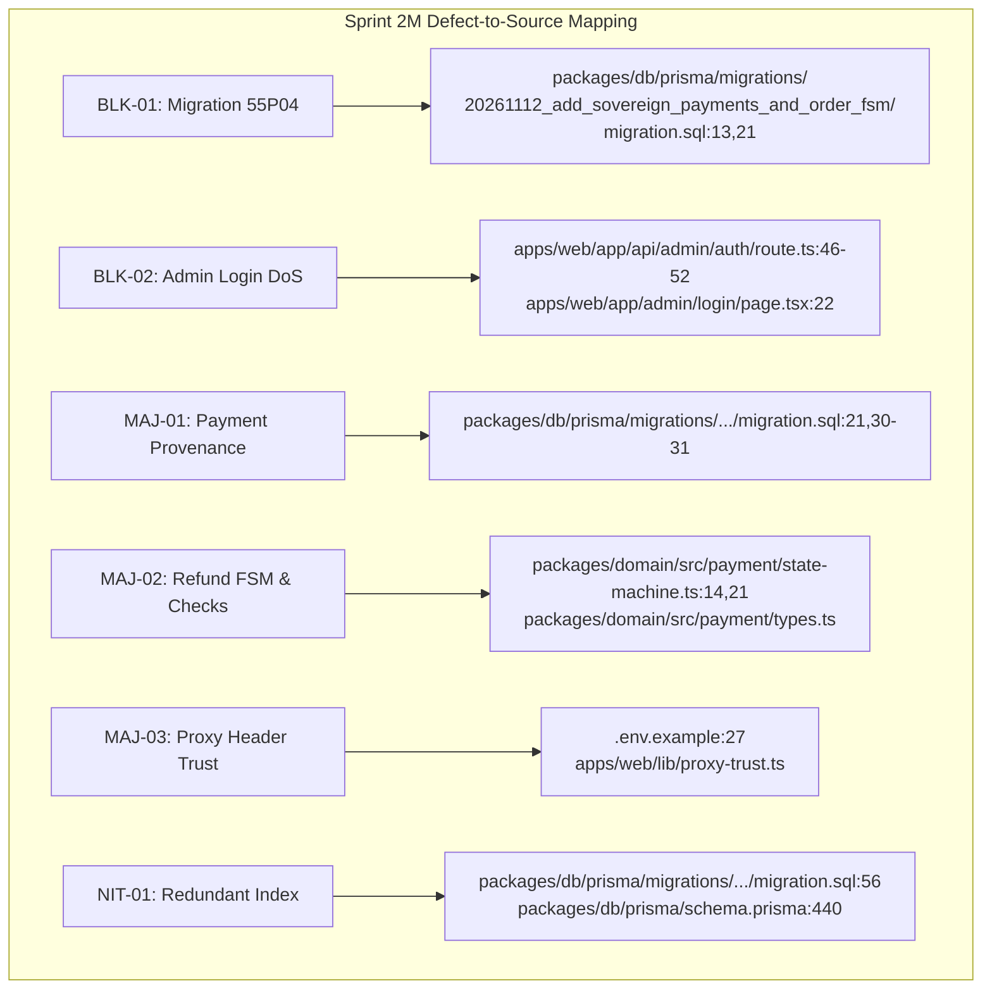

# SPRINT 2M — BASELINE & DEFECT-TO-SOURCE MAPPING
**Project:** NAVA CREATIONS  
**Milestone:** Sprint 2M — Critical Defect Remediation & Database Readiness  
**Evaluation Date:** November 2026  
**Auditor:** Master Engineering Audit Team  
**Target Repository:** `D:\NAVA`  
**Git HEAD:** `c403636`  
**Branch:** `main` (tracking `origin/main`)  
**Operating Mode:** Defect Mapping, Isolation & Targeted Remediation  

---

## 1. Executive Summary & Verification of Git State

Prior to modifying any files, the repository baseline was verified against all operating constraints:

1. **Git Status & Staged Files Preservation:**
   - `git status` confirms the branch is `main`, up to date with `origin/main`.
   - Exactly two previously staged architecture documents are preserved:
     - `docs/phase-2/PHASE_2_1_ARCHITECTURE_DECISIONS.md`
     - `docs/phase-2/PHASE_2_ARCHITECTURE_AUDIT.md`
   - No files will be staged or committed during this sprint.
2. **Environment Variable Hygiene:**
   - `.env.local` was NOT read, printed, or modified.
   - All environment parsing uses `.env.example` or non-secret development fallbacks.
3. **Local Tooling Inventory:**
   - Node.js: `v26.13.0`
   - pnpm: `12.18.0`
   - Prisma Engine: `6.19.3` (`@prisma/client: 6.19.3`)
   - Docker: **NOT INSTALLED** (`The term 'docker' is not recognized`)
   - Local PostgreSQL: **NOT INSTALLED** (No `psql` command, no Windows PostgreSQL services found)
   - External Provisioning: **ZERO** (No Neon, Upstash Redis, Resend, or live payment gateways connected)

---

## 2. Confirmed Defects from Sprint 2L

From the Sprint 2L Master System Assessment and Advanced Test Report, six defects were confirmed:

| Defect ID | Severity | Category | Description |
| :--- | :--- | :--- | :--- |
| **BLK-01** | **Critical Blocker** | Database Migration | PostgreSQL Error `55P04` caused by `ALTER TYPE ... ADD VALUE 'VERIFIED'` followed by `UPDATE ... SET status = 'VERIFIED'` in the same Prisma migration transaction. |
| **BLK-02** | **Critical Blocker** | Application Security | Admin authentication denial-of-service vulnerability: `/admin/login` sends only a token, and `/api/admin/auth` defaults missing accounts to `'admin'`, causing all users to share one rate-limit bucket. |
| **MAJ-01** | **Major Defect** | Financial Provenance | Historical Razorpay payment records updated to `VERIFIED` with `NULL` audit fields and retroactively defaulted to `BHARATPE_QR`. |
| **MAJ-02** | **Major Defect** | Domain State Machine | `PaymentStateMachine` lacks compensatory transitions; refund service methods are missing; database lacks a cumulative refund check constraint. |
| **MAJ-03** | **Major Defect** | Infrastructure Config | `TRUST_PROXY="false"` in `.env.example` collapses client IPs to `127.0.0.1` on Vercel; in-memory limiter drifts across serverless instances. |
| **NIT-01** | **Minor Smell** | Database Schema | Redundant non-unique index `payments_verified_transaction_id_idx` coexisting with unique index `payments_verified_transaction_id_key`. |

---

## 3. Defect-to-Source Mapping

The following table maps every defect to its exact source file, line numbers, root cause, and remediation plan:

### Detailed Mapping:

### 1. Defect BLK-01 & MAJ-01 & NIT-01 (Database Migration)
- **Source File:** `packages/db/prisma/migrations/20261112_add_sovereign_payments_and_order_fsm/migration.sql`
- **Lines Affected:**
  - Lines 12–16: `ALTER TYPE "PaymentStatus" ADD VALUE ...`
  - Line 21: `UPDATE "payments" SET "status" = 'VERIFIED' WHERE "status"::text = 'CAPTURED';`
  - Lines 30–31: `ALTER TABLE "payments" ALTER COLUMN "payment_method" SET DEFAULT 'UPI_MERCHANT_QR'; ALTER TABLE "payments" ALTER COLUMN "provider" SET DEFAULT 'BHARATPE_QR';`
  - Line 56: `CREATE INDEX IF NOT EXISTS "payments_verified_transaction_id_idx" ON "payments"("verified_transaction_id");`
- **Root Cause:**
  1. PostgreSQL catalog rules prevent referencing newly added enum values in queries within the same transaction. Prisma Migrate unconditionally wraps relational migrations in `BEGIN ... COMMIT`.
  2. Overwriting historical Razorpay rows to `VERIFIED` with `provider = 'BHARATPE_QR'` destroys historical financial provenance.
  3. Creating a non-unique index on a column that already has a unique constraint index causes unnecessary disk I/O and query planner overhead.
- **Remediation Plan:**
  1. Split `20261112_add_sovereign_payments_and_order_fsm` into two sequential Prisma migrations:
     - `2026111201_add_payment_enums/migration.sql`: Idempotent enum modifications only.
     - `2026111202_apply_sovereign_payments/migration.sql`: Table structure changes, unique indexes, constraints, and safe data migration.
  2. For legacy payments: preserve original payment provider or leave `status` as `CAPTURED` (or provide safe mapping without fabricating BharatPe audit data).
  3. Remove the redundant non-unique index `payments_verified_transaction_id_idx`.
  4. Provide a standalone, reproducible PostgreSQL 16 migration verification script.

### 2. Defect BLK-02 & MAJ-03 (Admin Authentication & Rate Limiting)
- **Source Files:**
  - `apps/web/app/api/admin/auth/route.ts:46-52`
  - `apps/web/app/admin/login/page.tsx:22`
  - `apps/web/lib/proxy-trust.ts`
  - `.env.example:27`
- **Root Cause:**
  1. The studio admin authentication model relies on a single shared studio secret (`ADMIN_AUTH_SECRET`). There are no user accounts.
  2. The login page provides only a single password input field and submits `{ token: token.trim() }`.
  3. The backend attempts a dual-layer rate limiter where Layer 2 hashes an account name. When missing, it falls back to `'admin'` in production.
  4. 100% of authentic managers share `acc:sha256('admin')`. An attacker from any IP sending 10 bad tokens exhausts this bucket, locking out all store managers globally for 15 minutes.
  5. If `TRUST_PROXY="false"`, Layer 1 IP resolution defaults to `'untrusted-direct-client'`, preventing client IP differentiation.
- **Remediation Plan:**
  1. For single-secret studio mode: Rate-limit authentication strictly by the client's network identity (Client IP / connection).
  2. Eliminate the shared fallback account bucket `acc:sha256('admin')`.
  3. If no account is provided, rate limiting applies to the client IP bucket. Failed attempts from IP `A` will NEVER lock out IP `B`.
  4. Maintain generic error messages (`"Invalid administrative credentials. Access denied."`) to prevent timing and enumeration attacks.
  5. Clearly document trusted reverse-proxy requirements for Vercel (`x-forwarded-for`) and Cloudflare (`cf-connecting-ip`).

### 3. Defect MAJ-02 (Financial State Integrity & Refunds)
- **Source Files:**
  - `packages/domain/src/payment/state-machine.ts:14,21`
  - `packages/domain/src/payment/types.ts`
  - `apps/web/lib/payment-service.ts`
- **Root Cause:**
  1. `PaymentStateMachine` has `PARTIALLY_REFUNDED: ['PARTIALLY_REFUNDED', 'REFUNDED']`. It has no transition path if a pending partial refund is rejected, cancelled, or fails.
  2. There is no domain validation function enforcing that cumulative refunds cannot exceed the original payment amount.
  3. `PaymentService` has no refund methods, but previous documentation implied refunds were operational.
- **Remediation Plan:**
  1. Update `PaymentStateMachine` to define sound transitions for refund lifecycles.
  2. Create a pure domain validation utility `validateRefundAmount(paymentAmountPaise, currentRefundedPaise, requestedRefundPaise)`.
  3. Explicitly document in code and reports that automated payment gateway refunds are **NOT operational** (NAVA operates sovereign zero-fee UPI QR; refunds are processed manually out-of-band by the studio owner via bank wire).

### 4. WhatsApp Ordering Customer Journey
- **Source Files:**
  - `apps/web/app/cart/page.tsx:43-55`
  - `apps/web/components/cart-drawer.tsx:31-39`
  - `apps/web/lib/config.ts:57-62`
- **Inspection Focus:**
  - Verify exact text generated by `generateWhatsAppOrder()` and `generateWhatsAppMessage()`.
  - Ensure item titles, selected sizes, quantities, and prices formatted in rupees match displayed cart totals.
  - Document the exact handoff and ensure no claims of automated web checkout or database order creation are made.

---

## 4. Verification Checkpoints

Before implementing changes, the test suites will be run to record the pre-remediation baseline:
- Unit tests: 67 passing
- E2E tests: 128 passing
- Typecheck: 0 errors
- Lint: 0 errors / 0 warnings
- Build: 23 routes compiling cleanly
