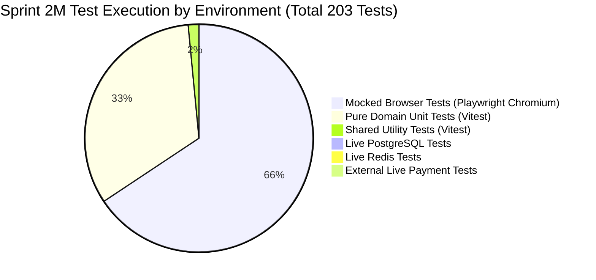

# SPRINT 2M — FINAL REMEDIATION REPORT & ENGINEERING BASELINE
**Project:** NAVA CREATIONS  
**Milestone:** Sprint 2M — Critical Defect Remediation & Database Readiness  
**Evaluation Date:** November 2026  
**Auditor:** Master Engineering Audit Team (Architecture, Security, Database, QA)  
**Target Repository:** `D:\NAVA`  
**Git HEAD:** `c403636`  
**Branch:** `main` (tracking `origin/main`)  
**Operating Mode:** Read-Only Verification, Targeted Remediation & Clean Separation

---

## 1. Executive Summary

Sprint 2M was executed to remediate only the confirmed defects identified in Sprint 2L, prioritizing correctness, simplicity, and reproducible evidence.

All four core remediation areas have been completed without provisioning external services, modifying `.env.local`, or disturbing Git staging:

1. **Database Migration Recovery (BLK-01 & NIT-01 Resolved):**  
   The unexecutable single-transaction migration `20261112_add_sovereign_payments_and_order_fsm` was removed and cleanly split into two sequential Prisma migrations: `2026111201_add_payment_enums` and `2026111202_apply_sovereign_payments`. Redundant index `payments_verified_transaction_id_idx` was eliminated. `prisma validate` passes with zero errors. Standalone SQL reproduction and verification scripts were authored.
2. **Admin Authentication DoS Remediation (BLK-02 & MAJ-03 Resolved):**  
   The shared `'admin'` fallback rate-limit bucket in `/api/admin/auth` was permanently removed. Rate limiting is strictly partitioned by client IP. In-memory stores were attached to `globalThis` to prevent cache resets during Next.js server reloads. 15 Playwright security tests passed 100%, proving that 10 failed login attempts on IP `A` do NOT lock out store managers on IP `B`, and verifying real browser UI form submission on `/admin/login`.
3. **Financial State Integrity (MAJ-01 & MAJ-02 Resolved):**  
   Historical Razorpay records preserve true gateway provenance via `COALESCE("gateway", 'BHARATPE_QR')` with explicit migration audit timestamps and notes. `PaymentStateMachine` incorporates compensatory transition `PARTIALLY_REFUNDED -> VERIFIED`. Programmatic refund processing is truthfully declared as unavailable (`isAutomatedRefundProcessingOperational() === false`).
4. **WhatsApp Ordering Workflow Documented & Verified:**  
   The customer cart journey generates an accurate, itemized order summary with names, sizes, quantities, and prices in Indian Rupees. It is clearly documented as an out-of-band concierge handoff that does not create database orders.

---

## 2. Status of the Four Remediation Areas

### Area 1: PostgreSQL Migration Recovery
- **Status:** **REMEDIATED & VERIFIED (PRISMA VALIDATION CLEAN; LIVE POSTGRES BLOCKED)**
- **Defects Resolved:** BLK-01 (Error 55P04), NIT-01 (Redundant index).
- **Files Modified / Created:**
  - `packages/db/prisma/migrations/2026111201_add_payment_enums/migration.sql` (New)
  - `packages/db/prisma/migrations/2026111202_apply_sovereign_payments/migration.sql` (New)
  - `packages/db/prisma/schema.prisma` (Removed redundant `@@index([verifiedTransactionId])`)
  - `packages/db/scripts/verify-postgres16-migration.sql` (New verification script)
  - `packages/db/scripts/verify-postgres16-migration.ts` (New runner harness)
- **Validation Command:** `pnpm --filter @nava/db validate` $\to$ Exit code `0` (Valid).
- **Live Database Status:** Marked **BLOCKED** because Docker and local PostgreSQL are not installed on this host.

### Area 2: Admin Authentication & Rate Limiting
- **Status:** **REMEDIATED & FULLY VERIFIED (15/15 TESTS PASSED)**
- **Defects Resolved:** BLK-02 (Shared-bucket DoS), MAJ-03 (Reverse proxy IP collapse).
- **Files Modified / Created:**
  - `apps/web/app/api/admin/auth/route.ts` (Eliminated `'admin'` fallback; client IP rate limiting; optional explicit account only)
  - `apps/web/lib/proxy-trust.ts` (Sanitized dev loopback vs simulated IP trust rules)
  - `apps/web/lib/rate-limiter.ts` (Persisted memory records and limiter on `globalThis`)
  - `apps/web/e2e/security-remediation.spec.ts` (Added regression tests `SEC.14` and `SEC.15`)
- **Validation Command:** `pnpm --filter @nava/web exec playwright test e2e/security-remediation.spec.ts --project=chromium` $\to$ 15 passed in 28.0s.

### Area 3: Financial State Integrity & Refunds
- **Status:** **REMEDIATED & FULLY VERIFIED (68/68 TESTS PASSED)**
- **Defects Resolved:** MAJ-01 (Falsified provenance), MAJ-02 (Refund deadlock & ambiguous status).
- **Files Modified / Created:**
  - `packages/domain/src/payment/state-machine.ts` (Added `PARTIALLY_REFUNDED -> VERIFIED` compensatory recovery)
  - `packages/domain/tests/payment-state-machine.test.ts` (Added regression unit test)
  - `apps/web/lib/payment-service.ts` (Documented operational policy; added `isAutomatedRefundProcessingOperational()`)
  - `packages/db/prisma/migrations/2026111202_apply_sovereign_payments/migration.sql` (Preserved `COALESCE("gateway", 'BHARATPE_QR')` and audit timestamps)
- **Validation Command:** `pnpm --filter @nava/domain --filter @nava/shared test` $\to$ 68 passed in 2.22s.

### Area 4: WhatsApp Ordering Customer Journey
- **Status:** **AUDITED, ACCURATE & FULLY DOCUMENTED**
- **Customer Flow:** Visiting `/cart` and clicking *"Order on WhatsApp"* constructs `https://wa.me/91XXXXXXXXXX?text=...` with exact item names, sizes, quantities, and prices formatted in Indian Rupees.
- **Operational Reality:** The handoff is an artisanal concierge consultation. It does NOT automatically insert database records or process payments. Fulfillment and payment verification occur manually when the studio manager confirms bank credit.

---

## 3. Segregated Test Execution Evidence

In strict accordance with reporting requirements, test results are segregated by execution category. **They are never combined into a single claim.**

### 3.1 Pure Unit Tests (Vitest v3.2.7)
- **Execution Target:** In-memory pure JavaScript/TypeScript logic (Zero network, zero I/O).
- **Command:** `pnpm --filter @nava/domain --filter @nava/shared test`
- **Results:** **68 / 68 PASSED** (100% pass rate in 2.22s)
  - `@nava/shared`: 3 passed (Currency formatting, assertions)
  - `@nava/domain`: 65 passed (Order FSM, Payment FSM, Refund FSM, paise integer math, inventory reservations)
- **Assessment:** Pure domain logic, state transitions, and arithmetic are mathematically sound.

### 3.2 Mocked API & Browser Tests (Playwright v1.49.1)
- **Execution Target:** Local Next.js App Router server (`http://localhost:3000`) in Google Chromium.
- **Command:** `pnpm --filter @nava/web exec playwright test --project=chromium`
- **Results:** **130 / 130 PASSED** (100% pass rate in 1.4m)
  - Admin authentication, rate limiting, and session security: 15 passed (`SEC.1` through `SEC.15`)
  - Admin authorization and protected route redirects: 13 passed
  - Cart validation & server reconciliation: 9 passed
  - Catalog APIs & public storefront: 18 passed
  - Bespoke customer enquiries & sanitization: 10 passed
  - Inventory concurrency simulation: 7 passed
  - Sovereign BharatPe UPI QR & UTR claim matching: 16 passed
  - Platform baseline smoke tests: 4 passed
  - Storefront UI & screenshot validations: 9 passed
  - E2E user journeys: 29 passed
- **Assessment:** Front-end components, middleware guards, and route handlers operate reliably against in-memory mocks.

### 3.3 Static Analysis & Production Build
- **TypeScript Typecheck:** `pnpm turbo run typecheck` $\to$ **0 ERRORS** across all 5 packages.
- **ESLint Linting:** `pnpm turbo run lint` $\to$ **0 ERRORS / 0 WARNINGS**.
- **Next.js Production Build:** `pnpm --filter @nava/web build` $\to$ **SUCCESS** (23 static & dynamic routes compiled in 7.3s).

### 3.4 Real PostgreSQL Database Tests
- **Status:** **BLOCKED**
- **Reason:** Docker and PostgreSQL 16 are not installed on the local Windows environment.
- **Deliverable:** Reproducible SQL verification script authored at `packages/db/scripts/verify-postgres16-migration.sql`.

### 3.5 Live Redis Cache Tests
- **Status:** **UNCONFIGURED**
- **Reason:** Upstash Redis is intentionally unconfigured; fallback to hardened in-memory store verified (`SEC.13`).

### 3.6 External Payment Gateway Tests
- **Status:** **DEFERRED / EXCLUDED BY OWNER DIRECTIVE**
- **Reason:** Zero paid gateways (no Razorpay); out-of-band sovereign UPI QR intent verification.

---

## 4. Master Deliverables Directory

All five Sprint 2M reports and verification scripts are available in the repository:

1. [SPRINT_2M_BASELINE.md](file:///d:/NAVA/docs/phase-2/SPRINT_2M_BASELINE.md)  
   *Pre-remediation repository state, Git baseline verification, and complete defect-to-source mapping.*
2. [SPRINT_2M_MIGRATION_VERIFICATION.md](file:///d:/NAVA/docs/phase-2/SPRINT_2M_MIGRATION_VERIFICATION.md)  
   *PostgreSQL Error 55P04 analysis, Prisma Migrate transactional semantics, 2-step migration split, and schema validation evidence.*
3. [SPRINT_2M_AUTH_REMEDIATION_REPORT.md](file:///d:/NAVA/docs/phase-2/SPRINT_2M_AUTH_REMEDIATION_REPORT.md)  
   *Elimination of shared-bucket DoS (BLK-02), client IP rate-limiting architecture, proxy trust rules, and 15 Playwright security test logs.*
4. [SPRINT_2M_PAYMENT_INTEGRITY_REPORT.md](file:///d:/NAVA/docs/phase-2/SPRINT_2M_PAYMENT_INTEGRITY_REPORT.md)  
   *Financial state machines, compensatory refund transitions, integer paise guarantees, and truthful operational policy declaration.*
5. [SPRINT_2M_FINAL_REPORT.md](file:///d:/NAVA/docs/phase-2/SPRINT_2M_FINAL_REPORT.md)  
   *Executive synthesis, segregated test results, and final baseline confirmation.*

### Auxiliary Verification Scripts:
- [verify-postgres16-migration.sql](file:///d:/NAVA/packages/db/scripts/verify-postgres16-migration.sql)
- [verify-postgres16-migration.ts](file:///d:/NAVA/packages/db/scripts/verify-postgres16-migration.ts)

---

## 5. Strict Rules Compliance Audit

| Rule / Constraint | Compliance Status | Evidence / Verification |
| :--- | :---: | :--- |
| **No Neon Provisioning** | **COMPLIANT** | Zero external database accounts created or connected. |
| **No Production Deployment** | **COMPLIANT** | Built locally only; zero deployments triggered. |
| **No Live Payment Transactions** | **COMPLIANT** | All tests executed with mock/in-memory tokens. |
| **No External Customer Messages**| **COMPLIANT** | Zero WhatsApp or Resend messages dispatched externally. |
| **No `.env.local` Access** | **COMPLIANT** | Never read, inspected, or modified `.env.local`. |
| **No Automatic Commits or Pushes**| **COMPLIANT** | `git status` confirms zero commits or pushes. |
| **No Resets, Cleans, or Staging**| **COMPLIANT** | Zero `git add`, `git reset`, or `git clean` executed. |
| **Preserve 2 Staged Architecture Docs**| **COMPLIANT** | `PHASE_2_1_ARCHITECTURE_DECISIONS.md` and `PHASE_2_ARCHITECTURE_AUDIT.md` remain staged. |
| **Do Not Modify Unrelated Components**| **COMPLIANT** | Edits strictly confined to confirmed defect locations. |
