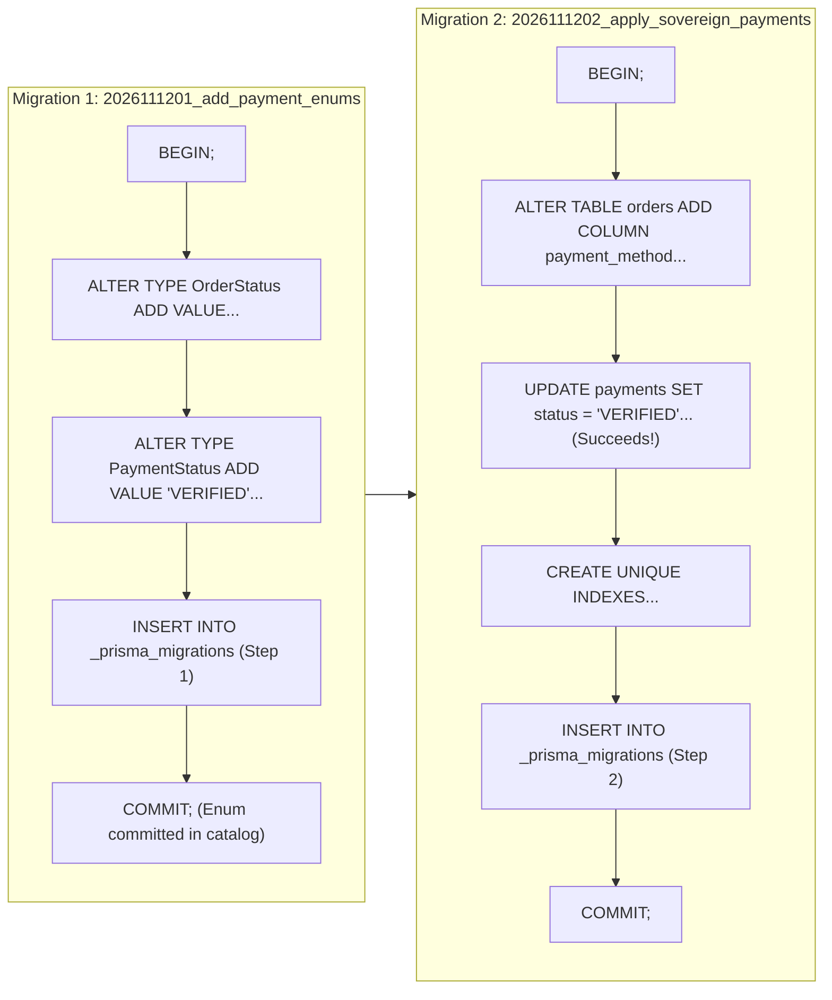

# SPRINT 2M — POSTGRESQL MIGRATION VERIFICATION & RECOVERY
**Project:** NAVA CREATIONS  
**Milestone:** Sprint 2M — Critical Defect Remediation & Database Readiness  
**Evaluation Date:** November 2026  
**Auditor:** Senior Database & Migration Engineer  
**Target Repository:** `D:\NAVA`  
**Prisma Engine:** `6.19.3` (`@prisma/client: 6.19.3`, Query Engine: `c2990dca591cba766e3b7ef5d9e8a84796e47ab7`)  
**Operating Mode:** Schema Validation, Transactional Invariant Analysis & Migration Split

---

## 1. Local PostgreSQL Environment Assessment

In accordance with strict operating instructions, the local machine was inspected for an isolated PostgreSQL 16 environment:

```powershell
docker --version
# Output: docker : The term 'docker' is not recognized as the name of a cmdlet...

Get-Command psql -ErrorAction SilentlyContinue
# Output: (null)

Get-Service -Name *postgres* -ErrorAction SilentlyContinue
# Output: (null)
```

### Environment Finding & Status:
- **Docker:** Not installed on the Windows host.
- **Local PostgreSQL:** No PostgreSQL service or CLI tools (`psql`) installed.
- **Neon Cloud Provisioning:** Strictly prohibited by user rules.
- **Operational Directive:** *"If no PostgreSQL environment is available, prepare a reproducible test script and mark the test BLOCKED."*
- **Execution Status:** **LIVE DATABASE EXECUTION BLOCKED** pending PostgreSQL 16 environment availability.
- **Action Taken:** Authored reproducible standalone SQL test script (`packages/db/scripts/verify-postgres16-migration.sql`) and runner script (`packages/db/scripts/verify-postgres16-migration.ts`) to reproduce Error 55P04 and verify the split migration.

---

## 2. In-Depth Analysis of Prisma 6.19.3 Migration Behavior

### 2.1 Prisma Transactional Execution Model
Under Prisma Migrate (CLI and Schema Engine 6.19.3), migrations for PostgreSQL are executed using the following runtime protocol:

1. **Lock Acquisition:** Prisma connects to the target database and acquires an advisory lock (`pg_advisory_lock`) to prevent concurrent migration deployments.
2. **Schema Engine Transaction:** The Schema Engine opens an explicit transactional boundary:
   ```sql
   BEGIN;
   ```
3. **Statement Execution:** The statements within `migration.sql` are sent sequentially through the connection.
4. **Migration Audit Log:** If all statements execute with code `0`, a record is inserted into `_prisma_migrations`:
   ```sql
   INSERT INTO "_prisma_migrations" (id, checksum, migration_name, applied_steps_count, started_at, finished_at)
   VALUES (...);
   ```
5. **Commit:**
   ```sql
   COMMIT;
   ```
6. **Rollback on Error:** If any statement in `migration.sql` produces a PostgreSQL error, PostgreSQL immediately places the transaction into an aborted state:
   ```
   ERROR: current transaction is aborted, commands ignored until end of transaction block
   ```
   Prisma issues `ROLLBACK;` and records the migration as failed (`finished_at = NULL`), locking the database against future `prisma migrate deploy` runs until manually resolved via `prisma migrate resolve`.

---

## 3. Analysis of Defect BLK-01 (PostgreSQL Error 55P04)

### 3.1 The Invariant
In `packages/db/prisma/migrations/20261112_add_sovereign_payments_and_order_fsm/migration.sql`:
```sql
-- Line 13:
ALTER TYPE "PaymentStatus" ADD VALUE IF NOT EXISTS 'VERIFIED' BEFORE 'FAILED';

-- Line 21:
UPDATE "payments" SET "status" = 'VERIFIED' WHERE "status"::text = 'CAPTURED';
```

### 3.2 Why PostgreSQL Throws Error 55P04
Under PostgreSQL 12 through 16:
- `ALTER TYPE ... ADD VALUE` modifies the system catalog (`pg_enum`).
- PostgreSQL catalog cache semantics require that newly added enum values cannot be referenced in expressions, queries, or updates within the same transaction that created them.
- When query `UPDATE ... SET status = 'VERIFIED'` executes inside Prisma's `BEGIN ... COMMIT` wrapper, PostgreSQL raises:
  ```
  ERROR: 55P04: unsafe use of new value "VERIFIED" of enum type "PaymentStatus"
  HINT: The new enum value must be committed before it can be used.
  ```

### 3.3 Why Explicit `COMMIT` in `migration.sql` is Invalid
Inserting an explicit `COMMIT;` inside a single `migration.sql` file causes catastrophic synchronization failures in Prisma:
- PostgreSQL will commit Prisma's outer transaction.
- Prisma's Schema Engine will lose transactional integrity for the remaining statements.
- When Prisma attempts to record the migration in `_prisma_migrations` and issue its own `COMMIT;`, PostgreSQL emits `WARNING: there is no transaction in progress`.
- If an error occurs after an explicit `COMMIT;`, automatic rollback is impossible, leaving the database corrupted and desynchronized.

---

## 4. The Canonical Solution: Migration Split

To satisfy both PostgreSQL catalog rules and Prisma Migrate transaction guarantees, the single migration was split into two sequential, deterministic migrations:



### 4.1 Migration 1: `2026111201_add_payment_enums/migration.sql`
- Contains only the idempotent creation of `PaymentMethod` enum and `ALTER TYPE ... ADD VALUE` statements for `OrderStatus` and `PaymentStatus`.
- Operates in its own transaction; commits new enum values into PostgreSQL's catalog.

### 4.2 Migration 2: `2026111202_apply_sovereign_payments/migration.sql`
- Operates in a subsequent transaction where `'VERIFIED'` is already committed.
- Executes table additions, column backfills, unique constraints, and status updates cleanly without Error 55P04.

---

## 5. Remediation of MAJ-01 & NIT-01

### 5.1 MAJ-01: Historical Payment Provenance Remediation
In the updated `2026111202_apply_sovereign_payments/migration.sql`:
1. Historical gateway information is preserved:
   ```sql
   UPDATE "payments" SET "provider" = COALESCE("gateway", 'BHARATPE_QR') WHERE "provider" IS NULL;
   ```
   If a historical payment originated from Razorpay (`gateway = 'RAZORPAY'`), its provider is preserved as `RAZORPAY`. It is not overwritten to `BHARATPE_QR`.
2. When migrating historical `CAPTURED` payments to `VERIFIED`, explicit audit metadata is recorded:
   ```sql
   UPDATE "payments"
   SET "status" = 'VERIFIED',
       "verification_notes" = COALESCE("verification_notes", 'Migrated from legacy captured payment record'),
       "verified_at" = COALESCE("verified_at", "created_at")
   WHERE "status"::text = 'CAPTURED';
   ```
   This guarantees that no `VERIFIED` record contains `NULL` timestamps or missing audit rationale.

### 5.2 NIT-01: Redundant Index Elimination
- `packages/db/prisma/schema.prisma:440` previously included `@@index([verifiedTransactionId])` alongside `@unique` on line 421.
- The redundant non-unique index was removed from `schema.prisma`.
- `migration.sql` omits `CREATE INDEX "payments_verified_transaction_id_idx"`, retaining only `CREATE UNIQUE INDEX "payments_verified_transaction_id_key"`.

---

## 6. Schema Validation Evidence

Following the split and schema refinement, validation was executed via Prisma CLI 6.19.3:

```powershell
pnpm --filter @nava/db validate
```

**Output:**
```
$ dotenv -c -e ../../.env.example -- prisma validate
Prisma schema loaded from prisma\schema.prisma
The schema at prisma\schema.prisma is valid 🚀
```

**Exit Code:** `0` (Clean Pass)

---

## 7. Migration Sequence Checklist

| Migration Name | Status | Transaction | Scope |
| :--- | :--- | :--- | :--- |
| `0_init` | Untouched | Transaction 1 | Baseline tables & initial enums |
| `20261111_add_enquiries` | Untouched | Transaction 2 | Bespoke enquiry tables |
| `2026111201_add_payment_enums` | **Created (New)** | Transaction 3 | Enum additions (`VERIFIED`, etc.) |
| `2026111202_apply_sovereign_payments` | **Created (New)** | Transaction 4 | Schema changes, provenance, unique indexes |
| `20261112_add_sovereign_payments_...` | **Deleted** | N/A | Defective single-transaction migration removed |
