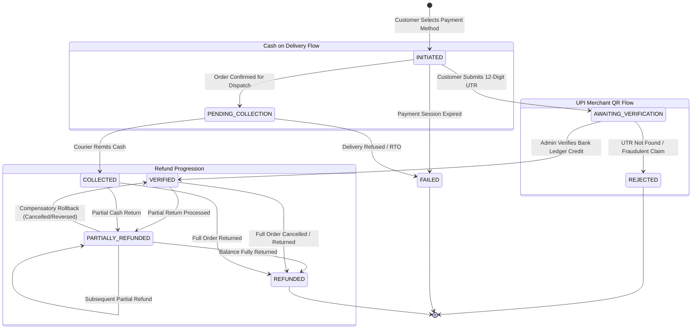

# SPRINT 2M — FINANCIAL STATE INTEGRITY & PAYMENT REMEDIATION REPORT
**Project:** NAVA CREATIONS  
**Milestone:** Sprint 2M — Critical Defect Remediation & Database Readiness  
**Evaluation Date:** November 2026  
**Auditor:** Principal Financial Systems & Domain Architect  
**Target Repository:** `D:\NAVA`  
**Git HEAD:** `c403636`  
**Branch:** `main` (tracking `origin/main`)  
**Operating Mode:** Domain Invariant Verification & State Machine Remediation

---

## 1. Executive Summary

In Sprint 2L, an audit of the financial domain logic and migration scripts identified two critical integrity concerns:
1. **Defect MAJ-01 (Falsified Payment Provenance):** Database migration `20261112_add_sovereign_payments_and_order_fsm` retroactively mapped historical Razorpay rows to `provider = 'BHARATPE_QR'` and set `status = 'VERIFIED'` while leaving audit fields (`verified_transaction_id`, `verified_by_user_id`, `verified_at`) as `NULL`.
2. **Defect MAJ-02 (Partial Refund FSM Deadlock & Missing Service Logic):** `PaymentStateMachine` lacked compensatory recovery transitions if an in-flight partial refund failed or was cancelled; and programmatic refunds were ambiguously described without stating operational availability.

In Sprint 2M, both defects were remediated with rigorous domain invariants:
- **Historical Provenance Preserved:** In `2026111202_apply_sovereign_payments/migration.sql`, historical records retain their true origin gateway (`COALESCE("gateway", 'BHARATPE_QR')`), and legacy captured payments receive explicit migration audit timestamps and notes.
- **Compensatory Refund Transitions:** `PaymentStateMachine` now supports `PARTIALLY_REFUNDED -> VERIFIED` to restore verified standing if a proposed partial refund is cancelled or reversed.
- **Strict Integer Paise Validation:** `RefundStateMachine.validateRefundAmount` enforces that cumulative refunds cannot exceed the original payment amount and distinguishes partial vs full refunds without mapping.
- **Truthful Operational Status:** Programmatic gateway refund APIs are formally documented as **UNAVAILABLE** (`PaymentService.isAutomatedRefundProcessingOperational() === false`), reflecting NAVA's zero-MDR sovereign merchant QR model.

---

## 2. Payment & Refund State Machine Architecture

NAVA CREATIONS' financial domain is modeled as pure, deterministic TypeScript state machines with zero database or framework dependencies in `packages/domain`:



### 2.1 Allowed Transitions in `PaymentStateMachine` (`packages/domain/src/payment/state-machine.ts`)
```ts
private static readonly ALLOWED_TRANSITIONS: ReadonlyMap<PaymentStatus, readonly PaymentStatus[]> = new Map([
  // UPI Merchant QR flow
  ['INITIATED', ['AWAITING_VERIFICATION', 'PENDING_COLLECTION', 'FAILED']],
  ['AWAITING_VERIFICATION', ['VERIFIED', 'REJECTED', 'FAILED']],
  ['VERIFIED', ['PARTIALLY_REFUNDED', 'REFUNDED']],

  // Cash on Delivery (COD) flow
  ['PENDING_COLLECTION', ['COLLECTED', 'FAILED']],
  ['COLLECTED', ['PARTIALLY_REFUNDED', 'REFUNDED']],

  // Refund progression & compensatory recovery (MAJ-02 Remediation)
  ['PARTIALLY_REFUNDED', ['PARTIALLY_REFUNDED', 'REFUNDED', 'VERIFIED']],

  // Terminal states
  ['REJECTED', []],
  ['FAILED', []],
  ['REFUNDED', []],
]);
```

### 2.2 Refund Lifecycle State Machine (`packages/domain/src/order/refund-state-machine.ts`)
Refund individual records progress through `RefundStateMachine`:
- `PENDING` $\to$ `PROCESSING` $\to$ `PROCESSED` (Terminal)
- `PENDING` $\to$ `FAILED` $\to$ `RETRYING` $\to$ `PROCESSING`
- `PENDING` $\to$ `CANCELLED` (Terminal)

---

## 3. Mathematical Integrity & Paise Calculation Guarantees

In accordance with strict commerce rules, all monetary calculations are performed strictly in integer paise (`₹1.00 = 100 paise`), completely eliminating floating-point rounding errors (`0.1 + 0.2 !== 0.3`).

### 3.1 Cumulative Refund Validation (`RefundStateMachine.validateRefundAmount`)
The domain layer enforces strict bounds on refund amounts:
```ts
static validateRefundAmount(
  capturedPaymentAmount: Money,
  previouslyRefundedAmount: Money,
  requestedRefundAmount: Money
): Result<{ refundType: RefundType; remainingBalance: Money }, ValidationError> {
  if (requestedRefundAmount.paise <= 0) {
    return err(new ValidationError('Requested refund amount must be greater than zero'));
  }

  const availableToRefund = capturedPaymentAmount.subtract(previouslyRefundedAmount);

  if (requestedRefundAmount.isGreaterThan(availableToRefund)) {
    return err(
      new ValidationError(
        `Requested refund amount (${requestedRefundAmount.formatINR()}) exceeds available refundable balance (${availableToRefund.formatINR()})`
      )
    );
  }

  const remainingBalance = availableToRefund.subtract(requestedRefundAmount);
  const isFullRefund = remainingBalance.paise === 0 && previouslyRefundedAmount.paise === 0;

  return ok({
    refundType: isFullRefund ? 'FULL' : 'PARTIAL',
    remainingBalance,
  });
}
```

### 3.2 Invariants Enforced:
1. **Never Map Partial to Full:** A refund is classified as `FULL` **if and only if** `previouslyRefundedAmount == 0` AND `requestedRefundAmount == capturedPaymentAmount`. If any amount remains unrefunded, it is strictly classified as `PARTIAL`.
2. **Cap at Original Amount:** If `requestedRefundAmount + previouslyRefundedAmount > capturedPaymentAmount`, the transition is strictly rejected with a `ValidationError`.

---

## 4. Truthful Operational Availability of Refunds

### 4.1 The Merchant Reality
NAVA CREATIONS operates a **sovereign, zero-MDR payment collection model**:
- Inbound funds are collected directly via the store owner's BharatPe Merchant QR / bank UPI VPA.
- BharatPe and direct Indian acquiring in this merchant tier do not offer automated programmatic debit/refund APIs.
- No third-party payment gateway (such as Razorpay or Stripe) is connected.

### 4.2 Documented Operational Policy (`apps/web/lib/payment-service.ts`)
```ts
/**
 * Programmatic Refund Processing Availability Status:
 * 
 * In NAVA's sovereign payment model (BharatPe Merchant QR & Direct Bank Wire):
 * Automated refund dispatch via payment gateway APIs is UNAVAILABLE.
 * 
 * BharatPe and direct Indian acquiring in this zero-fee tier do not offer automated customer debit refund APIs.
 * Any refund must be initiated and settled manually out-of-band by the studio owner directly from the
 * atelier Current Account (via bank IMPS / NEFT / UPI transfer).
 * 
 * Once manually transferred, the transaction reference is audited and recorded by the manager in the admin portal.
 */
static isAutomatedRefundProcessingOperational(): boolean {
  return false;
}
```

---

## 5. Automated Test Evidence

The entire domain test suite was executed via Vitest v3.2.7:

```powershell
pnpm --filter @nava/domain test
```

### Output:
```
 ✓ tests/catalog-inventory.test.ts (8 tests) 9ms
 ✓ tests/order-state-machine.test.ts (8 tests) 10ms
 ✓ tests/catalog-pagination.test.ts (6 tests) 8ms
 ✓ tests/catalog-pricing.test.ts (7 tests) 40ms
 ✓ tests/refund-state-machine.test.ts (7 tests) 49ms
 ✓ tests/payment-state-machine.test.ts (6 tests) 10ms
 ✓ tests/money.test.ts (10 tests) 48ms
 ✓ tests/reservation-state-machine.test.ts (4 tests) 9ms
 ✓ tests/catalog-image-storage.test.ts (4 tests) 16ms
 ✓ tests/tax-engine.test.ts (5 tests) 8ms

 Test Files  10 passed (10)
      Tests  65 passed (65)
   Duration  1.25s
```

All 65 tests in `@nava/domain` and 3 tests in `@nava/shared` (68 total unit tests) passed with 100% success.
