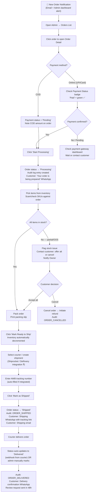

# NAVA CREATIONS — Admin User Journey Documentation

> [!NOTE]
> Phase 0 UX document. Admin journeys are based on the four roles defined below. All permissions and workflows are proposals — confirm with the business owner before implementation.

---

## 1. Admin Personas

| Persona | Description | Technical Level | Daily Usage |
|---------|-------------|----------------|-------------|
| **Owner / Super Admin** | Business owner — Nava. Manages everything, sees all reports, sets strategy. | Low — needs guided UI with helpful tooltips | 1–2 hrs/day |
| **Product Manager** | Responsible for cataloguing new products, updating descriptions, prices, images, stock. | Medium | 2–4 hrs/day |
| **Order Manager** | Processes orders: picks, packs, updates fulfilment status, adds tracking numbers. | Low–Medium | Full-time |
| **Support Staff** | Handles customer queries, return/exchange requests, custom enquiry follow-ups. | Low | Full-time |

---

## 2. Role-Permission Matrix

| Feature / Action | Owner / Super Admin | Product Manager | Order Manager | Support Staff |
|-----------------|:-------------------:|:---------------:|:-------------:|:-------------:|
| **Dashboard — view KPIs** | ✅ Full | ✅ Limited (no revenue) | ✅ Limited (orders only) | ✅ Limited (enquiries) |
| **Products — view** | ✅ | ✅ | ✅ | ✅ |
| **Products — create/edit** | ✅ | ✅ | ❌ | ❌ |
| **Products — delete/archive** | ✅ | ✅ (soft-delete only) | ❌ | ❌ |
| **Inventory — view** | ✅ | ✅ | ✅ | ❌ |
| **Inventory — adjust stock** | ✅ | ✅ | ✅ (fulfil only) | ❌ |
| **Orders — view all** | ✅ | ❌ | ✅ | ✅ |
| **Orders — update status** | ✅ | ❌ | ✅ | ❌ |
| **Orders — cancel** | ✅ | ❌ | ✅ | ❌ (can request) |
| **Orders — issue refund** | ✅ | ❌ | ✅ (initiate) | ❌ |
| **Customers — view** | ✅ | ❌ | ✅ | ✅ |
| **Customers — edit** | ✅ | ❌ | ❌ | ✅ (notes only) |
| **Customers — export data** | ✅ | ❌ | ❌ | ❌ |
| **Custom Enquiries — view** | ✅ | ❌ | ❌ | ✅ |
| **Custom Enquiries — respond/quote** | ✅ | ❌ | ❌ | ✅ |
| **Custom Enquiries — convert to order** | ✅ | ❌ | ✅ | ❌ |
| **Promotions — create/edit** | ✅ | ❌ | ❌ | ❌ |
| **Promotions — view** | ✅ | ✅ | ✅ | ❌ |
| **Content/Banners — manage** | ✅ | ✅ | ❌ | ❌ |
| **Blog — create/publish** | ✅ | ✅ | ❌ | ❌ |
| **Reports — full revenue** | ✅ | ❌ | ❌ | ❌ |
| **Reports — orders/fulfilment** | ✅ | ❌ | ✅ | ❌ |
| **Admin Users — manage** | ✅ | ❌ | ❌ | ❌ |
| **Settings — manage** | ✅ | ❌ | ❌ | ❌ |
| **Audit Log — view** | ✅ | ❌ | ❌ | ❌ |

> [!IMPORTANT]
> The Owner / Super Admin is the only role that can manage other admin users, change system settings, view full financial reports, and access the audit log.

---

## 3. Journey 1: Adding a New Product (with Variants)

**Persona:** Product Manager (or Owner)
**Entry point:** Admin Dashboard

### Step-by-Step Flow

#### Step 1 — Login to Admin
| Attribute | Detail |
|-----------|--------|
| **What admin sees** | `/admin/login` — email + password fields, "Forgot password" link |
| **What they input** | Email address, password |
| **Validation** | Incorrect credentials → inline error "Invalid email or password". 5 failed attempts → 15-min lockout with notification to Owner. |
| **Potential errors** | Forgotten password, locked out after failed attempts |
| **Help text** | "Contact your admin if you've been locked out" |
| **Audit event** | `ADMIN_LOGIN_SUCCESS` or `ADMIN_LOGIN_FAILURE` logged with IP |

#### Step 2 — Dashboard
| Attribute | Detail |
|-----------|--------|
| **What admin sees** | KPI tiles (today's orders, revenue, low-stock alerts), Quick Action buttons ("Add Product", "View Orders") |
| **Action** | Clicks "Add Product" button (or navigates Products → New Product) |
| **Help text** | Tooltip on "low-stock" tile: "Products below 5 units in stock" |

#### Step 3 — Products List
| Attribute | Detail |
|-----------|--------|
| **What admin sees** | Table of all products with status badges (Published / Draft / Archived), search bar, "Add New Product" button |
| **Action** | Clicks "Add New Product" |

#### Step 4 — New Product Form
Multi-section form. Each section is expandable/collapsible:

**Section A — Basic Info**

| Field | Type | Validation | Help Text |
|-------|------|-----------|-----------|
| Product Name | Text input | Required, max 100 chars | "Use a descriptive name. E.g. 'Gold Kundan Bridal Bangle Set – 6 Piece'" |
| Category | Dropdown | Required | Select one primary category |
| Occasion Tags | Multi-select | Optional | "Tag occasions to surface in Occasion pages" |
| Short Description | Textarea (160 chars) | Required | "Shown on product cards and search results" |
| Long Description | Rich text editor | Required | "Tell the story — materials, craftsmanship, styling tips" |

**Section B — Images & Media**

| Field | Type | Validation | Help Text |
|-------|------|-----------|-----------|
| Product Images | Drag-and-drop uploader | Min 3, max 10; JPG/PNG/WEBP; max 5 MB each | "First image is the thumbnail. Add wrist/hand photos for best conversion." |
| Video URL | URL input | Optional; YouTube or Vimeo | "Short product video boosts conversion" |
| Alt Text (per image) | Text input | Recommended | "Describe the image for accessibility and SEO" |

> [!TIP]
> Images are automatically optimised and converted to WEBP on upload. Original files are preserved.

**Section C — Variants**

| Field | Type | Validation | Help Text |
|-------|------|-----------|-----------|
| Has Variants? | Toggle | — | "Turn on if product comes in multiple sizes, colours, or materials" |
| Variant Type(s) | Multi-select | Required if variants on | "Size, Colour, Material" |
| Variant Values | Tag input per type | Min 1 per type | "E.g. for Size: 2/4, 2/6, 2/8, 2/10" |
| Auto-generate combinations | Button | — | "Creates all size × colour × material combinations" |

**Variant Table (auto-generated):**
Each row = one SKU with:

| Column | Field |
|--------|-------|
| Variant (e.g. Size 2/6 × Gold) | Auto-filled |
| SKU | Auto-generated (editable) |
| Price (₹) | Number input — required |
| Compared-at Price (MRP) | Number input — optional (shows "Save X%" badge) |
| Stock Qty | Number input — required |
| Active | Toggle |

**Section D — Pricing & Tax**

| Field | Type | Help Text |
|-------|------|-----------|
| Base Price (if no variants) | Number | "The price customer pays" |
| GST Rate | Dropdown (0%, 3%, 5%, 12%, 18%) | "Bangles: 3% GST ❓ — confirm with CA" |
| Price includes GST? | Toggle | "If ON, displayed price is GST-inclusive" |

**Section E — SEO**

| Field | Type | Validation | Help Text |
|-------|------|-----------|-----------|
| SEO Title | Text (60 chars) | Recommended | "Appears in Google results. If blank, product name is used." |
| Meta Description | Textarea (160 chars) | Recommended | "Appears in Google snippet. Write a compelling summary." |
| URL Slug | Text | Auto-generated from name, editable | "Only use lowercase letters, numbers, and hyphens" |
| Canonical URL | Display only | — | Shows the final canonical URL |

#### Step 5 — Preview
| Attribute | Detail |
|-----------|--------|
| **What admin sees** | "Preview" button opens the product page in a new tab in DRAFT mode (not visible to public) |
| **Action** | Reviews product page on mobile and desktop |
| **Potential errors** | Missing required fields — prevented from saving; inline error highlights |

#### Step 6 — Publish
| Attribute | Detail |
|-----------|--------|
| **What admin sees** | Save dropdown: "Save as Draft" / "Publish Now" / "Schedule Publish" |
| **Action** | Selects "Publish Now" → confirmation modal "Are you sure you want to publish [Product Name]?" |
| **Validation** | Cannot publish without: name, min 3 images, at least one variant with price and stock |
| **Audit event** | `PRODUCT_PUBLISHED` with product ID, actor (admin user ID), timestamp |
| **Notifications** | No customer notification. Owner notified if Product Manager publishes (optional setting ❓) |

### Decision Points

```
Has Variants? → Yes → Define variant types → Auto-generate SKU table → Price/stock each SKU
Has Variants? → No → Single price, single stock field
Price includes GST? → Yes → Display price = GST-inclusive → System calculates tax amount on invoice
Price includes GST? → No → Display price = ex-GST → System adds tax at checkout
```

### Error Scenarios

| Error | Trigger | Recovery |
|-------|---------|---------|
| Image upload fails | File too large or wrong format | Toast error; re-upload prompt |
| Duplicate slug | Same slug as existing product | Inline warning; auto-append `-2` |
| Missing required fields | Submit attempted | Fields highlighted in red; scroll-to-first-error |
| Session timeout | Admin idle > 30 min | Redirect to login; form data preserved in localStorage |

---

## 4. Journey 2: Processing an Incoming Order

**Persona:** Order Manager (or Owner)
**Trigger:** New order notification

### Order Processing Mermaid Flowchart



### Step-by-Step Detail

| Step | What Admin Sees | Action | Audit Event | Notification |
|------|----------------|--------|------------|--------------|
| 1. Order Notification | Email alert + dashboard badge | Open admin | — | — |
| 2. View Order | Order detail: items, customer, address, payment status | Review all details | `ORDER_VIEWED` | — |
| 3. Verify Payment | Payment status badge (Paid / Pending / Failed) | Confirm payment | — | — |
| 4. Start Processing | "Start Processing" button | Click button | `ORDER_STATUS_CHANGED: Processing` | Customer: "Your order is being prepared" |
| 5. Pick & Pack | Packing slip printable from order detail | Print slip, pick items | — | — |
| 6. Mark Ready to Ship | "Mark Ready to Ship" button | Click; stock auto-decrements | `INVENTORY_DECREMENTED` | — |
| 7. Add Tracking | Tracking number field (manual or auto-fill) | Enter AWB number, select courier | — | — |
| 8. Mark Shipped | "Mark as Shipped" button | Click | `ORDER_STATUS_CHANGED: Shipped` | Customer: Shipping notification with tracking |
| 9. Mark Delivered | Auto (webhook) or manual | — / Click | `ORDER_STATUS_CHANGED: Delivered` | Customer: Delivery notification + review request |

### Error Scenarios

| Error | Trigger | Recovery |
|-------|---------|---------|
| Payment not confirmed | Gateway webhook delay | Manual check in gateway portal; wait 1 hr |
| Item out of stock after order | Stock discrepancy | Flag in order, contact customer within 2 hrs |
| Wrong tracking number entered | Typo | Edit tracking number before customer opens link |
| Courier pickup missed | Logistics issue | Re-schedule pickup; notify customer of delay |

---

## 5. Journey 3: Managing a Return / Exchange Request

**Persona:** Support Staff (or Owner)
**Trigger:** Customer submits return request via Order Detail page or contacts support

### Step-by-Step Flow

| Step | What Admin Sees | Action | Decision Point | Audit Event | Notification |
|------|----------------|--------|---------------|------------|--------------|
| 1. Request Received | Notification in admin: new return request linked to Order ID | Open request | — | `RETURN_REQUEST_CREATED` | Support staff email/WhatsApp alert |
| 2. View Order | Order detail + return request tab: reason, photos, customer note | Review | — | `RETURN_REQUEST_VIEWED` | — |
| 3. Assess Eligibility | Return policy checker: days since delivery, item type (custom = non-returnable ❓) | Check vs policy | **Eligible?** Yes/No | — | — |
| 4a. Approve Return | "Approve" button → select: Refund or Exchange | Click Approve | **Refund or Exchange?** | `RETURN_APPROVED` | Customer: "Your return has been approved" + pickup instructions |
| 4b. Reject Return | "Reject" button → mandatory reason field | Enter reason, click Reject | — | `RETURN_REJECTED` | Customer: rejection reason + policy link |
| 5. Schedule Pickup | Coordinate reverse pickup via courier integration or manual arrangement | Raise pickup request | — | `REVERSE_PICKUP_SCHEDULED` | Customer: pickup date/time |
| 6. Item Received | Mark "Item Received" when courier delivers item back | Click | — | `RETURN_ITEM_RECEIVED` | — |
| 7. Quality Check | Inspect item vs return condition policy | Inspect physically | **Condition OK?** Yes/No | `RETURN_QC_PASSED/FAILED` | — |
| 8a. Process Refund | "Issue Refund" → refund to original payment method via gateway | Click | — | `REFUND_INITIATED` | Customer: refund initiated, 5–7 business days |
| 8b. Process Exchange | Create new order for replacement item; link to original return | Create exchange order | — | `EXCHANGE_ORDER_CREATED` | Customer: exchange order confirmed |
| 8c. Reject Post-QC | Mark return rejected (item damaged/worn) | Enter reason | — | `REFUND_REJECTED` | Customer: explanation + photos if needed |
| 9. Close Request | Mark request "Closed" | Click Close | — | `RETURN_REQUEST_CLOSED` | — |

### Error Scenarios

| Error | Trigger | Recovery |
|-------|---------|---------|
| Customer claims item not delivered | Delivery status = Delivered but customer disputes | Check courier proof of delivery; escalate to Owner if dispute |
| Item returned in damaged condition | QC fails | Photo document damage; reject refund per policy; notify customer with evidence |
| Reverse courier doesn't pick up | Logistics failure | Re-schedule; keep customer informed |
| Refund gateway failure | Gateway error | Retry after 24 hrs; escalate to Owner |

---

## 6. Journey 4: Running a Festival Sale Campaign

**Persona:** Owner / Super Admin
**Trigger:** Upcoming festival season (Navratri, Diwali, Ugadi, etc.)

### Step-by-Step Flow

| Step | What Admin Sees | Action | Audit Event |
|------|----------------|--------|------------|
| 1. Create Coupon | Promotions → New Coupon | Enter coupon code (e.g. `DIWALI20`) | `COUPON_CREATED` |
| 2. Set Discount Rules | Discount type selector: % off / flat ₹ off / free shipping / BOGO | Select type, enter value | `COUPON_UPDATED` |
| 3. Set Conditions | Min cart value, applicable categories, max uses, per-customer limit | Enter conditions | `COUPON_UPDATED` |
| 4. Set Validity | Date-time pickers: Start date, End date | Select dates | `COUPON_UPDATED` |
| 5. Feature Collection | Products → Bulk-tag products with "Festival Sale" tag OR create a "Festival Sale" collection | Tag/create | `COLLECTION_UPDATED` |
| 6. Publish Banner | Content → Banners → Upload sale banner image → Set display dates | Upload, set dates, activate | `BANNER_PUBLISHED` |
| 7. Announcement Bar | Content → Announcement Bar → "🎉 Diwali Sale — 20% off with code DIWALI20" | Enter text, set dates | `ANNOUNCEMENT_PUBLISHED` |
| 8. Activate | Review all settings, click "Go Live" on coupon | Activate | `COUPON_ACTIVATED` |
| 9. Monitor | Reports → Promotions dashboard: coupon usage count, revenue attributed, top products | Daily review | — |
| 10. End Sale | Sale end date auto-deactivates coupon and banner, OR manual deactivation | — / Manual | `COUPON_DEACTIVATED`, `BANNER_DEACTIVATED` |

### Decision Points

```
Discount type:
  → % off: Good for encouraging larger carts
  → Flat ₹ off: Good for specific price-point promos
  → Free Shipping: Good for cart abandonment recovery

Min cart value:
  → Set to encourage AOV uplift (e.g. min ₹500 for 20% off ❓)
```

### Error Scenarios

| Error | Trigger | Recovery |
|-------|---------|---------|
| Coupon code already exists | Duplicate code entered | Inline warning; suggest alternative code |
| Banner not displaying | Wrong display dates / cache issue | Check date settings; purge CDN cache |
| Coupon over-used | Per-customer limit not set | Add per-customer limit; deactivate if abuse detected |
| Coupon still active after sale ends | Auto-deactivation misconfiguration | Manual deactivation; check date logic |

---

## 7. Journey 5: Responding to a Custom Bridal Enquiry

**Persona:** Support Staff (or Owner)
**Trigger:** Customer submits enquiry via `/custom-orders` or WhatsApp

### Admin Operations: Custom Enquiry Lifecycle (State Machine)

```mermaid
stateDiagram-v2
    [*] --> New : Customer submits enquiry form

    New --> UnderReview : Support staff opens enquiry
    UnderReview --> InfoRequested : Admin requests more details from customer
    InfoRequested --> UnderReview : Customer provides details
    UnderReview --> QuotationSent : Admin sends quotation to customer

    QuotationSent --> QuoteAccepted : Customer approves quote + pays advance
    QuotationSent --> QuoteRejected : Customer declines or goes silent
    QuotationSent --> QuoteRevised : Customer negotiates → revised quote sent
    QuoteRevised --> QuotationSent

    QuoteAccepted --> InProduction : Admin marks as In Production
    InProduction --> ReadyForDispatch : Production complete; final photo shared
    ReadyForDispatch --> BalancePaid : Customer pays balance
    BalancePaid --> Shipped : Admin ships; tracking shared
    Shipped --> Delivered : Courier delivers

    Delivered --> Closed : Admin closes enquiry
    QuoteRejected --> Closed : No conversion
    Closed --> [*]

    InProduction --> OnHold : Production issue / customer-requested pause
    OnHold --> InProduction : Issue resolved
```



### Step-by-Step Flow

| Step | What Admin Sees | Action | Decision Point | Audit Event | Notification |
|------|----------------|--------|---------------|------------|--------------|
| 1. Enquiry Notification | Dashboard alert + email: "New custom enquiry from [Name]" | Open enquiry | — | `ENQUIRY_CREATED` | Admin: email + WhatsApp alert |
| 2. View Enquiry | Enquiry detail: customer name, mobile, occasion date, design description, budget range, uploaded images | Read and assess | — | `ENQUIRY_VIEWED` | — |
| 3. Review Requirements | Does NAVA have capacity and capability for this design? | Assess | **Can we fulfil?** Yes / No / Partial | — | — |
| 4a. Request More Info | Click "Request Info" → WhatsApp/email template | Send message | — | `ENQUIRY_INFO_REQUESTED` | Customer: "We'd love to create this for you! Could you share [X, Y, Z]?" |
| 4b. Add Internal Notes | Notes field on enquiry (private, not visible to customer) | Type notes | — | `ENQUIRY_NOTE_ADDED` | — |
| 5. Send Quotation | "Send Quotation" → quotation editor (line items, total, validity, payment terms) | Compose & send | — | `QUOTATION_SENT` | Customer: PDF quotation via WhatsApp + email |
| 6. Record Customer Response | Mark quote: Accepted / Rejected / Negotiating | Update status | **Accepted?** | `QUOTE_ACCEPTED/REJECTED` | — |
| 7. Collect Advance | Generate payment link (Razorpay); paste into WhatsApp | Send link | **Payment received?** | `ADVANCE_PAYMENT_RECEIVED` | Customer: Order confirmation with timeline |
| 8. Convert to Order | "Convert to Order" button → creates order record linked to enquiry | Click | — | `ENQUIRY_CONVERTED_TO_ORDER` | Customer: Formal order ID issued |
| 9. Production Updates | Add update notes + upload production photo | Send WhatsApp update | — | `PRODUCTION_UPDATE_SENT` | Customer: Progress photo |
| 10. Final Approval | Share final product photo; await customer "looks good" | Customer approves | **Final approved?** | `FINAL_APPROVED` | Customer: "Your order is ready!" |
| 11. Collect Balance | Generate balance payment link | Send link | — | `BALANCE_PAYMENT_RECEIVED` | — |
| 12. Ship | Add tracking number; mark shipped | Standard shipping steps | — | `ORDER_SHIPPED` | Customer: Shipping details |
| 13. Close Enquiry | Mark enquiry Closed | Click Close | — | `ENQUIRY_CLOSED` | — |

### Error Scenarios

| Error | Trigger | Recovery |
|-------|---------|---------|
| Customer goes silent after quote | No response in 7 days | Automated follow-up reminder; then manual WhatsApp |
| Production issue (material OOS) | Artisan/supplier cannot source material | Notify customer immediately; offer alternatives |
| Customer unhappy with final product | Quality dispute | Owner escalation; offer revision or refund per policy |
| Payment link expires | Razorpay link validity exceeded | Generate new link |

---

## 8. Audit Trail — Key Events Reference

| Audit Event Key | Description | Who Triggers |
|----------------|-------------|-------------|
| `ADMIN_LOGIN_SUCCESS` | Admin successfully authenticated | System |
| `ADMIN_LOGIN_FAILURE` | Failed login attempt (IP logged) | System |
| `PRODUCT_CREATED` | New product record created | Product Manager / Owner |
| `PRODUCT_UPDATED` | Product fields edited | Product Manager / Owner |
| `PRODUCT_PUBLISHED` | Product made live | Product Manager / Owner |
| `PRODUCT_ARCHIVED` | Product hidden from store | Product Manager / Owner |
| `INVENTORY_ADJUSTED` | Manual stock level change | Product Manager / Order Manager |
| `INVENTORY_DECREMENTED` | Stock reduced on order fulfilment | System (on ship) |
| `ORDER_STATUS_CHANGED` | Order moved to new status | Order Manager / System |
| `ORDER_CANCELLED` | Order cancelled | Order Manager / Owner |
| `REFUND_INITIATED` | Refund sent to gateway | Order Manager / Owner |
| `RETURN_REQUEST_CREATED` | Customer return request submitted | System (customer action) |
| `RETURN_APPROVED` / `RETURN_REJECTED` | Return decision recorded | Support / Owner |
| `COUPON_CREATED` / `COUPON_ACTIVATED` / `COUPON_DEACTIVATED` | Promotion lifecycle events | Owner |
| `BANNER_PUBLISHED` | Homepage banner made live | Owner / Product Manager |
| `ENQUIRY_CREATED` | Custom enquiry received | System (customer form) |
| `QUOTATION_SENT` | Quotation sent to customer | Support / Owner |
| `ENQUIRY_CONVERTED_TO_ORDER` | Enquiry → formal order | Support / Owner |
| `ADMIN_USER_INVITED` | New admin user added | Owner |
| `ADMIN_USER_DEACTIVATED` | Admin user access removed | Owner |
| `SETTINGS_CHANGED` | Store settings modified | Owner |

> [!CAUTION]
> The Audit Log is **immutable** — no admin user (including Owner) can delete or edit log entries. Logs must be retained for a minimum of 2 years for compliance.

---

## 9. Admin Notification Matrix

| Event | Owner | Product Manager | Order Manager | Support Staff | Customer |
|-------|:-----:|:---------------:|:-------------:|:-------------:|:--------:|
| New order placed | ✅ Email | ❌ | ✅ Email + WhatsApp | ❌ | ✅ WhatsApp + Email |
| Payment failed | ✅ | ❌ | ✅ | ❌ | ✅ |
| Low stock (< 5 units) | ✅ | ✅ | ✅ | ❌ | ❌ |
| New custom enquiry | ✅ | ❌ | ❌ | ✅ WhatsApp | ✅ Auto-reply |
| Order shipped | ❌ | ❌ | ✅ (confirmation) | ❌ | ✅ WhatsApp + Email |
| Order delivered | ❌ | ❌ | ✅ | ❌ | ✅ WhatsApp |
| Return request submitted | ✅ | ❌ | ✅ | ✅ WhatsApp | ✅ Acknowledgement |
| Refund processed | ✅ | ❌ | ✅ | ✅ | ✅ WhatsApp + Email |
| Coupon usage > 80% limit | ✅ | ❌ | ❌ | ❌ | ❌ |
| New admin user added | ✅ | ❌ | ❌ | ❌ | ❌ |

---

*Document version: 0.1 — Phase 0 — NAVA CREATIONS*
*Author: UX Specialist — Antigravity Swarm*
*Status: Draft — Pending business owner review and confirmation of permissions model*
