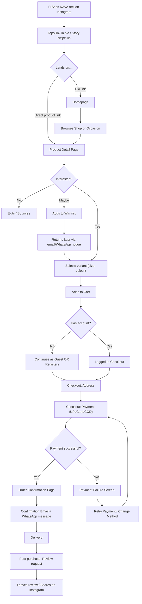
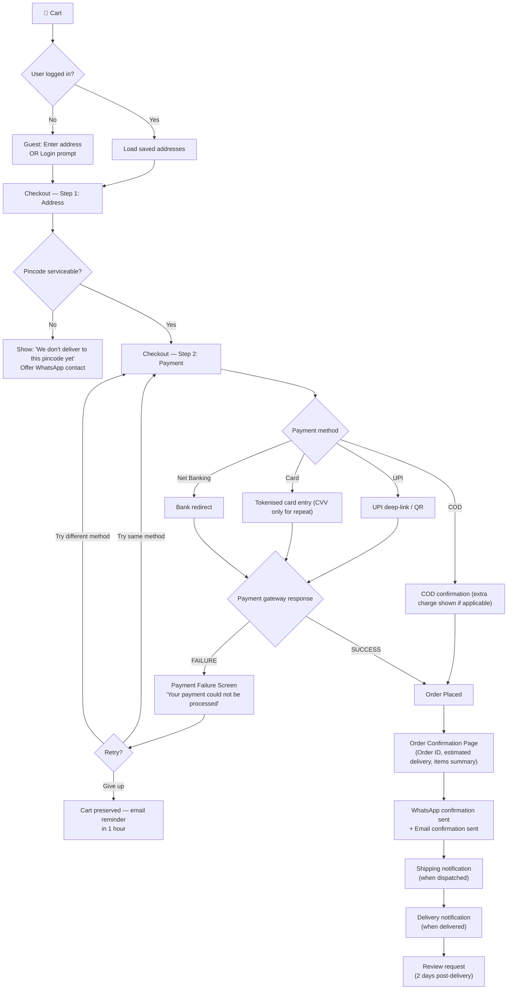
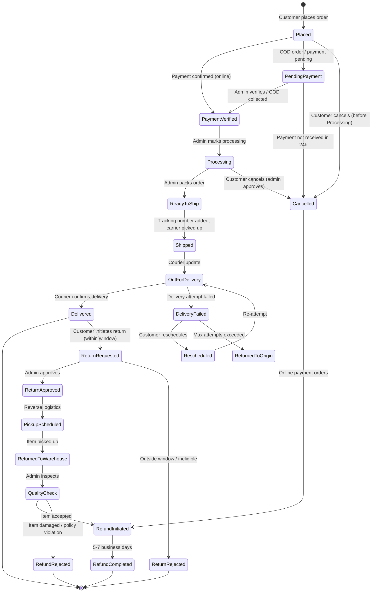

# NAVA CREATIONS — Customer Journey Maps

> [!NOTE]
> Phase 0 UX document. Journeys are based on the customer segments defined in CUSTOMER_SEGMENTS.md. Emotions and pain points are hypotheses — validate with actual customer interviews before finalising designs.

---

## Overview

| Journey | Persona | Channel Entry | Goal |
|---------|---------|--------------|------|
| J1 | Mobile Instagram Browser | Instagram / WhatsApp | First purchase — everyday bangles |
| J2 | Bridal Customer | Google / Instagram / Word-of-mouth | Custom bridal order |
| J3 | Festival / Event Organiser | Instagram / Google | Bulk return gifts |
| J4 | Registered Repeat Customer | Email / WhatsApp nudge | Quick reorder |

---

## Journey 1: Mobile Instagram Browser → First Purchase (Everyday Bangles)

### Mermaid Flowchart

---

### Stage-by-Stage Map

#### Stage 1: Awareness
| Attribute | Detail |
|-----------|--------|
| **Customer Action** | Scrolling Instagram, sees a NAVA reel or story showing a bangle styled with an outfit. Taps the link. |
| **Touchpoints** | Instagram feed/reels, Instagram Stories, WhatsApp status ❓ |
| **Emotion** | 😍 Excited, curious |
| **Pain Points** | Link in bio leads to generic homepage — loses context of what she just saw on Instagram. Slow page load on mobile kills momentum. |
| **Opportunities** | Use UTM-linked landing pages matching Instagram content. Ensure LCP ≤ 2.5 s on mobile. Show the exact product from the reel using Instagram Shopping tags. WhatsApp "Chat to buy" button in bio. |
| **Success Metric** | Instagram → Website click-through rate; Bounce rate on landing page |

#### Stage 2: Consideration
| Attribute | Detail |
|-----------|--------|
| **Customer Action** | Browses product detail page. Looks at photos, reads description, checks price, looks for size guide, reads reviews. |
| **Touchpoints** | Product Detail Page (`/product/{slug}`), Size Guide (`/size-guide`), Reviews section |
| **Emotion** | 🤔 Curious, slightly anxious (Will it look as good in real life? Is this the right size?) |
| **Pain Points** | Too few product images (no lifestyle shots, no wrist model shots). No size guide link near the size selector. No reviews or only 1–2 reviews. Price seems high without context of craftsmanship. |
| **Opportunities** | Min 5 images per product including hand/wrist shots, zoom functionality. Inline size guide modal (no page navigation needed). Social proof: show review count + star rating prominently. Craftsmanship badge or tooltip. "X people are viewing this" urgency signal. |
| **Success Metric** | Product page → Add to Cart conversion rate; Size guide link click rate |

#### Stage 3: Decision
| Attribute | Detail |
|-----------|--------|
| **Customer Action** | Selects variant (size, colour), adds to cart. May hesitate at checkout. |
| **Touchpoints** | Product Detail Page, Cart (`/cart`) |
| **Emotion** | 💭 Deciding, slightly anxious about size, return policy |
| **Pain Points** | Unclear return/exchange policy (especially for wrong size). No easy way to ask a question before buying. COD not visible until payment step — surprises customer. |
| **Opportunities** | Show "Easy Exchange for wrong size within 7 days" snippet below size selector ❓. WhatsApp "Ask before you buy" button on product page. Show all payment methods (including COD) on product page as trust badges. |
| **Success Metric** | Add to Cart rate; Cart abandonment rate |

#### Stage 4: Purchase
| Attribute | Detail |
|-----------|--------|
| **Customer Action** | Enters address, selects UPI or COD, confirms order. |
| **Touchpoints** | Checkout Address (`/checkout/address`), Checkout Payment (`/checkout/payment`), Order Confirmation (`/checkout/confirmation`) |
| **Emotion** | 😬 Anxious (Is this website safe? Will my payment go through?), then 😊 Relieved/happy on confirmation |
| **Pain Points** | Too many form fields for guest checkout. UPI timeout with no clear retry option. No order confirmation WhatsApp message — only email (many customers don't check email). |
| **Opportunities** | Minimal-field guest checkout (name, mobile, address). UPI deep-link on mobile (auto-opens UPI app). Immediate WhatsApp order confirmation (WhatsApp Business API). Trust signals: "Secured by Razorpay", SSL badge, "10,000+ happy customers" ❓. |
| **Success Metric** | Checkout completion rate; Payment success rate; Payment method distribution |

#### Stage 5: Post-Purchase
| Attribute | Detail |
|-----------|--------|
| **Customer Action** | Receives order confirmation, tracks delivery, receives order, leaves review, shares on Instagram. |
| **Touchpoints** | Email, WhatsApp, Order Tracking (`/track-order`), Review request (email / WhatsApp) |
| **Emotion** | 😊 Happy → 🤩 Delighted (if packaging is beautiful) OR 😤 Disappointed (if product doesn't match expectation) |
| **Pain Points** | No proactive shipping updates — customer has to manually track. Generic packaging (missed brand moment). Review request comes too early (before delivery) or never arrives. |
| **Opportunities** | WhatsApp proactive shipping notifications at key milestones (Shipped, Out for delivery, Delivered). Branded unboxing experience (tissue, thank-you card, re-usable pouch) ❓. Review request 2 days after delivery with direct link. Instagram reshare incentive ("Tag us @nava__creationsss for a 10% off next order coupon"). |
| **Success Metric** | Review submission rate; Repeat purchase rate within 90 days; Instagram brand mention count |

---

## Journey 2: Bridal Customer Research → Custom Order

### Stage-by-Stage Map

#### Stage 1: Research
| Attribute | Detail |
|-----------|--------|
| **Customer Action** | Searching Google ("custom bridal bangles Bengaluru") and scrolling Instagram for inspiration. Saves posts to Instagram collections. |
| **Touchpoints** | Google Search, Instagram, Pinterest, Bridal Facebook groups |
| **Emotion** | 😊 Excited but overwhelmed — many options |
| **Pain Points** | Cannot find pricing online. Unclear what "custom" means — made to order vs choosing from existing catalogue? |
| **Opportunities** | SEO-optimised `/occasions/bridal` and `/custom-orders` pages rank for "custom bridal bangles Bengaluru". Clear "How it Works" section explaining the custom process. Starting-price range to set expectations ❓. |
| **Success Metric** | Organic sessions to bridal/custom pages; Google Search ranking for target keywords |

#### Stage 2: Shortlist
| Attribute | Detail |
|-----------|--------|
| **Customer Action** | Visits NAVA website, browses bridal catalogue and custom orders page, saves items to wishlist, possibly shares links with family (mother, mother-in-law). |
| **Touchpoints** | `/shop/bridal-bangles`, `/occasions/bridal`, `/custom-orders`, Wishlist, Share link |
| **Emotion** | 🤔 Evaluating, consulting family |
| **Pain Points** | No way to share wishlist with family for joint decision-making. Portfolio of past custom work is sparse. No video walkthroughs of craftsmanship. |
| **Opportunities** | Shareable wishlist URL. Rich portfolio gallery on `/custom-orders` with before-and-after, process photos. Video testimonials from previous bridal customers. |
| **Success Metric** | Bridal page time-on-page; Wishlist add rate; Custom enquiry form submission rate |

#### Stage 3: Enquiry
| Attribute | Detail |
|-----------|--------|
| **Customer Action** | Fills custom bridal enquiry form or sends WhatsApp message with requirements, occasion date, design inspo images. |
| **Touchpoints** | `/custom-orders` enquiry form, WhatsApp Business |
| **Emotion** | 😬 Hopeful but nervous — big purchase, unsure about process |
| **Pain Points** | Enquiry form with too many required fields. No acknowledgement message after submitting form. Waiting too long for a response. |
| **Opportunities** | Streamlined form (5–7 fields max, images optional). Instant auto-response: "Thank you! We'll reply within 24 hours." WhatsApp option for customers who prefer chat. |
| **Success Metric** | Enquiry form completion rate; Response time (target: < 4 hrs) |

#### Stage 4: Consultation
| Attribute | Detail |
|-----------|--------|
| **Customer Action** | Consults with NAVA via WhatsApp/call. Shares reference images, discusses design, materials, timeline. |
| **Touchpoints** | WhatsApp Business, Phone call, Email |
| **Emotion** | 😊 Engaged and excited when consultant is knowledgeable; 😟 Disappointed if response feels scripted |
| **Pain Points** | No structured intake process — conversation starts from scratch every time. Customer has to repeat requirements. |
| **Opportunities** | Admin CRM notes on enquiry (see Admin Journey 5). Structured consultation checklist for the NAVA team. WhatsApp template messages for common consultation steps. |
| **Success Metric** | Consultation-to-quote conversion rate |

#### Stage 5: Quote
| Attribute | Detail |
|-----------|--------|
| **Customer Action** | Receives price quotation (via WhatsApp/email PDF). Reviews with family. May negotiate. |
| **Touchpoints** | WhatsApp, Email |
| **Emotion** | 😐 Evaluating value vs budget; 😮 Sticker shock if expectations weren't set |
| **Pain Points** | Quotation arrives as a WhatsApp text — hard to reference later. No itemised breakdown. |
| **Opportunities** | PDF quotation with NAVA branding, itemised costs, validity period (e.g., "Quote valid for 7 days"). Advance payment options clearly stated. |
| **Success Metric** | Quote-to-approval conversion rate |

#### Stage 6: Approval & Order
| Attribute | Detail |
|-----------|--------|
| **Customer Action** | Approves quote, pays advance (50% ❓). Receives order confirmation with timeline. |
| **Touchpoints** | WhatsApp, Payment link (Razorpay) ❓, Admin converts enquiry to order |
| **Emotion** | 😊 Committed and excited |
| **Pain Points** | Payment link feels unsafe if from an unknown number. No formal order receipt. |
| **Opportunities** | Branded payment link from Razorpay. Formal order confirmation email/WhatsApp with order ID, agreed design spec, estimated completion date. |
| **Success Metric** | Advance payment completion rate |

#### Stage 7: Order & Delivery
| Attribute | Detail |
|-----------|--------|
| **Customer Action** | Waits during production. Receives progress photo updates. Approves final design. Pays balance. Receives delivery. |
| **Touchpoints** | WhatsApp Business, Email |
| **Emotion** | 😊 Excited, 😬 Anxious if no updates |
| **Pain Points** | Silence during production = anxiety. Customer has no visibility into timeline. |
| **Opportunities** | WhatsApp milestone updates ("Your bangles are being crafted! Estimated completion: [date]", "Final product photo for your approval"). |
| **Success Metric** | Customer satisfaction at delivery (survey); On-time delivery rate |

#### Stage 8: Review
| Attribute | Detail |
|-----------|--------|
| **Customer Action** | Receives bangles, tries on, shares on Instagram, leaves review on website / Google. |
| **Touchpoints** | Product Review on website, Google Business Profile, Instagram |
| **Emotion** | 🤩 Delighted (if experience matched expectations) |
| **Pain Points** | No prompt to leave a review. Instagram post not reshared by NAVA — missed word-of-mouth moment. |
| **Opportunities** | Personal WhatsApp thank-you from founder after delivery. Review request 3 days post-delivery. Reshare bridal customer's Instagram post (with permission) — most powerful social proof. |
| **Success Metric** | Review submission rate; Google rating; Instagram mentions |

---

## Journey 3: Festival Season Gifting (Return Gifts / Bulk)

### Stage-by-Stage Map

#### Stage 1: Need Recognition
| Attribute | Detail |
|-----------|--------|
| **Customer Action** | Realises they need return gifts for an upcoming puja, wedding function, or corporate gifting event. Sets budget and quantity in mind. |
| **Touchpoints** | Word of mouth, WhatsApp group recommendations, Google ("return gift bangles Bengaluru bulk") |
| **Emotion** | 😟 Mildly stressed — event is approaching, needs good quality at reasonable price |
| **Pain Points** | Most bangle wholesalers have no website — have to visit shops physically. No clear pricing visible online. |
| **Opportunities** | Rank for "return gift bangles Bengaluru" and "bulk bangle orders Bengaluru". Clear MOQ ❓ and pricing on `/return-gifts`. |
| **Success Metric** | Organic/paid traffic to `/return-gifts`; Enquiry form views |

#### Stage 2: Discovery
| Attribute | Detail |
|-----------|--------|
| **Customer Action** | Lands on NAVA website via Google or Instagram. Browses `/return-gifts` and `/shop/festival-collection`. |
| **Touchpoints** | `/return-gifts`, `/shop/festival-collection`, `/occasions/gifting` |
| **Emotion** | 🤔 Evaluating — does NAVA do bulk? Can they handle my quantity? |
| **Pain Points** | Unclear if NAVA does bulk orders (if not prominently stated). MOQ not visible. Lead time not stated. |
| **Opportunities** | "We do bulk orders!" hero banner on return gifts page. Clear MOQ, lead time, and pricing bands. Sample request option. Photo gallery of past bulk orders (custom packaging). |
| **Success Metric** | `/return-gifts` bounce rate; Time on page |

#### Stage 3: Product Selection
| Attribute | Detail |
|-----------|--------|
| **Customer Action** | Browses products suitable for gifting. Considers price per unit at target quantity. May want customised packaging. |
| **Touchpoints** | `/shop/festival-collection`, `/shop/handmade-bangles`, Product Detail Pages |
| **Emotion** | 😊 Engaged when product fits criteria; 😟 Stuck if pricing isn't transparent for bulk |
| **Pain Points** | No "request sample" option. No bulk pricing calculator. |
| **Opportunities** | "Request a Sample" CTA on gifting-suitable products. Bulk price tiers shown on product page (e.g., 50+ units, 100+ units). Custom packaging options clearly displayed. |
| **Success Metric** | Products added to bulk enquiry cart / shortlist |

#### Stage 4: Bulk Enquiry
| Attribute | Detail |
|-----------|--------|
| **Customer Action** | Submits bulk enquiry form with quantity, occasion, delivery date, packaging preferences. |
| **Touchpoints** | `/return-gifts` enquiry form, WhatsApp |
| **Emotion** | 😬 Hoping for quick response — event deadline looms |
| **Pain Points** | Enquiry disappears into a void. No auto-acknowledgement. Response takes >24 hrs. |
| **Opportunities** | Instant auto-reply with acknowledgement and expected response time. NAVA team gets instant notification (email + WhatsApp to admin). Priority queue for bulk enquiries in admin. |
| **Success Metric** | Enquiry submission rate; Response time (target < 4 hrs) |

#### Stage 5: Quote
| Attribute | Detail |
|-----------|--------|
| **Customer Action** | Receives bulk quotation. Compares with alternatives. Gets family/colleague sign-off. |
| **Touchpoints** | WhatsApp, Email, PDF quotation |
| **Emotion** | 🤔 Evaluating — price, quality assurance, trust |
| **Pain Points** | No testimonials from previous bulk buyers. Unclear cancellation/refund policy for bulk orders. |
| **Opportunities** | Dedicated bulk buyer testimonials on return-gifts page. Clear cancellation/refund terms in quotation. References on request ❓. |
| **Success Metric** | Quote-to-payment conversion rate |

#### Stage 6: Payment
| Attribute | Detail |
|-----------|--------|
| **Customer Action** | Makes advance payment (or full payment for smaller orders). |
| **Touchpoints** | Razorpay payment link, Bank transfer ❓, Admin payment record |
| **Emotion** | 😬 Trusting NAVA with significant upfront payment |
| **Pain Points** | Sending money to an unknown business feels risky. No formal invoice immediately. |
| **Opportunities** | GST invoice issued immediately on payment. Formal order confirmation with delivery commitment in writing. |
| **Success Metric** | Payment completion rate |

#### Stage 7: Delivery
| Attribute | Detail |
|-----------|--------|
| **Customer Action** | Receives bulk order. Inspects quality. Distributes at event. |
| **Touchpoints** | Courier/logistics, WhatsApp |
| **Emotion** | 😊 Relieved when on time and correct; 😤 Angry if wrong items/qty or late |
| **Pain Points** | Packing errors (wrong sizes, wrong qty). Late delivery for event. |
| **Opportunities** | Pre-dispatch quality check and photo shared with customer for approval. Packing list included in shipment. Dedicated bulk order tracking. |
| **Success Metric** | On-time delivery rate; Order accuracy rate |

#### Stage 8: Review
| Attribute | Detail |
|-----------|--------|
| **Customer Action** | Event happens. Receives compliments on return gifts. May or may not leave a review. |
| **Touchpoints** | Google, Website reviews, Word of mouth |
| **Emotion** | 🤩 Proud (if gifts were well-received); will strongly recommend NAVA |
| **Pain Points** | No follow-up from NAVA after delivery. |
| **Opportunities** | "How did your event go?" WhatsApp message 3–4 days post-delivery. Photo of event from customer → Instagram social proof. Early-bird discount for next event booking. |
| **Success Metric** | Repeat bulk order rate; Review/testimonial submission |

---

## Journey 4: Repeat Customer (Registered) Quick Reorder

### Stage-by-Stage Map

#### Stage 1: Re-engagement
| Attribute | Detail |
|-----------|--------|
| **Customer Action** | Receives WhatsApp message or email about new arrivals / festival sale. Taps link. |
| **Touchpoints** | WhatsApp Business broadcast, Email newsletter, Push notification ❓ |
| **Emotion** | 😊 Happy to hear from a brand they trust; 😒 Annoyed if too frequent/irrelevant |
| **Pain Points** | Generic broadcast feels spammy. No personalisation ("Hi! Based on your previous purchase, you might love…"). |
| **Opportunities** | Personalised WhatsApp message referencing past purchase category. Timing: festival season messaging 4–6 weeks before festival. Clear unsubscribe option to maintain trust. |
| **Success Metric** | Email/WhatsApp open rate; Click-through rate |

#### Stage 2: Browse
| Attribute | Detail |
|-----------|--------|
| **Customer Action** | Browses new arrivals or the specific collection linked in the message. |
| **Touchpoints** | Homepage, `/shop/{category}`, Product Detail Page |
| **Emotion** | 😊 Familiar and comfortable with the site |
| **Pain Points** | Cannot remember what they bought before — has to search. New items not clearly labelled. |
| **Opportunities** | "New Arrivals" badge on products added in last 30 days. "Continue where you left off" section on homepage for logged-in users. "Previously purchased" indicator on product cards. |
| **Success Metric** | Pages per session; Product detail view rate |

#### Stage 3: Select
| Attribute | Detail |
|-----------|--------|
| **Customer Action** | Selects product and variant. Size is remembered from past order — no need to look up. |
| **Touchpoints** | Product Detail Page |
| **Emotion** | 😊 Confident — knows the brand, knows her size |
| **Pain Points** | Still has to re-select size even though it's saved in account. |
| **Opportunities** | Pre-select previously purchased size on variant selector for logged-in users. "Reorder [Product Name]" shortcut on Order History page. |
| **Success Metric** | Add to Cart rate for repeat visitors |

#### Stage 4: Fast Checkout
| Attribute | Detail |
|-----------|--------|
| **Customer Action** | Logged in automatically. Selects saved address and saved UPI/card. Places order in <60 seconds. |
| **Touchpoints** | Cart (`/cart`), Checkout Address, Checkout Payment |
| **Emotion** | 😊 Delighted — frictionless experience |
| **Pain Points** | Saved address not shown by default. Saved payment method requires re-entering CVV (unavoidable per RBI tokenisation rules). |
| **Opportunities** | Default saved address pre-selected on checkout load. Tokenised card shown — only CVV needed. One-click UPI (if supported by payment gateway). |
| **Success Metric** | Checkout completion time; Checkout abandonment rate for repeat users |

#### Stage 5: Track
| Attribute | Detail |
|-----------|--------|
| **Customer Action** | Receives WhatsApp order confirmation. Tracks via link. |
| **Touchpoints** | WhatsApp, `/track-order`, `/account/orders/{id}` |
| **Emotion** | 😊 Confident — has tracked orders before, knows what to expect |
| **Pain Points** | Tracking link in WhatsApp leads to courier website (bad UX) rather than NAVA's branded tracking page. |
| **Opportunities** | Branded tracking page on NAVA's domain embedding courier status. WhatsApp milestone notifications proactively. |
| **Success Metric** | Track order page visits; Customer support contacts during delivery |

#### Stage 6: Review
| Attribute | Detail |
|-----------|--------|
| **Customer Action** | Receives order. Optionally leaves review. High chance of tagging NAVA on Instagram. |
| **Touchpoints** | Website review, Instagram |
| **Emotion** | 🤩 Loyal brand advocate |
| **Pain Points** | Review process requires login — friction. |
| **Opportunities** | One-tap review from WhatsApp message (pre-authenticated link for logged-in customers). Loyalty programme: points for reviews → discounts ❓. |
| **Success Metric** | Review rate from repeat customers; NPS score ❓ |

---

## Checkout Flow Diagram

---

## Order Lifecycle State Diagram

---

*Document version: 0.1 — Phase 0 — NAVA CREATIONS*
*Author: UX Specialist — Antigravity Swarm*
*Status: Draft — Emotions and pain points are hypotheses; validate with customer research*
